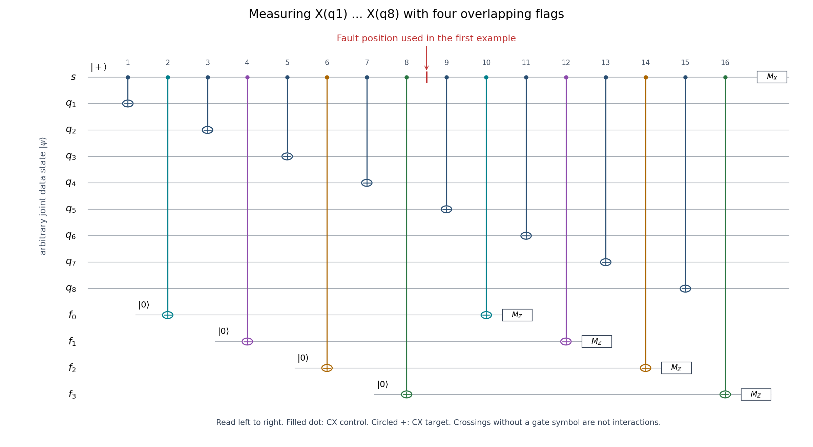
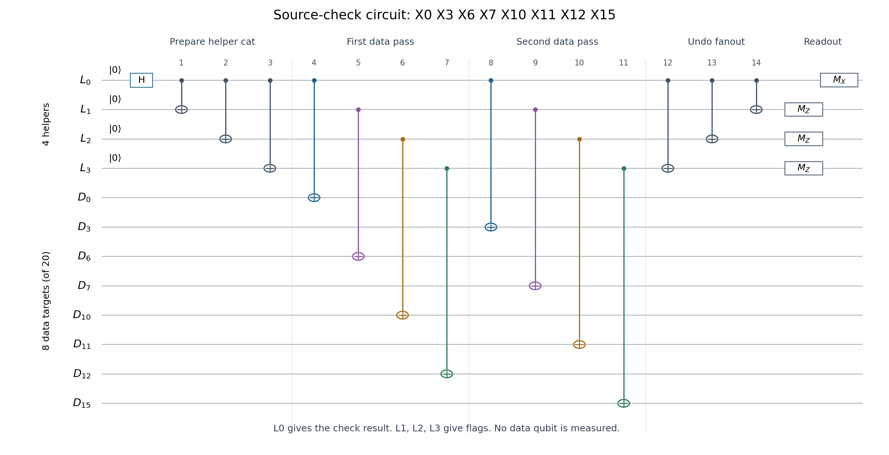
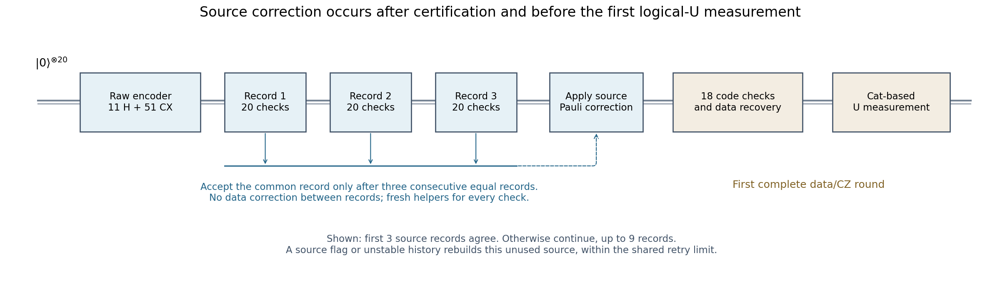

# Understanding the internal logical CZ measurement

This note explains how
single-qubit gates on twenty physical data qubits combine to act as CZ on the
two logical qubits in one C4-Helix block, and how controlling those gates lets
us measure logical CZ and prepare a magic state. Sections 14–22 then explain
how flagged stabilizer-measurement circuits limit errors introduced during
error correction, using explicit faults and a local support proof. Sections
23–25 develop repeated syndrome acquisition and recovery after a flag.
Sections 26–29 assemble the genuine-cat factory and explain its source
preparation, including its differences from the C4-Helix paper. Sections
30–36 develop graph gauging, the earlier round-trip schedule, and the
persistent implementation. They use the gauging paper's enrichment symbol
\(\Omega\) and incident-edge notation \(X^A_{\mathrm d\mathbf v}\);
the additional coherent control product is written explicitly.

The operation is **internal to one twenty-qubit block**, between its two
encoded qubits.

The central distinction throughout the proof is between a physical
computational basis state and an encoded logical state, which is a
superposition of many physical computational basis states. We first calculate
the physical action term by term. We then prove that the phases agree across
each encoded superposition.

## 1. Registers, operators, and conventions

There are twenty physical data qubits, labelled \(D_0,\ldots,D_{19}\).
Together they encode two logical qubits, labelled \(0\) and \(1\), in the
\([[20,2,6]]\) C4-Helix code. A bar denotes an encoded state or a logical
operator. For example,

\[
|\overline{01}\rangle
\]

is the twenty-qubit encoded state with logical qubit \(0\) equal to \(0\)
and logical qubit \(1\) equal to \(1\).

We use \(X_q\) for a physical Pauli on data qubit \(q\), and
\(\overline X_0\) for a logical Pauli on encoded qubit \(0\). These are
different uses of the subscript, distinguished by the bar.

The target logical operation is defined by

\[
\boxed{
\overline{\mathrm{CZ}}|\overline{ab}\rangle
=(-1)^{ab}|\overline{ab}\rangle,
\qquad a,b\in\{0,1\}.
}
\]

Thus the required phases on logical \(00,01,10,11\) are
\((+1,+1,+1,-1)\).

When writing a physical computational basis state, we use

\[
|\mathbf b\rangle=|b_0,b_1,\ldots,b_{19}\rangle.
\]

Here the components of \(\mathbf b\) are physical bits; they are not the
two logical labels \(a,b\).

Products of operators act from right to left. Circuit instructions written
with arrows are in chronological order. We use

\[
T=\operatorname{diag}(1,e^{i\pi/4}),\qquad
S=T^2=\operatorname{diag}(1,i).
\]

## 2. The two physical W gates and their assignment

For \(s=+1\) or \(-1\), define

\[
\boxed{
W_s=T^{-s}XT^s=\frac{X-sY}{\sqrt2}.
}
\]

In particular,

\[
W_+=\frac{X-Y}{\sqrt2}=T^\dagger XT,
\qquad
W_-=\frac{X+Y}{\sqrt2}=TXT^\dagger.
\]

The subscript specifies the sign parameter; notice the minus sign in
\(X-sY\). Both gates are Hermitian and square to the identity:
\(W_s^\dagger=W_s\) and \(W_s^2=I\).

Each data qubit \(q\) is assigned a fixed sign \(s_q\), telling us whether
to apply \(W_+\) or \(W_-\). These signs are choices of gates, not qubit
values or measurement outcomes.

| Physical data positions, in order | Assigned signs, in the same order |
|---|---|
| \(0,1,2,3\) | \(-1,+1,-1,+1\) |
| \(4,5,6,7\) | \(-1,+1,+1,-1\) |
| \(8,9,10,11\) | \(+1,+1,+1,+1\) |
| \(12,13,14,15\) | \(+1,+1,+1,+1\) |
| \(16,17,18,19\) | \(-1,+1,+1,-1\) |

The grouping displays the five inner four-qubit blocks. For example,
\(s_0=-1\), so qubit \(0\) receives \(W_-\); qubit \(1\) receives
\(W_+\).

Our full physical unitary is

\[
\boxed{U=\bigotimes_{q=0}^{19}W_{s_q}.}
\]

The main task is to prove that this particular product acts as logical CZ
on the code. This is a property of the code and this assignment; an
arbitrary choice of twenty W gates need not do so.

## 3. How the T-gate sandwich produces a controlled W

Introduce an ancilla control qubit \(c\), distinct from the data. To apply
controlled-\(W_s\) to data qubit \(q\), execute

\[
T_q^s
\quad\longrightarrow\quad
\mathrm{CX}_{c\to q}
\quad\longrightarrow\quad
T_q^{-s}.
\]

The CX is the physical two-qubit gate in this implementation. The T gates
act on the data, and both are applied regardless of the control value.

If the control is \(0\), CX acts as identity on the target, so the data
experiences

\[
T^{-s}IT^s=I.
\]

If the control is \(1\), CX applies \(X\), so the data experiences

\[
T^{-s}XT^s=W_s.
\]

This proves the exact controlled operation

\[
C_c(W_s)
=|0\rangle\langle0|_c\otimes I
+|1\rangle\langle1|_c\otimes W_s.
\]

The T gates cancel on the identity branch. On the other branch, the X
between them changes their combined action. No further gate is needed to
turn W into X: controlled W is the desired interaction.

For a control in superposition, linearity gives

\[
\frac{|0\rangle_c+|1\rangle_c}{\sqrt2}|\phi\rangle_q
\longmapsto
\frac{|0\rangle_c|\phi\rangle_q
+|1\rangle_cW_s|\phi\rangle_q}{\sqrt2}.
\]

The exact phases in the definition of W matter. For example,
\(W_s=e^{-is\pi/4}XS^s\). Dropping that scalar inside a controlled gate
would change the relative phase of the control branches.

## 4. First compute U on one physical basis state

This calculation uses no encoding assumptions.

For a single physical bit \(b_q\in\{0,1\}\), apply the three gates:

\[
\begin{aligned}
W_{s_q}|b_q\rangle
&=T^{-s_q}XT^{s_q}|b_q\rangle\\
&=e^{is_q\pi b_q/4}T^{-s_q}|1-b_q\rangle\\
&=e^{is_q\pi b_q/4}e^{-is_q\pi(1-b_q)/4}|1-b_q\rangle\\
&=\boxed{e^{-is_q\pi/4}i^{s_qb_q}|1-b_q\rangle.}
\end{aligned}
\]

For example, for \(s_q=+1\),

\[
W_+|0\rangle=e^{-i\pi/4}|1\rangle,
\qquad
W_+|1\rangle=e^{i\pi/4}|0\rangle.
\]

For twenty physical bits, multiply the twenty single-qubit results:

\[
U|\mathbf b\rangle
=e^{-i\pi(\sum_qs_q)/4}
\,i^{\sum_qs_qb_q}
|1-b_0,\ldots,1-b_{19}\rangle.
\]

The assignment in Section 2 contains fourteen positive signs and six
negative signs. Therefore

\[
\sum_qs_q=8,
\qquad e^{-i\pi(\sum_qs_q)/4}=e^{-2\pi i}=1.
\]

Define the integer-valued signed count

\[
f(\mathbf b)=\sum_{q=0}^{19}s_qb_q.
\]

To compute it, add the assigned signs at the positions where
\(b_q=1\). Positions with \(b_q=0\) contribute zero.

Also define

\[
\mathbf b^{\,c}=(1-b_0,\ldots,1-b_{19}).
\]

The superscript here denotes bitwise complement: flip every physical bit.
For example, \(00101\) becomes \(11010\). It is unrelated to the control
label \(c\).

We have proved

\[
\boxed{U|\mathbf b\rangle=i^{f(\mathbf b)}|\mathbf b^{\,c}\rangle.}
\]

This formula is for a physical basis state. On a superposition, we must
apply it to every term, retaining each term's phase.

## 5. The code information used in the proof

The code has nine independent X-stabilizer generators and nine matching
Z-stabilizer generators. For each row below, with support \(R_j\), they
are

\[
S_j^X=\prod_{q\in R_j}X_q,
\qquad
S_j^Z=\prod_{q\in R_j}Z_q.
\]

All have eigenvalue \(+1\) on the code. The final column records the
signed count of each support, which we will use in Section 7.

| \(j\) | Support \(R_j\) | \(\sum_{q\in R_j}s_q\) |
|---|---|---:|
| 0 | \(0,1,2,3\) | 0 |
| 1 | \(4,5,6,7\) | 0 |
| 2 | \(8,9,10,11\) | 4 |
| 3 | \(12,13,14,15\) | 4 |
| 4 | \(16,17,18,19\) | 0 |
| 5 | \(0,3,6,7,10,11,12,15\) | 4 |
| 6 | \(4,7,8,9,14,15,16,19\) | 0 |
| 7 | \(1,2,8,11,12,13,18,19\) | 4 |
| 8 | \(2,3,5,6,13,14,16,17\) | 4 |

The logical X representatives in our convention are

\[
\begin{aligned}
\overline X_0&=X_2X_3X_8X_{11}X_{12}X_{15},\\
\overline X_1&=X_0X_3X_6X_7X_{18}X_{19}.
\end{aligned}
\]

For completeness, the corresponding logical Z representatives are

\[
\begin{aligned}
\overline Z_0&=Z_0Z_3Z_6Z_7Z_{18}Z_{19},\\
\overline Z_1&=Z_2Z_3Z_8Z_{11}Z_{12}Z_{15}.
\end{aligned}
\]

These specify which encoded qubit we call 0 and which we call 1.

Let \(C\) be the set of physical bit strings obtained from the all-zero
twenty-bit string by applying any combination of the nine X-stabilizer
generators. Their independence gives \(|C|=2^9=512\). In the positive-phase
logical basis used here,

\[
|\overline{00}\rangle
=\frac1{\sqrt{512}}\sum_{\mathbf u\in C}|\mathbf u\rangle.
\]

The other logical basis states are

\[
|\overline{ab}\rangle
=\overline X_0^{\,a}\overline X_1^{\,b}|\overline{00}\rangle.
\]

Let \(B_{ab}\) denote the set of 512 physical strings appearing in this
last superposition. Thus

\[
|\overline{ab}\rangle
=\frac1{\sqrt{512}}\sum_{\mathbf b\in B_{ab}}|\mathbf b\rangle.
\]

Each string in \(B_{ab}\) has even parity on every \(R_j\), because the
encoded state satisfies every \(S_j^Z=+1\) and these checks are diagonal
in the physical computational basis.

## 6. Apply U to the entire encoded superposition

By linearity and Section 4,

\[
\boxed{
U|\overline{ab}\rangle
=\frac1{\sqrt{512}}\sum_{\mathbf b\in B_{ab}}
i^{f(\mathbf b)}|\mathbf b^{\,c}\rangle.
}
\]

At this point we have not assumed that the phases are equal. To recover
the original encoded state times one phase, we must show two things:

1. Every string in \(B_{ab}\) gets the same phase \(i^{f(\mathbf b)}\).
2. Flipping all twenty bits permutes the strings within \(B_{ab}\).

We prove these separately.

## 7. Why every term within one logical state gets the same phase

Fix one X-stabilizer generator, with support \(h=R_j\). Here \(h\) is a
set of physical positions. If \(\mathbf b\in B_{ab}\), let
\(\mathbf b'\) be the string obtained by applying this stabilizer:

\[
b'_q=
\begin{cases}
1-b_q,&q\in h,\\
b_q,&q\notin h.
\end{cases}
\]

This explicitly defines a flip on the support; no product between a bit
string and a set is being taken. If one writes this using XOR, one must
first replace \(h\) by its binary indicator vector.

Only positions in \(h\) contribute to the change of \(f\):

\[
\begin{aligned}
f(\mathbf b')-f(\mathbf b)
&=\sum_{q\in h}s_q(b'_q-b_q)\\
&=\sum_{q\in h}s_q\bigl((1-b_q)-b_q\bigr)\\
&=\boxed{\sum_{q\in h}s_q-2\sum_{q\in h}s_qb_q.}
\end{aligned}
\]

The first sum is 0 or 4 for every generator, as explicitly recorded in
Section 5. It is therefore a multiple of four.

For the second sum, note that \(s_q\equiv1\pmod2\), whether the sign is
positive or negative. Hence

\[
\sum_{q\in h}s_qb_q
\equiv\sum_{q\in h}b_q
\equiv0\pmod2.
\]

The last equality is precisely the matching Z-stabilizer condition.
Consequently, the second sum is even, and twice that sum is a multiple
of four. We conclude

\[
f(\mathbf b')-f(\mathbf b)\equiv0\pmod4,
\qquad
i^{f(\mathbf b')}=i^{f(\mathbf b)}.
\]

For a concrete instance, take \(h=\{0,1,2,3\}\), where the signs are
\((-1,+1,-1,+1)\). If these four physical positions contain \(1100\),
the stabilizer flips them to \(0011\). Their contribution to \(f\) is
\(-1+1=0\) before and \(-1+1=0\) after. The remaining sixteen positions
are unchanged.

Every string in \(B_{ab}\) can be reached from a chosen representative
by a sequence of these generator flips. Applying the argument repeatedly
proves that all 512 terms have the same phase. Their integer values of
\(f\) need not be identical; equality modulo four is sufficient.

## 8. Why flipping all twenty bits preserves the encoded superposition

The first five X-stabilizer generators act on disjoint four-qubit blocks,
and their product is

\[
S_0^XS_1^XS_2^XS_3^XS_4^X=X^{\otimes20}.
\]

Thus applying X to every physical qubit is itself a stabilizer operation.
It maps each string in \(B_{ab}\) to another string in the same set. Since
flipping every bit twice returns the starting string, this is a
permutation, and

\[
\frac1{\sqrt{512}}\sum_{\mathbf b\in B_{ab}}|\mathbf b^{\,c}\rangle
=\frac1{\sqrt{512}}\sum_{\mathbf b\in B_{ab}}|\mathbf b\rangle
=|\overline{ab}\rangle.
\]

Combining Sections 7 and 8, for any one representative
\(\mathbf r_{ab}\in B_{ab}\), we now have

\[
\boxed{
U|\overline{ab}\rangle
=i^{f(\mathbf r_{ab})}|\overline{ab}\rangle.
}
\]

This is the point at which checking one representative becomes valid.

## 9. Choose the representatives and count their phases

Choose the all-zero physical string as \(\mathbf r_{00}\). It is one
term of \(|\overline{00}\rangle\), not the whole encoded state.

To obtain the other representatives, apply the logical X operators to
that term. Define their physical supports

\[
L_0=\{2,3,8,11,12,15\},\qquad
L_1=\{0,3,6,7,18,19\}.
\]

Then the positions occupied by a 1 in each representative are:

- \(\mathbf r_{00}\): none.
- \(\mathbf r_{10}\): the positions in \(L_0\).
- \(\mathbf r_{01}\): the positions in \(L_1\).
- \(\mathbf r_{11}\): positions in exactly one of \(L_0,L_1\).

The last rule follows because physical position 3 belongs to both
supports and is flipped twice. It returns to zero. Thus

\[
\operatorname{supp}(\mathbf r_{11})
=\{0,2,6,7,8,11,12,15,18,19\}.
\]

Now use the assigned signs at the occupied positions:

| Logical labels | Occupied positions of the chosen physical representative | Occupied positive-sign positions | Occupied negative-sign positions | \(f\) | \(i^f\) |
|---|---|---:|---:|---:|---:|
| \(00\) | None | 0 | 0 | 0 | \(+1\) |
| \(01\) | \(0,3,6,7,18,19\) | 3 | 3 | 0 | \(+1\) |
| \(10\) | \(2,3,8,11,12,15\) | 5 | 1 | 4 | \(+1\) |
| \(11\) | \(0,2,6,7,8,11,12,15,18,19\) | 6 | 4 | 2 | \(-1\) |

Here is the final row with every contribution displayed:

| Position \(q\) | 0 | 2 | 6 | 7 | 8 | 11 | 12 | 15 | 18 | 19 |
|---|---|---|---|---|---|---|---|---|---|---|
| Sign \(s_q\) | \(-1\) | \(-1\) | \(+1\) | \(-1\) | \(+1\) | \(+1\) | \(+1\) | \(+1\) | \(+1\) | \(-1\) |

There are six positive contributions and four negative contributions:

\[
f(\mathbf r_{11})=6-4=2,
\qquad i^{f(\mathbf r_{11})}=i^2=-1.
\]

The four phases therefore establish

\[
\begin{aligned}
U|\overline{00}\rangle&=|\overline{00}\rangle,\\
U|\overline{01}\rangle&=|\overline{01}\rangle,\\
U|\overline{10}\rangle&=|\overline{10}\rangle,\\
U|\overline{11}\rangle&=-|\overline{11}\rangle.
\end{aligned}
\]

Equivalently,

\[
\boxed{U\big|_{\mathrm{code}}=\overline{\mathrm{CZ}}.}
\]

This is an exact equality on encoded states, including the overall sign.
The physical product U is still an operator on all twenty physical
qubits; the equality specifies its restriction to the code space.

## 10. From controlled physical W gates to controlled logical CZ

For the ideal measurement principle, use one ancilla control \(c\) for
all twenty controlled W gates. The interactions share a control but act
on separate data targets, so their combined action is

\[
\prod_{q=0}^{19}C_c(W_{s_q})
=|0\rangle\langle0|_c\otimes I
+|1\rangle\langle1|_c\otimes U.
\]

If the control is zero, every data interaction is identity. If it is
one, every W acts, giving their product U. For encoded data, Section 9
therefore gives

\[
|c\rangle|\overline{ab}\rangle
\longmapsto(-1)^{cab}|c\rangle|\overline{ab}\rangle.
\]

That is controlled logical CZ. A single physical controlled W does not
by itself implement it; the complete assigned product does.

The single-control circuit is used here to explain the ideal measurement.
The graph-gauging schedule distributes the control role among vertex
ancillas and has additional measurements and corrections. Its full
schedule and fault protection are separate from this derivation.

## 11. How the ancilla measures logical CZ

Let \(|\psi\rangle\) be an arbitrary encoded data state. Prepare the
control in \(|+\rangle_c\), and apply controlled U:

\[
|+\rangle_c|\psi\rangle
\longmapsto
\frac{|0\rangle_c|\psi\rangle+|1\rangle_cU|\psi\rangle}{\sqrt2}.
\]

Next apply a Hadamard to the control, using

\[
H|0\rangle=\frac{|0\rangle+|1\rangle}{\sqrt2},
\qquad
H|1\rangle=\frac{|0\rangle-|1\rangle}{\sqrt2}.
\]

Substitution gives

\[
\frac{
(|0\rangle_c+|1\rangle_c)|\psi\rangle
+(|0\rangle_c-|1\rangle_c)U|\psi\rangle
}{2}.
\]

Collecting the control-zero and control-one terms,

\[
\boxed{
|0\rangle_c\frac{I+U}{2}|\psi\rangle
+|1\rangle_c\frac{I-U}{2}|\psi\rangle.
}
\]

Define \(P_+=(I+U)/2\) and \(P_-=(I-U)/2\). Since U is Hermitian and
\(U^2=I\), these are its two eigenspace projectors. Measuring the control
in Z therefore gives:

- Outcome 0: unnormalized data state \(P_+|\psi\rangle\), with probability
  \(\|P_+|\psi\rangle\|^2\).
- Outcome 1: unnormalized data state \(P_-|\psi\rangle\), with probability
  \(\|P_-|\psi\rangle\|^2\).

Applying H and measuring Z is equivalent to measuring the control in X
directly. The Hadamard causes the identity and U branches to add or
subtract. It acts on the control; we do not undo the data W gates.

## 12. Apply the measurement to encoded ++

Start with

\[
|\psi\rangle=|\overline{++}\rangle
=\frac{|\overline{00}\rangle+|\overline{01}\rangle
+|\overline{10}\rangle+|\overline{11}\rangle}{2}.
\]

The proved logical action gives

\[
U|\psi\rangle
=\frac{|\overline{00}\rangle+|\overline{01}\rangle
+|\overline{10}\rangle-|\overline{11}\rangle}{2}.
\]

Adding and subtracting these expressions,

\[
P_+|\psi\rangle
=\frac{|\overline{00}\rangle+|\overline{01}\rangle
+|\overline{10}\rangle}{2},
\qquad
P_-|\psi\rangle=\frac{|\overline{11}\rangle}{2}.
\]

Thus, just before control readout, the full state is

\[
\boxed{
\frac12|0\rangle_c
\bigl(|\overline{00}\rangle+|\overline{01}\rangle
+|\overline{10}\rangle\bigr)
+\frac12|1\rangle_c|\overline{11}\rangle.
}
\]

The three mutually orthogonal terms with control zero each have amplitude
\(1/2\), giving probability \(3/4\). After normalization, this branch is

\[
\boxed{
|\overline{CZ_{\mathrm{magic}}}\rangle
=\frac{|\overline{00}\rangle+|\overline{01}\rangle
+|\overline{10}\rangle}{\sqrt3}.
}
\]

Control outcome one has probability \(1/4\) and leaves
\(|\overline{11}\rangle\). That attempt is rejected. This branch is a
different eigenspace outcome, not an unwanted relative sign that can
simply be corrected into the target.

The target is a non-stabilizer state at the logical level. For example,
it has three nonzero computational amplitudes of equal magnitude,
whereas a pure qubit stabilizer state's computational support has size
a power of two. Applying logical CZ alone to encoded ++ would instead
give a four-term stabilizer state. It is the **measurement and positive
projection** that prepares the magic resource here. The controlled W
interactions contain the required non-Clifford gates.

## 13. What has been established

The argument has three distinct ingredients:

1. The T-gate sandwich implements each controlled W exactly.
2. The assigned product of twenty W gates acts as logical CZ. The
   physical basis calculation, stabilizer phase invariance, and
   representative counts together prove this for whole encoded states.
3. An ancilla-controlled U followed by ancilla readout implements the
   projectors \((I\pm U)/2\). On encoded ++, the positive outcome yields
   the three-term resource with probability \(3/4\).

This is an ideal logical-action and measurement proof. It does not by
itself establish fault tolerance of a shared physical control or of the
complete graph schedule.

## 14. Which operation are we trying to protect?

The ideal ancilla measurement above can spread one ancilla fault to many
data qubits. Before describing the full cat-state and graph procedures,
we need a way to measure their error-correction checks without introducing
uncontrolled data damage.

We will study one ordinary eight-qubit X stabilizer. To distinguish it
from the phase gate \(S\) defined in Section 1, write it as

\[
S_8=X_{q_1}X_{q_2}\cdots X_{q_8}.
\]

Here \(q_1,\ldots,q_8\) label eight distinct data qubits in their interaction
order; they are placeholders for the support of a particular code check.
The joint input is an arbitrary state \(|\psi\rangle\), possibly entangled
with other registers. Define

\[
P^{(8)}_\pm=\frac{I\pm S_8}{2}.
\]

Our ideal measurement should apply one of these projectors, with its Born
probability, and report the corresponding sign. The fault-tolerance question
is what data damage and wrong reports can be caused by faults in that circuit.

A circuit **location** is one elementary gate, preparation, measurement/report,
or specified one-qubit idle. A fault may act on that location's participants:
for example, one faulty CX can damage both its qubits. We first calculate
Pauli fault examples; Section 21 explains how those calculations extend to
arbitrary local quantum faults.

The following labels have separate roles:

| Symbol | Meaning |
|---|---|
| \(s\) | The syndrome ancilla: a physical helper qubit used to measure \(S_8\). It is not one of the fixed gate signs \(s_q\) from Section 2. |
| \(f_0,\ldots,f_3\) | Physical flag ancillas. |
| \(\boldsymbol f=(f_0^{\rm rep},\ldots,f_3^{\rm rep})\) | Four classical reported flag bits, in that order. This bold symbol is distinct from the signed count \(f(\mathbf b)\) used earlier. |
| \(r\) | The reported syndrome bit for this check; ideally its eigenvalue is \((-1)^r\). |
| \(E\) | A propagated data-error operator. |

A flag report supplies information about faults during extraction. It is
not the stabilizer syndrome. In a faulty measurement, the actual quantum
outcome and its classical report can also differ.

The factories use these tools as follows:

| Factory | Logical-CZ measurement | Ordinary data-stabilizer measurements |
|---|---|---|
| Genuine cat-state route | A verified twenty-leaf cat, with one controlled W per leaf. | Can use flagged circuits. |
| Gauging/ungauging route | Graph interactions and protected local Gauss checks. | Can use flagged circuits. |

The flagged circuit below is an alternative to a verified cat for measuring
\(S_8\). It is not a step performed after a cat measurement. A separate
direct flagged logical-U comparator also exists; it is not the genuine-cat
route. The compact Pauli circuit below is not automatically a valid
replacement for a controlled-W or graph-check gadget.

## 15. One ancilla fault can produce a multi-qubit data hook

First remove all flags. Prepare \(s\) in \(|+\rangle\), execute
\(\mathrm{CX}_{s\to q_1},\ldots,\mathrm{CX}_{s\to q_8}\), and measure
\(s\) in X. Ideally this measures \(S_8\), by the same derivation as in
Section 11.

Suppose an \(X_s\) fault occurs after the fourth data CX. To move it
through the remaining gates, use

\[
\mathrm{CX}_{s\to q}X_s
=X_sX_q\,\mathrm{CX}_{s\to q}.
\]

The propagated operator changes at each later data interaction:

\[
X_s
\longrightarrow X_sX_{q_5}
\longrightarrow X_sX_{q_5}X_{q_6}
\longrightarrow X_sX_{q_5}X_{q_6}X_{q_7}
\longrightarrow X_sX_{q_5}X_{q_6}X_{q_7}X_{q_8}.
\]

Thus one faulty location has produced the four-qubit data error

\[
E=X_{q_5}X_{q_6}X_{q_7}X_{q_8}.
\]

This ancilla-induced, propagated data error is called a **data hook**.
Its Pauli weight is the number of data positions with a nonidentity factor;
the error E above has weight four.
The final \(X_s\) does not flip an X-basis ancilla readout, so that readout
need not announce the fault. Other data checks may detect E, but distance
six alone does not turn this into a one-qubit error.

More generally, suppose \(s\) controls disjoint single-target operators
\(Q_1,\ldots,Q_m\), each Hermitian with \(Q_j^2=I\). Then

\[
C_s(Q_j)(X_s\otimes I)C_s(Q_j)^\dagger=X_s\otimes Q_j.
\]

An \(X_s\) fault after interaction k therefore appends the data hook
\(Q_{k+1}\cdots Q_m\). For X checks these are X factors. For the
controlled-W circuits they are W factors, which need not form a Pauli
operator. This is the same propagation mechanism, but its fault analysis
must respect the actual gates used.

### How a cat changes the interaction pattern

For an eight-target cat measurement, prepare

\[
|\mathrm{cat}_8\rangle
=\frac{|0\rangle^{\otimes8}+|1\rangle^{\otimes8}}{\sqrt2}.
\]

Leaf \(\ell_j\) controls only \(X_{q_j}\). The product of the eight
X-basis leaf outcomes measures \(S_8\). A bit error on one leaf at the
data-coupling stage can propagate to only its one data target.

Cat preparation can itself spread a fault to several leaves, so we verify
the cat before coupling it to data. Cat phase errors can instead corrupt
the reported check sign; bit-error verification alone does not remove
the need for repeated certification.

Flags take a different approach: keep one ancilla visiting several data
qubits, but record evidence of dangerous propagation.

## 16. What one flag bracket does

As an introductory example, add one flag \(f\) in \(|0\rangle\) to the
unprotected X-check circuit. Execute these operations in order:

1. \(\mathrm{CX}_{s\to q_1},\mathrm{CX}_{s\to q_2}\).
2. \(\mathrm{CX}_{s\to f}\): open the flag bracket.
3. \(\mathrm{CX}_{s\to q_3},\ldots,\mathrm{CX}_{s\to q_6}\).
4. \(\mathrm{CX}_{s\to f}\): close the bracket.
5. \(\mathrm{CX}_{s\to q_7},\mathrm{CX}_{s\to q_8}\).
6. Measure f in Z and s in X.

“Bracket” denotes the time interval between these two flag couplings.
It is a description of gate placement, not an additional operation.

To track the ideal state, define data operators
\(A=X_{q_1}X_{q_2}\), \(B=X_{q_3}\cdots X_{q_6}\), and
\(C=X_{q_7}X_{q_8}\). Write ancillas in the order s,f. The state changes as

\[
\begin{aligned}
|+\rangle_s|0\rangle_f|\psi\rangle
&\xrightarrow{\text{first two data CXs}}
\frac{|00\rangle|\psi\rangle+|10\rangle A|\psi\rangle}{\sqrt2}\\
&\xrightarrow{\text{first flag CX}}
\frac{|00\rangle|\psi\rangle+|11\rangle A|\psi\rangle}{\sqrt2}\\
&\xrightarrow{\text{middle four data CXs}}
\frac{|00\rangle|\psi\rangle+|11\rangle BA|\psi\rangle}{\sqrt2}\\
&\xrightarrow{\text{second flag CX}}
\frac{|00\rangle|\psi\rangle+|10\rangle BA|\psi\rangle}{\sqrt2}\\
&\xrightarrow{\text{last two data CXs}}
\frac{|00\rangle|\psi\rangle+|10\rangle S_8|\psi\rangle}{\sqrt2}.
\end{aligned}
\]

Each data CX preserves the computational value of its control s. Thus the
second flag CX reverses the first one on both branches. The ideal flag
is zero and the desired measurement is unchanged.

An \(X_s\) fault between the two flag couplings propagates to f at the
second coupling and gives flag 1. The hook still occurs; the flag detects
it rather than preventing it.

Two controller flips inside that same bracket can escape: one after the
interaction with \(q_2\) but after opening the flag, and one after the
interaction with \(q_6\) but before closing it, produce
\(X_{q_3}X_{q_4}X_{q_5}X_{q_6}\) while the flag returns zero. This
four-qubit error is not reduced below weight four by multiplying by
\(S_8\). One broad bracket is therefore insufficient for our two-fault
support guarantee.

## 17. The eight-data-qubit circuit with four overlapping brackets

The compact gadget uses four flags. All numbered gates below are CXs
controlled by s; the circled plus identifies their target.



*Figure: read left to right. Crossing a wire without a gate symbol does
not act on that qubit. Each flag is prepared before its first coupling
and measured after its second. The red mark is the fault position used
in Section 18. The gate numbers count CXs, not preparation or readout
locations. [Vector version](notes/figures/understandable-inter-cz/eight-qubit-flagged-check.svg).*

| Gates | First operation | Second operation |
|---|---|---|
| 1–2 | \(\mathrm{CX}_{s\to q_1}\) | \(\mathrm{CX}_{s\to f_0}\) |
| 3–4 | \(\mathrm{CX}_{s\to q_2}\) | \(\mathrm{CX}_{s\to f_1}\) |
| 5–6 | \(\mathrm{CX}_{s\to q_3}\) | \(\mathrm{CX}_{s\to f_2}\) |
| 7–8 | \(\mathrm{CX}_{s\to q_4}\) | \(\mathrm{CX}_{s\to f_3}\) |
| 9–10 | \(\mathrm{CX}_{s\to q_5}\) | \(\mathrm{CX}_{s\to f_0}\) |
| 11–12 | \(\mathrm{CX}_{s\to q_6}\) | \(\mathrm{CX}_{s\to f_1}\) |
| 13–14 | \(\mathrm{CX}_{s\to q_7}\) | \(\mathrm{CX}_{s\to f_2}\) |
| 15–16 | \(\mathrm{CX}_{s\to q_8}\) | \(\mathrm{CX}_{s\to f_3}\) |

The four brackets therefore run from gate 2 to 10, 4 to 12, 6 to 14,
and 8 to 16. Prepare s in plus and the flags in zero. Read s in X
(H followed by Z measurement); read the flags in Z.

### The fault-free measurement

All these CXs have the same control and distinct targets, so they commute.
For the ideal calculation we can bring each flag's two couplings together
and cancel them, using \(\mathrm{CX}_{s\to f_j}^2=I\). The remaining
data gates implement controlled-\(S_8\). Thus the ideal pre-readout state is

\[
|\Psi_{\rm ideal}\rangle
=|0000\rangle_f\otimes
\frac{|0\rangle_s|\psi\rangle+|1\rangle_sS_8|\psi\rangle}{\sqrt2}.
\]

The flags are zero. An X readout of s gives unnormalized data state
\(P^{(8)}_+|\psi\rangle\) or \(P^{(8)}_-|\psi\rangle\). Gate
commutation establishes the ideal action only; for faults we keep the
actual order and the location of each fault.

## 18. Four worked fault patterns in that circuit

### An isolated controller flip after gate 8

Insert \(X_s\) at the red mark. Its propagation through gates 9–16 is:

| Next gate | Propagated operator |
|---|---|
| 9: \(\mathrm{CX}_{s\to q_5}\) | \(X_sX_{q_5}\) |
| 10: \(\mathrm{CX}_{s\to f_0}\) | \(X_sX_{q_5}X_{f_0}\) |
| 11: \(\mathrm{CX}_{s\to q_6}\) | \(X_sX_{q_5}X_{q_6}X_{f_0}\) |
| 12: \(\mathrm{CX}_{s\to f_1}\) | \(X_sX_{q_5}X_{q_6}X_{f_0}X_{f_1}\) |
| 13–16 | \(X_sX_{q_5}X_{q_6}X_{q_7}X_{q_8}X_{f_0}X_{f_1}X_{f_2}X_{f_3}\) |

The final flag state is \(|1111\rangle\), and the data hook acts on
\(q_5,\ldots,q_8\). In this example all readouts are ideal, so the
reported flag bits are also 1111.

### Two controller flips that one broad bracket could miss

Place one \(X_s\) immediately after gate 4, and another immediately after
gate 12. The controller is flipped during data interactions 3–6, leaving

\[
E=X_{q_3}X_{q_4}X_{q_5}X_{q_6}.
\]

The first fault alone would give flag report 1100; the second alone would
give 0011. Together their effects XOR to 1111. Equivalently, each of the
four brackets encloses exactly one of the faults. The overlapping
brackets detect this pattern even though a bracket enclosing both flips
would not.

### A faulty flag CX hides its own flag

Let gate 8, the first coupling to \(f_3\), be faulty. Model one possible
fault as the ideal gate followed by \(X_sX_{f_3}\). This is one faulty
two-qubit location.

The \(X_s\) component propagates just as in the first example. Its
propagated flip on \(f_3\) cancels the direct \(X_{f_3}\) from the fault.
The final operator is

\[
X_sX_{q_5}X_{q_6}X_{q_7}X_{q_8}X_{f_0}X_{f_1}X_{f_2}.
\]

The report is 1110. One flag was hidden, but the other brackets still
announce the four-qubit hook.

### A fault escapes every flag but has a small equivalent error

Instead put \(X_sX_{f_0}\) immediately after gate 2. The data hook is

\[
E=X_{q_2}\cdots X_{q_8}.
\]

The direct \(X_{f_0}\) cancels the controller-induced flip at gate 10.
For each other flag, the controller flip is before both of its couplings;
the two induced flips cancel. All flags are zero.

The error has seven physical factors, but

\[
E=X_{q_1}S_8.
\]

For a state \(|\phi_\lambda\rangle\) satisfying
\(S_8|\phi_\lambda\rangle=\lambda|\phi_\lambda\rangle\), with
\(\lambda=\pm1\),

\[
E|\phi_\lambda\rangle=\lambda X_{q_1}|\phi_\lambda\rangle.
\]

Thus the undetected error acts like a one-qubit error on a measured
eigenspace. Zero flags do not mean no error; they must mean a sufficiently
small error after the relevant stabilizer equivalence is used.

## 19. Why group errors by flag report? Work through the row 1110

We want to know whether two faults can cancel every flag while leaving
large data damage. To answer that, group single-fault data errors by
their reported flag pattern, not by the data-stabilizer syndrome.

Return to gate 7, the data CX with \(q_4\). A fault immediately after
this gate can be \(X_sP_{q_4}\), where \(P_{q_4}\) is any of
\(I,X_{q_4},Y_{q_4},Z_{q_4}\). The first three brackets are open and the
fourth has not opened. The controller flip produces report 1110 and hook

\[
H_4=X_{q_5}X_{q_6}X_{q_7}X_{q_8}.
\]

The extra \(P_{q_4}\) remains on that data target and does not change
the flags. Four different data errors therefore share the same report:

\[
H_4,\quad X_{q_4}H_4,\quad Y_{q_4}H_4,\quad Z_{q_4}H_4.
\]

These all act identically on \(q_5,\ldots,q_8\) and differ only on
\(q_4\). In fact, these are the four distinct data-Pauli errors for the
single-fault row 1110, ignoring scalar phases.

Choose a **reference hook**, a mathematical comparison operator,

\[
K_{1110}=H_3=X_{q_4}H_4.
\]

It is not a measured operator or an instruction to correct. Each error
above equals \(K_{1110}R\), up to phase, with R supported on at most one
qubit:

| Possible data error E | Single-qubit remainder R in \(E\propto K_{1110}R\) |
|---|---|
| \(H_4\) | \(X_{q_4}\) |
| \(X_{q_4}H_4\) | \(I\) |
| \(Y_{q_4}H_4\) | \(Z_{q_4}\) |
| \(Z_{q_4}H_4\) | \(Y_{q_4}\) |

The phases follow from Pauli multiplication. For example,
\(K_{1110}Z_{q_4}=-iY_{q_4}H_4\), so
\(Y_{q_4}H_4=iK_{1110}Z_{q_4}\).

The reference is not unique: choosing \(H_4\) would also work for this
row. Its purpose is to isolate the shared broad error from the small
remaining uncertainty.

For a concrete cancellation, take two individually propagated faults
whose errors are

\[
E_1=H_4,\qquad E_2=X_{q_4}H_4.
\]

Each individually gives report 1110, so together their flags cancel.
Their broad data factors also cancel:

\[
E_1E_2=H_4X_{q_4}H_4=X_{q_4}.
\]

This particular row leaves at most one-qubit support after cancellation.
The general two-fault guarantee below is at most two qubits, since the
two small remainders need not act on the same qubit in every row.

## 20. The reference-hook table and the local support guarantee

Define all suffix hooks by

\[
H_j=X_{q_{j+1}}\cdots X_{q_8},\qquad 0\le j\le8,
\]

where \(H_0=S_8\) and \(H_8=I\). The indexed symbol \(H_j\) denotes
this data operator; the unindexed H used earlier denotes a Hadamard gate.

For data Paulis E and F, write \(E\simeq F\) if they differ by a scalar
Pauli phase and possibly a factor \(S_8\). This is an equivalence for
comparing support on a conditioned measurement branch. The branch has
an ideal projector \(P^{(8)}_\lambda\), and
\(S_8P^{(8)}_\lambda=\lambda P^{(8)}_\lambda\). An equivalent reduced
error therefore has the same action there up to a scalar. A faulty
syndrome report may name the wrong branch; we do not assume that report
is correct.

The following table has a precise meaning: for every single-location
Pauli fault giving report \(\boldsymbol f\), its data error satisfies

\[
\boxed{E\simeq K_{\boldsymbol f}R,\qquad
R\text{ acts on at most one data qubit}.}
\]

| Report \(\boldsymbol f\), ordered \(f_0,f_1,f_2,f_3\) | Chosen reference \(K_{\boldsymbol f}\) |
|---|---|
| 0000 | \(I\) |
| 1000 | \(H_1\) |
| 1100 | \(H_2\) |
| 1110 | \(H_3\) |
| 1111 | \(H_4\) |
| 0111 | \(H_5\) |
| 0011 | \(H_6\) |
| 0001 | \(H_7\) |
| 0100 | \(I\) |
| 0010 | \(I\) |

No other pattern arises from one Pauli fault in this local circuit. A
reference is a label for a group of errors, not an error inferred with
certainty and not a correction command. The actual recovery problem
also needs data syndromes and possible faults elsewhere.

### How to establish the table's property

For an isolated controller X component, the data hook is a suffix and
the flags identify which brackets it crosses. Moving that flip across
one data interaction changes the hook on only its one target:

\[
H_j=X_{q_{j+1}}H_{j+1}.
\]

A faulty data CX can additionally damage that target, so its uncertainty
is still a one-qubit factor. A faulty flag CX can additionally flip its
own flag; Section 18 showed both a detected example and a zero-flag
boundary example. Controller Z components can change the syndrome report
without making a data hook. Flag faults and wrong reports must be
included even when they cause no direct data damage.

These propagation rules reduce the proof to a finite check of local
Pauli actions. The repository's independent propagator enumerates each
allowed participant Pauli at every gate, preparation, measurement/report,
and included idle. For a two-qubit gate this includes all 15 nonidentity
two-qubit Paulis. It records each resulting data Pauli and reported flag
pattern. For the eight-qubit X gadget, including the identity case, this
gives 60 distinct signatures. Each satisfies the table's one-qubit
remainder property. This finite check is the exhaustive step in the
argument, rather than an assumption that isolated controller flips cover
every faulty gate.

### One fault and zero flags

The table assigns \(K_{0000}=I\), so immediately

\[
\boldsymbol f=0000\quad\Longrightarrow\quad E\simeq R,
\qquad |\operatorname{supp}R|\le1.
\]

The support is the set of data qubits where an operator is not identity.

### Two faults whose flags cancel

For two Pauli faults, propagate each independently through the ideal
Clifford circuit (its gates map Paulis to Paulis under conjugation).
Let their data errors be \(E_1,E_2\) and flag patterns
\(\boldsymbol f^{(1)},\boldsymbol f^{(2)}\). Their combined data error
is a product up to phase, and their reported flag flips combine by XOR.
Zero combined flags require

\[
\boldsymbol f^{(1)}\oplus\boldsymbol f^{(2)}=0000
\quad\Longrightarrow\quad
\boldsymbol f^{(1)}=\boldsymbol f^{(2)}=\boldsymbol f.
\]

The faults need not be identical. Equal flag reports suffice to give
them the same reference hook:

\[
E_1\simeq K_{\boldsymbol f}R_1,
\qquad
E_2\simeq K_{\boldsymbol f}R_2.
\]

Because these operators are Paulis, moving them past each other changes
only scalar phases. Also \(K_{\boldsymbol f}^2=I\). Therefore

\[
\begin{aligned}
E_1E_2
&\simeq K_{\boldsymbol f}R_1K_{\boldsymbol f}R_2\\
&=\pm R_1R_2.
\end{aligned}
\]

Each remainder acts on at most one qubit. Their product acts on at most
the union of those two supports. Thus

\[
\boxed{
\begin{gathered}
\text{All reported flags zero and }k\text{ faults in this gadget},\quad k=1,2,\\
\Longrightarrow\quad
\text{new data error equivalent to support on at most }k\text{ qubits}.
\end{gathered}
}
\]

The single-qubit remainders can act on different qubits. The general
two-fault conclusion is two-qubit support, even though the worked row
1110 gives a stronger bound. The direct local certificate independently
checks all 964 ordered equal-flag signature pairs, including a
conservative inclusion of same-location pairs.

## 21. What this guarantee includes, and what it does not

### Arbitrary faults, not only random Pauli errors

The calculations used Pauli faults as a basis for local operators. An
arbitrary fault operator on its allowed participants can be expanded as
\(F=\sum_P a_P P\); coefficients may also carry environment information.
Since this Pauli-check circuit is Clifford, each term has a definite
propagated Pauli and flag effect. Conditioning on a reported zero flag
record retains a linear combination of the allowed terms.

Each retained term reduces, modulo \(S_8\), to support on at most k
qubits. The resulting operator need not have one common k-qubit support;
it lies in the linear span of such errors. A code correcting all
weight-at-most-two Paulis also corrects their coherent span. Scalar
phases introduced by the reductions remain in the coefficients; this
argument does not replace a coherent superposition by a random choice.

This reasoning applies to the Pauli-check circuit. It does not justify
propagating a Pauli as a single Pauli through T. Controlled-W gadgets
require their separately established support and operator-span arguments.

### Existing errors and wrong syndrome reports

The bound concerns errors newly introduced by the gadget. It does not
say that arbitrary incoming data damage becomes small. In this circuit,
incoming data Paulis do not spread to other data targets, although they
can affect the syndrome readout. The factory must separately bound and
decode its incoming error families.

Zero flags do not certify a truthful syndrome. For example, a controller
phase error can reverse the X readout without creating a data hook.
Nor does a nonzero flag identify a unique data error: it may even be a
wrong flag report. A controller can reject a flagged record or use fresh
syndromes and flag-aware recovery, correcting only if all compatible
possibilities share one class modulo the code stabilizers.

For a Z check, the corresponding circuit is obtained by the Hadamard
dual: prepare the syndrome ancilla in zero; use data-to-syndrome CXs;
prepare flags in plus, use flag-to-syndrome CXs, and read flags in X and
the syndrome in Z. The same support guarantee has a separate finite
check. No physical data Hadamards are needed in the compiled Z circuit.

## 22. Why these tools are needed for the remaining procedure

The distance-six code corrects arbitrary physical errors of weight at
most two. It does not automatically correct the broad data hooks from
two unprotected faulty controllers. The local flag guarantee supplies
the missing circuit-level restriction: an accepted zero-flag Pauli-check
gadget adds at most one correctable error factor per fault, modulo its
measured stabilizer.

That restriction is only one ingredient in the factory proof. The next
steps have distinct jobs:

1. **Certify measurement histories.** A reported syndrome can be wrong.
   Complete records are repeated using stopping rules proved for their
   fault allowance; these establish a clean reference record, rather
   than assuming one readout is trustworthy.
2. **Recover flagged or inherited errors.** Use the flag pattern together
   with certified data syndromes. If compatible errors differ by a
   nontrivial logical operation, reject instead of choosing a correction
   from the flag alone. A successful repair changes the data and can
   require restarting the relevant syndrome history.
3. **Certify the logical-CZ sector.** Code checks alone do not select the
   desired logical magic state. Complete code/CZ rounds on the cat route,
   or the corresponding data/graph/Gauss rounds on the gauging route,
   must establish the positive logical sector.
4. **Control errors after the clean reference.** Physical corrections,
   later measurements, and idles may still be faulty. Their remaining
   damage must fit the final correctable error span.

All of this shares one assumption: at most two arbitrary faulty locations
in the entire attempted factory, including retries and corrections.
There is no new two-fault allowance at each stage. A nonzero flag proves
that at least one faulty location has occurred, even if only its report
was wrong; conditional diagnostic circuits can exploit the reduced
remaining allowance. They cannot erase damage already caused.

Under that global assumption, three positive unflagged complete
certification rounds include a fault-free complete round. The surrounding
recovery and late-error arguments are still needed to connect that clean
round to the final accepted output. This is not simply a majority vote
on three independently trusted bits.

The cat route uses verified leaves to limit propagation during its
logical-U measurement and can use the flagged Pauli checks above around
that measurement. The gauging route additionally needs graph cycle and
Gauss checks, coordinate changes, and measurement-dependent ungauging
corrections. Those graph operations have different fault propagation
rules; the eight-data-qubit circuit proved here covers the ordinary
Pauli-check building block shared by both routes, not the whole graph
protocol.

## 23. Repeated measurements: data state, actual outcome, and report

**Question:** if a flagged extraction limits data damage, why repeat it?
Because its syndrome report can still be wrong. We first repeat the one
check \(S_8=X_{q_1}\cdots X_{q_8}\), using fresh helpers each round and
applying no data corrections between the rounds.

Let the initial data satisfy

\[
S_8|\psi_0\rangle=|\psi_0\rangle.
\]

For any data eigenstate \(|\psi_\lambda\rangle\), with eigenvalue
\(\lambda=\pm1\), the ideal pre-readout state is

\[
\frac{|0\rangle_s|\psi_\lambda\rangle+
|1\rangle_sS_8|\psi_\lambda\rangle}{\sqrt2}
=\frac{|0\rangle_s+\lambda|1\rangle_s}{\sqrt2}|\psi_\lambda\rangle.
\]

The equality substitutes the eigenvalue equation. The ancilla is plus
for \(\lambda=+1\), minus for \(\lambda=-1\), and its ideal X
measurement leaves the data eigenstate unchanged.

### Clean data with one wrong report

Suppose only the first classical syndrome report is flipped. The data
after every round is still \(|\psi_0\rangle\).

| Round | Data eigenvalue | Actual ancilla X outcome | Report received | Reported flags | Data afterward |
|---|---|---|---|---|---|
| 1 | +1 | + | − | 0000 | Unchanged, clean |
| 2 | +1 | + | + | 0000 | Unchanged, clean |
| 3 | +1 | + | + | 0000 | Unchanged, clean |

The controller sees \((-,+,+)\), not the hidden actual-outcome column.
Correcting immediately from the first report could damage clean data.

A physical ancilla fault can give the same reported history by a different
mechanism. A \(Z_s\) immediately before the first X measurement changes
\(|+\rangle_s\) to \(|-\rangle_s\). Its actual outcome is then minus,
faithfully reported as minus, although the data remains clean. The
controller cannot distinguish these two mechanisms from the reports alone.

### A persistent data error with truthful reports

In a separate attempt, let one \(Z_{q_3}\) occur before round 1, and let
all three extraction rounds be ideal. Define

\[
|\psi_E\rangle=Z_{q_3}|\psi_0\rangle.
\]

Since \(S_8\) and \(Z_{q_3}\) anticommute,

\[
S_8|\psi_E\rangle
=-Z_{q_3}S_8|\psi_0\rangle
=-|\psi_E\rangle.
\]

The data after every round is now \(|\psi_E\rangle\), not the original
state. Syndrome measurements detect this error but do not remove it.

| Round | Data eigenvalue | Actual ancilla X outcome | Report received | Reported flags | Data afterward |
|---|---|---|---|---|---|
| 1 | −1 | − | − | 0000 | Same persistent data error |
| 2 | −1 | − | − | 0000 | Same persistent data error |
| 3 | −1 | − | − | 0000 | Same persistent data error |

One data fault has affected several later outcomes. Those are truthful
measurements of damaged data, not three separate readout faults. Preparing
fresh helpers removes their previous quantum states; it does not remove
a hook already left on data.

### What agreement establishes under a fault allowance

Assume at most two faulty locations in the entire attempt. Two equal
reports alone are insufficient: clean data can give two minus reports
through two separate faulty readouts. Both locations are allowed.

Three separate acquisitions include at least one with no faulty location.
If their reports all agree, the common value was genuine at that clean
acquisition. It is not necessarily the last acquisition that was clean:
a faulty circuit can still report a correct result.

A **clean reference** means a fault-free measurement occurrence at which
the reported information was genuine. It does not mean error-free input
data. Nor does it exclude faults after that occurrence. Later damage must
be bounded using the extraction and correction circuits.

More generally, n+1 separate acquisitions contain a clean one if at most
n locations are faulty. This counting fact is not by itself a recovery
theorem. The measured information must agree, the relevant observables
must admit the reference argument, and post-reference errors must remain
controlled. If records differ, further acquisition or rejection may be
needed; n+1 is not a universal total number of rounds.

### A complete record measures all eighteen code checks

Let \(R_j\), \(j=0,\ldots,8\), be the supports listed in Section 5.
Write

\[
\mathcal Z_j=\prod_{q\in R_j}Z_q,
\qquad
\mathcal X_j=\prod_{q\in R_j}X_q.
\]

A complete code-syndrome record is the eighteen-bit vector

\[
\boldsymbol\sigma=(z_0,\ldots,z_8;\ x_0,\ldots,x_8),
\]

where a bit is zero for reported eigenvalue +1 and one for −1. Agreement
means equality of all eighteen entries. For known-source preparation,
the record additionally includes the two logical-X checks, as explained
in Section 27.

The default triple-history rule selects the first three consecutive
identical complete records, with a cap of nine acquisitions. There are
no data corrections between records in this acquisition. These Pauli
checks commute: a clean acquisition projects into a definite syndrome,
and another clean acquisition preserves it unless a fault intervenes.
The cap bounds work when noise exceeds the proof's fault allowance.

Different rules have different premises. After a nonzero flag has already
established a fault, the conditional recovery below requires two equal
consecutive records within four acquisitions. Neither rule should be
applied without its stated fault allowance or to a noncommuting family
of measurements.

## 24. Repetition adds faults as well as protection

**Question:** can extra error-correction circuitry make performance worse?
Yes. Repeating syndrome extraction is standard, but the fault guarantee
and the performance at a physical noise rate are separate questions.

For an illustrative fixed circuit with L independent locations, each
faulty with probability p, let N count faulty locations. Then

\[
\mathbb E[N]=Lp.
\]

If a complete circuit is proved safe for every pattern of at most two
faults, a bad output requires at least three. For small Lp,

\[
P(N\ge3)\approx\binom L3p^3.
\]

The cubic factor helps at small p; the coefficient grows with circuit
size. Fault tolerance is not a claim that adding arbitrarily much
verification improves a circuit at any fixed noise rate.

For a postselected factory, define A as the event that the attempt is
accepted and B as the event that its decoded output is wrong. The relevant
conditional error probability is

\[
P(B\mid A)=\frac{P(A\cap B)}{P(A)}.
\]

Rejection may protect accepted outputs while making each usable output
more expensive. Fidelity, acceptance, and total resources per accepted
output must therefore be compared together.

As a scale check, our saved gauging clean path has 1,889 CX gates. Its
benchmark CX nonidentity-fault probability is 1/800, corresponding to
average gate infidelity 0.001 in that depolarizing model. A fixed sequence
of 1,889 independent CXs with that probability has

\[
\mathbb E[N_{\rm CX}]=1889/800\approx2.36,
\qquad P(N_{\rm CX}\ge3)\approx0.420.
\]

This is not a logical failure probability, nor the measured fault-count
distribution of the adaptive factory: actual attempts can terminate early
or execute additional conditional gates. Many three-or-more-fault patterns
are harmless, correctable, or rejected. The calculation shows why the
two-fault theorem alone does not predict good finite-noise performance.

The saved 200-attempt comparison permits unrestricted fault counts:

| Method | Accepted / 200 | Total CX per accepted output, including discarded attempts |
|---|---:|---:|
| Gauging, joint recovery | 94 | 5,459 |
| Genuine cat, dual conditional checks | 120 | 3,788 |
| Direct flagged U, recovery | 99 | 4,099 |

This sample does not establish equal population fidelity or a practical
gauging advantage. Memory noise was zero. The proof's two-fault condition
is not a cap imposed on physical shots or on these simulations.

The repetition principle is not specific to this repository or to
AI-assisted construction. Traditional Shor extraction repeats complete
syndromes until t+1 consecutive records agree for a t-fault target;
adaptive schemes reduce the required work. See
[Adaptive syndrome measurements for Shor-style error correction](https://arxiv.org/abs/2208.05601)
and [Optimization Tools for Distance-Preserving Flag Fault-Tolerant Error Correction](https://journals.aps.org/prxquantum/abstract/10.1103/PRXQuantum.5.020336).
These established techniques do not establish that our particular schedule
is efficient. Its overhead must still be justified by comparison.

## 25. Recover a flagged hook using fresh syndrome records

**Claim:** a flag need not force rejection if fresh, certified syndrome
information identifies one correctable stabilizer class. We follow the
same four-qubit hook from Sections 18–19 in the actual twenty-qubit code.

### Trigger, available information, and conditional acquisition

Measure

\[
\mathcal X_5=X_0X_3X_6X_7X_{10}X_{11}X_{12}X_{15}
\]

with the four-flag compact circuit, using that ordered target list. An
\(X_s\) immediately after the fourth data CX, with \(D_7\), but before
opening the fourth bracket, produces

\[
E_0=X_{10}X_{11}X_{12}X_{15},
\qquad \boldsymbol f=(1,1,1,0).
\]

The first three flags have received their first coupling but not their
second: their brackets are open and they detect this controller flip.
The fourth flag receives both couplings after the flip; its two induced
bit flips cancel. An open bracket is a detecting interval, not a disabled
flag.

The controller sees the check identity, extraction circuit, and reported
flags. It does not know the injected error \(E_0\). It finishes the
helper readouts, discards the flagged gadget's syndrome as recovery
evidence, and aborts the incomplete eighteen-check acquisition.

A nonzero reported flag proves at least one faulty location, even if
only the flag report was wrong. With two faults globally, at most one
fault remains outside that flagged gadget. Acquire fresh complete
eighteen-check records, stopping at two consecutive equal vectors within
four acquisitions. Apply no corrections between them. Reject a new
diagnostic flag or an unstable history.

The cheaper diagnostic circuit is a new extraction with freshly prepared
helpers, not a flag attached to an existing flag. For an X product on
ordered targets \(q_1,\ldots,q_n\), it uses one syndrome ancilla s in plus
and one flag f in zero:

\[
\begin{gathered}
\mathrm{CX}_{s\to q_1},\quad \mathrm{CX}_{s\to f},\quad
\mathrm{CX}_{s\to q_2},\ldots,\mathrm{CX}_{s\to q_{n-1}},\quad
\mathrm{CX}_{s\to f},\quad \mathrm{CX}_{s\to q_n},\\
M_Z(f),\quad M_X(s).
\end{gathered}
\]

Its separately certified zero-flag guarantee is one-site residual spread
for one fault. It is valid here because at most one additional fault can
occur, not because we changed the original two-fault assumption. The
initial broad hook remains to be decoded. The dual-basis implementation
can reduce the Z-check basis changes without changing this reasoning.

### Calculate the hook's full syndrome

For this worked trajectory, let all diagnostic acquisitions be ideal.
An X error flips a Z-check sign precisely when their supports overlap
oddly. In particular,

\[
\mathcal Z_6=Z_4Z_7Z_8Z_9Z_{14}Z_{15}Z_{16}Z_{19}
\]

overlaps \(E_0\) only at position 15. It anticommutes with \(E_0\).
Checking the other supports gives

\[
\boldsymbol\sigma_*=
(0,0,0,0,0,0,1,0,0;\ 0,0,0,0,0,0,0,0,0).
\]

Two ideal diagnostic records both equal \(\boldsymbol\sigma_*\).
The decoder's available information is now the flagged gadget, report
1110, and this certified syndrome. For this combination, it selects

\[
C=X_0X_3X_6X_7.
\]

For the injected hook, verification is immediate:

\[
CE_0=\mathcal X_5,
\qquad CE_0|\overline\psi\rangle=|\overline\psi\rangle
\]

for every encoded input \(|\overline\psi\rangle\), since
\(\mathcal X_5\) is a stabilizer. Both E and C have weight four. Flags
make this possible by restricting candidates; distance six does not
correct arbitrary weight-four errors.

### Prove that the same correction works for every compatible candidate

Correcting the injected hook alone is insufficient. Let E denote any
Pauli error compatible with the flag, certified syndrome, and the proof's
allowed fault families. We show that \(F=EE_0^\dagger\) is a code
stabilizer. This makes E and \(E_0\) equivalent for recovery.

There are two cases. The first uses a premise from the surrounding factory
proof: at the clean diagnostic reference, one fault outside this gadget
contributes an arbitrary Pauli within one four-qubit inner block. This
premise is not a consequence of the compact extraction circuit alone.

**Case A: one gadget fault and possibly one outside fault.** The single-
gadget-fault row 1110 consists of \(P_7E_0\), with
\(P_7\in\{I,X_7,Y_7,Z_7\}\). An outside block error B gives, up to phase,

\[
E=P_7E_0B,\qquad F=EE_0^\dagger\propto P_7B.
\]

Conjugation of the Pauli B by \(E_0\) changes only a phase. F has support
on at most five qubits: one block plus position 7. Equal syndromes for
E and \(E_0\) imply that F commutes with every code stabilizer. Distance
six excludes a nontrivial logical Pauli of weight below six, so F must
be a stabilizer.

**Case B: two faults on the gadget's participating wires.** Their data
error, and hence F, is supported within

\[
R=\{0,3,6,7,10,11,12,15\}.
\]

Distance alone is insufficient for an eight-site support. Write
\(F\propto X(u)Z(v)\), where \(u_q\) specifies its X component and
\(v_q\) its Z component; Y has both components. Both binary vectors
vanish outside R. Commutation with the code Z checks imposes

\[
\begin{gathered}
u_0=u_3,\quad u_6=u_7,\quad u_{10}=u_{11},\quad u_{12}=u_{15},\\
u_7=u_{15},\quad u_{11}=u_{12},\quad u_3=u_6.
\end{gathered}
\]

The inner checks give the first four equations, and outer checks 6, 7,
and 8 give the last three. All eight components must therefore be equal.
The matching X checks impose the same equations on v. Consequently,

\[
F\propto I,\quad X_R,\quad Z_R,\quad\text{or }X_RZ_R.
\]

Both \(X_R=\mathcal X_5\) and \(Z_R=\mathcal Z_5\) are stabilizers.
Thus F is a stabilizer in this case as well. The candidate families
conservatively include physically incompatible combinations; proving the
claim for this larger set does not omit a permitted candidate.

Both cases show \(E\simeq E_0\). Therefore the chosen C works for every
candidate, not only for the injected hook. Pauli expansion extends the
statement to their coherent span, with scalar coefficients retained.

### Rejection and the physical correction

If compatible errors \(E_1,E_2\) instead differ by a nontrivial logical
operator, no single correction is guaranteed suitable for both on an
arbitrary encoded input. A correction undoing one possibility would leave
an unknown logical action in the other. Such an ambiguous record rejects.
The flag alone is never a command to apply its reference hook.

Apply the selected correction only after syndrome certification and a
unique-class decision. Its physical Pauli gates can themselves fail and
share the global fault allowance. Restart the interrupted code record
and the relevant enclosing history after repair, rather than reusing
syndromes acquired before deliberately changing the data.

## 26. Assemble one complete cat-based logical-CZ factory

**Question:** where do cats and flags each enter? The factory prepares
one encoded input, retains that same data, and repeats two distinct
operations: flagged data checks followed by a genuine-cat U measurement.

```text
prepare and certify encoded ++ once
                  |
                  v
     18 data checks and required recovery       <- flagged extraction
                  |
     prepare/verify a fresh 20-leaf cat
                  |
     leaf Lq controls W(sq) on data Dq          <- one leaf per target
                  |
     measure every leaf in X; combine reports
                  |
     retain data; repeat complete round
                  |
     accept after 3 passing rounds, within 5
```

Section 27 constructs the input rather than assuming its preparation is
free. After preparation, source logical-X measurements stop. Only the
eighteen code stabilizers are used for ordinary data correction: measuring
the two source logical-X operators after producing magic would disturb
the desired output.

### Data checks at the beginning of each round

There are ten weight-four checks and eight weight-eight checks. In the
compact implementation, a weight-four check uses one syndrome ancilla
and one flag; a weight-eight check uses the four-flag circuit of
Section 17. Certified syndrome recovery handles nonzero syndromes, and
Section 25 describes recovery after a flag. Ambiguity or unsuccessful
certification rejects.

These checks do not use a twenty-leaf cat. They protect the data around
the separate logical-U measurement. The genuine-cat route is also
distinct from the direct global flagged-U comparator.

### Prepare and verify the cat before coupling to data

Introduce twenty ancilla leaves \(L_0,\ldots,L_{19}\), distinct from the
twenty data qubits. Prepare them in zero, apply H to \(L_0\), then

\[
\mathrm{CX}_{L_0\to L_1},\ldots,
\mathrm{CX}_{L_{18}\to L_{19}}.
\]

Ideally this prepares

\[
|\mathrm{cat}_{20}^+\rangle
=\frac{|0^{20}\rangle+|1^{20}\rangle}{\sqrt2}.
\]

Verify adjacent parities \(Z_{L_j}Z_{L_{j+1}}\). For each one, prepare
a meter w in zero, execute
\(\mathrm{CX}_{L_j\to w},\mathrm{CX}_{L_{j+1}\to w}\), and read w in
Z. Each scan gives nineteen reported parity bits. These are cat-bit
verification records, not the data-check flags of Section 17.

The recovery implementation has a separately proved shortcut when its
first two scans both report zero. Otherwise it acquires a certified
commuting parity history and repairs indicated leaf bits. In ideal
parity decoding, choose a correction bit \(a_0=0\) and set
\(a_{j+1}=a_j\oplus b_j\) from the certified adjacent-parity bits
\(b_j\); apply X to leaves with \(a_j=1\). The two choices of root bit
differ by flipping every leaf. Verification, histories, and correction
gates remain physical noisy operations.

These checks control dangerous cat bit errors, not arbitrary phase:

\[
|\mathrm{cat}_{20}^-\rangle
=\frac{|0^{20}\rangle-|1^{20}\rangle}{\sqrt2}
\]

also satisfies every adjacent ZZ check. Do not infer a perfect plus cat
from zero verification reports. Unstable verification rejects; the
conservative reference implementation instead rebuilds unused cats under
its own verification/retry rule.

### Couple the cat and read the logical sign

For each q, execute the three physical operations

\[
T_{D_q}^{s_q},\quad \mathrm{CX}_{L_q\to D_q},\quad T_{D_q}^{-s_q}.
\]

Here \(s_q\) is the fixed sign from Section 2, and the sequence implements
controlled-\(W_{s_q}\). One leaf controls one data qubit; no leaf visits
several data targets. On an ideal cat and arbitrary data \(|\psi\rangle\),

\[
|\mathrm{cat}_{20}^+\rangle|\psi\rangle
\longmapsto
\frac{|0^{20}\rangle_L|\psi\rangle_D+
|1^{20}\rangle_LU|\psi\rangle_D}{\sqrt2}.
\]

Measure all leaves in X. Let \(m_q=\pm1\) denote actual X eigenvalue
outcomes and define \(x=\prod_qm_q\). For an X eigenstate \(|m_q\rangle\),

\[
\langle m_q|0\rangle=1/\sqrt2,\qquad
\langle m_q|1\rangle=m_q/\sqrt2.
\]

Conditioning on all leaf results therefore leaves data proportional to

\[
|\psi\rangle+xU|\psi\rangle=(I+xU)|\psi\rangle.
\]

After grouping all leaf words of a given product sign, the ideal
measurement has projectors \(P_\pm=(I\pm U)/2\). The controller uses
reported leaf bits and their XOR, not the hidden actual outcomes. Faults
may invalidate a single report's ideal projector interpretation.

### What is repeated, and why?

One complete round consists of successful data checks/recovery followed
by the cat-based U measurement. The clean path uses three complete rounds
in total. Each has fresh cat states and helpers; the twenty data qubits
are retained. The controller collects three passing rounds within five;
failure to collect enough, or another rejection condition, rejects.

For ideal input \(|\overline{++}\rangle\), the first positive measurement
has probability 3/4 and produces

\[
|\overline M\rangle
=\frac{|\overline{00}\rangle+|\overline{01}\rangle+
|\overline{10}\rangle}{\sqrt3}.
\]

Since \(U|\overline M\rangle=|\overline M\rangle\),

\[
P_+|\overline M\rangle=|\overline M\rangle,
\qquad P_+^3=P_+.
\]

The next ideal U measurements are positive with probability one and do
not change that state. The ideal success probability is 3/4, not
\((3/4)^3\). A genuine first negative branch gives encoded 11, remains
negative under ideal remeasurement, and does not supply an accepted
magic output.

Repeated rounds are necessary because a positive report may be false.
For example, using the minus cat changes the joint state to

\[
\frac{|0^{20}\rangle|\psi\rangle-|1^{20}\rangle U|\psi\rangle}{\sqrt2}.
\]

The same actual leaf product x now selects \(I-xU\), rather than
\(I+xU\). Adjacent ZZ verification does not detect this phase reversal.
Data checks, independent fresh cats, and complete-round certification
are all needed. Three passing rounds include a clean complete round
under the two-fault assumption; inherited-error and late-error lemmas
are still necessary to connect that reference to the final output.

## 27. Prepare the encoded ++ source: raw encoding, checks, and correction

**Claim:** the input source is a substantial, separately protected stage,
performed once per factory attempt. Here we describe the repository's
cheaper `decoded_flags` source option used in the matched benchmark.
It is not the original paper's initialization recipe; Section 29 states
that distinction explicitly.

### Twenty commuting source operators specify a unique target

Let \(G_1,\ldots,G_{20}\) denote, in order, the nine code Z checks,
nine code X checks, and \(\overline X_0,\overline X_1\). They are
twenty independent commuting Paulis on twenty data qubits. Their joint
positive projector has rank one:

\[
\boxed{\prod_{j=1}^{20}\frac{I+G_j}{2}
=|\overline{++}\rangle\langle\overline{++}|.}
\]

The eighteen code checks alone leave two logical qubits unspecified.
The additional logical-X conditions fix the particular known state.
They are allowed during source preparation and are not remeasured after
the magic projection.

### Run the ordinary encoder; do not assume it is fault tolerant

Start all twenty data qubits in zero. Apply H at positions
\(0,1,2,4,5,6,8,9,10,12,16\), then the following CXs. Rows are in
chronological order; within a row, apply the targets in the listed order.

| CX control | Ordered targets |
|---|---|
| 0 | 3, 13, 14, 17, 19 |
| 1 | 3, 13, 15, 18, 19 |
| 2 | 3, 14, 15, 17, 18 |
| 4 | 7, 13, 15, 17, 19 |
| 5 | 7, 14, 15, 18, 19 |
| 6 | 7, 13, 14, 17, 18 |
| 8 | 11, 13, 15, 17, 18 |
| 9 | 11, 14, 15, 17, 19 |
| 10 | 11, 13, 14, 18, 19 |
| 12 | 13, 14, 15 |
| 16 | 17, 18, 19 |

These eleven H and 51 CX gates ideally prepare the equal positive
superposition of all 2,048 physical strings satisfying the nine Z
checks. This is encoded ++: the code X checks and both logical-X
conditions are also positive. A fault in this encoder can spread broadly.
The following certification, not the encoder alone, establishes the
fault-tolerant source interface.

### One helper per occupied inner block

For the source check \(\mathcal X_5\), group the targets into pairs
\((0,3),(6,7),(10,11),(12,15)\). Introduce four additional helpers
\(L_0,L_1,L_2,L_3\), all in zero. They are not computation qubits.



*Figure: the same helper leaves that control the data are decoded for
readout. L0 gives the syndrome; L1–L3 give flags. No data qubit is measured.
The numbers label the fourteen CXs; H and readouts are separate locations.
[Vector version](notes/figures/understandable-inter-cz/decoded-source-check.svg).*

Apply \(H_{L_0}\), then CX from \(L_0\) to \(L_1,L_2,L_3\). This
prepares a four-leaf cat ideally. Next execute the complete first data
pass, then the complete second pass:

| Helper | First pass target | Second pass target |
|---|---|---|
| \(L_0\) | \(D_0\) | \(D_3\) |
| \(L_1\) | \(D_6\) | \(D_7\) |
| \(L_2\) | \(D_{10}\) | \(D_{11}\) |
| \(L_3\) | \(D_{12}\) | \(D_{15}\) |

Every entry means CX with the helper as control and that data target.
After these interactions the ideal joint state is

\[
\frac{|0000\rangle_L|\psi\rangle+
|1111\rangle_L\mathcal X_5|\psi\rangle}{\sqrt2}.
\]

Undo the helper fanout with CX from \(L_0\) to \(L_3,L_2,L_1\), in
that order. The state becomes

\[
\frac{|0\rangle_{L_0}|\psi\rangle+
|1\rangle_{L_0}\mathcal X_5|\psi\rangle}{\sqrt2}
\otimes|000\rangle_{L_1L_2L_3}.
\]

Read \(L_1,L_2,L_3\) in Z as flags and \(L_0\) in X as syndrome.
No extra flag qubits are added to these four helpers: the three nonroot
leaves themselves supply the flags. This small decoded helper cat is
different from the twenty-leaf cat later used for logical U.

The analogous source circuits use one helper for a four-target inner
check, three helpers for a six-target logical-X check, and four helpers
for an eight-target outer check. Source Z-check data ports use H/CX/H
on each target. Their separately certified zero-flag spread is at most
one occupied inner block per fault, modulo the measured source operator.
It is not the one-physical-site bound of the compact ordinary data checks.

### Certify a source record, then apply one correction

Acquire complete twenty-bit source records, without corrections between
them. In the triple-history policy, stop at three consecutive equal
records within nine acquisitions. A source flag or unstable history
finishes helper readouts and rebuilds only this known unused source,
within the shared retry allowance. We do not preserve an unknown magic
state at this stage, so a source rebuild is permitted.

Let the selected source record be \(\boldsymbol\sigma\). At a clean
occurrence, all twenty actual source measurements have these signs.
Their joint eigenspace is a single state \(|\phi_{\boldsymbol\sigma}\rangle\):

\[
G_j|\phi_{\boldsymbol\sigma}\rangle
=(-1)^{\sigma_j}|\phi_{\boldsymbol\sigma}\rangle.
\]

Choose a physical Pauli \(C_{\boldsymbol\sigma}\) satisfying

\[
G_jC_{\boldsymbol\sigma}
=(-1)^{\sigma_j}C_{\boldsymbol\sigma}G_j.
\]

The classical controller solves these binary commutation equations.
Then

\[
G_jC_{\boldsymbol\sigma}|\phi_{\boldsymbol\sigma}\rangle
=(-1)^{2\sigma_j}C_{\boldsymbol\sigma}|\phi_{\boldsymbol\sigma}\rangle
=C_{\boldsymbol\sigma}|\phi_{\boldsymbol\sigma}\rangle.
\]

Every source eigenvalue becomes positive. Since that joint positive
space is one-dimensional,

\[
C_{\boldsymbol\sigma}|\phi_{\boldsymbol\sigma}\rangle
\propto|\overline{++}\rangle.
\]

Apply this source correction after certification, not after each check
or each record. A selected all-zero record gives the identity correction,
so no physical correction gate is required. The current recovery-profile
source does not append three more all-zero verification records after
this correction; that acquisition-plus-verification sequence belongs to
the separate conservative reference schedule.



*Figure: one double line denotes the retained twenty-qubit data register.
The first three source records are shown agreeing. The dashed connection
is classical selection of the Pauli correction. The first complete
data/CZ round begins with eighteen data checks, after source correction.
[Vector version](notes/figures/understandable-inter-cz/source-preparation-timeline.svg).*

## 28. Source correction can fail: account for the remaining faults

**Question:** what if the correction itself introduces an error? It is
a physical operation included in the original two-fault allowance. Source
certification does not reset that allowance or guarantee a perfect state
after subsequent operations.

| Faulty locations already used in source preparation, including its correction | Maximum remaining in the whole attempt |
|---|---:|
| 0 | 2 |
| 1 | 1 |
| 2 | 0 |

The controller generally does not know the row. A zero-flag record does
not establish that no fault occurred. The proof must cover every allowed
placement of the two faults, including failed source attempts and idles.

For a concrete two-fault trajectory, insert \(X_0\) after the raw encoder.
This is the first faulty location. The data is
\(X_0|\overline{++}\rangle\). Ideal source acquisitions report its
syndrome: the code Z bits 0 and 5 are one, and all eleven source X bits
are zero. Our source solver selects \(C=X_0\).

Now let the correction gate be faulty, with its intended \(X_0\) followed
by an extra \(Z_0\). This is the second faulty location. Its actual action
is \(\widetilde C=Z_0X_0\), leaving

\[
\widetilde C X_0|\overline{++}\rangle
=Z_0X_0X_0|\overline{++}\rangle
=Z_0|\overline{++}\rangle.
\]

The source is physically damaged, but both faults have been used. Under
the theorem's assumption, later operations in this trajectory are ideal.
The next stage is the eighteen-check data acquisition and recovery,
before coupling the logical-U cat. It detects this single \(Z_0\), and
the data decoder selects \(Z_0\) to restore the state. One must not add
an independent further faulty cat operation to this trajectory while
claiming it remains within the two-fault theorem.

For general source histories, a clean twenty-check measurement establishes
a unique reference state even if the earlier encoder suffered broad
damage. That earlier fault remains counted. Faults after the reference
can add new damage, including inner-block-supported errors from the
decoded-helper gadgets. The later factory proof allows that incoming
family and recovers only unambiguous classes; other cases reject.

This source guarantee is weaker than claiming a weight-two physical
residual immediately after source preparation. It is a known-state
reference plus a proved bound on subsequent error families. Correcting
or rejecting those families, preserving the intended logical branch,
and bounding final late errors are separate composition obligations.

## 29. Source costs and what differs from the original paper

**Claim:** the described source is an implementation choice with an
internal cost improvement, not a demonstrated improvement over the
paper's initialization.

The original paper prepares physical qubits in plus and projectively
measures Z stabilizers. Initial Z-check signs are generally random and
are accounted for in sign tracking and decoding over the circuit history.
For the all-positive ideal branch,

\[
\prod_{j=0}^{8}\frac{I+\mathcal Z_j}{2}
|+\rangle^{\otimes20}\propto|\overline{++}\rangle.
\]

Physical plus already satisfies the code X checks and both logical-X
conditions. The Z checks commute with these, so the ideal projection
preserves them. The full noisy preparation needs the paper's extraction
and decoding treatment; the equation alone is not its fault-tolerance
proof. A detailed walkthrough of that alternative is deferred.

Our repository instead runs the raw encoder, certifies all twenty source
operators, and applies a physical source correction. This gives the
factory an explicit known-state reference and a specified incoming error
family. It does not establish minimal preparation cost.

The paper also uses flags: its outer weight-eight extraction has one
syndrome ancilla and three flag ancillas, and its two inner-check ancillas
also flag each other. Thus the comparison is not “our flags versus the
paper's cats.” The paper's parallel syndrome schedule and leakage
mitigation also differ from our serial accounting and local-fault model.

For the repository's decoded-helper source, a clean complete twenty-check
record costs 172 CX: 76 for nine Z checks, 76 for nine X checks, and 20
for the two logical-X checks. Including the raw encoder and three records,

\[
\boxed{C_{\rm source}=51+3(172)=567\ \mathrm{CX}.}
\]

This is a clean-path count, excluding conditional extra acquisitions,
retries, and any nonidentity source correction. On the ideal encoded
input the source record is zero. Preparation and one-qubit operations
are also physical locations even though the displayed count is CX only.

| Repository source option | Clean CX, including encoder |
|---|---:|
| Uniform rolling-flag source | 975 |
| Grouped decoded-helper source described here | 567 |

The saving is 408 CX against that repository alternative. It is not a
comparison with the paper's projective initialization, nor proof of
better noisy performance. The matched cat/gauging benchmarks use the
same source option so that it does not unfairly favor one route; they
do not establish that the shared source is competitive with the paper.

To make that comparison, one would need compatible output guarantees,
noise and leakage assumptions, treatment of syndrome signs before the
logical-U measurement, and accounting for acceptance, gate count,
duration, and live helpers. No practical advantage over the paper's
source preparation is established by the present construction.

## 30. Gauging notation and the two schedules being compared

The persistent implementation performs the coherent data correction once
and stays in the resulting coordinates. The earlier **round-trip
implementation in this repository** repeatedly enters those coordinates
and returns. Neither name denotes the whole protocol of the original
paper. We compare their physical measurements explicitly below.

We use the gauging paper's \(\Omega\) for initial symmetry enrichment and
\(X^A_{\mathrm d\mathbf v}\) for an incident-edge operator. We do not
introduce another named Omega operation for the coordinate change.

The data register is \(D=(D_0,\ldots,D_{19})\). Divide it into five
four-qubit sets

\[
J_a=\{0,1,2,3\},\quad J_b=\{4,5,6,7\},\quad J_c=\{8,9,10,11\},
\quad J_d=\{12,13,14,15\},\quad J_e=\{16,17,18,19\}.
\]

The local and full data symmetries are

\[
U_v=\prod_{q\in J_v}W_{s_q},\qquad
U=\prod_{v=a}^{e}U_v=\bigotimes_{q=0}^{19}W_{s_q}.
\]

The signs \(s_q\) and W gates are those of Section 2. Each \(U_v^2=I\),
and disjoint block operations commute. U acts as logical CZ on the code.

There is one ancilla \(a_v\) per graph vertex and one \(A_e\) per edge.
For the thirteen-edge graph, the edge order is

```text
e:   0   1   2   3   4   5   6   7   8   9  10  11  12
    ab  ac  ad  ae  bc  bd  be  cd  ce  de  ab  cd  ae
```

Parallel edges are different qubits. Choose vertex a as reference and
edges 0,1,2,3 as the tree joining a to b,c,d,e. The symbol \(A_{av}\)
means this chosen edge, not its parallel duplicate.

For vertex bits t, the edge word \(\mathrm dt\) has components
\((\mathrm dt)_{uv}=t_u\oplus t_v\). The paper's incident-edge operator is

\[
\boxed{X^A_{\mathrm d\mathbf v}
=\prod_{e\text{ incident on }v}X_{A_e}.}
\]

Here \(\mathbf v\) is the binary indicator of vertex v; its image
\(\mathrm d\mathbf v\) identifies the incident edges. It is not a
measurement result. For example,

\[
X^A_{\mathrm d\mathbf b}=X_{A_0}X_{A_4}X_{A_5}X_{A_6}X_{A_{10}}.
\]

We retain one useful notation from the old SWAP explanation, defined
explicitly as a data operation rather than another physical circuit:

\[
V_t=\prod_vU_v^{t_v}.
\]

A coherent controlled operation is

\[
C_c(B)=|0\rangle\langle0|_c\otimes I
+|1\rangle\langle1|_c\otimes B.
\]

This gate does not measure c. Measuring c and applying a classical
conditional B is a different circuit. That distinction separates the
intermediate coherent passes from final measurement-based correction.

## 31. The earlier round-trip version and its final noiseless correction

Prepare data \(|\psi\rangle=|\overline{++}\rangle\), vertex ancillas in
plus, and edge ancillas in zero. For every edge e=(u,v), apply
\(\mathrm{CX}_{a_u\to A_e}\) and \(\mathrm{CX}_{a_v\to A_e}\). The graph
resource is

\[
\frac1{\sqrt{32}}\sum_{t\in\{0,1\}^5}|t\rangle_a|\mathrm dt\rangle_A.
\]

Apply the paper's vertex-controlled enrichment,

\[
\Omega=\prod_{v=a}^{e}C_{a_v}(U_v).
\]

The resulting state is

\[
\frac1{\sqrt{32}}\sum_t|t\rangle_a|\mathrm dt\rangle_A V_t|\psi\rangle_D.
\]

Measure the vertices in X. Write the ideal outcomes as
\(x_v=(-1)^{b_v}\), \(b_v\in\{0,1\}\), and \(r=\prod_vx_v\).
The unnormalized remaining state is

\[
\frac1{32}\sum_t\left(\prod_vx_v^{t_v}\right)
|\mathrm dt\rangle_A V_t|\psi\rangle_D.
\]

The vertices are consumed; the edges are not yet measured. Complementary
patterns t and \(\bar t\) satisfy

\[
\mathrm d\bar t=\mathrm dt,\qquad
V_{\bar t}=V_tU,\qquad
\prod_vx_v^{\bar t_v}=r\prod_vx_v^{t_v}.
\]

A connected graph has exactly these two vertex patterns for each allowed
edge word. Pair them and choose the representative with \(t_a=0\):

\[
\frac1{32}\sum_{t:t_a=0}\left(\prod_vx_v^{t_v}\right)
|\mathrm dt\rangle_A V_t(I+rU)|\psi\rangle_D.
\]

Choosing \(t_a=0\) is bookkeeping, not a Z measurement of a vertex.
The known edge-Z operation \(\prod_{v\ne a}Z_{A_{av}}^{b_v}\) removes
the displayed scalar coefficient for each edge component. On the ideal
positive branch, the normalized state becomes

\[
\frac14\sum_{t:t_a=0}|\mathrm dt\rangle_A V_t|\psi_+\rangle_D,
\qquad
|\psi_+\rangle=
\frac{(I+U)|\psi\rangle}{\|(I+U)|\psi\rangle\|}.
\]

If we now read the edges in Z, outcome \(\mathrm dt_0\) selects data
\(V_{t_0}|\psi_+\rangle\). Reconstruct t with reference bit zero:

\[
t_{0,a}=0,\qquad
(t_{0,b},t_{0,c},t_{0,d},t_{0,e})=(z_0,z_1,z_2,z_3),
\]

and check the other edge parities. Apply the ordinary data correction

\[
\boxed{V_{t_0}[V_{t_0}|\psi_+\rangle]=|\psi_+\rangle.}
\]

For example, \(t_0=(0,1,0,1,0)\) selects \(V_{t_0}=U_bU_d\).
This final correction is conditioned on classical measurements. It
cannot be selected before edge readout while preserving that edge
superposition.

### Why the earlier protected schedule makes repeated coherent passes

Before consuming the edges, one can apply the actual unitary

\[
\prod_{v\ne a}C_{A_{av}}(U_v).
\]

For a root-zero component, its control on edge av equals \(t_v\), so
it applies another \(V_t\). Therefore

\[
\begin{aligned}
&\left(\prod_{v\ne a}C_{A_{av}}(U_v)\right)
\left[\frac14\sum_{t:t_a=0}|\mathrm dt\rangle_A V_t|\psi_+\rangle_D\right]\\
&\hspace{1cm}=
\left[\frac14\sum_{t:t_a=0}|\mathrm dt\rangle_A\right]|\psi_+\rangle_D.
\end{aligned}
\]

This disentangles the data without collapsing the edge superposition.
The earlier round-trip schedule checks the ordinary data stabilizers in
these coordinates, repairs graph-X signs, applies the same controlled
product again, and measures the local vertex check at a,
\(U_aX^A_{\mathrm d\mathbf a}\). The latter is the sign-standardized
specialization of the paper's vertex stabilizer \(\mathcal A^A_{\mathbf a}\).

Three protected rounds contain six such sixteen-target coherent passes.
They are not three repetitions of the initial \(\Omega\). Their purpose
is to retain a local four-data-qubit vertex measurement while reusing
ordinary flagged Pauli-check gadgets. Final edge readout and classical
\(V_{t_0}\) replace an additional disentangling pass, not those six.

### Direct deformed-check measurements are another implementation choice

The round trip measures the deformed checks indirectly. For a data check S,
its measurement operators are

\[
\left(\prod_{v\ne a}C_{A_{av}}(U_v)\right)
\frac{I\pm S}{2}
\left(\prod_{v\ne a}C_{A_{av}}(U_v)\right).
\]

One could instead compile direct measurements of these observables and
stay in gauged coordinates. They need not be Pauli strings. For example,
the deformed block-b X check is

\[
X_4X_5X_6X_7\prod_{q=4}^{7}\mathrm{CZ}_{A_0,D_q}.
\]

A naive controlled extraction controls those CZ factors, introducing
\(\mathrm{CCZ}_{s,A_0,D_q}\). Its cost and hook protection require new
circuits; this is not simply a heavier Pauli measurement. Direct
extraction might be better, but has not been compared here. The earlier
schedule's two coherent passes are a compilation choice, not a
requirement of gauging.

## 32. Persistent entry: cancel partial data operations once

The persistent implementation applies

\[
\boxed{\left(\prod_{v\ne a}C_{A_{av}}(U_v)\right)\Omega}
\]

once, before vertex readout. Moving the first factor before that readout
is allowed: it acts on edges and data, not the vertex qubits. It also
commutes with the known edge-Z feedback applied afterward.

Fix one computational component with vertex bits t. On block \(v\ne a\),
the initial operation is \(U_v^{t_v}\); the edge-controlled operation is
\(U_v^{t_a\oplus t_v}\). Since \(U_v^2=I\),

\[
U_v^{t_a\oplus t_v}U_v^{t_v}
=U_v^{(t_a\oplus t_v)\oplus t_v}=U_v^{t_a}.
\]

For example, when \(t_a=0,t_v=1\), two applications cancel. When
\(t_a=1,t_v=0\), only the edge-controlled application acts. In all four
bit cases the result depends only on \(t_a\). The reference block
already has \(U_a^{t_a}\); it has no tree correction. Consequently,

\[
\boxed{
\frac1{\sqrt{32}}\sum_t|t\rangle_a|\mathrm dt\rangle_A V_t|\psi\rangle_D
\longmapsto
\frac1{\sqrt{32}}\sum_t|t\rangle_a|\mathrm dt\rangle_A U^{t_a}|\psi\rangle_D.
}
\]

This was computed separately on each basis component and extended by
linearity. No control bit was measured. In the compiled circuit, a
nonroot target receives chronological gates

\[
T^{s_q}_{D_q},\quad\mathrm{CX}_{a_v\to D_q},\quad
\mathrm{CX}_{A_{av}\to D_q},\quad T^{-s_q}_{D_q}.
\]

The adjacent rotations of two separately compiled controlled-W gates
have cancelled. Including the root block, this entry uses 36 CX and
40 T/T-dagger gates. It is performed once, not once per round.

## 33. Vertex-X readout: why a control becomes I plus or minus U

Measuring vertices combines amplitudes; it does not replace the bit
\(t_a\) by a classical sign. We first show all terms for two vertices,
with one edge e and state order (vertices, edge, data):

\[
\frac12\left[
|00\rangle|0\rangle|\psi\rangle+
|01\rangle|1\rangle|\psi\rangle+
|10\rangle|1\rangle U|\psi\rangle+
|11\rangle|0\rangle U|\psi\rangle
\right].
\]

An X result \(x=\pm1\) has overlaps
\(\langle x|0\rangle=1/\sqrt2\) and
\(\langle x|1\rangle=x/\sqrt2\). Vertex results \(x_a,x_b\) therefore
leave the unnormalized state

\[
\begin{aligned}
\frac14\bigl[
|0\rangle(I+x_ax_bU)|\psi\rangle+
|1\rangle(x_bI+x_aU)|\psi\rangle
\bigr]
&=\frac14(|0\rangle+x_b|1\rangle)(I+rU)|\psi\rangle,\\
&r=x_ax_b.
\end{aligned}
\]

The equality uses \(x_b^2=1\). The I and U contributions have interfered
with relative sign r. Their sum is a measurement projector numerator,
not another unitary operation.

For five vertices, put \(x_v=(-1)^{b_v}\) and \(r=\prod_vx_v\).
The two patterns t and \(\bar t\) giving the same edges have root bits
0 and 1. Their measurement amplitudes differ by r. Pairing them yields

\[
\frac1{32}\sum_{t:t_a=0}
\left(\prod_{v\ne a}x_v^{t_v}\right)
|\mathrm dt\rangle_A(I+rU)|\psi\rangle_D.
\]

For a record of nonzero probability, normalization gives the separable
state

\[
\boxed{
\left[\frac14\sum_{t:t_a=0}
\left(\prod_{v\ne a}x_v^{t_v}\right)|\mathrm dt\rangle\right]_A
\otimes
\frac{(I+rU)|\psi\rangle_D}{\|(I+rU)|\psi\rangle\|}.
}
\]

Thus noiseless data is already projected. If \(r=+1\), one could discard
the graph immediately. The extra graph sign repair and repeated checks
are for noisy certification, not further ideal magic-state creation.
In particular, the edges are still quantum qubits: only vertices have
been measured.

The implemented edge operation \(\prod_{v\ne a}Z_{A_{av}}^{b_v}\)
removes the known graph coefficients. Indeed, for the representative
\(t_a=0\), edge av contains \(t_v\), and this operation contributes
\((-1)^{\sum_{v\ne a}b_vt_v}=\prod_{v\ne a}x_v^{t_v}\). Its effect is

\[
\left[\frac14\sum_{t:t_a=0}
\left(\prod_{v\ne a}x_v^{t_v}\right)|\mathrm dt\rangle\right]_A
\longmapsto
\left[\frac14\sum_{t:t_a=0}|\mathrm dt\rangle\right]_A.
\]

It acts only on edges. No selected \(V_{t_0}\) data correction is applied:
the coherent entry already removed that byproduct. The physical graph-Z
repair is a convention; known signs could instead be tracked in a
classical Pauli frame with consistently adjusted measurement rules. The
current implementation uses the physical repairs.

## 34. One persistent verification round: code, graph signs, joint check

The verification round contains no further edge-controlled data product.
We describe actual outcomes of ideal measurements first; a noisy
controller has only reports, which may be wrong.

### Restore the eighteen ordinary code conditions

Measure the eighteen \(S_j\) defined by the supports in Section 5, using
flagged extraction and certified recovery. Correct only a unique allowed
stabilizer class; ambiguity rejects. After a successful clean restoration,

\[
S_j|\phi\rangle=|\phi\rangle,\qquad j=1,\ldots,18.
\]

These data-only checks do not depend on known graph signs. Nor do they
certify magic: both the desired magic state and encoded 11 satisfy all
code checks.

### Measure four graph-X operators and repair their signs

For each v=b,c,d,e, prepare a fresh helper in plus, apply CX from it into
each incident edge, then measure the helper in X. This measures
\(X^A_{\mathrm d\mathbf v}\). No original vertex qubit is remeasured.
These are bare graph-only extraction circuits in this implementation.

Let their outcomes be \(g_v=\pm1\). For a graph state with those
measured eigenvalues, the repair is

\[
\prod_{v\ne a}Z_{A_{av}}^{(1-g_v)/2}.
\]

Each selected Z anticommutes with \(X^A_{\mathrm d\mathbf v}\) and the
reference operator \(X^A_{\mathrm d\mathbf a}\), but commutes with the
other three nonreference operators. Its sign change at v is

\[
(-1)^{(1-g_v)/2}g_v=+1.
\]

After repair, denote the graph state by \(|\gamma'\rangle\). Because
every edge touches two vertices,

\[
\prod_{v=a}^{e}X^A_{\mathrm d\mathbf v}=I,
\qquad
X^A_{\mathrm d\mathbf a}=\prod_{v\ne a}X^A_{\mathrm d\mathbf v}.
\]

Thus the four repairs imply

\[
X^A_{\mathrm d\mathbf v}|\gamma'\rangle=|\gamma'\rangle\ (v\ne a),
\qquad
X^A_{\mathrm d\mathbf a}|\gamma'\rangle=|\gamma'\rangle.
\]

This restores the graph signs needed by the next check, not every graph
stabilizer. In the persistent schedule, Z-cycle defects may remain.

### Measure the transformed vertex stabilizer, including its graph factor

In gauged coordinates the sign-standardized vertex stabilizer at a is
\(U_aX^A_{\mathrm d\mathbf a}\). Conjugating by the edge-controlled
product changes it to

\[
\boxed{
\left(\prod_{v\ne a}C_{A_{av}}(U_v)\right)
U_aX^A_{\mathrm d\mathbf a}
\left(\prod_{v\ne a}C_{A_{av}}(U_v)\right)
=U X^A_{\mathrm d\mathbf a}.
}
\]

This is the paper's vertex-stabilizer measurement expressed in persistent
coordinates. It is not a measurement of a remaining vertex qubit. Its
data part now includes all twenty W factors rather than four.

The physical extraction uses a new syndrome helper s:

```text
prepare s in plus
20 controlled-W data interactions, with rolling flags interleaved
finish every flag coupling and flag readout
CX(s, A_e) for each edge e incident on reference vertex a
measure s in X
```

All data couplings precede the graph tail. For actual ideal outcome
q=+1 or −1, the measurement operator is

\[
\frac{I+qU X^A_{\mathrm d\mathbf a}}{2}.
\]

On the repaired graph sector, it acts as the data-U projector:

\[
\boxed{
\frac{I+qU X^A_{\mathrm d\mathbf a}}2
\bigl(|\gamma'\rangle_A|\phi\rangle_D\bigr)
=|\gamma'\rangle_A\frac{I+qU}{2}|\phi\rangle_D.
}
\]

It is a fresh check of the current logical sector, not just a
recalculation of the original vertex parity r. Product-state notation
makes the equality readable; the same operator reduction holds for any
state in the repaired graph-X sector, including correlated states.

### What happens if we omit the graph-sign checks?

Let the unchecked graph satisfy
\(X^A_{\mathrm d\mathbf a}|\gamma_g\rangle=g|\gamma_g\rangle\),
with g=+1 or −1. Then

\[
\boxed{
\frac{I+qU X^A_{\mathrm d\mathbf a}}2
\bigl(|\gamma_g\rangle_A|\phi\rangle_D\bigr)
=|\gamma_g\rangle_A\frac{I+qgU}{2}|\phi\rangle_D.
}
\]

A positive joint result with negative graph sign selects the negative
U component. For example,

\[
q=+1,\quad g=-1,\quad |\phi\rangle=|\overline{++}\rangle
\quad\Longrightarrow\quad
\frac{I-U}{2}|\overline{++}\rangle=\frac12|\overline{11}\rangle.
\]

This does not turn already-perfect positive-U data into negative data:
for such an input this branch has zero amplitude. The danger is accepting
an existing negative component because of an unaccounted graph sign.
Ordinary code checks cannot distinguish it from valid positive-U data.
For instance, a graph \(Z_{A_{ab}}\) flips the signs at a and b without
changing the data; the b measurement detects the defect and the same Z
repairs both signs.

One could instead measure U directly on data. Its projector is simply
\(I_A\otimes(I+qU)/2\), independent of the graph sign. That is a
different extraction circuit and is the direct flagged-U comparator.
The persistent implementation retains the graph in its joint check;
separability of an ideal state does not change the operator that the
implemented circuit measures.

### Repetition, flags, and the specific target state

Actual readout reports can differ from the outcomes above. Three passing
complete rounds within five are required, under at most two faults in
the entire attempt. A complete round includes data restoration, graph-X
repair, and a positive reported joint outcome. A nonzero flag in the
joint twenty-W extraction rejects in this persistent implementation;
it does not invoke the local-vertex joint-recovery option.

The extraction's zero-flag guarantee limits new data support to one site
per fault, modulo the measured operator and arbitrary graph factors.
Faults inside extraction are not automatically just graph-sign flips;
the separate mixed-W support certificate is essential. Data flags retain
their certified recovery rules and record restarts.

Positive U alone has a three-dimensional encoded eigenspace. The
preparation and recovery proof additionally preserve the logical span
of \(|\overline{++}\rangle\) and \(U|\overline{++}\rangle\), allowing
arbitrary graph/environment coefficients. On that span,

\[
\frac{I+U}{2}
\bigl(\alpha|\overline{++}\rangle+\beta U|\overline{++}\rangle\bigr)
=(\alpha+\beta)\frac{I+U}{2}|\overline{++}\rangle.
\]

Every nonzero positive branch is therefore the desired three-term magic
state after normalization. A genuinely negative encoded-11 component
cannot pass a clean positive joint check after graph-sign repair.

## 35. Why graph faults have different effects before and after entry

A tree-edge bit error before its controlled data interaction can spread
into a full block:

\[
C_{A_{ab}}(U_b)X_{A_{ab}}C_{A_{ab}}(U_b)^\dagger
=X_{A_{ab}}U_b.
\]

This is why initial resource verification and the one-inner-block error
family are still needed. Two early faults are not assumed to produce
only two physical data errors.

After persistent entry there are no further graph-controlled block
operations. A graph X introduced then is graph-only and commutes with
both the graph-X checks and the joint verification observable. It can
change a Z-cycle sector without requiring data repair. A graph Z can
reverse the relevant X-check signs, which are measured and repaired as
above. Y combines these two effects.

The joint measurement still couples a helper to data and edges, so its
fault propagation must be proved. Its graph CXs are placed after all
data ports: a fault arising in that tail has no later data target on
which to make a forward hook. The rolling flags protect faults that
can propagate through the preceding data interactions.

Choose the last clean passing complete round. Its certified data is
\(|M\rangle\), the encoded magic state with \(U|M\rangle=|M\rangle\).
For a later data error E, graph state \(|\chi\rangle\), and ideal joint
outcome q, the projector gives

\[
\begin{aligned}
&\frac{I+qU X^A_{\mathrm d\mathbf a}}2
\bigl(|\chi\rangle_A E|M\rangle_D\bigr)\\
&=\frac12\left[
|\chi\rangle_A E|M\rangle_D+
qX^A_{\mathrm d\mathbf a}|\chi\rangle_A(UEU)|M\rangle_D
\right].
\end{aligned}
\]

Conjugation by U, a product of single-qubit Cliffords, does not enlarge
E's data support. Together with the extraction and recovery bounds,
this preserves the correctable weight-two operator span after the last
clean round. It is a support argument, not an assumption that the graph
and data remain perfectly separable under faults.

Finally measure and discard the edges. Their Z reports select no data
gates. There is no final \(V_{t_0}\), cycle repair, or terminal data
screen in this persistent schedule; adding the old correction would
apply the byproduct a second time. The proof of the late-error bound,
not ideal factorization alone, permits these omissions.

## 36. Persistent versus the earlier version: operations, graph, and costs

The following table compares two repository implementations. The
original gauging paper's wavefunction derivation is a separate reference:
it writes inverse cluster-entangling and inverse-enrichment operations
around its measurements and feedforward. It does not publish either
of the complete finite-size schedules costed here. The graph-gauging
paper also identifies fault-tolerant decoding as further work.

| Operation | Earlier round-trip schedule | Persistent schedule |
|---|---|---|
| Initial enrichment | Apply \(\Omega\) once | Apply \(\Omega\) once, fused with the coherent edge-controlled product |
| Coherent edge-controlled product \(\prod_{v\ne a}C_{A_{av}}(U_v)\) | Twice in each of three clean rounds | Once at entry |
| Data checks | Ordinary checks between each pair of passes | Ordinary checks throughout |
| Vertex check used for logical verification | \(U_aX^A_{\mathrm d\mathbf a}\): four data W factors | \(U X^A_{\mathrm d\mathbf a}\): twenty data W factors |
| Final graph readout | Decode edge word and apply \(V_{t_0}\) | Discard graph; no data feedback |
| Terminal protection | Separate cycle certification and data screen/recovery | Late-error closure proved for the persistent schedule |

Staying in the new coordinates thus exchanges repeated coherent passes
and a local vertex check for a global flagged data-U check. It is not
obtained merely by deleting gates and retaining the old measurements.
The graphs' roles also change: the persistent proof needs no final
cut-word decoder, so it can use only four edges ab,ac,ad,ae. This tree
has cut distance one, not the old graph's cut distance five. Its validity
uses the new fault-propagation proof, not a claim that the old gauged-code
distance theorem survives unchanged.

Clean-path counts with matched decoded source and compact data checks:

| Implementation | CX | T/T-dagger | Peak live qubits |
|---|---:|---:|---:|
| Round-trip, thirteen edges | 1889 | 256 | 39 |
| Persistent, same thirteen edges | 1574 | 160 | 39 |
| Persistent, four-edge tree | 1421 | 160 | 30 |
| Genuine twenty-leaf cat | 1476 | 120 | 41 |
| Direct flagged U, no graph | 1317 | 120 | 25 |

The persistent T count is 40 at fused entry plus three global checks
using 40 each. The older schedule has 20 initial controlled-W ports,
three pairs of sixteen-target passes, and three four-W vertex checks:
\(2[20+3(16+16+4)]=256\) T/T-dagger gates.

These counts exclude extra acquisitions and retries and are not a
hardware-depth or matched-fidelity comparison. The same graph/source
preparation assumptions and single global two-fault allowance remain.
Persistence is cheaper than the earlier round-trip implementation on
these clean counts, while direct flagged U is still smaller. Retaining
the graph as a verification witness has no established practical
advantage here merely because the ideal gauging identity holds.

## Sources in this repository

- [Current physical procedure, Sections 2–3](docs/single-block-cz/current/full_procedure_single_block_cz.md): code supports, logical representatives, final W signs, and controlled-gate implementation.
- [Base proof, Section A](docs/single-block-cz/current/full_procedure_single_block_cz_proof.md): exact signed logical action and measurement identities.
- [Physical schedule constants](src/single_block_cz/c4_helix_single_block_cz.py): `SUPPORTS`, `X0`, `X1`, and `SIGNS`.
- [Existing finite verification](verification/single_block_cz/check_single_block_cz.py): checks the physical signed action on all computational strings satisfying the Z checks.
- [C4-Helix paper, local Appendix A source](arXiv-2609.03194v1/appendix.tex): logical-CZ measurement and the three-term magic-state proposal, under “Non-Clifford gates.” The phase-counting presentation above uses our repository's explicit logical convention.
- [Compact Pauli-check circuit](docs/single-block-cz/components/single_block_cz_compact_checks.md) and [local proof](docs/single-block-cz/components/single_block_cz_compact_checks_proof.md): the four-flag eight-data-qubit gadget and its exact support guarantee.
- [Executable compact circuits](src/single_block_cz/single_cz_compact_checks.py), [independent Pauli propagator](verification/shared/check_optimized_extraction.py), and [finite certificate](verification/single_block_cz/check_single_cz_compact_checks.py): physical gate order and exhaustive local signature checks. The reference-hook table above is a verified organization of those signatures.
- [General flagged-gadget proof](docs/single-block-cz/components/single_block_cz_flagged_verification_proof.md): separately certified rolling flags, mixed-W ports, and limitations of zero-flag reports.
- [Flag-dependent recovery](docs/single-block-cz/components/single_block_cz_flag_dependent_recovery.md): combining flag records with certified syndromes and the remaining global fault allowance.
- [Genuine-cat comparator](docs/single-block-cz/simulation/SINGLE_BLOCK_CZ_CAT_BASELINE.md) and [current local-Gauss recovery extension](docs/single-block-cz/current/single_block_cz_graph_assisted_root_recovery.md): how the common Pauli-check tools fit into the two factory schedules.
- [Circuit figure generator](tools/figures/single_block_cz/draw_understandable_flags.py): regenerates the PNG and SVG used in Section 17.
- [Recovery-profile proof](docs/single-block-cz/components/single_block_cz_simulation_recovery_proof.md): commuting-record histories, cat-bit verification/repair, and the decoded-helper source's inner-block support bound.
- [Flag-aware recovery decoder](src/single_block_cz/single_cz_flag_recovery.py) and [independent recovery certificate](verification/single_block_cz/check_single_cz_flag_recovery.py): candidate families and the worked flag-1110/syndrome decision in Section 25.
- [Physical controller](src/single_block_cz/single_cz_controller.py) and [genuine-cat controller](src/single_block_cz/simulate_single_block_cz_cat_depolarizing.py): source correction timing, acquisition limits, and the complete cat-round schedule.
- [Paper's main text](arXiv-2609.03194v1/main.tex), “Error-corrected memory,” and [appendix](arXiv-2609.03194v1/appendix.tex), “Defining Detectors and Sign Tracking”: physical-plus projective initialization and circuit-history decoding. The appendix's “Syndrome extraction” describes its flag ancillas.
- [Source cost comparison](docs/single-block-cz/history/single_block_cz_simulation_results.md): 567-CX decoded source versus 975-CX uniform rolling source; these are repository alternatives, not a benchmark against the paper.
- [Saved matched benchmark](output/cz-root-recovery-comparison-200-20261111/comparison.md) and [gauging noise manifest](output/cz-root-recovery-comparison-200-20261111/gauging-joint/manifest.json): the finite-sample costs, acceptance counts, noise convention, and absence of a simulated fault-count cap.
- [Source diagram generator](tools/figures/single_block_cz/draw_understandable_source.py): regenerates the decoded source-check circuit and preparation timeline used in Section 27.
- [Original gauging paper](arXiv-2602.12228v1/main.tex), “Non-Abelian Codes from Gauging with Graph States,” “Logical Clifford Measurement from Gauging and Ungauging,” and “Discussion and Outlook”: enrichment notation, inverse operations in the ideal derivation, and the stated fault-tolerance scope.
- [Earlier SWAP ungauging note](docs/two-block-swap/history/c4-helix-ungauging-and-magic.md): the \(V_t\) notation and complementary-pattern argument, here adapted to the single-block W product without importing physical SWAP gates.
- [Earlier graph-only check schedule](docs/single-block-cz/components/single_block_cz_bare_graph_stars.md): incident-edge X measurements and deferred cycle certification in the round-trip implementation.
- [Persistent-coordinate implementation](docs/single-block-cz/alternatives/single_block_cz_persistent_coordinates.md) and [its proof](docs/single-block-cz/alternatives/single_block_cz_persistent_coordinates_proof.md): fused entry, the global joint vertex check, harmless graph disposal, and the distinct late-error bound used in Sections 32–36.
