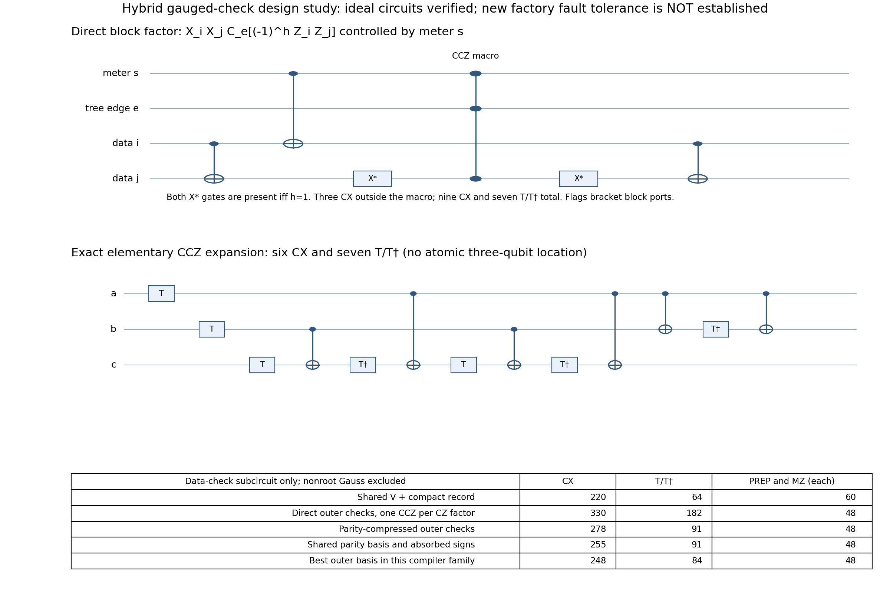

# Hybrid gauged-check study: direct extraction does not yet beat shared V

This is an additive circuit-design study, not a new accepted-output factory.
It implements and verifies ideal hybrid check circuits, including their
controlled phases, and searches a restricted check-basis/compiler family.
No existing simulator, decoder, or default is replaced. No noisy acceptance
improvement or full-factory fault-tolerance theorem is claimed.

The motivating question is whether retaining the gauged frame, extracting
inner checks cheaply, and measuring four outer dressed checks directly can
avoid the expensive shared coordinate changes. The answer for the concrete
elementary-gate circuits below is: **some helper costs fall, but CX and T
costs still increase, even after three optimizations.**

## Exact ideal checks and proposed ordering

Use the original compact13 graph and the exact physical U/W signs.
The comparison is to the round-trip local-Gauss scheme, not the persistent
scheme's global transported-root measurement.

1. Extract the nine bare Z checks. All commute with V and the dressed X family.
2. Given the ACTUAL inner Z eigenvalues, extract each inner X check as the
   corresponding conditional Pauli. Root a is bare XXXX. For nonroot v,

       Q_v = X_v C_(av)(Z_v)
           = X_v on Z_v=+1, or X_v Z_(av) on Z_v=-1.

3. Measure four independent outer dressed X checks directly, using the
   elementary programs in `src/single_block_cz/single_cz_hybrid_study.py`.
4. Retain local Gauss measurement, graph recovery and eventual ungauging.

This ordering has the correct ideal joint measurement instrument: first
resolve the commuting Z sector, then measure the conditional inner operators
and the globally commuting outer dressed operators. It preserves the
original ideal projector and its signed positive/negative CZ branches.
Steps 2 and 4 do NOT yet specify fault-tolerant noisy recovery rules.

## How an outer check is compiled

For each block intersection J of an outer X support R,

    Q_R = product_v X_J C_(av)[(-1)^h Z_J],
    h = (sum_(q in J) SIGNS[q])/2 mod 2.

The root has only X_J. Every occupied block in these weight-eight checks
has two data sites. The signed edge factor is essential: a controlled
minus sign is not an irrelevant global phase.

Four increasingly economical circuits were constructed:

* Literal: controlled X ports and a separate controlled-CZ for every
  physical CZ decoration. This has 26 exact CCZ macros across four checks.
* Parity compression: compute Z_i Z_j into existing data j, use one CCZ,
  uncompute. This reduces 26 CCZ macros to 13.
* Shared parity basis: conjugation by CX(i,j) maps X_i X_j to X_i and
  Z_i Z_j to Z_j. The complete nonroot block port is therefore

      CX(i,j), CX(s,i), [X(j)], CCZ(s,e,j), [X(j)], CX(i,j).

  The two bracketed X gates occur iff h=1. They absorb the signed edge
  factor without a separate CZ(s,e). This costs nine CX and seven T/Tdg
  per nonroot block port. A root block port uses two CX.
* Outer-basis change: replace outer check 6 by check 5 times check 6
  times inner check 2. Every outer generator then meets root a, leaving
  only twelve nonroot block ports instead of thirteen.

Every CCZ is actually expanded into six CX and seven T/Tdg. No atomic
three-qubit location is silently introduced. One exact phase identity is

    4abc = a+b+c -(b XOR c)+(a XOR b XOR c)
           -(a XOR c)-(a XOR b) mod 8.

The new support for check 6 is (0,3,4,6,12,14,16,19).
The other outer supports retain their original definitions. In an ideal
record the original check-6 bit is new-check-6 XOR check-5 XOR inner-X-2.
No noisy-report decoder is licensed merely by this ideal relation.

The search enumerates all fifteen nonzero outer-check combinations and
all thirty-two inner multipliers, retaining weight-eight/four-pair
representatives, then all independent four-word bases. The selected basis
has outer-word labels (1,3,4,8). Its minimum is certified only within this
specific independent-block-port compiler family, not over all possible
measurement circuits or alternative gate sets.



## Resource comparison

These are one complete syndrome record on its all-positive inner-sector
path. The reference includes BOTH V passes. The root Gauss circuit is excluded. Nonroot graph-star extraction is also
excluded from this SUBCIRCUIT table, but is NOT unchanged when staying
gauged; its additional cost is accounted for immediately below.

| Circuit | CX | T/Tdg | One-qubit Cliffords | Preparations | Measurements |
|---|---:|---:|---:|---:|---:|
| Shared V plus current compact record | 220 | 64 | 60 | 60 | 60 |
| Literal direct hybrid | 330 | 182 | 80 | 48 | 48 |
| Parity-compressed hybrid | 278 | 91 | 80 | 48 | 48 |
| Shared parity basis and absorbed signs | 255 | 91 | 80 | 48 | 48 |
| Best outer basis in this compiler family | **248** | **84** | **76** | **48** | **48** |
| Same best basis, even removing all outer flags | 240 | 84 | 76 | 44 | 44 |

The last row is deliberately unprotected; it shows that merely removing
outer flag overhead cannot close this compiler's CX/T gap. The best
candidate saves 12 preparations and 12 measurements per record, but adds
28 CX, 20 T/Tdg and 16 Clifford operations. Initial graph preparation still
sets the original 39-qubit peak; using fewer check helpers does not reduce it.

**Correction from the subsequent fault audit:** the earlier 1973-CX /
316-T schematic omitted the change in nonroot graph readout. In the gauged
frame those observables are G_v=U_v Xstar_v, not bare Xstar_v. Keeping the
bare star circuit would measure the wrong observable. A direct unflagged
controller costs 4+degree(v) CX and eight T per nonroot vertex, with all
data hooks confined to that vertex's block. Across compact13 this is
36 CX / 32 T instead of 20 CX / zero T for bare stars in V coordinates.
The new bare Gauss primitive is an IDEAL circuit; recovery of its block
hooks still needs a new composition proof. Its signed ideal action is
independently verified on all 4096 involved basis inputs.

Including this missing cost, the optimistic one-flag hybrid budget becomes
**2021 CX and 412 T/Tdg**, versus 1889 and 256 for the reference. Adding a
second overlapping block flag gives 2045 CX and 412 T/Tdg. These remain
NOT matched-guarantee factory budgets: extra sector certification,
nonzero-sector gadgets, protected diagnostics and recovery are not priced.
Retaining shared V only for the graph stars is another valid ideal option,
but gives back the coordinate changes we intended to remove.

For a replacement CCZ gadget costing c CX and t T, this best compiler's
record has 176+12c CX and 12t T, before any new helper verification costs.
This equation is a tradeoff, not a claim that a gadget meeting both
improvement thresholds exists. Joint extraction, shared non-Clifford
resources and measurement-assisted circuits are outside this search.

## Why no noisy accepted-output benchmark is exposed

A faulty Z report may select the wrong conditional inner measurement.
For example, let a two-data toy inner code be in Bell+ and its edge in +.
Both inner XX and ZZ are positive. Using a false negative ZZ report makes
the controller measure XX Z_edge instead of XX. Either outcome collapses
the edge in Z, reducing its X expectation from one to zero. This is a
different quantum instrument, not simply a wrong sign in the record.
Later graph recovery might repair it; that composition has to be proved.

Recovery also changes physically. A Pauli E decoded in V coordinates
requires V E V in the gauged frame. For instance Z_q gains a graph Z,
while X_q gains a controlled-phase Clifford decoration. Applying the old
bare-data correction unchanged would be unjustified. A software Clifford
frame is more involved than the recent software Z sign frame.

The candidate one-flag-per-four-BLOCK-port circuit has been checked only
ideally. Its elementary CCZ/T/CX faults, controller hooks, flags, changed
syndrome basis, sector reports, correction gates and terminal recovery
would need one global two-fault proof. Whole blocks must not be counted
as single physical-qubit errors. Existing Pauli-gadget fault certificates
are not automatically certificates for these Clifford block ports.

Thus there is no honest matched-fidelity acceptance number to compare yet.
The helper savings might affect rejection, but clean gate counts alone
cannot determine it. Given the higher CX/T counts even in the optimistic
candidate, this is not currently a justified replacement for production
benchmarks. A joint-extraction compiler or a cheaper protected non-Clifford
primitive would be needed to make this avenue more promising.

## Reproduce the finite ideal audit and circuits

```fish
/Users/kevinhemery/pytket-venv/bin/python /Users/kevinhemery/quanti/top-order-lit-rev/verification/single_block_cz/check_single_cz_hybrid_study.py
/Users/kevinhemery/pytket-venv/bin/python /Users/kevinhemery/quanti/top-order-lit-rev/tools/figures/single_block_cz/build-single-cz-hybrid-study.py
```

The first command runs in seconds and writes
`output/single-cz-hybrid-study.json`. It checks exact integer phase
exponents modulo eight and output basis permutations against an independent
physical V-X-V oracle for every involved data/edge/meter input, with ideal
flags initialized zero. Dense matrices independently verify H-CX-H=CZ.
Unselected data cancel analytically in V-X-V; complementary fillings are
also tested. The signed inner identity is checked on all 128 local basis
cases. The audit is exhaustive over its declared ideal gadget inputs and
basis search, NOT over noisy full-factory locations or arbitrary faults.

The figure's editable generator and SVG are retained alongside the PNG.
Existing production modes and the two-block SWAP implementation are unchanged.


## Fault-distinguishability follow-up

The [isolated-meter fault audit](single_block_cz_hybrid_fault_distinguishability.md)
now enumerates one/two elementary-location faults, including idles and
wrong reports, with coherent T propagation. It finds actual branches
where graph diagnostics resolve data-only ambiguities, and tests an
extra overlapping flag. This does not establish factory acceptance.
