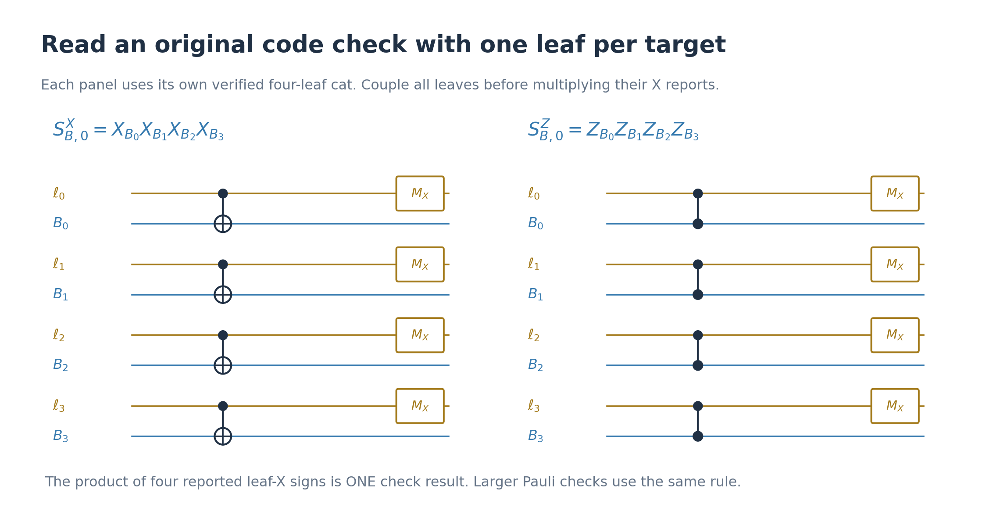
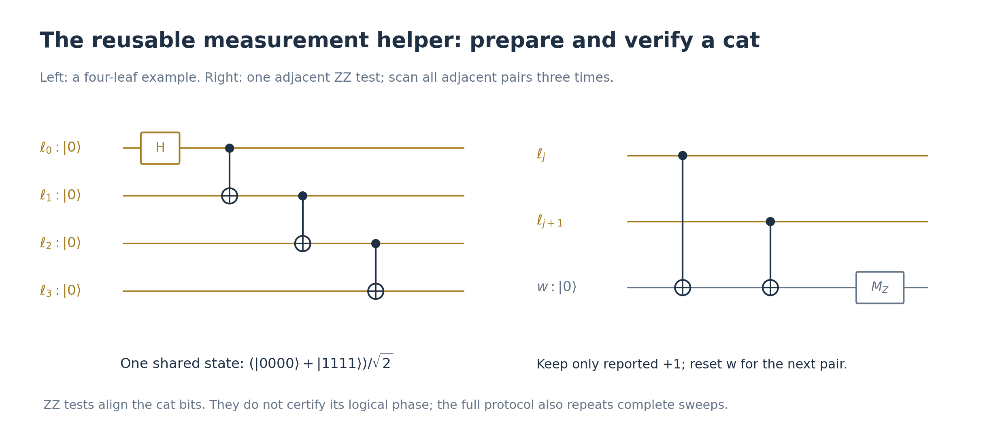

# Fault-tolerant cat states: verification, repeated syndromes, and the nine-round bound

## 1. Why distance six leads us to choose t=2

**Definition: the code distance d** is the minimum weight of a Pauli
operator that acts nontrivially on the logical information while
commuting with every stabilizer check. Such an operator changes the
logical state without making the checks complain.

Distance six therefore means that a harmful, undetectable logical Pauli
needs at least six physical qubits. Every lower-weight Pauli is either
detectable or acts harmlessly as a stabilizer. This is a statement about
**detection**, not yet about finding the right correction.

For a concrete correction ambiguity, the C4-Helix code has

\[
\overline X_0=X_2X_3X_8X_{11}X_{12}X_{15}.
\]

Consider two possible three-qubit errors:

\[
E=X_2X_3X_8,\qquad F=X_{11}X_{12}X_{15},
\qquad EF=\overline X_0.
\]

E and F give the same check signs: multiplying an error by a logical
operator does not change those signs. If F happened but we correct using
E, we obtain \(EF|\psi\rangle=\overline X_0|\psi\rangle\). We have
restored positive checks but changed the logical information.

Two possible errors of weight at most t can differ on at most 2t qubits.
To exclude a harmful logical ambiguity between them, we require

\[
2t<d,\qquad
t=\left\lfloor\frac{d-1}{2}\right\rfloor.
\]

The second expression is the largest integer satisfying the inequality.
The errors may still differ by a stabilizer, which is harmless. For d=6 this
gives t=2. Thus five-qubit Pauli errors are detectable unless harmless,
but only **all errors on up to two qubits** are guaranteed correctable.
The logical support above is from
[the manuscript's check and logical-operator table](../arXiv-2609.03194v1/appendix.tex).

## 2. What “tolerating t faults” actually promises

t is a chosen **protection target**, not a physical limit on how unlucky
an experiment can be. Real noise can produce t+1 or more faulty operations.

A familiar classical example is sending a bit three times and taking a
majority vote. If at most one transmission is corrupted, the answer is
correct. Two corruptions can defeat it. The receiver does not know which
transmissions were corrupted; it simply applies the voting rule.

Fault-tolerance proofs likewise establish conditional statements about
all fault patterns up to a specified size. For a verified preparation,
the intended statement is of the form:

> If at most t faulty operations occur in the specified circuit, every
> accepted branch has the correct logical state, allowing the stated
> correctable residual errors.

That statement neither rules out larger fault patterns nor certifies
from the reports how many faults actually occurred. Fault tolerance
suppresses damaging failure; it does not make failure impossible.

For ordinary recovery, the input also matters. If its error weight is r
and f further faults occur, the usual logical-correctness condition is
\(r+f\le t\). A recovery cannot promise to restore an arbitrarily
corrupted unknown logical state. These conditions are formalized in
[Gottesman's §4.2](https://arxiv.org/pdf/0904.2557#page=20).

The whole factory uses one shared fault budget, including preparation,
gates, reports, and idles. Each cat or recovery round does not receive a
new allowance of two faults.

## 4. How a cat measures a product operator

Suppose we want to measure

\[
Q=P_0P_1\cdots P_{m-1},
\]

where each \(P_j\) is a single-qubit Pauli on a different data qubit.
Prepare m helper qubits, called **leaves**, in

\[
|\mathrm{cat}_m^+\rangle
=\frac{|0^m\rangle+|1^m\rangle}{\sqrt2}.
\]

Leaf \(\ell_j\) controls only \(P_j\). Controlled X is CNOT;
controlled Z is CZ. With an ideal cat and gates, the joint state becomes

\[
\frac{|0^m\rangle|\psi\rangle
+|1^m\rangle Q|\psi\rangle}{\sqrt2}.
\]

Measure every leaf in X. If its reported eigenvalue is
\((-1)^{\lambda_j}\), the check bit is

\[
y=\lambda_0\oplus\cdots\oplus\lambda_{m-1}.
\]

The exact ideal data operator for that particular leaf record is

\[
\langle\lambda_X|
\Big[\prod_j\mathrm C_{\ell_j}(P_j)\Big]
|\mathrm{cat}_m^+\rangle
=2^{-(m+1)/2}\big(I+(-1)^yQ\big).
\]

Consequently, forgetting the individual leaf bits but retaining y gives
the projective measurement

\[
\rho\longmapsto\Pi_y(Q)\rho\Pi_y(Q),\qquad
\Pi_y(Q)=\frac{I+(-1)^yQ}{2}.
\]

For a positive check, the **combined parity** y must be zero. Individual
leaf-X outcomes can be negative.

This is the Shor-style cat measurement. Its circuit and ancilla-parity
interpretation are reviewed in
[Gottesman's §4.4, especially PDF pages 24–25](https://arxiv.org/pdf/0904.2557#page=24).

The one-leaf-per-target assignment limits propagation: one erroneous
leaf does not control many data qubits. This benefit requires controlling
correlated errors introduced while preparing the cat.

For the local Gauss checks in our gauging construction, the same ideal
measurement identity also applies to a product of disjoint X and SWAP
factors. A twelve-leaf cat has eight CNOT target ports and four Fredkin
target ports. A Fredkin port is a data pair rather than one qubit, so
the resulting fault-propagation claim needs the factory-specific analysis;
the ordinary Pauli-measurement theorem does not establish it automatically.

## 6. The parity-verification circuit

The intended cat has positive adjacent ZZ parities:

\[
Z_{\ell_0}Z_{\ell_1}=+1,\quad\ldots,\quad
Z_{\ell_{m-2}}Z_{\ell_{m-1}}=+1.
\]

To measure one such parity, prepare a separate helper w in zero and run

\[
\mathrm{CNOT}(\ell_j\to w);\quad
\mathrm{CNOT}(\ell_{j+1}\to w);\quad M_Z(w).
\]

Indeed, for computational-basis bits x and z,

\[
|xz\rangle|0\rangle_w
\longmapsto |xz\rangle|x\oplus z\rangle_w.
\]

Equal leaf bits give helper bit 0; different leaf bits give helper bit 1.
Reset w before the next pair. A **complete cat-verification scan** runs
through all m−1 adjacent pairs once.

Requiring positive adjacent parities checks that all leaf bits agree.
The helper is always a CNOT target: its X errors cannot propagate back
as leaf bit flips. Its phase errors can propagate to the leaves, which
will matter below. Pairwise parity verification is described in
[Shor's original paper, §4](https://arxiv.org/pdf/quant-ph/9605011#page=6).

### A concrete false-positive report

Take a two-leaf example. Fault 1 during preparation creates

\[
|\mathrm{bad}\rangle=\frac{|01\rangle+|10\rangle}{\sqrt2}.
\]

The parity circuit correctly produces

\[
|\mathrm{bad}\rangle|0\rangle_w
\longmapsto |\mathrm{bad}\rangle|1\rangle_w.
\]

Now let fault 2 be an unwanted \(X_w\) immediately before readout:

\[
|\mathrm{bad}\rangle|1\rangle_w
\xrightarrow{X_w\ \mathrm{fault}}
|\mathrm{bad}\rangle|0\rangle_w.
\]

You receive a positive report, although the cat is still bad. There is
no separate alarm announcing fault 2. A following fault-free scan reports
negative and makes you reject.

| Stage | Physical situation | Available report | Action |
|---|---|---|---|
| Preparation | Fault 1 creates the bad cat | None | Begin verification |
| First scan | Fault 2 hides its negative parity | Positive | Continue |
| Second scan | Correctly measures the bad parity | Negative | Reject |

Thus “restart whenever a scan reports negative” is correct, but does not
eliminate the need to check again after a reported positive.

Three separate readout faults could hide this bad parity three times.
Together with the preparation fault, that particular history contains
four faults. It is physically possible; it is outside a two-fault guarantee.

## 7. What three scans on the same cat guarantee

In our circuit, the rule for t=2 is:

1. Prepare one fresh cat.
2. Scan all adjacent ZZ parities once; reject if any report is negative.
3. Repeat the complete scan twice more, with the same rejection rule.
4. If all three scans pass, couple the cat to its data targets and read
   its leaf-X parity.

Do not continue scanning a cat after a failure. Do not collect successful
scans across intervening failures or across different cats. Standalone
ancilla preparation can discard and rebuild the unused cat; the factory
in [full_procedure.md](full_procedure.md) rejects the whole attempt.

The reasoning is conditional: among three disjoint scans, two faulty
operations can spoil at most two scans. At least one scan is clean. If
the attempt was accepted, that scan applied the exact positive projector

\[
P_{\mathrm{uniform}}
=\prod_{j=0}^{m-2}\frac{I+Z_{\ell_j}Z_{\ell_{j+1}}}{2}
=|0^m\rangle\langle0^m|+|1^m\rangle\langle1^m|.
\]

Immediately after it, the leaves are in the uniform-string subspace:

\[
\alpha|0^m\rangle+\beta|1^m\rangle.
\]

This notation allows mixed states or entanglement with other systems as
well; the support is what is constrained. Preparation errors giving
nonuniform strings have been removed or have caused rejection.

We do not know which scan was clean. Later faults can still introduce
errors. During verification, each subsequent fault can introduce a bit
error on at most one leaf, because no leaf-to-leaf gates remain. This
limits subsequent propagation; it does not certify a perfect final cat.

The same clean-scan counting suggests t+1 scans for a chosen t-fault
budget. **This is a sufficient choice for our verification argument, not
a universal minimum prescribed by the code distance.** It should not be
confused with the standard syndrome-repetition rule in §9 below.

### The phase is still unverified

Both states

\[
|\mathrm{cat}_m^\pm\rangle
=\frac{|0^m\rangle\pm|1^m\rangle}{\sqrt2}
\]

pass every adjacent-ZZ check. A single leaf Z can change the positive
cat into the negative one. If the negative cat is used to measure Q,
a positive reported leaf-X parity implements the ideal data projector
\((I-Q)/2\), rather than \((I+Q)/2\).

Consequently, even accepted cat verification does not guarantee a correct
data-check report. Full fault tolerance also needs protection against
these phase faults, wrong reports, and late data errors. This motivates
repeated data-syndrome extraction. The separate proof for our gauging
factory must also handle these effects; the clean-cat-scan argument alone
does not prove that entire factory correct.

## 8. What the experiment knows, and what the proof labels

The apparatus receives ordinary bit strings. It does not receive labels
such as “this round had a gate fault.” A parity reported negative can
come from bad data measured correctly, or from good data measured
incorrectly. Even an unchanged report need not mean the round was clean.

When an analysis marks a round as faulty, that label describes one
hypothetical physical history. We prove a statement for every history
within the chosen budget. The controller follows the same reported-data
rule without knowing which history occurred.

A persistent detector malfunction can spoil several readings. The local
fault count treats each affected operation as a faulty location; it is
not a count of the number of underlying hardware defects. Arbitrarily
correlated failures are not excluded by performing more scans.

## 9. Traditional Shor recovery: repeat the complete data syndrome

Now switch from checking the cat to checking the **data code block**.
Let its independent checks be \(S_1,\ldots,S_N\). One round means:

1. Measure \(S_1\) with a fresh verified cat.
2. Do the same for every remaining check, each with another fresh cat.
3. Collect the N check bits into the reported vector
   \(\mathbf s^{(k)}=(s_1^{(k)},\ldots,s_N^{(k)})\).

A cat is measured and discarded after one data-check measurement. It
is not reused for the next check or the next syndrome round.

The traditional stopping rule is

\[
\tau=\min\left\{k\ge t+1:
\mathbf s^{(k)}=\mathbf s^{(k-1)}=\cdots=\mathbf s^{(k-t)}\right\}.
\]

Do not apply data corrections between these rounds. After stopping,
choose a minimum-weight Pauli correction matching the repeated syndrome.
This is the standard rule reviewed in
[Tansuwannont, Pato, and Brown, §2](https://arxiv.org/html/2208.05601v4#S2).

For t=2, the stopping rule requires **three identical reported vectors**.
They can all be nonzero. A negative data-check result is information for
recovery, not an automatic instruction to discard the state.

For example,

\[
A,\ B,\ C,\ C,\ C
\]

makes the controller stop at round five. Each letter denotes a complete
syndrome vector. It stops without knowing whether all three C rounds
were clean. A change resets the current agreement streak; it does not
restart state preparation.

With at most t faults, the final t+1 matching rounds contain at least
one clean round. Their common report therefore matches a genuine data
syndrome at that round. This does not make it a perfect description of
the data at every later instant: faults after that reference round can
leave residual errors. Bounded error propagation and the input-error
condition are needed for the full recovery guarantee.

## 10. Why the maximum is \((t+1)^2\) rounds

The maximum is a conditional bound for the traditional rule, assuming
at most t faults in the syndrome-extraction circuit. It is explicitly
listed in [Table 1 of the reference paper](https://arxiv.org/html/2208.05601v4#S1.t1).
Here is the counting argument.

Each round includes its own fresh helper preparations, checks, and
idles. At most t faulty operations can make at most t rounds faulty.
Those faulty rounds divide the clean rounds into at most t+1 stretches.

Within an uninterrupted clean stretch, the data syndrome is unchanged,
and the reports are accurate. Thus t+1 consecutive clean rounds guarantee
t+1 identical reports and force the stopping rule to have been satisfied.

If this has not happened yet, every clean stretch has length at most t.
The longest possible arrangement avoiding such a stretch therefore has

\[
\underbrace{t(t+1)}_{\text{clean rounds in at most t+1 stretches}}
+\underbrace{t}_{\text{faulty rounds}}
=(t+1)^2-1
\]

rounds. The next round forces a clean stretch of length t+1. Hence

\[
\tau\le (t+1)^2.
\]

This proves an upper bound. The apparatus may stop earlier because
identical reports do not require every contributing round to be clean.

### Distance six: a nine-round example

With t=2, an example consistent with this counting is

\[
A,\ A,\ B,\ C,\ C,\ D,\ E,\ E,\ E.
\]

Choose the letters distinct so that no earlier identical triple occurs.
One hypothetical physical history has faults in rounds three and six:

| Round | Report seen by the apparatus | Description used only in the analysis |
|---|---|---|
| 1 | A | Clean |
| 2 | A | Clean |
| 3 | B | Faulty; may change the data and its report |
| 4 | C | Clean |
| 5 | C | Clean |
| 6 | D | Faulty; may change the data and its report |
| 7 | E | Clean |
| 8 | E | Clean |
| 9 | E | Clean; the apparatus stops |

The controller sees only the middle column. The last column is not an
experimental fault flag. In general the controller cannot distinguish
a genuine syndrome change from a wrong report by looking at one round.

### Could the third E itself be faulty?

Yes, physically. But in the displayed history, rounds three and six
already use two faults. A further fault in round nine would be a third
fault, so the two-fault bound would no longer apply.

Alternatively, reserve one of the two faults for round nine. Then the
first eight rounds contain at most one faulty round. One faulty round
can separate clean rounds into only two stretches. Avoiding a clean
triple would then allow at most

\[
2\text{ clean}+1\text{ faulty}+2\text{ clean}=5\text{ rounds}.
\]

The stopping rule would therefore have been satisfied by round six.
We could not reach a ninth syndrome round with that allocation of faults.

Most importantly, a faulty last E that still reports E would not make
the controller continue. Its condition is three identical reports,
not three certified-clean rounds.

### What happens when more than t faults occur?

There may be a matching triple that gives an unreliable recovery, or
more than \((t+1)^2\) rounds may pass before any matching streak appears.
Neither contradicts a guarantee whose hypothesis was at most t faults.

The uncapped traditional stopping rule can keep collecting reports.
Our finite factory instead rejects if it has not obtained an identical
triple by round nine. It also rejects helper-verification failures and
syndromes unsupported by its specified correction lookup. These are
explicit factory acceptance rules, not additional claims from Table 1.

## 11. Which “three,” and which “nine”?

| Procedure | What is repeated? | Rule in our t=2 factory |
|---|---|---|
| Cat verification | All adjacent ZZ checks on the same unused cat | Three scans; reject any negative report |
| One data-check measurement | Cat-controlled coupling and leaf-X readout | One fresh verified cat per check measurement |
| Postselected data/gauge filter | Its complete check list | Three positive rounds; reject any negative report |
| Ordinary syndrome recovery | All original code checks, with fresh cats | Stop at the first identical triple; at most nine rounds before rejection |

Cat verification and positive filters are postselection: reported failure
rejects the candidate. Ordinary recovery keeps nonzero syndromes and uses
them to choose a correction. The rules must not be interchanged.

The exact prescription “three adjacent-ZZ scans on the same cat for this
distance-six factory” is our conservative circuit choice. The references
below support the Shor ingredients and the standard data-syndrome rule;
they should not be cited as establishing that this exact cat scan count
is necessary, optimal, or mandated solely by distance six.

### Rounds are not individual measurements

For an m-leaf cat, one adjacent-ZZ scan uses m−1 helper readouts. Our
three scans use \(3(m-1)\) such readouts, followed later by m leaf-X
readouts for the data-check result.

For a block with N independent checks, nine completed syndrome rounds
produce 9N data-check outcomes, each itself using a cat gadget. For one
C4-Helix block, N=18, so this is at most 162 such outcomes. Joint recovery
of B and C has N=36, giving at most 324. These counts exclude the internal
cat-verification and leaf readouts.

The nine-round bound applies to one recovery invocation, not to unlimited
retries of a rejected preparation or to the total number of elementary
measurements in a factory.

 I’m sorry—the explanations mixed **cat verification**, **postselection**, and **recovery**. They have different acceptance rules.

The crucial point is: **a negative check result does not mean the measurement apparatus failed. It may be a perfectly correct measurement of an error in the data.**

Here is the procedure used in our factory, starting with one data block.

**1. Prepare a cat to measure one data check**

Prepare the cat, then measure all its adjacent \(ZZ\) parities in three complete scans.

- Any reported negative parity: **reject the factory attempt**.
- All three scans positive: use this cat to measure one data check.
- After that measurement, discard the cat. The next data check uses a fresh one.

This stage checks the **measurement ancilla**, not the data block. Passing limits dangerous error propagation; it does not certify that every subsequent measurement report will be correct.

**2. Measure the data checks—but distinguish the state from the report**

Take the actual C4-Helix check

\[
S=Z_0Z_1Z_2Z_3.
\]

A correctly encoded state \(|\psi\rangle\) satisfies \(S|\psi\rangle=|\psi\rangle\).

Suppose an unwanted \(X_2\) acts on the data. Then

\[
S X_2|\psi\rangle=-X_2|\psi\rangle.
\]

A correct measurement now reports **negative**. That is useful information, not a failed measurement. Applying \(X_2\) again restores \(|\psi\rangle\).

There is another possibility: the data is fine, but a phase fault changes the measurement cat from

\[
|\mathrm{cat}^+\rangle
=\frac{|0000\rangle+|1111\rangle}{\sqrt2}
\]

to \(|\mathrm{cat}^-\rangle\), with a minus between the terms. This can produce a negative report while leaving the data unchanged.

| Data before the check | Measurement cat | Report |
|---|---|---|
| Correct \(|\psi\rangle\) | Correct cat | Positive |
| Erroneous \(X_2|\psi\rangle\) | Correct cat | Negative, correctly |
| Correct \(|\psi\rangle\) | Cat with a phase fault | Negative, incorrectly |

**The report alone does not announce which situation occurred.**

**3. Recover the data by repeating its complete syndrome**

One syndrome round measures **all** independent data checks, using a fresh verified cat for each check. Collect their reported signs into one vector.

Then follow these instructions:

1. Measure a complete syndrome.
2. Compare it with the preceding reported syndrome. If different, start a new agreement streak.
3. Stop when the same vector has appeared three consecutive times.
4. Apply the minimum-weight correction associated with that vector.
5. If no identical triple appears by round nine, **reject the factory attempt**. Also reject if the required correction does not exist in our specified lookup.

**Do not restart merely because a data-check result is negative.** A stable nonzero syndrome is exactly what recovery can use.

Let \(\mathbf0\) mean all checks positive, \(\mathbf e\) the syndrome of \(X_2\), and \(\mathbf f\) a spurious report:

| Physical history | Reported rounds | Action |
|---|---|---|
| Data correct; measurements correct | \(\mathbf0,\mathbf0,\mathbf0\) | Stop at round 3; no correction |
| Data has \(X_2\); measurements correct | \(\mathbf e,\mathbf e,\mathbf e\) | Stop at round 3; correct with \(X_2\) |
| Data correct; round 2 gives a false report | \(\mathbf0,\mathbf f,\mathbf0,\mathbf0,\mathbf0\) | Stop at round 5; no correction |
| No identical triple by round 9 | Any such sequence | Reject |

A **clean round** means its operations worked correctly. The second example has three clean rounds, even though they all report an error in the data.

**Where the other “three positive rounds” fit**

Our factory also has deliberate **postselection filters**: input-state verification, gauged verification, and the terminal original-code filter. There, we specifically demand positive checks.

| What is being done? | Negative result means |
|---|---|
| Verifying a cat | Reject |
| Applying a positive postselection filter | Reject |
| Collecting a recovery syndrome | Retain the result and continue the agreement test |

Finally, **we never count actual faults during the experiment**. The statement “at most two faults” belongs to the mathematical guarantee. Distance six motivates protecting against two faults; the three-identical-syndrome rule then has a nine-round upper bound under that condition.

A physical data error such as \(X_2\) is usually correctable. A **logical error** changes the encoded information while leaving the stabilizer checks satisfied. Preventing a few circuit faults from becoming such an undetected logical change is the purpose of the fault-tolerant construction.

# Why three repetition for the cat state preparation?
For **our cat-verification circuit**, \(t+1\) repetitions give a sufficient guarantee: **at least one complete scan operated correctly.** Here is why that helps.

**1. One correctly performed scan is enough to check agreement between all the leaf bits.**

It measures

\[
Z_{\ell_0}Z_{\ell_1},\ldots,Z_{\ell_{m-2}}Z_{\ell_{m-1}}.
\]

If these measurements are performed correctly and all results are positive, the leaves are projected into

\[
\operatorname{span}\{|0^m\rangle,|1^m\rangle\}.
\]

At that moment, a dangerous nonuniform pattern such as \(|000111\rangle+|111000\rangle\) cannot remain.

**2. A faulty scan might falsely report that everything was positive.**

Therefore, one reported-positive scan does not establish that projection.

We repeat the complete scan, requiring every report in every scan to be positive. A reported negative causes rejection.

**3. With at most \(t\) faulty operations, \(t+1\) scans cannot all contain a malfunction.**

To put a faulty operation into every scan would require at least \(t+1\) distinct faulty operations.

Thus, among the accepted scans, at least one was performed correctly. Its positive results were genuine, so the projection described in step 1 really occurred.

This argument does not require knowing which scan was correct.

**4. Faults after that scan must still be accounted for.**

The guarantee is **not that the cat is perfect at the end**. After preparation, our verification circuit has no leaf-to-leaf gates. Each later fault can introduce a bit error on at most one leaf. Consequently, later faults cannot recreate the large correlated bit pattern that a single faulty preparation gate could produce.

Cat-phase faults remain possible; the subsequent data-measurement protocol must handle them separately.

For \(t=2\), this becomes:

\[
\text{three positive scans}
\quad+\quad
\text{at most two faulty operations}
\quad\Longrightarrow\quad
\text{one genuinely positive, correctly performed scan}.
\]

**Why exactly \(t+1\), rather than fewer?** It is the smallest number that guarantees a clean scan using this counting argument alone. A more detailed analysis can exploit the preparation circuit and the faults already needed to create a dangerous error, potentially reducing verification. So this establishes **sufficiency**, not an optimal scan count.

That is the conservative repeated-verification strategy discussed by [Steane, PDF page 2](https://arxiv.org/pdf/quant-ph/0202036#page=2); his paper then develops ways to avoid the repetition through better verification networks.

# An example  

Consider measuring the two-qubit stabilizer
\[
Q=Z_{D_1}Z_{D_2}
\]
on an arbitrary data state \(|\psi\rangle_{D_1D_2}\). Introduce two helper qubits, \(\ell_0,\ell_1\). In the equations below, helper registers appear first.

**1. Prepare the helper cat state.**

Initialize both helpers in zero, apply \(H\) to \(\ell_0\), then apply a CNOT with control \(\ell_0\) and target \(\ell_1\):
\[
|00\rangle_\ell
\xrightarrow{H_{\ell_0}}
\frac{|00\rangle_\ell+|10\rangle_\ell}{\sqrt2}
\xrightarrow{\mathrm{CNOT}(\ell_0\to\ell_1)}
\frac{|00\rangle_\ell+|11\rangle_\ell}{\sqrt2}.
\]

The combined helper–data state is therefore
\[
|\Psi_0\rangle
=
\frac{|00\rangle_\ell+|11\rangle_\ell}{\sqrt2}
\otimes|\psi\rangle_{D_1D_2}.
\]

**2. Couple each helper to its corresponding data qubit.**

Apply precisely these two gates:
\[
\boxed{
\mathrm{CZ}(\ell_0,D_1),
\qquad
\mathrm{CZ}(\ell_1,D_2).
}
\]

The first gate applies \(Z_{D_1}\) when \(\ell_0=1\); the second applies \(Z_{D_2}\) when \(\ell_1=1\). Thus
\[
\begin{aligned}
|\Psi_0\rangle
&\xrightarrow{\mathrm{CZ}(\ell_0,D_1)}
\frac{
|00\rangle_\ell|\psi\rangle
+
|11\rangle_\ell Z_{D_1}|\psi\rangle
}{\sqrt2}
\\[2mm]
&\xrightarrow{\mathrm{CZ}(\ell_1,D_2)}
\frac{
|00\rangle_\ell|\psi\rangle
+
|11\rangle_\ell Z_{D_1}Z_{D_2}|\psi\rangle
}{\sqrt2}.
\end{aligned}
\]

Although CZ is symmetric between its two qubits, describing the helper as its control makes the measurement mechanism transparent.

**3. Measure both helpers in X.**

Let their reported bits be \(\lambda_0,\lambda_1\), with
\[
|\lambda_X\rangle
=
\frac{|0\rangle+(-1)^\lambda|1\rangle}{\sqrt2}.
\]

For a particular pair of outcomes, the unnormalized remaining data state is
\[
\begin{aligned}
|\widetilde\psi_{\lambda_0,\lambda_1}\rangle
&=
\big(\langle\lambda_{0,X}|\otimes
\langle\lambda_{1,X}|\big)|\Psi_2\rangle
\\
&=
\frac{I+(-1)^{\lambda_0+\lambda_1}Z_{D_1}Z_{D_2}}
{2\sqrt2}\,|\psi\rangle.
\end{aligned}
\]

Define the outcome parity
\[
y=\lambda_0\oplus\lambda_1.
\]
Then
\[
\boxed{
|\widetilde\psi_{\lambda_0,\lambda_1}\rangle
=
\frac1{\sqrt2}\,
\Pi_y(Q)|\psi\rangle,
\qquad
\Pi_y(Q)=\frac{I+(-1)^yQ}{2}.
}
\]

**4. Interpret the parity as the stabilizer result.**

| Helper-X bits \((\lambda_0,\lambda_1)\) | Parity \(y\) | Measured eigenvalue of \(Z_{D_1}Z_{D_2}\) |
|---|---|---|
| \(00\) or \(11\) | 0 | \(+1\) |
| \(01\) or \(10\) | 1 | \(-1\) |

After keeping only the parity information, the probability and normalized conditional data state are
\[
p_y=\langle\psi|\Pi_y(Q)|\psi\rangle,
\qquad
|\psi_y\rangle=\frac{\Pi_y(Q)|\psi\rangle}{\sqrt{p_y}},
\]
for \(p_y>0\).

This is exactly a projective measurement of the **joint operator** \(Z_{D_1}Z_{D_2}\). It does not separately measure \(Z_{D_1}\) and \(Z_{D_2}\).

In the fault-tolerant gadget, the three cat-verification scans are inserted **after step 1 and before step 2**. The calculation above describes the ideal action of that gadget.

## References and relation to the other notes

1. Peter W. Shor, **Fault-tolerant quantum computation** (1996),
   [arXiv:quant-ph/9605011](https://arxiv.org/abs/quant-ph/9605011), §4.
   Historical source for verified cats and repeated extraction.
2. Daniel Gottesman, **An Introduction to Quantum Error Correction and
   Fault-Tolerant Quantum Computation** (2009),
   [arXiv:0904.2557](https://arxiv.org/abs/0904.2557).
   Start with §4.4, especially PDF pages 24–25, for the circuit mechanism;
   §4.2 defines the fault-tolerance conditions.
3. Theerapat Tansuwannont, Balint Pato, and Kenneth R. Brown,
   **Adaptive syndrome measurements for Shor-style error correction**,
   Quantum **7**, 1075 (2023),
   [arXiv:2208.05601](https://arxiv.org/abs/2208.05601),
   [journal article](https://quantum-journal.org/papers/q-2023-08-08-1075/).
   Table 1 and §2 give the traditional stopping rule and round bound;
   the remainder develops improved adaptive alternatives.

For our particular construction, see
[the full circuit equations](full_procedure.md),
[the overview with diagrams](Synthesis.md), and
[the factory-specific fault analysis](c4-helix-intrinsic-gauged-verification.md).
The circuit figures above are reused from Synthesis. This note explains
the verification and repetition logic; it does not supply a new proof
of the complete gauging/ungauging factory.
