# Synthesis: C4-Helix magic preparation by gauging a block SWAP

This is a circuit-level walkthrough of the **single-cycle, postselected
80-Fredkin construction**. Start with two encoded stabilizer states, attach
a gauge register, measure a joint SWAP symmetry, and remove the gauge
register with a decoded correction. The retained C block contains

\[
\boxed{|M\rangle=\frac{2|0\rangle+|1\rangle}{\sqrt5}}
\]

on its first logical qubit, with its second logical qubit in zero. This
is the encoded magic resource produced by this procedure, ready for later
use in a computation.

The drawings use the same five colors for inner groups a–e. **Turquoise
labels are gauge qubits; gold wires are measurement-cat leaves.** A quantum
circuit's black dot is a control, a circled plus is an X target, two dots
denote CZ, and two crosses denote SWAP. The small wire fragments in the
check drawings specify the couplings; use serial order for the resource
count and schedule quoted here. \(M_X\) and \(M_Z\) denote single-qubit
measurements in those bases.

## 1. A brief reminder of the code and the desired symmetry

Each block is a \([[20,2,6]]\) code: twenty physical qubits, two encoded
qubits, distance six. It consists of five inner four-qubit groups. The
subscript q in \(B_q\) or \(C_q\) labels a **physical** qubit; an overbar
labels an encoded state or operator.

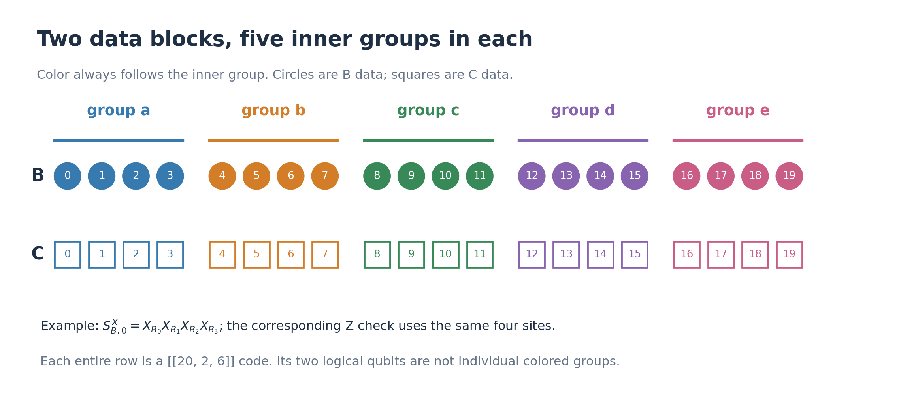

The original X and Z checks have the same supports \(R_s\):

\[
S^X_{B,s}=\prod_{q\in R_s}X_{B_q},\qquad
S^Z_{B,s}=\prod_{q\in R_s}Z_{B_q},
\]

and similarly for C. For example, \(R_0=\{0,1,2,3\}\) gives XXXX and
ZZZZ on group a. Each inner group is a \([[4,2,2]]\) code with these
two checks; upper checks couple the groups into the full code. Its code
space is the common +1 eigenspace of the original checks.
The full supports are listed in Appendix A. There are
nine independent checks of each type per block; throughout the protocol
we use s=0 through 8.

Prepare

\[
|\psi\rangle=|\overline{00}\rangle_B|\overline{+0}\rangle_C.
\]

The measured symmetry is the **whole-block SWAP**

\[
U=\prod_{q=0}^{19}\operatorname{SWAP}(B_q,C_q).
\]

It exchanges both corresponding logical pairs as one joint operation.
Since the second logical qubit in each block is zero, the useful action
is on the first pair. We keep the positive symmetry outcome, implementing
\(\Pi_+=(I+U)/2\), then extract the magic into C.

## 2. Choose the graph from the upper code checks

Take the five upper supports \(R_5,\ldots,R_9\), and name them a,b,c,d,e.
Every physical label q occurs in **exactly two** of these supports. Put an
edge labelled q between those two vertices, with a physical gauge qubit
\(A_q\) on it. The redundant fifth upper check \(R_9\) is useful for
this graph construction, although the measured code-check set uses only
the independent rows through \(R_8\).

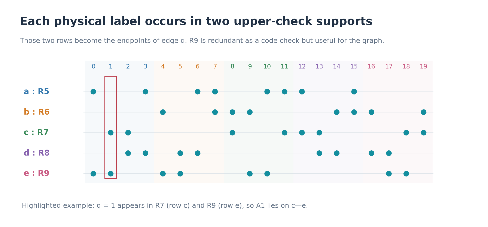

This gives two edges between every pair of vertices: a doubled K5.

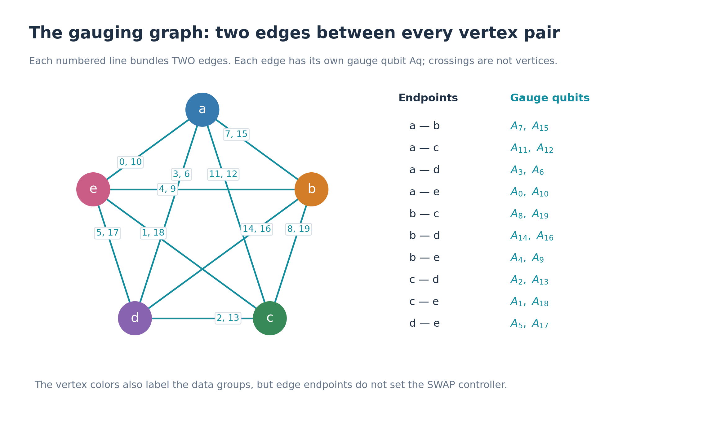

This graph gives us a connected joint symmetry measurement, short cycle
checks, and a redundant gauge readout. In particular, a nonzero graph cut
has at least eight edges, which will protect the ungauging correction.

**There are two separate assignments to remember.**

- Edge endpoints determine the CNOTs used to prepare \(A_q\).
- The inner group containing q determines the temporary vertex controlling
  \(\operatorname{SWAP}(B_q,C_q)\): a controls 0–3, b controls 4–7,
  c controls 8–11, d controls 12–15, and e controls 16–19.

For example, \(A_1\) lies on edge c–e, but the data pair \(B_1,C_1\)
is controlled by a. **The controller need not be an endpoint of edge q.**
The three qubits \(A_q,B_q,C_q\) remain distinct throughout.

## 3. One reusable gadget for Pauli measurements

To measure a Pauli product with m physical targets, prepare m helper
leaves in the cat state

\[
|\mathrm{cat}_m\rangle=\frac{|0^m\rangle+|1^m\rangle}{\sqrt2}.
\]

A **leaf** is one physical qubit of this helper state, labelled
\(\ell_j\) in the circuits.

First verify all adjacent leaf-ZZ parities, using the small circuit below.
Perform **three complete scans**, keeping only reported +1 outcomes.
The parity helper w is reset for every adjacent pair.

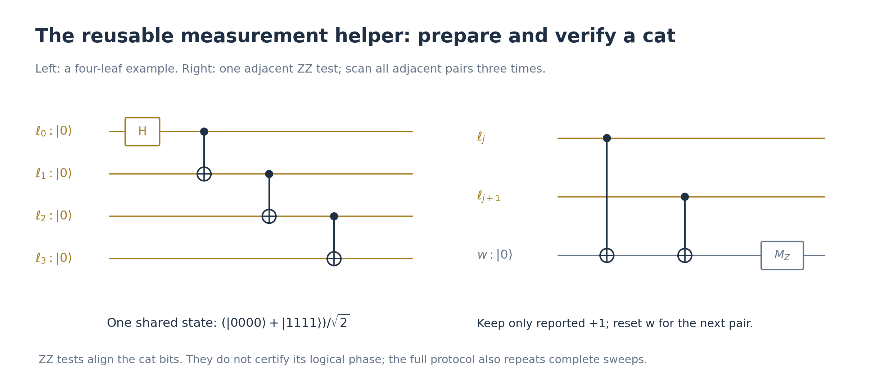

Then couple one leaf to each target: use CNOT for an X factor and CZ for
a Z factor. Measure every leaf in X. The product of its reported signs
is the **one Pauli-check result**. A fresh verified cat is used for every
check. One leaf is never reused on several physical targets.
Accepting a +1 check means accepting the product of the leaf signs;
individual leaf-X reports may be negative.

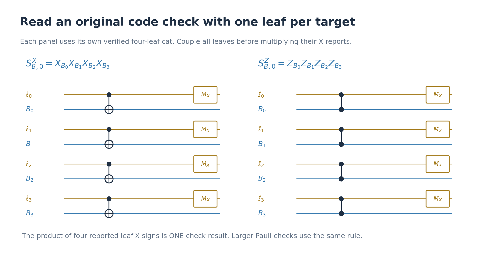

The same circuit reads an eight-body upper check or a logical Pauli;
only the target list changes. ZZ verification aligns the cat bits but
does not certify the logical cat phase. The repetition of whole
verification rounds below also accounts for phase faults and wrong reports.

## 4. Prepare and verify the input states and graph resource

**Inputs.** Start B and C in physical zero states. On each block, measure
its eighteen independent code checks together with the two logical checks
below. Keep +1 throughout and perform three complete rounds per block.

| Block | Additional logical checks | Resulting encoded input |
|---|---|---|
| B | \(\overline Z_0,\overline Z_1\) |   \(|\overline{00}\rangle\) |
| C | \(\overline X_0,\overline Z_1\) | \(|\overline{+0}\rangle\) |

These twenty independent Pauli checks specify one state on each block.
Their physical logical supports are in Appendix B. This preparation uses
the same measurement gadget; no unspecified encoding circuit is assumed.

**Graph resource.** Initialize the five temporary vertex qubits in plus
states and the twenty gauge qubits independently in zero. For every edge
q:u–v, apply

\[
\operatorname{CNOT}(u\to A_q),\qquad
\operatorname{CNOT}(v\to A_q).
\]

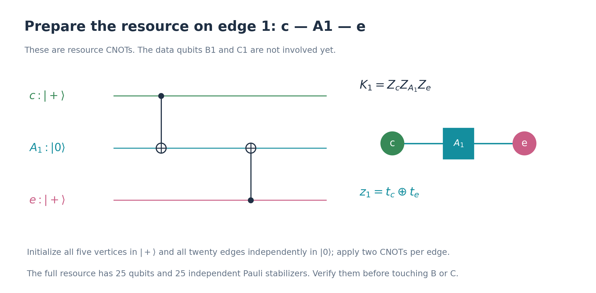

There are forty CNOTs. In the CNOT convention used here, the resource
stabilizers are

\[
K_v=X_v\prod_{q\in E_v}X_{A_q},\qquad
K_q=Z_uZ_{A_q}Z_v,
\]

where \(E_v\) is the set of edges incident on v. Verify these five vertex
and twenty edge checks in three complete positive rounds. The resource
is now ready to couple to B and C. A negative source or helper
verification report rejects this attempt.

## 5. Gauge the SWAP and read the temporary vertices

Define the partial data operations

\[
T_a=\prod_{q=0}^{3}\operatorname{SWAP}(B_q,C_q),
\quad T_b=\prod_{q=4}^{7}\operatorname{SWAP}(B_q,C_q),
\quad\ldots,\quad U=T_aT_bT_cT_dT_e.
\]

For each group, its temporary vertex controls its four physical SWAPs.
Each controlled SWAP is a three-qubit Fredkin gate.

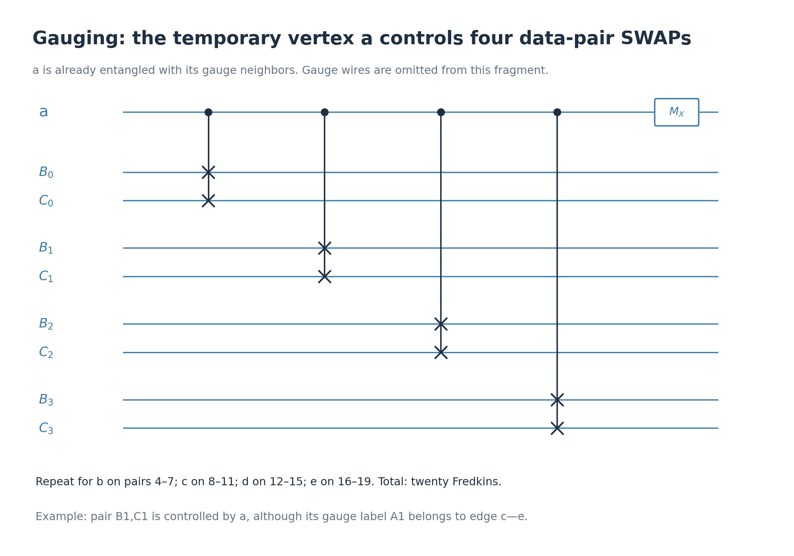

Apply this pattern on all five groups: **twenty Fredkins**. The gauge
qubits are untouched during enrichment. Then measure all five temporary
vertices in X, obtaining signs \(x_a,\ldots,x_e\), and retain only

\[
r=x_ax_bx_cx_dx_e=+1.
\]

Why does this measure U? In a computational-basis branch of the vertices,
let their bits be t. The resource gauge word is
\((\delta t)_q=t_u\oplus t_v\), and enrichment applies
\(V_t=\prod_vT_v^{t_v}\). Exactly two vertex patterns give that word:
t and its complement. Their data operations are \(V_t\) and \(V_tU\).
The vertex-X parity gives their relative sign, so they combine as
\(V_t(I+rU)|\psi\rangle\).

**Fix the individual signs.** Use root a and the four tree edges

\[
e_b=7,\quad e_c=11,\quad e_d=3,\quad e_e=0.
\]

For each v=b,c,d,e with reported \(x_v=-1\), apply the **quantum Pauli
gate** \(Z_{A_{e_v}}\). In the ideal circuit this changes the Gauss signs
at a and v. With r=+1 the resulting five signs are all +1.

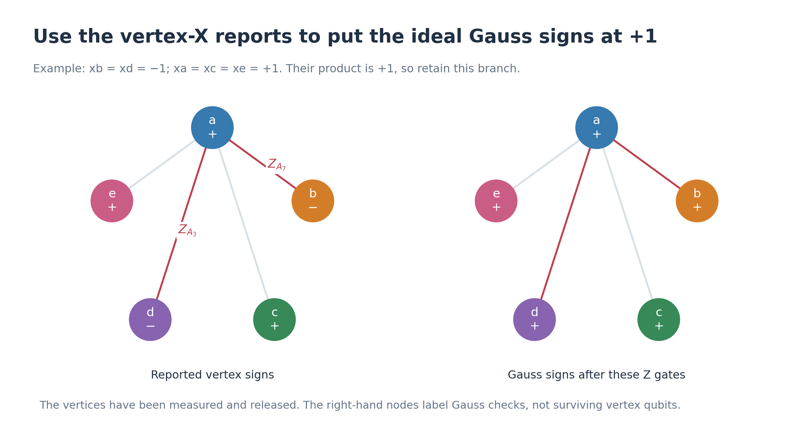

The temporary vertices have now been measured and can be reset. The
letters a–e still label graph locations and check supports; they no
longer denote five surviving vertex qubits.

## 6. Verify while remaining gauged

A complete verification round measures the following **39 checks**,
requiring every reported sign to be +1. Perform three complete rounds.
The gauge register stays in place throughout.

### 6a. Eighteen paired code checks

Measure

\[
N_s^P=S^P_{B,s}S^P_{C,s},\qquad P=X,Z,\quad s=0,\ldots,8.
\]

Use one cat across the targets of **both** blocks. The following example
has eight leaves and yields one result.

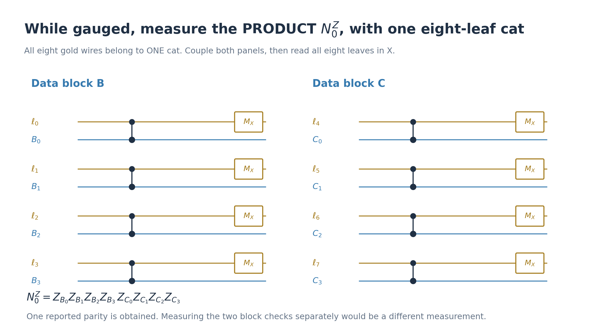

These products survive gauging: every matched factor
\(P_{B_q}P_{C_q}\) commutes with its physical SWAP. Measuring
\(S_{B,s}\) and \(S_{C,s}\) separately while gauged would be a different
operation. Here we measure only their product.

### 6b. Sixteen gauge-cycle checks

For each chosen cycle \(\eta\), measure

\[
L_\eta=\prod_{q\in\eta}Z_{A_q}
\]

with the same Pauli gadget. Use the ten parallel-edge pairs in the edge
dictionary, and these six triangles:

\[
\begin{gathered}
(7,8,11),\quad(7,14,3),\quad(7,4,0),\\
(11,2,3),\quad(11,1,0),\quad(3,5,0).
\end{gathered}
\]

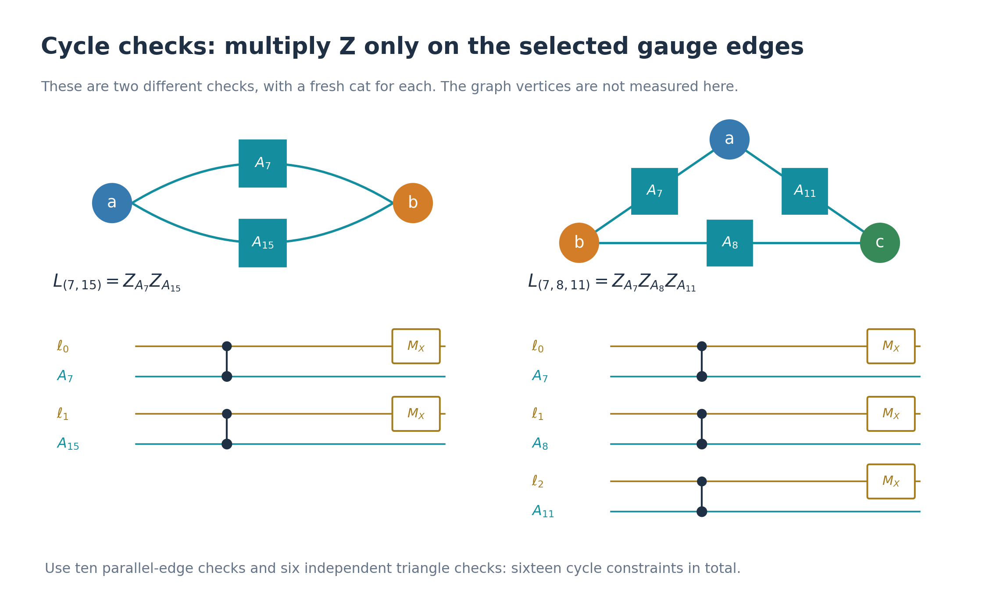

These checks constrain the edge bits to be consistent with endpoint
differences. They involve only gauge qubits, with no measurement of the
former vertices.

### 6c. Five local Gauss checks

Measure

\[
G_v=T_v\prod_{q\in E_v}X_{A_q}.
\]

Be careful about the two supports: \(T_a\) swaps **four data pairs**,
0–3, whereas \(E_a=\{0,3,6,7,10,11,12,15\}\) contains **eight gauge
qubits**. They are different lists.

For each \(G_v\), prepare **one twelve-leaf cat**. Eight leaves each
control one gauge-X factor with a CNOT. Four other leaves each control
one data-pair SWAP with a Fredkin. Measure all twelve leaves in X and
multiply the reports.

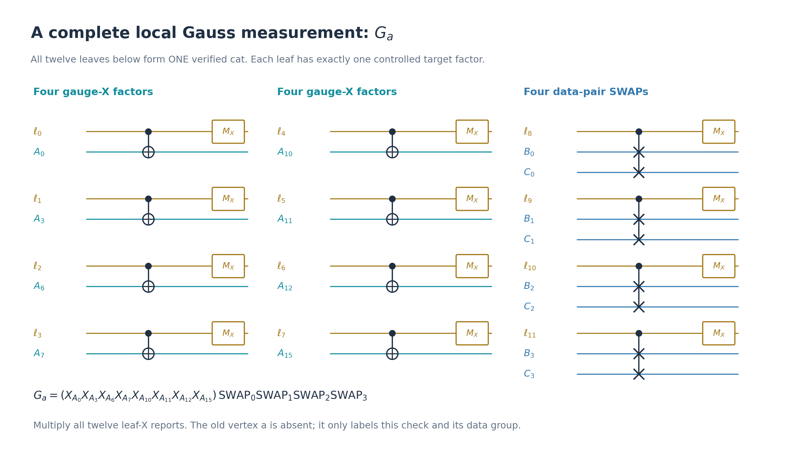

The old vertex is not the measurement ancilla: these are fresh helper
leaves. Each leaf touches only its one gauge qubit or one data pair.
Use the same pattern for b,c,d,e, with the corresponding color and
supports. Since every gauge-X factor occurs in two stars,

\[
G_aG_bG_cG_dG_e=U.
\]

Thus these are local constraints of the gauging construction that also
verify its full SWAP outcome. All N, L and G checks in this version commute
with one another. One round has 18+16+5=39 results; a fresh cat is used
for each check, and three full rounds provide temporal redundancy.

| Stage | Code information actually measured |
|---|---|
| Before gauging | Original B/C checks and known logical input checks |
| While gauged | Paired N checks, cycle L checks, local Gauss G checks |
| After ungauging | Original B/C checks again |

The dressed X/Z checks of the full gauged-memory construction are not
part of this particular postselected factory. The detailed
[paired-check argument](c4-helix-intrinsic-gauged-verification.md#6-the-error-bound-and-the-key-paired-check-lemma)
explains why this subset suffices for the two-fault preparation claim.

## 7. Ungauge: read the edges, decode, then apply ordinary SWAPs

Measure every gauge qubit in Z. Write its reported bit as m_q, using
0 for +1 and 1 for −1. An ideal word has the form

\[
w_q=t_u\oplus t_v\quad\text{for edge }q:u\text{--}v.
\]

Such a word is called a **cut word**. There are sixteen: t and its
complement give the same word. To decode, enumerate them and find the
one that disagrees with the full reported word m on at most two edges.
Reject if none exists. Two candidates cannot both fit, because distinct
cut words differ in at least eight positions.

After finding the corrected word w, reconstruct a representative by

\[
t_a=0,\qquad t_b=w_7,\quad t_c=w_{11},\quad
t_d=w_3,\quad t_e=w_0.
\]

Apply \(T_v\) for each decoded \(t_v=1\). These are **ordinary physical
SWAPs**, not controlled SWAPs. The correction undoes the gauge-dependent
partial exchange of B and C.

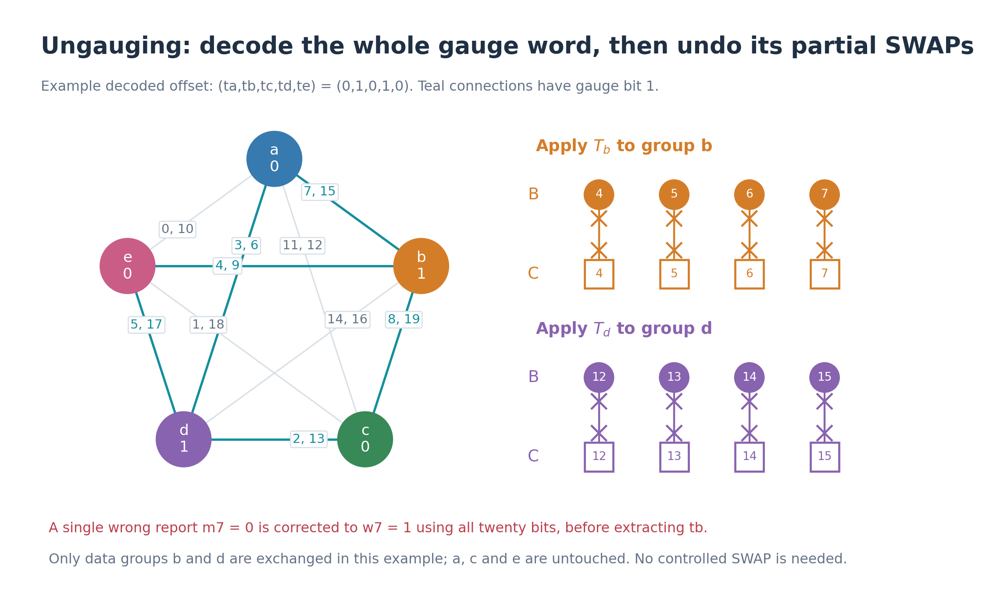

For this example t=(0,1,0,1,0), exchange pairs 4–7 and 12–15. A raw
error in m_7 is corrected using all twenty reports **before** extracting
t_b. Taking the four tree bits directly from noisy m would give the
wrong correction. Choosing the complementary representative would add
the full U, which acts as +1 on the retained reference state.

Discard/reset the gauge register. In the ideal case B and C have returned
to the original code spaces, retaining the positive logical SWAP
projection. The next stage checks the original code and handles residual
errors.

## 8. Restore the original code and perform physical recovery

First measure the original eighteen checks on B and eighteen on C,
requiring +1, in **three complete rounds**. Use the original Pauli gadget
from Section 3. This is the post-ungauging filter: under the two-fault
argument, one clean complete round removes the possible inner-group
errors before handing the state to ordinary recovery.

Then perform the following recovery, with its faults included:

1. Measure the joint 36-bit original-code syndrome with fresh verified
   cats. Keep positive **and negative** syndrome results, and do not
   correct between rounds.
2. Stop at the first three consecutive identical joint records, allowing
   at most nine rounds. Reject helper-verification failure or failure
   to stop by the limit.
3. On each block choose a minimum-weight Pauli of weight at most two
   matching that syndrome. Reject if there is no candidate. Apply it
   using single-qubit Pauli gates.

The distinction is deliberate: the three preceding positive rounds
**postselect**, whereas these recovery rounds retain a nonzero syndrome
and use it for a correction. The [decoder implementation](c4_helix_intrinsic_decoder.py)
supplies the lookup tables and stopping rule.

## 9. Read B and retain the encoded magic in C

On the active logical pair the ideal positive projection is

\[
\frac{(I+\mathrm{SWAP})|0\rangle|+\rangle}
{\|(I+\mathrm{SWAP})|0\rangle|+\rangle\|}
=\frac{2|00\rangle+|01\rangle+|10\rangle}{\sqrt6}.
\]

The coefficient two comes from the shared \(|00\rangle\) component of
\(|0\rangle|+\rangle\) and \(|+\rangle|0\rangle\).

Measure all twenty B qubits physically in Z. Decode that complete word
using the nine B Z-check supports and a bit-flip correction of weight
at most two. Then evaluate the logical parity

\[
\overline Z^B_0=\prod_{q\in\{0,3,6,7,18,19\}}Z_{B_q}
\]

on the **corrected** word. Keep +1. Raw parity on six uncorrected reports
does not provide the protected logical readout.

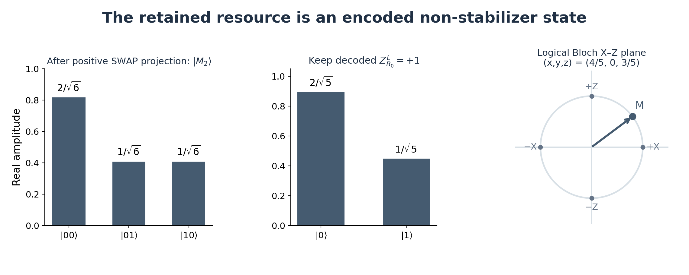

Selecting logical B_0=0 leaves C_0 proportional to \(2|0\rangle+|1\rangle\).
The second C logical qubit remains zero. Discard B; the output is the
twenty-qubit C block containing this resource.

## 10. Repetitions, resources, and the fault-tolerance scope

| Operation | Repetition in one attempt |
|---|---|
| Adjacent-ZZ verification of a fresh cat | 3 full scans |
| Twenty known-state checks on each input block | 3 full rounds |
| Twenty-five graph-resource checks | 3 full rounds |
| Original enrichment | Once: 20 Fredkins |
| Thirty-nine intrinsic checks while gauged | 3 full rounds; 20 Gauss-measurement Fredkins per round |
| Gauge-Z readout and decoded ordinary-SWAP correction | Once |
| Thirty-six original-code checks after ungauging | 3 positive rounds |
| Subsequent syndrome recovery | First identical triple, at most 9 rounds |
| Decoded B logical readout and magic extraction | Once |

The displayed implementation uses **80 Fredkins**: twenty for enrichment
and sixty for the three rounds of local Gauss measurements. The ordinary
ungauging correction adds at most sixteen physical SWAPs.

With serial measurement and reset/reuse, **77 physical qubits suffice**:
40 data + 20 gauge + a 17-qubit helper pool. The largest paired Pauli
check has sixteen targets, needing sixteen cat leaves and one parity
helper. Initially five pool qubits act as graph vertices; after their
measurement they return to the pool. This is an allocation for this
implementation, not a lower bound on possible qubit cost.

The [detailed analysis](c4-helix-intrinsic-gauged-verification.md) argues
that every accepted branch with at most **two faulty locations total**
has the correct decoded magic output. Its model includes arbitrary local
gate faults, wrong reports, preparation and idle faults, recovery and
readout faults, with reliable classical processing. All live-qubit idles
count. No stage receives a separate two-fault allowance.

The main ingredients are the block-aligned controllers, paired checks
protecting the SWAP-sector label, one clean round among each group of
three, full-word gauge decoding, and the terminal original-code filter.
The full proof and finite certificates stay in the detailed note. This
overview specifies the physical operations and their acceptance rules.

With no faults, conditioned on successful input preparation, positive
gauging succeeds with probability 3/4 and final logical extraction with
probability 5/6: yield 5/8. No noisy yield or optimal-overhead claim is
made.

## Appendix A. All check supports and the graph dictionary

Each row below specifies both an all-X check and an all-Z check.

| s | Physical support \(R_s\) | Role |
|---|---|---|
| 0 | 0, 1, 2, 3 | Inner group a |
| 1 | 4, 5, 6, 7 | Inner group b |
| 2 | 8, 9, 10, 11 | Inner group c |
| 3 | 12, 13, 14, 15 | Inner group d |
| 4 | 16, 17, 18, 19 | Inner group e |
| 5 | 0, 3, 6, 7, 10, 11, 12, 15 | Graph star a |
| 6 | 4, 7, 8, 9, 14, 15, 16, 19 | Graph star b |
| 7 | 1, 2, 8, 11, 12, 13, 18, 19 | Graph star c |
| 8 | 2, 3, 5, 6, 13, 14, 16, 17 | Graph star d |
| 9 | 0, 1, 4, 5, 9, 10, 17, 18 | Graph star e; redundant code row |

Row 9 is the binary sum of rows 5–8. For each endpoint pair the two
gauge labels are:

| Pair | Labels | Pair | Labels |
|---|---|---|---|
| ab | 7, 15 | bc | 8, 19 |
| ac | 11, 12 | bd | 14, 16 |
| ad | 3, 6 | be | 4, 9 |
| ae | 0, 10 | cd | 2, 13 |
| ce | 1, 18 | de | 5, 17 |

## Appendix B. Logical supports needed for preparation and extraction

On either block D=B or C:

| Logical operator | Physical implementation |
|---|---|
| \(\overline X^D_0\) | X on 2, 3, 8, 11, 12, 15 |
| \(\overline Z^D_0\) | Z on 0, 3, 6, 7, 18, 19 |
| \(\overline Z^D_1\) | Z on 2, 3, 8, 11, 12, 15 |

Sources: [C4-Helix Table I](../arXiv-2609.03194v1/appendix.tex),
[the original SWAP-gauging construction](../arXiv-2602.12228v1/main.tex),
and [Magic Quantum Code Surgery](../arXiv-2610.03920v1/spacetime.tex).
The specific postselected circuit and its two-fault argument are in
[the intrinsic-verification note](c4-helix-intrinsic-gauged-verification.md).
The [figure generator](plot-c4-helix-synthesis.py) and its
[data manifest](figures/c4-helix/synthesis/manifest.json) make the labels
and example correction reproducible.
