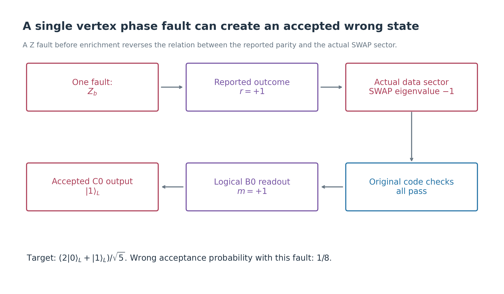
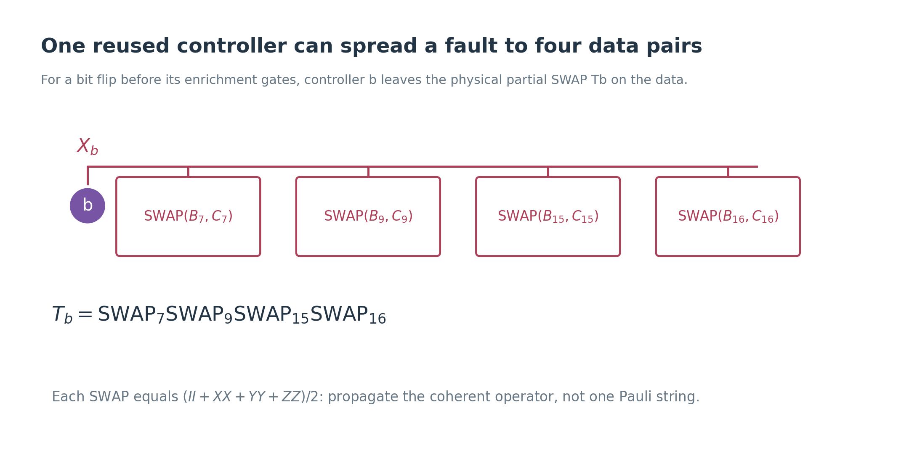
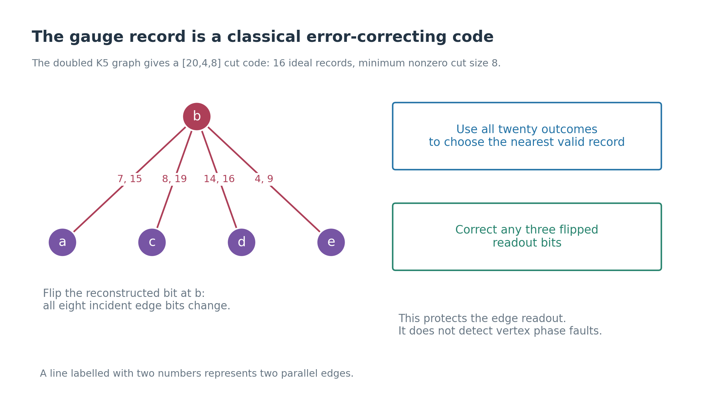
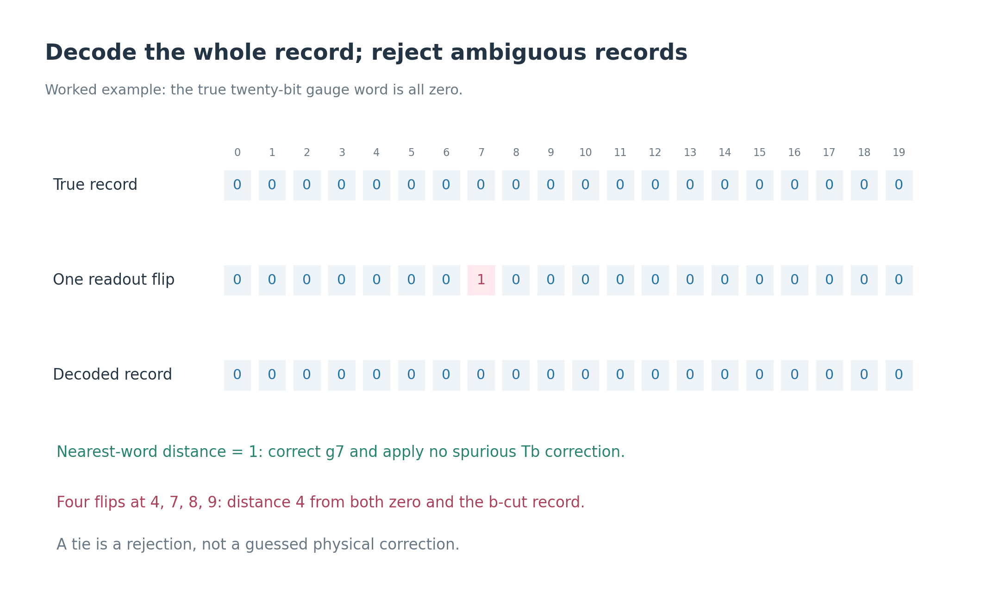
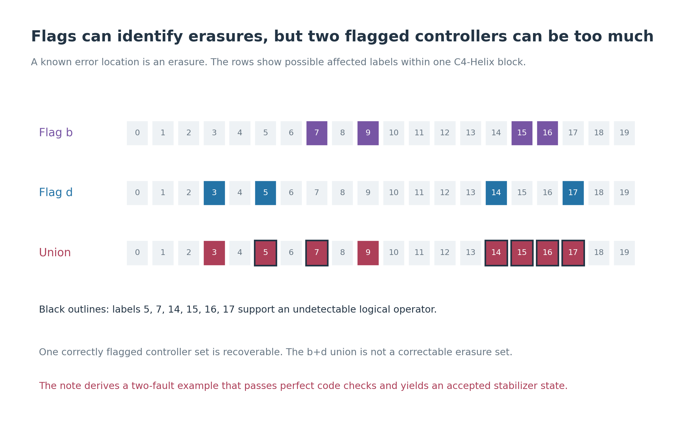
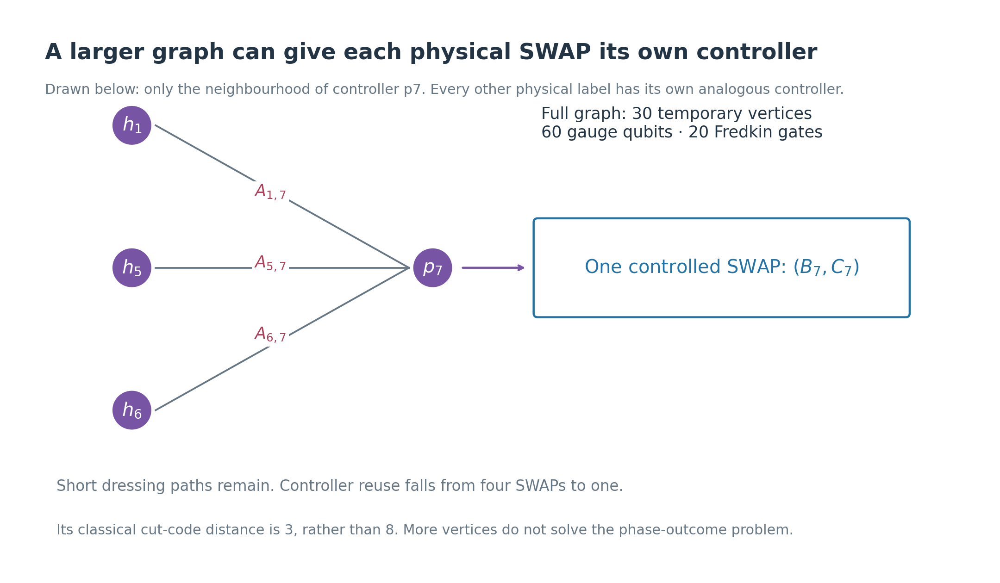
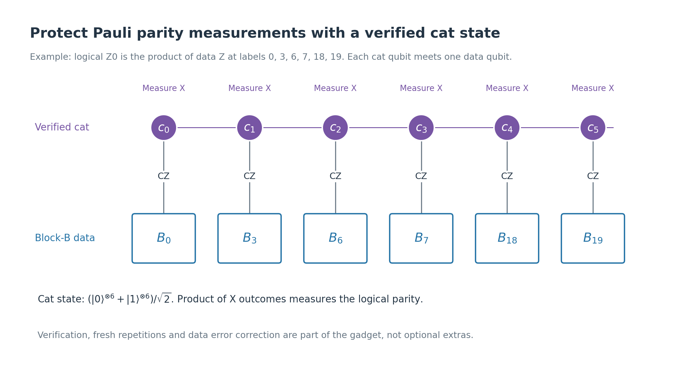
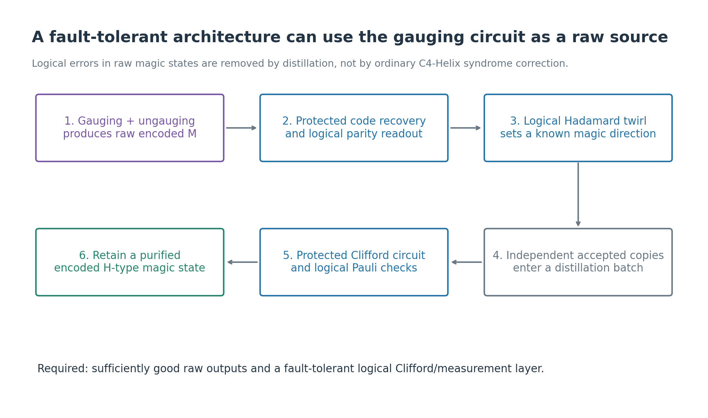
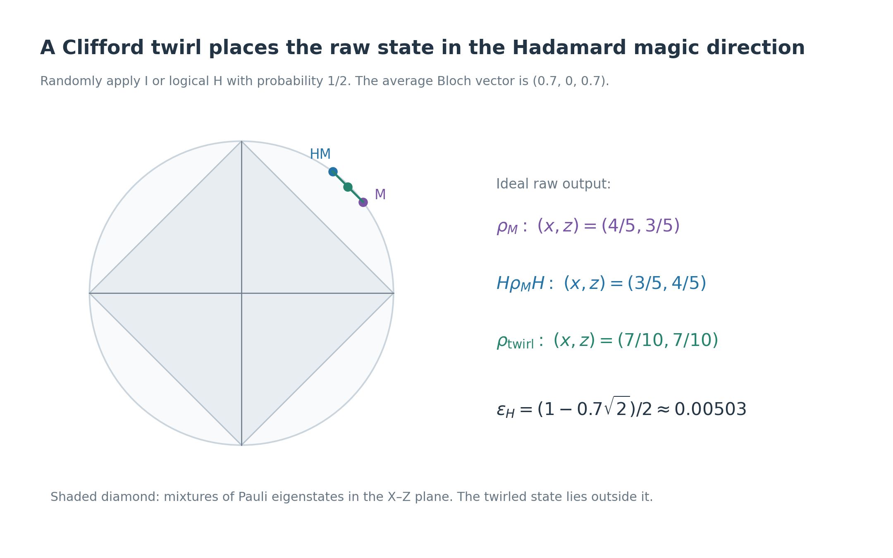
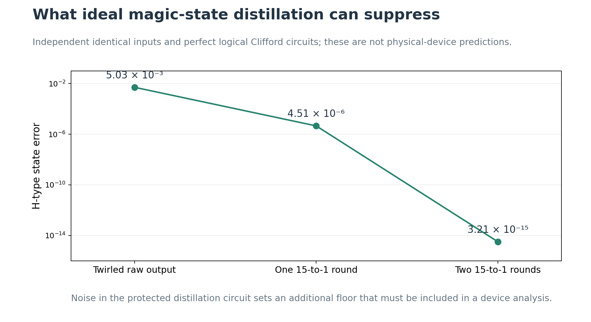

# Making the C4-Helix gauging magic factory compatible with fault tolerance

This is the third note, following
[the five-vertex gauging construction](c4-helix-five-vertex-swap-gauging.md)
and [ungauging and magic extraction](c4-helix-ungauging-and-magic.md).
We keep their graph, controller assignment, and encoded inputs.

**The unmodified 25-qubit ancillary circuit is not fault tolerant.** A
single vertex phase fault can give an accepted wrong logical output while
every ordinary code check passes. We derive that failure, add a concrete
readout decoder, examine controller faults, and construct a route from
raw encoded outputs to distilled magic using a protected Clifford layer.

There are two distinct ambitions here: make the whole gauging gadget
itself tolerate two faults, or use it as a sufficiently accurate raw source
inside a fault-tolerant magic factory. The second has a standard route via
distillation. For the first, this note identifies specific repairs and
gadget requirements, but does not claim a complete two-fault-tolerance proof.

**Sources.** The gauging and code sources are
[arXiv:2602.12228v1](../arXiv-2602.12228v1/main.tex) and
[the C4-Helix Table I](../arXiv-2609.03194v1/appendix.tex).
The gauging paper explicitly leaves a fault-tolerant decoder as an open
problem. Protected parity measurements are discussed in
[Gottesman's textbook, Chapter 12](https://www.cs.umd.edu/~dgottesm/QECCbook-2024.pdf).
The distillation sections use the primary papers of
[Reichardt](https://arxiv.org/html/quant-ph/0411036#S2) and
[Bravyi and Kitaev](https://arxiv.org/html/quant-ph/0403025).

## 1. What does distance six actually promise?

**Definition — error.** An unwanted operation acting on qubits. Its
support is the set of qubits on which it acts nontrivially.

**Definition — fault.** A failure at one circuit location: a preparation,
gate, measurement, or idle period. One fault can produce an error on
several qubits if later gates spread it.

A distance-six code corrects arbitrary errors on at most two unknown
physical qubits. This includes coherent errors on those qubits, not only
classical random Pauli errors. With two input blocks, errors supported on
at most two qubits in B and two in C can be corrected jointly by their
separate recoveries.

That promise assumes we implement the syndrome measurements and recovery
reliably. It does not say that two circuit faults cause only two-qubit
errors, nor that every wrong logical state violates a code check.

For a **two-fault-tolerant heralded preparation**, the desired requirement
is: starting with clean encoded inputs, any allowed set of at most two
faults either causes rejection or leaves an accepted output which ideal
final recovery turns into the intended logical state. Under a fixed-size,
independent small-p circuit-noise model, such a verified gadget has no
accepted logical failures at orders p or \(p^2\); the leading order can
then be \(p^3\). That is a target, not a result for our present circuit.

For the counterexamples below, allow single-qubit Pauli faults between
gates and flipped classical readout bits. More generally a faulty gate
may leave an arbitrary error on the qubits it touches. Treating Fredkin
as one three-qubit primitive is an explicit analysis convention; a native
decomposition would need its own location-by-location audit. Leakage and
long-lived correlated faults are outside these finite examples.

## 2. A single phase fault defeats ordinary error correction

Recall the ideal logical operation after ungauging:

\[
\Pi_r=\frac{I+rU}{2},\qquad
U=\prod_q\operatorname{SWAP}(B_q,C_q),\qquad
r=x_ax_bx_cx_dx_e.
\]

Consider one \(Z_b\) fault after resource preparation and before
enrichment. It commutes with the controlled-SWAP circuit, but anticommutes
with the later \(X_b\) measurement. Thus its effect on the wavefunction
coefficients is

\[
\chi_x(t)\longmapsto(-1)^{t_b}\chi_x(t).
\]

This is exactly the coefficient associated with a vertex record whose b
sign is reversed. **The actual data sector has eigenvalue −r, although
the reported product is r.** The gauge Z record remains consistent, and
the ordinary ungauging correction still returns the data to the code spaces.

For the inputs \(|\overline{00}\rangle_B|\overline{+0}\rangle_C\), a
reported \(r=+1\) therefore gives the actual negative-branch state

\[
\frac{|01\rangle_L-|10\rangle_L}{\sqrt2}
\]

on the active logical pair. Both spectator logical qubits are still 0.
Every original C4-Helix code check passes.

The final logical \(Z^B_0\) readout can then give \(m=+1\), leaving
\(|1\rangle_L\) in C rather than the target
\(|M\rangle_L=(2|0\rangle_L+|1\rangle_L)/\sqrt5\).

Conditioned on this particular fault being present and everything else
being ideal, wrong acceptance has probability

\[
\frac14\times\frac12=\frac18.
\]

The accepted state has target overlap squared \(1/5\), or infidelity
\(4/5\). Increasing the distance of the data code does not diagnose
this mistake: the wrong state is valid encoded information.

### A small-noise example makes the issue quantitative

Suppose this Z fault occurs with probability p, with no other noise.
The good acceptance probability is \(5(1-p)/8\), and the bad one is
\(p/8\). The accepted output is

\[
\rho_{\rm raw}=(1-\lambda)|M\rangle\!\langle M|
+\lambda|1\rangle\!\langle1|,
\qquad
\lambda=\frac{p}{5-4p}.
\tag{1}
\]

Its logical infidelity is \(4\lambda/5\), which is linear in p for
small p. Perfect ordinary code recovery cannot remove it.

### Why repeating one readout is insufficient

A classical misrecording of \(x_b\) can be addressed by reliable repeated
readout of the same X eigenstate. A physical Z fault before the first
measurement has already changed the relation between that eigenstate
and the data sector. Repeating X on that same measured vertex consistently
returns the altered outcome.

To repair the logical-sector measurement itself, one would need fresh,
protected **whole measurement rounds**, with recovery and a proof of their
combined action. Five readouts of the same ancilla are not that construction.

## 3. A controller bit flip can spread into four data pairs

The controller assignment reuses each vertex for four Fredkin gates.
For example,

\[
T_b=\mathrm{SWAP}_7\mathrm{SWAP}_9
\mathrm{SWAP}_{15}\mathrm{SWAP}_{16},
\qquad \mathrm{SWAP}_q:=\operatorname{SWAP}(B_q,C_q).
\]

A controller X fault before those gates obeys

\[
\Omega X_b\Omega^\dagger=X_bT_b.
\tag{2}
\]

The subsequent X measurement turns the vertex X into a scalar sign.
After the usual ungauging correction, **\(T_b\) remains on the data**.
A fault partway through the four gates leaves the corresponding suffix
of this SWAP product.

This is a coherent, non-Pauli error. Its exact expansion is based on

\[
\operatorname{SWAP}(B_q,C_q)
=\frac{I+X^B_qX^C_q+Y^B_qY^C_q+Z^B_qZ^C_q}{2}.
\tag{3}
\]

Expanding four factors can produce terms of weight four in each block.
We cannot replace that expansion by a randomly chosen Pauli term unless
the noise model supplies the corresponding decoherence.

### Even perfect final code postselection has a two-fault failure

Add two controller X faults, at b and d, after the cluster circuit and
before enrichment. Their residual data operation is \(T_bT_d\), supported
on labels

\[
S_{bd}=\{3,5,7,9,14,15,16,17\}
\]

in each block. This set contains

\[
L=\{5,7,14,15,16,17\},
\]

the support of a weight-six nontrivial logical operator.
In Table I's logical basis,

\[
X_L\doteq\overline X_0\overline X_1,
\qquad Z_L\doteq\overline Z_0\overline Z_1.
\]

Let \(\mathcal P_{\rm code}\) project onto both original code spaces.
Expanding (3) and retaining the Pauli terms surviving this projection gives

\[
\left.\mathcal P_{\rm code}T_bT_d\mathcal P_{\rm code}\right|_{\mathcal C_B\otimes\mathcal C_C}
=\frac{(I+\overline X_{\rm all})(I+\overline Z_{\rm all})}{256},
\tag{4}
\]

where
\(\overline X_{\rm all}=\overline X^B_0\overline X^B_1
\overline X^C_0\overline X^C_1\), and similarly for Z.

On the positive magic branch, this produces

\[
\frac{|0000\rangle_L+|1111\rangle_L}{\sqrt2},
\]

in logical order \((B_0,B_1,C_0,C_1)\). Final \(Z^B_0=+1\) extraction
then gives \(|\overline{00}\rangle_C\), a stabilizer state which our old
heralding rule would accept.

The ideal code postselection succeeds with probability \(1/12288\)
conditioned on \(r=+1\). Including that branch and the final extraction,
wrong acceptance has probability \(1/32768\) conditioned on these two
faults. It is rare, but nonzero: rarity does not establish two-fault tolerance.

## 4. An exact repair for gauge readout errors

The spanning-tree reconstruction in note two assumed ideal gauge bits.
We can do better without changing the quantum circuit.

**Definition — gauge readout code.** The valid twenty-bit words are

\[
\mathcal G=\{\delta t:t\in\{0,1\}^5\},
\qquad (\delta t)_q=t_u\oplus t_v.
\]

There are sixteen words, since globally complementing t leaves the word
unchanged. A nonzero word is the set of edges crossing a partition of
the five vertices. If one side has k vertices, its weight is

\[
2k(5-k).
\]

The minimum is eight. Hence these outcomes form a classical
**\([20,4,8]\) binary linear code**: length 20, four independent bits,
and distance 8. Single square brackets denote a classical code, unlike
\([[20,2,6]]\) for the quantum data code.

### Decoder to use instead of the four-bit shortcut

Given a noisy measured word h:

1. Enumerate the sixteen patterns with \(t_a=0\).
2. For each pattern, form \(\delta t\) and count its differing bits from h.
3. Choose the unique nearest word if its distance is at most three.
4. Otherwise reject this trial under this conservative decoder.
5. Use the decoded t to choose the physical correction \(V_t\).

The difference count is the **Hamming distance**. Distance eight guarantees
unique correction of any three flipped readout bits. The audit checks all
\(16[1+20+\binom{20}{2}+\binom{20}{3}]=21616\) such cases.

For true word zero and one wrong bit \(h_7=1\), the four-bit shortcut
would select \(T_b\). The full decoder returns zero and applies no such
correction. Four flips at labels 4,7,8,9 give a tie between zero and the
eight-edge b-cut, so our decoder rejects.

**This guarantee concerns pure readout errors.** A gate fault can change
several gauge qubits and data qubits together. Its correct treatment must
use their joint history, not assume those changed bits are measurement
mistakes. Moreover, the phase fault in Section 2 leaves the gauge record
valid and is invisible to this decoder.

## 5. Flags can turn a spreading error into a known-location error

**Definition — flag.** An auxiliary measurement indicating that a fault
may have spread to a specified set of data locations, while revealing no
logical input information.

**Definition — erasure set.** Locations known to be potentially erroneous.
The actual Pauli or coherent error on those locations is still unknown.
Known locations can be more recoverable than equally many unknown errors.

For one correctly flagged controller v, the affected labels are confined
to its four-element controller set \(S_v\) in each block. Any four-qubit
erasure set is recoverable in a distance-six code, since its size is less
than six. This applies to the full partial-SWAP error, not just its Pauli
components chosen individually.

This particular code offers a stronger verified fact. For all five
controller sets,

\[
\min_{P\text{ nontrivial logical Pauli}}
|\operatorname{supp}(P)\setminus S_v|=3.
\tag{5}
\]

Thus arbitrary errors on a known \(S_v\), together with one additional
unknown error, are correctable per block. Two candidate errors in that
set of possibilities differ on at most two outside locations, while every
nontrivial logical Pauli needs at least three outside locations.

However, \(S_b\cup S_d\) contains the logical support L from Section 3
and is not a correctable erasure set. A heralded scheme could reject this
flag combination, provided its flag circuit remains reliable with two
faults. Rejecting dangerous known patterns is permitted for a factory.

**We have verified the recovery properties of these location sets, not
constructed a fault-tolerant Fredkin flag gadget.** Such a gadget must
prove that every dangerous controller fault raises the appropriate flag,
including faults in flag preparation and readout. A flag that monitors
controller bit flips also does not automatically detect controller phase
faults. Those remain a logical-sector problem.

## 6. A graph change that limits controller reuse

Another option is to give every physical data pair its own controller.
An explicit alternative graph has:

- twenty controller vertices \(p_q\), each controlling only
  \(\operatorname{SWAP}(B_q,C_q)\);
- ten check-anchor vertices \(h_s\), one per Table I support \(R_s\);
- an edge \((h_s,p_q)\) whenever \(q\in R_s\), carrying a new gauge qubit
  \(A_{s,q}\).

Identical X and Z supports share their anchor. This graph has thirty
temporary vertices and sixty gauge qubits. It is connected. Controller
degree is three; anchor degree is four or eight. Every dressing path is
one edge.

A controller bit fault after resource preparation can now attach only
one data-pair SWAP. Equation (3) shows that this is an error on one qubit
per block, within the distance-six correction capability. Two such
wrong pair exchanges occupy at most two qubits per block.

This improvement has a cost: its classical cut-code distance is only
three, as checked by minimum cuts. The original graph had distance eight.
We trade controller reuse against readout redundancy. Resource-preparation
faults and the joint gauge/data decoder still require analysis, and the
single phase-fault mechanism persists.

Thus this is a concrete candidate geometry, not a proof that adding
vertices alone makes the full protocol fault tolerant.

## 7. Protect the ordinary code checks and logical extraction

After the offset SWAP correction, measure and recover the original
C4-Helix checks with a protected syndrome-extraction gadget. The final
logical \(\overline Z^B_0\) readout must also be protected.

An elementary safe design principle is to use a verified **cat state**
for a Pauli check \(Q_1\cdots Q_w\):

\[
|\mathrm{cat}_w\rangle=
\frac{|0\rangle^{\otimes w}+|1\rangle^{\otimes w}}{\sqrt2}.
\]

Each cat qubit controls just one \(Q_j\) on one data qubit. Measuring all
cat qubits in X and multiplying their outcomes measures the check.
Cat parity verification before data coupling prevents a single preparation
fault from supplying many uncontrolled bit flips. The detailed multi-fault
verification and syndrome history are part of the gadget. See
[Gottesman, Sections 12.1.3–12.1.5](https://www.cs.umd.edu/~dgottesm/QECCbook-2024.pdf#page=195).

For our logical extraction, the six data labels are 0,3,6,7,18,19.
Use controlled Z for its six factors; X checks instead use controlled X.
Code checks have weight four or eight.

Fresh measurement repetitions with interspersed fault-tolerant recovery
protect the classical parity result. Five repetitions are the usual
\(2t+1\) count for \(t=2\), under the corresponding gadget guarantees.
This statement applies to protected Pauli measurements; it is not a theorem
for our unprotected Fredkin gauging circuit. A syndrome-history decoder
must account for errors occurring between rounds.

### Where may we measure the original checks?

| Stage | Appropriate constraints |
|---|---|
| Before gauging | Original B and C Pauli code checks |
| During gauging | The dressed matter, vertex and flux constraints from note one |
| After gauge readout and offset correction | Original B and C Pauli code checks again |

Do not insert ordinary B/C error correction indiscriminately between the
Fredkin gates. The intermediate state need not satisfy the original
checks; such measurements could alter the intended coherent projection.
Protected recovery during gauging would require measured dressed
constraints or another justified schedule.

## 8. A practical route: raw encoded magic followed by protected distillation

The failure examples do not make the gauging source useless. They mean
that its accepted outputs must be treated as **noisy magic states**.
Ordinary code recovery handles correctable physical errors. Distillation
handles wrong encoded states, including the undetectable phase-fault output.

The required protected layer supplies encoded stabilizer preparation,
recovery, logical Clifford operations, and logical Pauli measurements.
These are interfaces to separately verified gadgets; this note does not
assume that the experimental paper proves two-fault tolerance for every
one of them. In particular, a logical Hadamard on the active encoded qubit
must be implemented as a verified logical operation. Applying physical H
to one data qubit is not a substitute.

The factory can then:

1. Run the raw gauging and ungauging trial.
2. Decode the full gauge record, reject inconsistent or dangerous flagged
   patterns, and apply its offset correction.
3. Perform protected original-code recovery and protected logical Z
   extraction. Keep outputs selected by the records.
4. Characterize their conditional logical state on sacrificial samples.
   Undetected SWAP-sector mistakes are included in this raw-state noise.
5. Supply fresh accepted outputs to a protected distillation circuit.

The ideal raw acceptance probability is \(5/8\). Added verification and
physical noise change the actual yield; we do not retain that number as
a noisy performance prediction.

## 9. Convert our raw state to a standard magic direction

The target supplied by note two is

\[
|M\rangle_L=\frac{2|0\rangle_L+|1\rangle_L}{\sqrt5},
\qquad (\langle X_L\rangle,\langle Y_L\rangle,\langle Z_L\rangle)
=\left(\frac45,0,\frac35\right).
\]

Define the standard Hadamard eigenstate

\[
|H_+\rangle_L=
\cos(\pi/8)|0\rangle_L+\sin(\pi/8)|1\rangle_L,
\qquad H_L=\frac{X_L+Z_L}{\sqrt2}.
\]

Our distilled output will approach \(|H_+\rangle_L\), rather than remain
the exact state \(|M\rangle_L\).

**Definition — Hadamard twirl.** Independently choose I or logical H with
equal probability and forget that random choice:

\[
\mathcal T_H(\rho)=\frac{\rho+H_L\rho H_L}{2}.
\tag{6}
\]

If the input Bloch vector is \((r_x,r_y,r_z)\), the averaged vector is
\((s,0,s)\), with \(s=(r_x+r_z)/2\). This follows because H exchanges X
and Z and reverses Y. The twirled state is diagonal in the H eigenbasis:

\[
\rho_H=(1-\epsilon_H)|H_+\rangle\!\langle H_+|
+\epsilon_H|H_-\rangle\!\langle H_-|,
\qquad \epsilon_H=\frac{1-\sqrt2s}{2}.
\tag{7}
\]

For an ideal raw M input,

\[
s=\frac7{10},\qquad
\epsilon_H=\frac{1-7\sqrt2/10}{2}\approx0.00502525.
\]

This small mixture is introduced intentionally by converting M to the
H direction. It exists even with perfect hardware and is not a measured
physical gate-error rate.

For the phase-only noise example (1), the twirled coordinate is

\[
s=\frac7{10}-\frac65\lambda.
\tag{8}
\]

Quality must be assessed on the **accepted** state; unconditional gate
error rates do not by themselves determine its distillation parameter.

## 10. A fully specified ideal distillation example on encoded outputs

Take seven independent copies of the twirled active logical qubit, each
still stored in a C4-Helix block. Call their Pauli operators
\(\mathsf X_j,\mathsf Z_j\), \(j=0,\ldots,6\).

Measure the following six commuting logical Pauli checks and keep their
joint +1 branch:

| Type | Three checks |
|---|---|
| X | \(\mathsf X_3\mathsf X_4\mathsf X_5\mathsf X_6\), \(\mathsf X_1\mathsf X_2\mathsf X_5\mathsf X_6\), \(\mathsf X_0\mathsf X_2\mathsf X_4\mathsf X_6\) |
| Z | \(\mathsf Z_3\mathsf Z_4\mathsf Z_5\mathsf Z_6\), \(\mathsf Z_1\mathsf Z_2\mathsf Z_5\mathsf Z_6\), \(\mathsf Z_0\mathsf Z_2\mathsf Z_4\mathsf Z_6\) |

These define an **outer Steane \([[7,1,3]]\) code on seven encoded
qubits**. They are additional checks across production blocks; the inner
C4-Helix checks still hold. Decode this outer code with logical Clifford
operations, placing its one retained qubit in a chosen C4-Helix block.
No logical information needs to be decoded into unprotected physical qubits.

For independent inputs with Bloch vector \((s,0,s)\), the exact ideal map is

\[
\boxed{
P_{\rm keep}^{(7)}=\frac{1+14s^4}{64},\qquad
s_{\rm out}=\frac{s^3(7+8s^4)}{1+14s^4}.
}
\tag{9}
\]

It improves states with \(1/2<s<1/\sqrt2\) towards the pure H target.
This is the Hadamard-direction protocol of
[Reichardt, Section II](https://arxiv.org/html/quant-ph/0411036#S2).
Our audit independently evaluates its projected density matrix from the
eight computational codewords of each logical basis state.

For \(s=0.7\), one round gives
\(s_{\rm out}\approx0.7015716\), with keep probability \(0.068146875\).
This example is explicit but inefficient; it illustrates the mechanism.
For (8), its sufficient input-quality condition is \(\lambda<1/6\).
That is a threshold for this logical input-state model, not for every
physical gate in the device.

To make this outer circuit fault tolerant, implement its logical Clifford
operations and logical Pauli checks using the protected interfaces in
Section 8. The outer code used for distillation and the inner code
protecting those operations have different jobs.

## 11. A more efficient purification example and its limits

The fifteen-input H-direction protocol of
[Bravyi and Kitaev, Eqs. (35)–(38)](https://arxiv.org/html/quant-ph/0403025)
has ideal formulas, with \(a=1-2\epsilon_H\),

\[
\begin{aligned}
P_{\rm keep}^{(15)}&=\frac{1+15a^8}{16},\\
\epsilon_{\rm out}
&=\frac{1-15a^7+15a^8-a^{15}}{2(1+15a^8)}.
\end{aligned}
\tag{10}
\]

Below its approximately 0.141 input-error threshold it purifies the
H-direction state; near zero, \(\epsilon_{\rm out}\approx35\epsilon_H^3\).
For the ideal twirled M state, exact high-precision evaluation gives:

| Stage | H-state error | Keep probability of that distillation round |
|---|---:|---:|
| Twirled raw M | \(5.0253\times10^{-3}\) | — |
| One fifteen-input round | \(4.5098\times10^{-6}\) | 0.92722015 |
| Two nested rounds | \(3.2103\times10^{-15}\) | approximately 0.99993236 for the second round |

The second round consumes fifteen accepted first-round outputs, not the
same fifteen initial copies again. These numbers exclude raw-production
failures, protected-gate noise and factory overhead.

The map assumes independent identical input states and perfect Clifford
processing. Correlated bad copies do not generally obey its cubic law.
Fresh preparation alone is not a proof against persistent hardware
correlations. A fault-tolerant factory needs an appropriate independence
or joint-noise bound and includes the noise of the distillation circuit.

Schematically, a verified protected circuit has an additional logical
failure contribution:

\[
\text{output error}\ \lesssim\
\text{ideal distillation error}+\text{protected-circuit failure probability},
\]

with conditioning on acceptance accounted for in the bound. For example,
suppose a protected circuit has N logical gadgets, each with stochastic
logical-failure probability at most \(q_L\). Let
\(\Delta=Nq_L<P_{\rm keep}\). A conservative good-circuit/bad-circuit
mixture bound is

\[
\epsilon_{\rm final}
\le\frac{P_{\rm keep}\epsilon_{\rm ideal}+\Delta}
{P_{\rm keep}-\Delta}.
\tag{11}
\]

The numerator allows every bad accepted circuit to produce a wrong state;
the denominator allows failures to reduce acceptance. This is conditional
on the stated stochastic logical model and the verified gadget bound,
not an estimate obtained from the bare gauging circuit.

Fixed-distance
C4-Helix gadgets have a finite accuracy floor at fixed physical noise.
Reaching arbitrarily smaller errors requires improving that protected
layer, for example using a larger-distance or concatenated encoding.

## 12. What a complete fault-tolerant gauging gadget would still require

If the objective is to make the gauging stage itself two-fault tolerant,
rather than rely on distillation for its logical noise, the missing proof
must cover all of the following together:

| Component | Required guarantee |
|---|---|
| Ancillary preparation | Faults in the forty-CNOT resource circuit do not create unhandled gauge/data correlations |
| Enrichment | Every dangerous spreading fault is corrected, localized by a reliable flag, or rejected |
| Logical-sector record | Physical vertex phase faults cannot create accepted wrong SWAP sectors |
| Gauge decoder | Uses readouts and any syndrome/flag history with the actual circuit fault model |
| Offset correction | Faults in its selected physical SWAPs leave only allowed recoverable errors |
| Code recovery and extraction | Verified multi-fault syndrome and logical-parity gadgets, including their own faults |

Repeating full SWAP measurements with fresh resources and protected recovery
is a candidate for the logical-sector problem. Its quantum action must
be proved with the actual non-Pauli propagated errors; a majority rule
alone is insufficient. The retained-vertex ungauging route from note two
also needs its own audit of inverse CNOTs and inverse Fredkins. Ideal
equivalence to the direct route does not imply equal fault behaviour.

The practical distillation route avoids assuming that this open proof has
already been completed. Its condition is instead: the accepted raw states
are good enough, their batch noise is controlled, and the Clifford and
measurement layer used to purify them is fault tolerant. The ideal raw
state lies well within a distillable region, so sufficiently small source
noise is compatible with that condition. No numerical device threshold
has been established here.

## 13. Results that have actually been checked

The [audit script](check-c4-helix-fault-tolerance.py) and
[saved report](../output/c4-helix-fault-tolerance-audit.json) verify:

- the one-phase-fault logical-sector reversal and its accepted wrong state;
- the classical \([20,4,8]\) readout code and all 21,616 three-or-fewer-bit
  correction cases;
- the erasure recovery properties of all five controller sets;
- the logical support inside the b+d union and the two-X-fault
  postselection counterexample;
- the connected split-controller graph and its minimum cut;
- the seven-input distillation map from exact density-matrix projection;
- the high-precision numerical evaluations of the cited fifteen-input map.

The [figure script](plot-c4-helix-fault-tolerance.py) generates ten PNG/SVG
pairs. The audit is not an enumeration of every one- and two-fault location
in a native implementation. The remaining circuit and decoder obligations
are recorded explicitly in the report.

The resulting architectural choice is concrete: retain the gauging circuit
as a raw encoded magic source, use the full gauge-record decoder and
protected recovery/readout, then purify its logical noise with a protected
distillation layer. Making the compact gauging circuit itself two-fault
tolerant remains a separate construction problem exposed by the examples
above.
