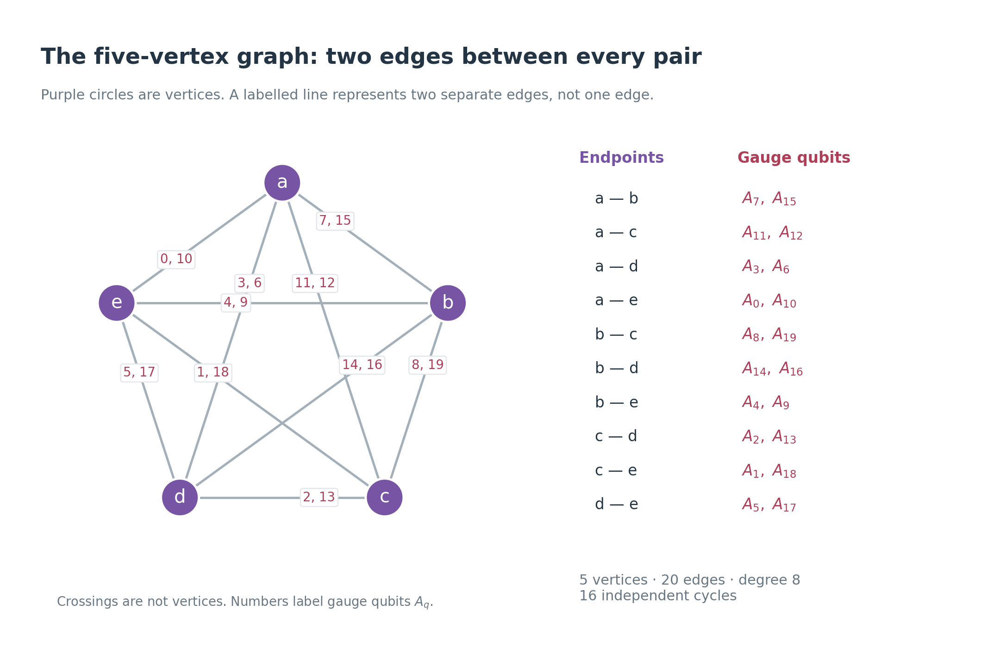
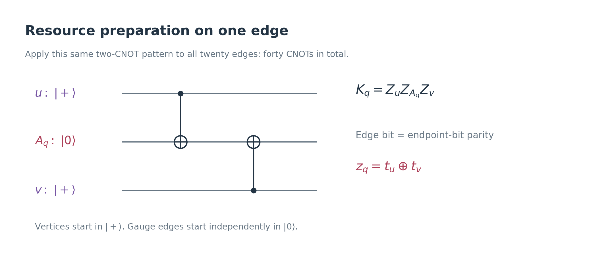
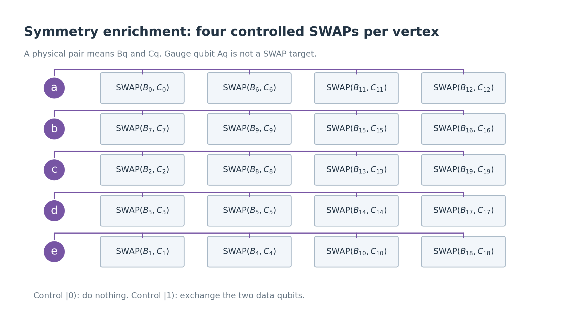
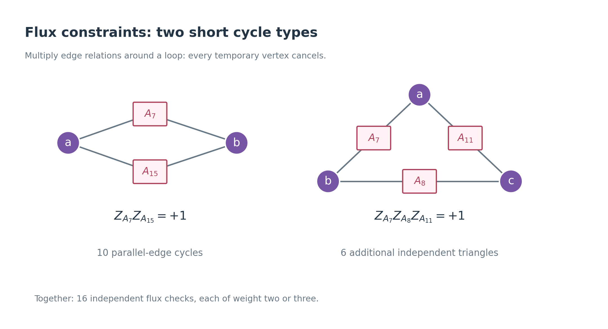
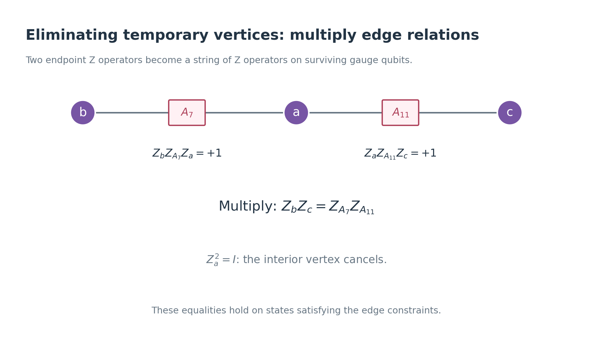
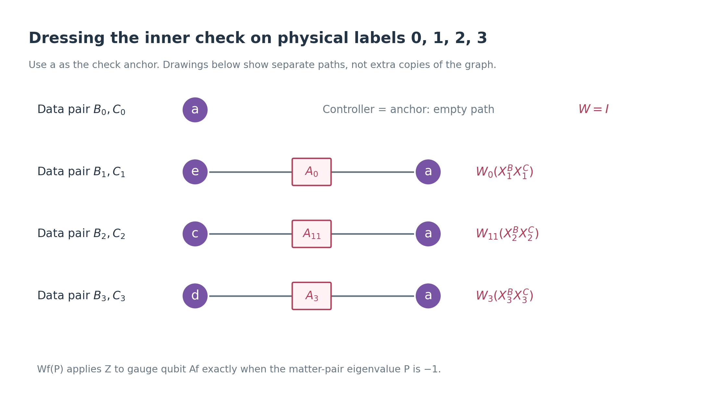
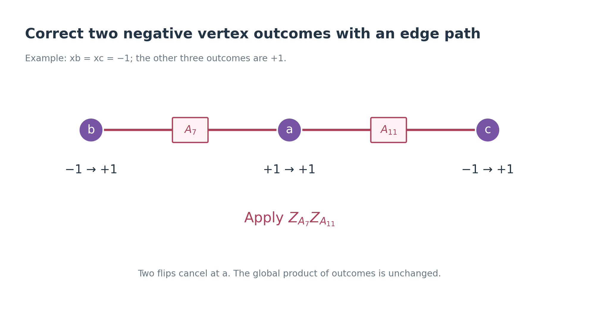

# Gauging the C4-Helix block SWAP with the five-vertex graph

This note follows the graph in your **25-qubit stabiliser resource** drawing
through the gauging procedure. It derives the constraints on the qubits
left after measurement, including explicit dressed X and Z checks.

**Sources:** “Example: Gauging transversal SWAP gate” in
[arXiv:2602.12228v1](../arXiv-2602.12228v1/main.tex), and Table I in
[the C4-Helix manuscript](../arXiv-2609.03194v1/appendix.tex).
The notation is adapted to the
[companion note](non-abelian-anyons-from-gauging-v2.md).
The graph, controller assignment and paths below specify one concrete
application of the paper's construction. The calculations describe the ideal
circuit; they do not establish its circuit-level fault tolerance.

## 1. Which qubits are we talking about?

There are two input C4-Helix blocks, **B and C**. Each has twenty physical
qubits and encodes two logical qubits. The code is \([[20,2,6]]\).

| Symbol | Meaning | Number |
|---|---|---:|
| \(B_q\), \(C_q\) | Physical data qubits in the two input blocks, \(q=0,\ldots,19\) | 40 |
| \(a,b,c,d,e\) | Temporary vertex qubits, measured in X | 5 |
| \(A_q\) | Gauge qubit on the graph edge labelled q | 20 |

There are **65 qubits before vertex measurement and 60 afterwards**.
The 25-qubit graph resource is the ancillary part of this system.

**Definition — \(X^B_q\).** This is Pauli X acting on data qubit \(B_q\).
Similarly, \(Z_{A_q}\) acts on gauge qubit \(A_q\), and \(X_a\) acts on
temporary vertex qubit a. Identities on other qubits are implicit.

For example, **\(A_7\), \(B_7\), and \(C_7\) are three different qubits**.
An edge number is used both to label a gauge qubit and to index a physical
data pair, but this does not identify those qubits.

The symmetry we gauge is

\[
U=\prod_{q=0}^{19}\operatorname{SWAP}(B_q,C_q).
\]

On encoded information, U exchanges logical qubit 0 of B with logical
qubit 0 of C, and logical qubit 1 of B with logical qubit 1 of C.
We gauge their **product as one symmetry**, obtaining one joint symmetry
outcome. A logical SWAP is distinguished from its measurement: the gauging
procedure introduces a gauge field and projects onto a SWAP symmetry sector.

## 2. Read the graph and the input checks

There are two separate edges between every pair of the five vertices.
Such a graph is called a **multigraph**: parallel edges are allowed and
carry distinct gauge qubits. Each vertex touches eight edges.

In this drawing, one labelled line groups two parallel edges for legibility.
For example, the line a—b represents edges 7 and 15, carrying \(A_7\)
and \(A_{15}\). Crossings of lines are not additional vertices.

**Definition — check support \(R_s\).** This is the set of physical
labels on which check s acts. For this code, Table I gives the same
supports for the X and Z checks:

| Check s | \(R_s\) | Anchor used later |
|---|---|---|
| 0 | 0, 1, 2, 3 | a |
| 1 | 4, 5, 6, 7 | b |
| 2 | 8, 9, 10, 11 | c |
| 3 | 12, 13, 14, 15 | d |
| 4 | 16, 17, 18, 19 | e |
| 5 | 0, 3, 6, 7, 10, 11, 12, 15 | a |
| 6 | 4, 7, 8, 9, 14, 15, 16, 19 | b |
| 7 | 1, 2, 8, 11, 12, 13, 18, 19 | c |
| 8 | 2, 3, 5, 6, 13, 14, 16, 17 | d |
| 9 | 0, 1, 4, 5, 9, 10, 17, 18 | e |

The original checks are

\[
S^X_{B,s}=\prod_{q\in R_s}X^B_q,
\qquad S^Z_{B,s}=\prod_{q\in R_s}Z^B_q,
\]

with analogous operators for C. Every input check has eigenvalue +1.
The five upper supports satisfy one binary relation, so there are nine
independent X checks and nine independent Z checks per block.

The edges incident on **a,b,c,d,e are exactly \(R_5,R_6,R_7,R_8,R_9\)**,
respectively. This is the precise connection between your graph and Table I.

**Definition — anchor.** The anchor of a check is a chosen graph vertex
from which we describe that check's gauge dressing. It need not control
all the physical SWAPs belonging to the check. The last table column fixes
our choices; it is not an additional quantum gate.

## 3. Prepare the ancillary cluster resource

Initialize each vertex in \(|+\rangle\), and each gauge qubit independently
in \(|0\rangle\). Thus the initial ancillary state is

\[
|+\rangle_a|+\rangle_b|+\rangle_c|+\rangle_d|+\rangle_e
\otimes |0\rangle_A^{\otimes20}.
\]

For each edge q with endpoints u and v, apply two CNOTs:

\[
\operatorname{CNOT}(u\rightarrow A_q),\qquad
\operatorname{CNOT}(v\rightarrow A_q).
\]

Repeat this for all twenty edges: **forty CNOTs**. The Hadamards needed to
prepare the vertices from \(|0\rangle\) are applied before these CNOTs.
The five entangled four-qubit blocks shown in the original image are
**not** the initialization for this resource; the image supplies the
connectivity and labels used here.

In the paper's convention the resulting cluster resource has two families
of stabilizers. If \(E_v\) is the set of edges incident on vertex v,

\[
\boxed{K_v=X_v\prod_{q\in E_v}X_{A_q}},
\qquad
\boxed{K_q=Z_uZ_{A_q}Z_v}\quad(q:u\text{—}v).
\tag{1}
\]

For example,

\[
K_7=Z_aZ_{A_7}Z_b,
\qquad
K_a=X_a X_{A_0}X_{A_3}X_{A_6}X_{A_7}
X_{A_{10}}X_{A_{11}}X_{A_{12}}X_{A_{15}}.
\]

The X stabilizers follow from propagating each initial vertex X through
its outgoing CNOTs. The Z stabilizers follow from propagating the initial
\(Z_{A_q}\) through the two CNOTs targeting \(A_q\).
These 25 independent commuting Pauli checks specify the ancillary state.

This is equivalent to the usual all-\(|+\rangle\), CZ-prepared incidence
graph state after Hadamards on the **gauge qubits**. We keep the CNOT
convention throughout, so the operators in (1) match the companion note.

## 4. Apply the symmetry enrichment

**Definition — controller map \(\phi(q)\).** This selects the temporary
vertex qubit controlling the SWAP of data pair \(B_q,C_q\).

We use the following assignment:

| Vertex v | Labels q with \(\phi(q)=v\) |
|---|---|
| a | 0, 6, 11, 12 |
| b | 7, 9, 15, 16 |
| c | 2, 8, 13, 19 |
| d | 3, 5, 14, 17 |
| e | 1, 4, 10, 18 |

Every controller is an endpoint of the correspondingly labelled graph
edge. Each vertex controls four data-pair SWAPs.

The controlled-SWAP, also called a Fredkin gate, is

\[
\operatorname{CSWAP}(v;B_q,C_q)
=|0\rangle\!\langle0|_v\otimes I
+|1\rangle\!\langle1|_v\otimes\operatorname{SWAP}(B_q,C_q).
\]

Apply the twenty-gate enrichment circuit

\[
\boxed{\Omega=\prod_{q=0}^{19}
\operatorname{CSWAP}(\phi(q);B_q,C_q).}
\tag{2}
\]

The gauge qubits \(A_q\) are untouched by \(\Omega\).

### What happens to a vertex stabilizer?

Let

\[
T_v=\prod_{q:\phi(q)=v}\operatorname{SWAP}(B_q,C_q).
\]

Flipping a controller interchanges the “apply SWAP” and “do nothing”
branches of each gate it controls. Consequently,

\[
\Omega K_v\Omega^\dagger
=X_v\left(\prod_{q\in E_v}X_{A_q}\right)T_v.
\tag{3}
\]

The edge checks \(K_q\) remain unchanged: their vertex Z factors commute
with the computational-basis controls in \(\Omega\).

### What happens to a data check?

For one label q, a controlled SWAP leaves \(X^B_q\) in B when its
controller is 0 and moves it to C when its controller is 1. The same is
true for Z. Introduce the projector

\[
n_v=\frac{I-Z_v}{2}=|1\rangle\!\langle1|_v.
\]

For either \(Q=X\) or \(Q=Z\), define \(P^Q_q=Q^B_qQ^C_q\).
Then

\[
\Omega S^Q_{B,s}\Omega^\dagger
=S^Q_{B,s}\prod_{q\in R_s}(P^Q_q)^{n_{\phi(q)}}.
\tag{4}
\]

Where \(R_s\) is the set of physical-qubit labels on which check \(s\) acts.
Here the controlled power means
\(P^{n_v}=(I-n_v)+n_vP\): apply P only in the controller-1 branch.
To understand equation (4), consider one factor \(Q^B_q\). The enrichment circuit swaps \(B_q\) and \(C_q\) if its controller \(\phi(q)\) is in state \(|1\rangle\). Consequently, conjugation transforms this factor into
\[
Q^B_q\longrightarrow
\begin{cases}
Q^B_q,&\text{controller is }0,\\
Q^C_q,&\text{controller is }1.
\end{cases}
\]
The compact expression for this is
\[
Q^B_q\bigl(Q^B_qQ^C_q\bigr)^{n_{\phi(q)}},
\]
where \(n_v=|1\rangle\langle1|_v\). Indeed:
- Controller 0: the additional factor is \(I\), leaving \(Q^B_q\).
- Controller 1: the additional factor is \(Q^B_qQ^C_q\), giving\[
  Q^B_q(Q^B_qQ^C_q)=Q^C_q,
  \]
  because \((Q^B_q)^2=I\).
Equation (4) still contains temporary vertex qubits. We cannot simply
discard those controls when we measure the vertices.

## 5. Measure the five vertices: the first surviving constraints

Measure \(X_a,X_b,X_c,X_d,X_e\), recording
\(x_a,x_b,x_c,x_d,x_e\in\{+1,-1\}\).

Equation (3) commutes with these measurements. On the surviving qubits,
it therefore becomes

\[
\boxed{G_v=\left(\prod_{q\in E_v}X_{A_q}\right)T_v,
\qquad G_v|\Psi_x\rangle=x_v|\Psi_x\rangle.}
\tag{5}
\]

These are the five **vertex constraints**. For the all-+ outcome branch,
their required eigenvalues are all +1. Explicitly, using
\(\mathrm{SWAP}_q=\operatorname{SWAP}(B_q,C_q)\),

\[
\begin{aligned}
G_a&=\left(\prod_{q\in R_5}X_{A_q}\right)
\mathrm{SWAP}_0\mathrm{SWAP}_6\mathrm{SWAP}_{11}\mathrm{SWAP}_{12},\\
G_b&=\left(\prod_{q\in R_6}X_{A_q}\right)
\mathrm{SWAP}_7\mathrm{SWAP}_9\mathrm{SWAP}_{15}\mathrm{SWAP}_{16},\\
G_c&=\left(\prod_{q\in R_7}X_{A_q}\right)
\mathrm{SWAP}_2\mathrm{SWAP}_8\mathrm{SWAP}_{13}\mathrm{SWAP}_{19},\\
G_d&=\left(\prod_{q\in R_8}X_{A_q}\right)
\mathrm{SWAP}_3\mathrm{SWAP}_5\mathrm{SWAP}_{14}\mathrm{SWAP}_{17},\\
G_e&=\left(\prod_{q\in R_9}X_{A_q}\right)
\mathrm{SWAP}_1\mathrm{SWAP}_4\mathrm{SWAP}_{10}\mathrm{SWAP}_{18}.
\end{aligned}
\]

Each acts on eight gauge qubits and eight data qubits. Their meaning is
local gauge invariance: flipping the incident gauge bits is accompanied by
exchanging the assigned data pairs.

These five operators commute with one another. They are Hermitian
involutions, meaning \(G_v^\dagger=G_v\) and \(G_v^2=I\), but they are
not Pauli products.

## 6. Closed loops give the gauge-flux constraints

An individual edge check \(K_q\) contains vertex Z operators, so it does
not survive an X measurement of its endpoints. Products around closed
loops do survive.

For example, the two parallel a—b edges give

\[
K_7K_{15}
=(Z_aZ_{A_7}Z_b)(Z_aZ_{A_{15}}Z_b)
=Z_{A_7}Z_{A_{15}}.
\]

The vertex factors cancel. The triangle a—b—c—a gives

\[
K_7K_8K_{11}=Z_{A_7}Z_{A_8}Z_{A_{11}}.
\]

**Definition — flux constraint.** For a closed cycle \(\eta\), require

\[
L_\eta=\prod_{q\in\eta}Z_{A_q}=+1.
\tag{6}
\]

In a computational-basis gauge configuration, this says that the number
of 1 bits around the cycle is even. This condition is called zero flux,
or flatness. It does not require each individual gauge bit to be 0.

For this graph a complete independent list consists of the following
**sixteen** cycles:

| Type | Edge labels in each cycle |
|---|---|
| Ten parallel pairs | (7,15), (11,12), (3,6), (0,10), (8,19), (14,16), (4,9), (2,13), (1,18), (5,17) |
| Six triangles | (7,8,11), (7,14,3), (7,4,0), (11,2,3), (11,1,0), (3,5,0) |

There are \(20-5+1=16\) independent cycles in a connected graph of this
size. The ten pair constraints identify the parallel gauge bits. The six
triangles then impose all remaining loop relations. Every constraint in
this chosen list has weight two or three.

## 7. Open paths remove the temporary controls from a data check

An open path gives a different useful relation. Multiplying the edge
checks along b—\(A_7\)—a—\(A_{11}\)—c gives

\[
K_7K_{11}=Z_bZ_{A_7}Z_{A_{11}}Z_c.
\]

On states satisfying the edge checks,

\[
Z_bZ_c\doteq Z_{A_7}Z_{A_{11}}.
\tag{7}
\]

**Definition — \(\doteq\).** This means equality when acting on states
satisfying the constraints being used. It is not an identity on arbitrary
states of all the qubits.

More generally, for a path \(\gamma\) from u to v,

\[
Z_uZ_v\doteq Z^A_\gamma,
\qquad Z^A_\gamma:=\prod_{f\in\gamma}Z_{A_f}.
\]

The direct b—c edge gives another representative, \(Z_{A_8}\).
It agrees with \(Z_{A_7}Z_{A_{11}}\) in the zero-flux sector, because
their product is the triangle constraint. Parallel edges give equivalent
representatives for the same reason.

### Why does a check anchor appear?

Let \(r_s\) be the chosen anchor of check s. Both input copies initially
satisfy their check, so their product remains fixed:

\[
\mathcal P^Q_s=S^Q_{B,s}S^Q_{C,s}
=\prod_{q\in R_s}P^Q_q=+1.
\tag{8}
\]

This product commutes with every controlled SWAP. Hence we can multiply
(4) by \((\mathcal P^Q_s)^{n_{r_s}}\), which acts as identity on the
enriched state. The result is

\[
\Omega S^Q_{B,s}\Omega^\dagger
\doteq S^Q_{B,s}\prod_{q\in R_s}
(P^Q_q)^{n_{\phi(q)}+n_{r_s}}.
\tag{9}
\]

The extra control at the anchor is essential: it supplies the second
endpoint needed to use an open-path relation. For each factor,

\[
(P^Q_q)^{n_{\phi(q)}+n_{r_s}}
=\frac{I+P^Q_q}{2}
+Z_{\phi(q)}Z_{r_s}\frac{I-P^Q_q}{2}.
\tag{10}
\]

This is an ordinary operator identity. On a matter-pair eigenstate with
\(P^Q_q=+1\), both sides are I; for \(P^Q_q=-1\), both sides are
\(Z_{\phi(q)}Z_{r_s}\). We can now use a graph path to replace that
pair of vertex Z operators by surviving gauge Z operators.

## 8. The final dressed X and Z checks

**Definition — dressing factor.** For a Hermitian matter operator P with
\(P^2=I\), and a path \(\gamma\), set

\[
\boxed{W_\gamma(P)=\frac{I+P}{2}
+Z^A_\gamma\frac{I-P}{2}.}
\tag{11}
\]

It applies the gauge Z string only when P has eigenvalue −1. Equivalently,
in a gauge sector where \(Z^A_\gamma=+1\), it is I; where
\(Z^A_\gamma=-1\), it is P. An empty path gives \(W_\varnothing(P)=I\).
For a one-edge path f, write \(W_f(P)\).

Let \(\gamma_{q,s}\) run from controller \(\phi(q)\) to anchor \(r_s\).
Then the final matter constraints are

\[
\boxed{
D^Q_{B,s}=S^Q_{B,s}\prod_{q\in R_s}
W_{\gamma_{q,s}}(Q^B_qQ^C_q)=+1,
\quad Q=X,Z.
}
\tag{12}
\]

There is an identical formula for \(D^Q_{C,s}\) with leading factor
\(S^Q_{C,s}\). Their product is the preserved pair constraint (8).

A useful way to read (12) is

\[
D^Q_{B,s}=\prod_{q\in R_s}
\left[
\frac{I+Z^A_{\gamma_{q,s}}}{2}Q^B_q
+\frac{I-Z^A_{\gamma_{q,s}}}{2}Q^C_q
\right].
\tag{13}
\]

**The gauge field tells the check which copy to use at each physical
label.** Positive path parity selects the B operator, and negative path
parity selects the C operator. This is the concrete meaning of dressing
the original check.

### Worked inner check: \(R_0=\{0,1,2,3\}\)

Its anchor is a. The controllers are
\(\phi(0)=a\), \(\phi(1)=e\), \(\phi(2)=c\), \(\phi(3)=d\).
Choose the paths shown below.

The controller for label 0 equals the anchor, so no dressing is needed
there. The other paths use gauge edges 0, 11 and 3, giving

\[
\begin{aligned}
D^X_{B,0}&=X^B_0X^B_1X^B_2X^B_3\,
W_0(X^B_1X^C_1)\,
W_{11}(X^B_2X^C_2)\,
W_3(X^B_3X^C_3),\\
D^Z_{B,0}&=Z^B_0Z^B_1Z^B_2Z^B_3\,
W_0(Z^B_1Z^C_1)\,
W_{11}(Z^B_2Z^C_2)\,
W_3(Z^B_3Z^C_3).
\end{aligned}
\tag{14}
\]

For a fixed gauge configuration with \(Z_{A_0}=-1\) and
\(Z_{A_{11}}=Z_{A_3}=+1\), these reduce to

\[
D^X_{B,0}=X^B_0X^C_1X^B_2X^B_3,
\qquad
D^Z_{B,0}=Z^B_0Z^C_1Z^B_2Z^B_3.
\]

We have displayed one component of the gauge superposition, not performed
a measurement of the gauge field.

### Worked upper check: \(R_5\), also anchored at a

For this support, labels 0,6,11,12 are controlled at a and need no paths.
Label 3 is controlled at d, labels 7 and 15 at b, and label 10 at e.
Therefore

\[
D^Q_{B,5}=S^Q_{B,5}\,
W_3(P^Q_3)\,
W_7(P^Q_7P^Q_{15})\,
W_0(P^Q_{10}),\qquad Q=X,Z.
\tag{15}
\]

We grouped the two uses of edge 7 by the identity
\(W_f(P)W_f(P')=W_f(PP')\) for commuting P and P'.

### Complete dressing list

Fix the one-edge path between two different vertices to be the
**smaller-numbered** of their parallel edges. This removes all ambiguity.
For every row, multiply the dressing in the last column by
\(S^Q_{B,s}\) or \(S^Q_{C,s}\). Use \(P_q=P^Q_q=Q^B_qQ^C_q\), separately
for \(Q=X\) and \(Q=Z\).

| s | Anchor | Dressing factor \(F^Q_s\) |
|---|---|---|
| 0 | a | \(W_0(P_1)W_3(P_3)W_{11}(P_2)\) |
| 1 | b | \(W_4(P_4)W_7(P_6)W_{14}(P_5)\) |
| 2 | c | \(W_1(P_{10})W_8(P_9)W_{11}(P_{11})\) |
| 3 | d | \(W_2(P_{13})W_3(P_{12})W_{14}(P_{15})\) |
| 4 | e | \(W_1(P_{19})W_4(P_{16})W_5(P_{17})\) |
| 5 | a | \(W_0(P_{10})W_3(P_3)W_7(P_7P_{15})\) |
| 6 | b | \(W_4(P_4)W_8(P_8P_{19})W_{14}(P_{14})\) |
| 7 | c | \(W_1(P_1P_{18})W_{11}(P_{11}P_{12})\) |
| 8 | d | \(W_2(P_2P_{13})W_3(P_6)W_{14}(P_{16})\) |
| 9 | e | \(W_0(P_0)W_4(P_9)W_5(P_5P_{17})\) |

Thus \(D^Q_{B,s}=S^Q_{B,s}F^Q_s\) and
\(D^Q_{C,s}=S^Q_{C,s}F^Q_s\). Together with the support table, this is
an explicit specification of **all forty dressed matter constraints**.
It includes redundant constraints, just as Table I does.

## 9. What exactly are the “new stabilizers”?

For outcome record x, the prepared state satisfies

| Family | Required constraint |
|---|---|
| Five vertex constraints | \(G_v=x_v\) |
| Sixteen independent flux constraints | \(L_\eta=+1\) |
| Dressed input checks | \(D^X_{B,s}=D^X_{C,s}=D^Z_{B,s}=D^Z_{C,s}=+1\), \(s=0,\ldots,9\) |

Here “stabilizer” means an operator fixing the prepared state with its
specified eigenvalue. Unlike an ordinary Pauli stabilizer code, these
operators are not all Pauli products and are not all mutually commuting
on the unrestricted Hilbert space.

In particular, a gauge transformation at the anchor exchanges the two
dressed copies of a check:

\[
G_{r_s}D^Q_{B,s}G_{r_s}=D^Q_{C,s}
=\mathcal P^Q_s D^Q_{B,s}.
\tag{16}
\]

So an individual dressed B-check need not commute with that vertex
constraint. It does commute on the sector \(\mathcal P^Q_s=+1\).
This is why the derivation retained the pair constraint in (8).

If we want a gauge-invariant projector imposing both copies at once, use

\[
\Pi^Q_s=\frac{(I+D^Q_{B,s})(I+D^Q_{C,s})}{4}.
\tag{17}
\]

It is unchanged when the B and C factors are exchanged, and commutes with
every \(G_v\). On the zero-flux sector, the X- and Z-check projectors
also commute: the dressed checks are related to ordinary checks by a
consistent pattern of physical SWAPs. Away from that sector, flatness
must be retained when forming a fully commuting projector description.
The list above specifies the prepared subspace without claiming that
the bare operators are an ordinary commuting Pauli generating set.

For the chosen paths, each inner dressed check acts on ten qubits; each
upper dressed check acts on at most fifteen. The vertex constraints act
on sixteen, and the flux checks act on two or three. These are support
sizes, not distances or numbers of gates needed for noisy measurement.

## 10. Measurement outcomes and the global SWAP sector

Multiply all five vertex constraints. Every gauge edge has two endpoints,
so its X occurs twice and cancels. Every data-pair SWAP occurs once:

\[
\boxed{G_aG_bG_cG_dG_e=U.}
\tag{18}
\]

Consequently the surviving state satisfies

\[
U|\Psi_x\rangle=r|\Psi_x\rangle,
\qquad r:=x_ax_bx_cx_dx_e.
\tag{19}
\]

**The product of the five outcomes records the eigenvalue of the joint
whole-block SWAP.** Individual outcomes also specify local gauge-charge
signs.

Applying \(Z_{A_q}\) flips the two vertex-constraint signs at that edge's
endpoints. It commutes with the flux and dressed matter constraints.
Thus negative signs can be paired and corrected by gauge Z strings.

For example, if only b and c have outcome −1, apply
\(Z_{A_7}Z_{A_{11}}\). This flips b and c once and a twice, making all
five signs positive.

A general correction can collect all residual sign at a:

\[
C_x=Z_{A_7}^{(1-x_b)/2}
Z_{A_{11}}^{(1-x_c)/2}
Z_{A_3}^{(1-x_d)/2}
Z_{A_0}^{(1-x_e)/2}.
\tag{20}
\]

After this correction, \(G_b=G_c=G_d=G_e=+1\) and \(G_a=r\).
For \(r=+1\), every sign is corrected to +1. For \(r=-1\), one negative
sign must remain: edge Z corrections preserve their global product.

For arbitrary unknown input data, we must keep this logical outcome;
we cannot assume the all-+ branch occurs deterministically. For input
already in the symmetric \(U=+1\) sector, every allowed record has
\(r=+1\), and these corrections prepare the all-+ vertex sector.

## 11. An explicit wavefunction check of the whole procedure

This section verifies how the three families of constraints fit together.
It can be read after the operator derivations above.

Let \(t=(t_a,t_b,t_c,t_d,t_e)\) be five binary vertex labels. Define the
twenty-bit gauge configuration \(\delta t\) by

\[
(\delta t)_q=t_u\oplus t_v\qquad(q:u\text{—}v),
\]

and the data operation

\[
U_t=\prod_q\operatorname{SWAP}(B_q,C_q)^{t_{\phi(q)}}.
\]

Starting with an arbitrary encoded two-block state \(|\psi\rangle_{BC}\),
resource preparation and enrichment give

\[
\frac{1}{\sqrt{32}}\sum_{t\in\{0,1\}^5}
|t\rangle_{\mathrm{vertices}}\,
|\delta t\rangle_A\,U_t|\psi\rangle_{BC}.
\tag{21}
\]

Projecting the vertices onto X outcomes x leaves the unnormalized state

\[
|\Psi_x\rangle=
\frac{1}{32}\sum_t
\left(\prod_v x_v^{t_v}\right)|\delta t\rangle_A U_t|\psi\rangle_{BC}.
\tag{22}
\]

Connectedness means that t and its global complement \(t+\mathbf1\)
are the only two vertex configurations giving the same gauge field.
Moreover, \(U_{t+\mathbf1}=U_tU\). Pairing those two terms, and choosing
representatives with \(t_a=0\), gives

\[
|\Psi_x\rangle=
\frac{1}{32}\sum_{t:t_a=0}
\left(\prod_v x_v^{t_v}\right)
|\delta t\rangle_A U_t(I+rU)|\psi\rangle_{BC}.
\tag{23}
\]

This makes the symmetry projection explicit. It also verifies the
surviving constraints:

- Every \(\delta t\) has zero flux around every cycle.
- Flipping one vertex bit changes its incident gauge bits and applies
  its assigned SWAPs: this is \(G_v\), with eigenvalue \(x_v\).
- In configuration \(\delta t\), a path from \(\phi(q)\) to \(r_s\)
  has parity \(t_{\phi(q)}\oplus t_{r_s}\). The dressed check therefore
  acts as the original B-check conjugated by \(U_t\), or as the
  conjugated C-check when \(t_{r_s}=1\). Both stabilize the input code.

For normalized input data, the probability of the global outcome is

\[
\Pr(r)=\langle\psi|\frac{I+rU}{2}|\psi\rangle.
\]

The two input blocks each have a four-dimensional encoded space. Their
whole-block SWAP has a **10-dimensional symmetric sector** and a
**6-dimensional antisymmetric sector**:
\(4(4+1)/2=10\), \(4(4-1)/2=6\).
The gauging map embeds the chosen sector into the sixty surviving
qubits; it does not restore the discarded symmetry sector. In particular,
the all-+ prepared subspace has dimension ten, so it cannot be described
as an ordinary Pauli \([[60,k,d]]\) code with an integer k.

## 12. What has been checked, and what remains for fault tolerance?

The accompanying [exact audit](check-c4-helix-five-vertex-gauging.py) reads
the supports from the manuscript and verifies:

- the graph incidence and the controller assignment;
- independence and closure of all sixteen flux generators;
- the Fredkin conjugation identities on all eight three-qubit basis states;
- symmetry-sector pairing and sign corrections for all 32 vertex outcome records;
- the complete dressing list for every one of the sixteen flat gauge
  configurations with \(t_a=0\);
- commutation of the dressed X and Z checks in those configurations;
- the anchor-dependent gauge transformation in (16).

The [audit output](../output/c4-helix-five-vertex-gauging.json) records every
edge, controller, anchor, path and cycle. The
[figure script](plot-c4-helix-five-vertex-gauging.py) produces PNG and SVG
versions of the seven drawings.

These checks establish the ideal preparation and its final constraints.
They do not provide a noisy check-measurement circuit or a decoder.
A fault-tolerance analysis must specify how the vertex, flux and dressed
matter constraints are actually measured, propagate faults through the
CNOT and controlled-SWAP gates, and determine which errors the measured
records distinguish. The distance-six input code alone does not answer
those questions.
