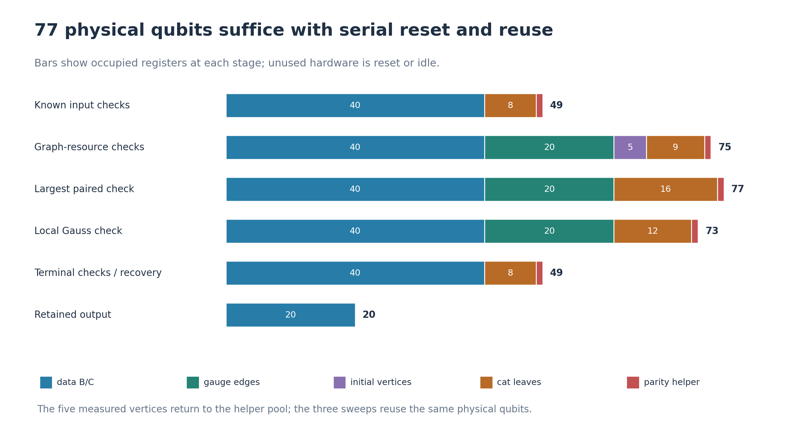
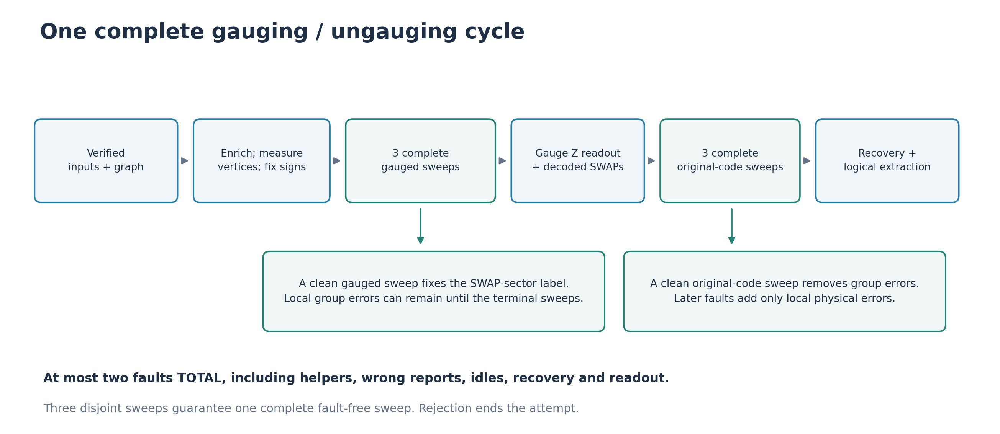
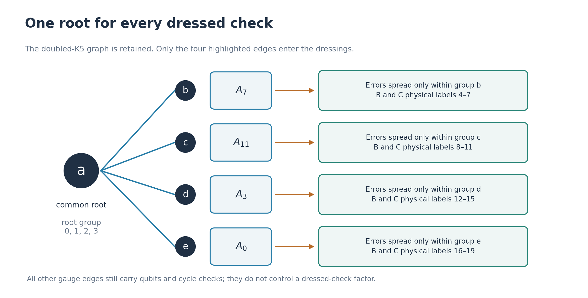
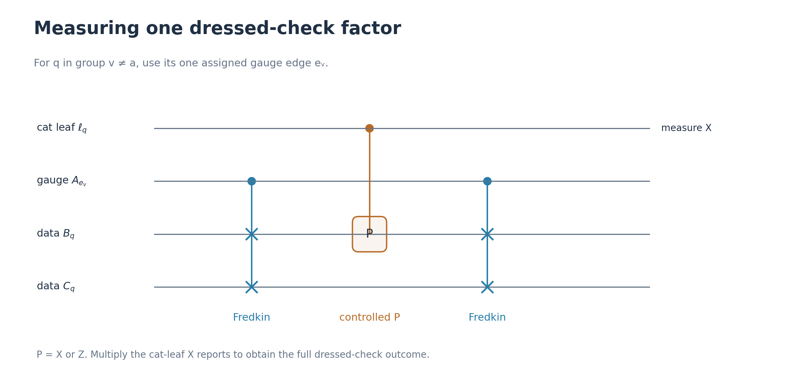

# One gauging cycle with intrinsic, postselected verification

This note gives a conservative fault-tolerant version of our **actual graph
gauging/ungauging procedure** for the C4-Helix block SWAP. The starting point
is the intrinsic-check approach of *Magic Quantum Code Surgery*,
arXiv:2610.03920v1. A code-specific argument lets us use a smaller set of
checks than its full gauged-memory protocol.

**Result under the fault model below:** every accepted attempt with at most
two faults produces the intended decoded magic state. The construction uses
one gauging/ungauging cycle, three intrinsic verification sweeps while
gauged, three original-code sweeps after ungauging, and protected recovery
and readout. It needs **77 physical qubits at peak**, with serial helper
reuse, and **80 Fredkins** in the displayed implementation.

It is postselected: nontrivial verification reports reject. This is not the
general active decoder left open by the paper, nor a claim of optimal
overhead or research novelty. The finite two-fault argument is given here;
it does not follow merely by substituting d=6 into the paper's asymptotic
theorem.

## 1. Registers, fault budget, and target

The original doubled-K5 graph has five vertices, twenty edge qubits, and
two edges between each vertex pair. The block-aligned controller assignment
is retained:

| Inner group | Physical labels in each of B and C | Controller |
|---|---|---|
| \(J_a\) | 0, 1, 2, 3 | a |
| \(J_b\) | 4, 5, 6, 7 | b |
| \(J_c\) | 8, 9, 10, 11 | c |
| \(J_d\) | 12, 13, 14, 15 | d |
| \(J_e\) | 16, 17, 18, 19 | e |

Put

\[
T_v=\prod_{q\in J_v}\operatorname{SWAP}(B_q,C_q),
\qquad U=\prod_vT_v,
\qquad \Pi_+=\frac{I+U}{2}.
\]

The input is
\(|\psi\rangle=|\overline{00}\rangle_B|\overline{+0}\rangle_C\).
Normalized positive projection gives, on the active logical pair,

\[
|M_2\rangle=\frac{2|00\rangle+|01\rangle+|10\rangle}{\sqrt6},
\]

with both spectator logical qubits zero. Keeping a +1 measurement of
\(\overline Z^B_0\) leaves C in

\[
|M0\rangle_C=\frac{2|0\rangle+|1\rangle}{\sqrt5}\otimes|0\rangle.
\]

**Fault model.** Preparations, physical measurements, single-qubit idles,
single-qubit gates, CNOT/CZ, ordinary SWAPs, and three-qubit Fredkins are
locations. A faulty location is an arbitrary operation on its listed
qubits, possibly correlated with an environment. Reports may be wrong.
At most two locations are faulty in the **entire attempt**, including
sources, helper verification, recovery, final readout, and every live-qubit
idle. Classical computation is reliable. A Fredkin decomposition confined
to those same three qubits is also covered by the support proof.

Use a serial schedule, with fresh helper states prepared inside the gadget
using them. Helpers are measured and reset before reuse. A sweep includes
all its helper preparations and data idles. Boundary idles belong to the
following interval. Three sweeps are therefore disjoint intervals, and at
least one contains no faulty location. A clean sweep can receive an
erroneous input; that is precisely what the proof handles.

The output guarantee concerns the decoded logical state. Physical output
errors may remain in a correctable error space. The physical recovery
below is included in the budget; mathematical decoding only defines the
logical output criterion.

## 2. Why the peak is 77 qubits

| Register or use | Qubits |
|---|---:|
| B and C data | 40 |
| Gauge-edge register | 20 |
| Reusable helper pool | 17 |
| **Peak physical hardware** | **77** |

The largest measured Pauli is a paired upper check \(S_{B,s}S_{C,s}\):
weight sixteen. Its gadget uses a sixteen-leaf cat and one additional
parity-verification helper. This fixes the seventeen-qubit helper pool.

Initially five pool qubits serve as graph vertices. The graph resource then
has 65 live data/graph qubits. Its largest verification check has weight
nine, requiring nine cat leaves and one helper: **75 live qubits** during
that stage. This fits in 77 because twelve pool qubits are available while
the five vertices are occupied. After their X measurements, reset the
vertices and reuse them as ordinary helpers.

Gauss measurement requires twelve cat leaves plus one parity helper;
terminal code checks and recovery require at most eight leaves plus one
helper. No stage exceeds the pool size. Repeated sweeps reuse the pool;
they do not need fresh physical hardware. The final retained output is one
twenty-qubit C4-Helix block. Parallel extraction, routing helpers, or a gate
implementation with extra ancillas would change this count.

## 3. The intrinsic checks we actually measure

Let \(S^P_{B,s}=\prod_{q\in R_s}P_{B_q}\), with corresponding C checks.
Use the nine independent Table-I indices s=0 through 8, for P=X,Z:

| s | \(R_s\) |
|---|---|
| 0 | 0, 1, 2, 3 |
| 1 | 4, 5, 6, 7 |
| 2 | 8, 9, 10, 11 |
| 3 | 12, 13, 14, 15 |
| 4 | 16, 17, 18, 19 |
| 5 | 0, 3, 6, 7, 10, 11, 12, 15 |
| 6 | 4, 7, 8, 9, 14, 15, 16, 19 |
| 7 | 1, 2, 8, 11, 12, 13, 18, 19 |
| 8 | 2, 3, 5, 6, 13, 14, 16, 17 |

**Paired Pauli checks:**

\[
N_s^P=S^P_{B,s}S^P_{C,s}.
\]

There are eighteen independent N checks. They survive gauging unchanged:
each local matched factor \(P_{B_q}P_{C_q}\) commutes with its SWAP.

**Cycle checks:** \(L_\eta=\prod_{q\in\eta}Z_{A_q}\).
Use the ten parallel-edge cycles and these six triangles:

\[
\begin{gathered}
(7,8,11),\quad(7,14,3),\quad(7,4,0),\\
(11,2,3),\quad(11,1,0),\quad(3,5,0).
\end{gathered}
\]

**Local Gauss checks:**

\[
G_v=T_v\prod_{q\text{ incident on }v}X_{A_q},
\qquad \prod_vG_v=U.
\]

There are five G checks. All 18+16+5=**39 measured checks commute globally**.
In particular, every one commutes with the Gauss constraints. They are a
subset of the gauged-code checks, not the full gauged-code generator set.
The dressed X/Z checks are omitted in this lighter protocol. Sections 6–7
explain why the finite postselected factory does not need them; Section 10
gives explicit circuits for the more expensive full-check variant.

## 4. Local measurement gadgets, including cat phase faults

### Pauli checks

To measure a Pauli Q of weight m, prepare a fresh cat
\((|0^m\rangle+|1^m\rangle)/\sqrt2\). Verify every adjacent ZZ parity in
three complete scans. For each parity, prepare one helper in zero, apply
two leaf-to-helper CNOTs, and measure that helper in Z. Reject a negative
report. Reset the helper before its next use.

Assign one leaf to each physical target. Apply controlled-X or controlled-Z
once from that leaf, then measure all leaves in X. Their reported sign
product is the check outcome. Cat preparation can use H followed by a
CNOT chain; there are no leaf-to-leaf gates after preparation.

One accepted clean ZZ scan projects the cat into the span of its two
uniform strings. Each later fault can add at most one erroneous leaf bit.
An X on a parity helper cannot spread to another leaf because the helper
is always a CNOT target. A helper Z may spread phases, which are allowed.

**ZZ verification does not verify the cat phase.** With faults the check
instrument can be \(aI+bQ\), rather than the desired \((I+Q)/2\). The
coefficients may include environmental operators. The proof permits this;
it never assumes an accepted faulty cat reports the true eigenvalue.

### Gauss checks

For \(G_v\), use twelve leaves: eight control the individual gauge-X
factors and four control the individual data-pair SWAPs. A SWAP leaf has
one Fredkin interaction. **No leaf controls all four SWAPs.**

The target ports in this gadget are disjoint. A faulty interaction reaches
one gauge qubit or one data pair. A faulty leaf bit applies only its own
X or SWAP factor. An arbitrary SWAP-pair error stays within one inner
group. There is no independent whole-block SWAP measurement.

For either kind of gadget, resolving the cat's computational branches
gives a sum of Kraus terms

\[
E(aI+bQ). \tag{1}
\]

Here each fault charges at most its one target port or its one idling
data qubit; phases and wrong reports remain in a,b. A fault-free gadget
gives the exact reported-eigenvalue projector. This is the bounded-spread
instrument property used below, including coherent faults.

## 5. The complete schedule

1. **Verify known inputs.** Start each block in physical zero states.
   Measure its eighteen independent code checks and two specified logical
   checks, in three complete positive passes. B uses
   \(\overline Z_0,\overline Z_1\); C uses
   \(\overline X_0,\overline Z_1\). The twenty checks specify a unique
   state on each block.
2. **Verify the original graph resource.** Prepare vertices in plus states,
   gauge qubits in zero, then forty endpoint-to-edge CNOTs. Verify its
   25 independent Pauli checks in three complete positive passes:
   \(K_v=X_vX^A_{\mathrm{star}(v)}\) and
   \(K_q=Z_uZ_{A_q}Z_v\). The initially entangled four-qubit edge blocks
   in the old drawing are not used.
3. **Gauge once.** Apply the twenty original enrichment Fredkins, with
   controller v for q in \(J_v\). Measure vertices in X. Require reported
   parity \(r=\prod_vx_v=+1\). Using the root-a tree
   \(e_b=7,e_c=11,e_d=3,e_e=0\), apply \(Z_{A_{e_v}}\) for each
   reported \(x_v=-1\), v other than a. Ideally this puts every Gauss
   sign at +1. Wrong signs give a gauge-Z frame error allowed by the proof.
4. **Three intrinsic sweeps.** In each sweep measure the eighteen N checks,
   sixteen cycle checks, and five G checks, in that order. Require every
   report to be +1. Each measurement has fresh verified cats and helpers.
5. **Ungauge once.** Measure all twenty gauge qubits in Z. Decode the
   whole word within radius two of a graph cut; reject failure. Apply the
   decoded ordinary physical SWAPs as in Section 8.
6. **Three terminal original-code sweeps.** Measure the 36 independent B/C
   Pauli checks in each sweep; require +1 throughout.
7. **Recover and extract.** Perform the repeated-syndrome recovery and
   decoded B readout of Section 9. Keep decoded \(\overline Z^B_0=+1\).

Within a family use X before Z, increasing s, B before C where applicable,
vertices a through e, and increasing physical labels. Order parallel-edge
cycles alphabetically by endpoints, then triangles as listed. Perform
everything serially, with all live-qubit idles included. Any failed source
or cat verification rejects the entire attempt; no uncounted retry is
coupled to retained data.

The history decoder rejects negative verification reports, then decodes the
gauge word and ordinary syndrome. It takes only reported bits, never an
oracle identifying clean rounds. This is an **accept/reject decoder**;
it does not try to correct a nontrivial gauged syndrome and continue.

## 6. The error bound and the key paired-check lemma

Let P project onto the original B/C product code space. Two finite code
facts are needed:

- Its physical distance is six.
- No nontrivial logical Pauli fits in at most two whole inner groups.

In particular, for any operator M on the B/C copies of at most two groups,

\[
PMP=c_M P. \tag{2}
\]

This is a detectable-error statement, not a promise that ordinary recovery
can correct arbitrary unknown two-group errors.

For an exact finite certificate, the binary span C of one type of Table-I
check has 512 elements and its orthogonal complement has 2048. Every vector
in \(C^\perp\setminus C\) occupies at least three inner groups and has
weight at least six. An undetectable general Pauli has both components
in \(C^\perp\); on at most two groups they must be in C, hence give a
stabilizer. Expanding arbitrary operators in Paulis proves (2).

Let \(P_N\) project onto all paired checks N=+1.

**Paired-check lemma.** For a Pauli M on at most two groups, either
\(P_N M P_N=0\), or M preserves the U eigenvalue on the N=+1 sector.

**Proof.** Write \(M=A_B\otimes B_C\), ignoring an overall phase. If M
anticommutes with an N check, its positive sandwich vanishes. Otherwise
the one-block relative Pauli \(A^\dagger B\) commutes with every original
code check. It is supported on at most two groups, so it must be a
stabilizer up to phase: \(A^\dagger B=e^{i\theta}S\). Thus

\[
M=e^{i\theta}(A\otimes A)(I\otimes S).
\]

The first factor commutes with SWAP. On N=+1, \(S_B=S_C\), since
\(S_BS_C\) is a product of the N checks. Exchanging the two copies of M
therefore changes nothing on that sector. Consequently
\(UM P_N=MU P_N\). This proves the lemma.

**Meaning.** The paired checks filter out precisely the local Pauli terms
that could change the SWAP-sector label without being equivalent to a
symmetric error. The restriction to at most two groups is essential.

**Why repeating Gauss checks alone is insufficient.** A single allowed
fault after the last enrichment Fredkin on group a can insert
\(Z_aX_{B_3}\). Write \(\Pi_-=(I-U)/2\). The vertex phase selects the wrong logical sector while
the data error gives \(X_{B_3}\mathcal W\Pi_-|\psi\rangle\).
Perfect positive G measurements then leave
\((X_{B_3}-X_{C_3})\mathcal W\Pi_-|\psi\rangle/2\).
A second \(X_{B_3}\) fault after all G sweeps gives
\((I-X_{B_3}X_{C_3})\mathcal W\Pi_-|\psi\rangle/2\).
Ungauging and the final original-code projection remove the cross term,
leaving the *wrong* encoded \(\Pi_-|\psi\rangle/2\), which original
code checks cannot reject. By contrast, a clean paired-check sweep
detects the first \(X_{B_3}\) through \(N_0^Z\). Thus the paired filters
are an essential part of this proof, not redundant decoration.

For the complete circuit, expand errors into terms

\[
E=X_A^x Z_A^z M_W,
\qquad |x|\le f,\quad |W|\le f, \tag{3}
\]

after f faults. There is **no bound on z**. Gauge phases may be arbitrarily
large. A fault may contribute to both bounds; it is still one location.

Why does (3) persist? N and cycle checks are Pauli and only change phases
when conjugating errors. Each G swaps matter only within its own group
and changes no gauge-X positions. Its target ports are disjoint, so (1)
adds only one port per fault. There is no dressed-check circuit in this
protocol that could copy a gauge-X error into several data groups.

For each known source, one of its three full positive passes is clean
and projects onto its unique intended state. Later Pauli gadgets leave
one residual source-qubit error per later fault. Raw preparation faults
before the clean pass disappear or reject. A resource vertex error or an
enrichment fault can affect only its controller's group; a residual gauge
error affects only that gauge qubit. Source waiting idles are counted.
Thus source preparation initializes (3), rather than assuming perfect
ancillas. Cat phase errors and reports stay in the I/check coefficients.

## 7. A clean intrinsic sweep fixes the logical-sector label

For \(t_a=0\), let \(V_t=\prod_vT_v^{t_v}\). Define

\[
\mathcal W|\phi\rangle
=\frac14\sum_{t:t_a=0}|\delta t\rangle_A V_t|\phi\rangle,
\quad (\delta t)_q=t_u+t_v\quad(q:u\text{--}v). \tag{4}
\]

There are sixteen orthogonal cut words, so this is an isometry. On the
original code, N, cycles, and \(G_{b,c,d,e}\) stabilize its image, while
\(G_a\mathcal W=\mathcal W U\). Also \(U\mathcal W=\mathcal W U\),
because all the partial physical SWAPs commute.

Resolving the original enrichment's vertex bits shows that a faulty
accepted gauging produces a state in the span

\[
E\mathcal W U^b|\psi\rangle,\qquad b=0,1, \tag{5}
\]

with (3). The two vertex strings for a cut differ by the full U; changes
of a control trajectory affect only its assigned group. Coefficients
depending on the relative vertex bits can be expanded in gauge-Z
characters. This includes wrong reports, arbitrary vertex phases, and
coherent I/U alternatives. The gadget property (1) and error normalization
preserve (5) until a clean intrinsic sweep.

Write \(P_L\) for the positive cycle projector, and
\(P_G=\prod_v(I+G_v)/2\). A clean accepted sweep applies exactly

\[
K_{\rm clean}=P_LP_GP_N,
\qquad
P_G=\left[\prod_{v\ne a}\frac{I+G_v}{2}\right]\frac{I+U}{2}. \tag{6}
\]

Its N projection kills Pauli terms with a nonzero paired syndrome.
For every remaining term, the paired-check lemma lets the U projector
pass through E on the N=+1 input. It therefore acts on the original
logical component as \(\Pi_+\): a negative input sector is rejected.
Expanding the four remaining Gauss projectors merely conjugates errors
by group-local SWAPs. It adds no new inner groups. Consequently the
output lies in

\[
\operatorname{span}\{E'\mathcal W\Pi_+|\psi\rangle:\ |W'|\le f\}. \tag{7}
\]

The cycle projection also removes every nonzero gauge-X term with weight
at most two: a nonzero cut has at least eight edges. Arbitrary gauge-Z
phases remain permitted.

At least one of the three sweeps is clean. It fixes the right-hand
reference state in (7), including the positive logical SWAP sector.
**It does not remove every local group error.** Those survive until the
terminal original-code projection. Later faulty intrinsic sweeps preserve
(7), with a total of at most two charged groups in the whole attempt.
No fresh fault budget starts at this point.

This is the role of the repeated intrinsic measurements. A phase-faulty
cat can give a wrong projector and a false positive report, but cannot
make all three complete sweeps faulty under a total budget of two.

## 8. Ungauging and the terminal clean projection

The graph cuts form a sixteen-word classical code. A cut separating k
vertices has \(2k(5-k)\) edges, so its minimum nonzero weight is eight.

Given the reported twenty-bit gauge-Z word m, find a cut word w with
\(|m+w|\le2\). Reject if none exists. It is unique: two candidates would
differ on at most four edges. Recover the offset from the **decoded** word,

\[
t_a=0,\quad t_b=w_7,\quad t_c=w_{11},
\quad t_d=w_3,\quad t_e=w_0,
\]

then apply \(V_t\) using ordinary SWAPs, at most sixteen of them.

Every remaining gauge-X error changes at most one bit per faulty location.
Each new Z-readout fault changes at most its one reported bit. Thus
\(m=\delta t+\epsilon\), \(|\epsilon|\le2\), under the same total fault
budget. An error and a false report on the same measured qubit still
change only that bit. Uniqueness ensures consistent correction even
when coherent error terms share a report.

Gauge-Z phases become scalar coefficients after readout. The two possible
representatives of a cut differ by U, which stabilizes the reference
\(|M_2\rangle\). Physical SWAP corrections preserve inner groups, and a
faulty correction adds only its own group. The ungauged state is therefore
in the span of \(M_W|M_2\rangle\), with \(|W|\le2\), including spectators
in their reference zero states.

One of the three terminal original-code sweeps is clean. It applies P;
equation (2) then gives exactly \(|M_2\rangle\), or rejection. Choose the
last clean terminal sweep as a reference. After it there are no
enrichment gates, SWAP corrections, or dressed measurements: every later
fault adds at most one physical target error. This is the ordinary
correctable-error promise needed by recovery.

## 9. Physical recovery and logical readout share the budget

Measure the joint 36-bit independent B/C syndrome with fresh verified
cats. Keep both signs and apply no intermediate corrections. Stop at the
first **three consecutive identical joint records**, with at most nine
rounds. Reject failed helper verification or failure to stop. On each
block choose a minimum-weight Pauli of weight at most two with that
syndrome, with a deterministic tie rule; reject if none exists. Apply
these corrections with single-qubit gates.

At most two rounds are bad. Nine rounds contain three consecutive clean
ones: otherwise three clean runs of length at most two, separated by
two bad rounds, would total at most eight. The stopping triple itself
contains a clean round. Its common record is therefore a true syndrome
at that reference time.

All errors there have weight at most two per block. Two candidates with
that syndrome differ by an undetectable Pauli of weight at most four;
distance six makes the difference a stabilizer. The chosen correction
is logically right. Later faults leave only their local residual errors;
conjugating by a Pauli correction does not enlarge their support.

Finally measure B physically in Z. Decode the whole word using its Z
checks and a weight-at-most-two X-error lookup. Evaluate
\(\overline Z^B_0\) on the corrected word, using support
\(\{0,3,6,7,18,19\}\), and keep +1. Two candidate corrections cannot
disagree on logical parity: their difference has weight at most four
and is a stabilizer. This handles both preceding B errors and wrong
readout bits. C idles during B readout are included in the remaining
budget and leave correctable physical errors.

**Composition conclusion.** A clean intrinsic sweep fixes the logical
reference to positive SWAP; a clean terminal code sweep removes group
errors. All faults after the latter share one remaining budget through
recovery and readout. Every accepted output has decoded C state
\(|M0\rangle\). There is no separate two-fault allowance per stage or
unbudgeted final noiseless physical recovery.

## 10. What about the full dressed-check construction?

The paper's full gauged-memory protocol also measures dressed code checks.
This factory omits them because it can reject and later return to the
original code, using the two-group paired-check lemma. It is **not** a
fault-tolerant memory for an arbitrarily long gauged evolution.

For completeness, a more expensive variant can measure all dressed
checks too. Choose **one common root a** for every check, even if its
original support excludes a. Set \(e_b=7,e_c=11,e_d=3,e_e=0\).

For q in group v, define

\[
Q_q^P=\begin{cases}
P_{B_q},&v=a,\\[1mm]
\dfrac{I+Z_{A_{e_v}}}{2}P_{B_q}
+\dfrac{I-Z_{A_{e_v}}}{2}P_{C_q},&v\ne a,
\end{cases}
\qquad D_s^P=\prod_{q\in R_s}Q_q^P.
\]

All D checks commute globally with these roots. Algebraically,
\(D_s^P=F S^P_{B,s}F^\dagger\), where F is the product of all
gauge-controlled data SWAPs on the four star edges. F is an identity
used in the proof, not an extra global verifier we apply. Their only
Gauss commutator is \([D_s^P,G_a]_{\rm grp}=N_s^P\).

To measure a factor outside group a, assign one cat leaf and apply

\[
\operatorname{CSWAP}(A_{e_v};B_q,C_q),\quad
\operatorname{C}P(\ell_q;B_q),\quad
\operatorname{CSWAP}(A_{e_v};B_q,C_q).
\]

These factors share gauge controls; the disjoint-port cat lemma alone
does not justify them. Instead, assign every gauge-X error on \(e_v\)
to group v in the support accounting. Only that group is ever targeted
by that control. A dressing Fredkin commutes with gauge Z, preserves
its gauge-X position, and can add matter support only within its assigned
group. Full D conjugation has the same property: paired CNOTs or CZs
add paired matter Paulis within v, while matter errors add only gauge
Z. Thus each fault still charges at most one group and one gauge-X bit.
Resolving the cat branches gives (1) in this enlarged error span, despite
the shared gauge controls.

Add nine D-X and nine D-Z measurements after G in each of three sweeps.
A clean full sweep projects onto the full gauged code. To see that this
is sufficient, use the isometry (4). For nonzero gauge x of weight at
most two its compression vanishes; for x=0,

\[
P\mathcal W^\dagger E\mathcal W P
=\frac1{16}\sum_{t:t_a=0}(-1)^{z\cdot\delta t}
P V_t^\dagger M_W V_t P=c_E P.
\]

Equation (2) gives the last equality. The full positive projector is
\(\mathcal W P\Pi_+\mathcal W^\dagger\): in the F frame, D and N
enforce P, cycles and four stars enforce the uniform cut state, and the
last Gauss check enforces U=+1. A clean full sweep therefore restores
exactly \(\mathcal W\Pi_+|\psi\rangle\), or rejects. The same ungauging
and terminal proof then applies.

This stronger intermediate projection costs **584 Fredkins** with the
displayed gadgets: twenty initially and three sweeps of twenty Gauss
Fredkins plus 168 dressed-check Fredkins. It has the same 77-qubit peak,
because each dressed check uses at most eight leaves and one helper.
It is an optional implementation, not required for the lighter result.

## 11. Scope, cost, and reproducible checks

| Resource | Lighter postselected factory |
|---|---:|
| Peak physical qubits, serial helper reuse | **77** |
| Complete original gauging/ungauging cycles | 1 |
| Intrinsic sweeps / terminal original-code sweeps | 3 / 3 |
| Paired / cycle / Gauss checks per intrinsic sweep | 18 / 16 / 5 |
| Initial enrichment Fredkins | 20 |
| Gauss-measurement Fredkins per sweep | 20 |
| **Total Fredkins** | **80** |
| Subsequent recovery rounds | At most 9 |
| Independent whole-block SWAP verifiers | 0 |

The earlier three-complete-cycle factory used sixty enrichment Fredkins.
Eighty is more, so this calculation establishes no Fredkin-count advantage.
Its value is a finite intrinsic-verification proof for a single gauged
interval. The number of Pauli checks, idle cost, noisy yield, and native
gate synthesis also matter; no overall efficiency comparison is claimed.

Fault-free, conditioned on successful known-input preparation, gauging
accepts with probability 3/4, verification is deterministic, and final
extraction accepts with probability 5/6: yield 5/8. No efficient source
yield or noisy acceptance-rate estimate is assumed.

The 39-check family is globally commuting, avoiding the particular
measurement-order randomization between Gauss and dressed checks discussed
in the paper. Arbitrary faults can still produce probabilistic outcomes;
the proof does not replace them by classical bit flips. Full active
correction of the non-Abelian gauged memory remains outside this result.

The measured observables commute with Gauss constraints. Their native
circuits need not preserve every constraint at every intermediate gate,
and a faulty state can violate constraints. The guarantee is circuit
fault tolerance of accepted output branches under the explicit local
model, not exact microscopic gauge invariance during noisy execution.

The [classical decoder](c4_helix_intrinsic_decoder.py) implements positive
history guards, the initial vertex frame, radius-two cut decoding,
finite Pauli recovery, and logical B readout. Its convention is **0 for
+1, 1 for −1**. Every helper's raw cat-parity reports must also pass
the positive-report guard. It requires no clean-round oracle. The optional
full-check mode expects 57 reports per sweep instead of 39.

The [certificate script](check-c4-helix-intrinsic-gauged-verification.py)
checks the code/group distances, cycle rank, all 3,376 radius-two gauge
records, 2,760 support-conjugation cases including the optional D checks,
32 exact dressed-factor basis/sign identities, all 7,141 weight-at-most-two
data Pauli errors for the implemented recovery lookup, and 844 representative
readout cases. It checks all 180 relative-normalizer cases on one- and
two-group regions, the Gauss-only counterexample, rejection guards, and the recovery-round
bound. The [JSON report](../output/c4-helix-intrinsic-gauged-verification.json)
records counts and scope. The complete composition proof is Sections 6–9;
the script is not exhaustive circuit fault-pair simulation.

Sources:

- [C4-Helix Table I](../arXiv-2609.03194v1/appendix.tex).
- [Original SWAP gauging](../arXiv-2602.12228v1/main.tex).
- [Magic Quantum Code Surgery: gauged-check construction](../arXiv-2610.03920v1/Gauging-procedure.tex).
- [Magic Quantum Code Surgery: spacetime protocol and faults](../arXiv-2610.03920v1/spacetime.tex).
- [Its discussion of decoding and overhead still to be developed](../arXiv-2610.03920v1/Discussion.tex).
