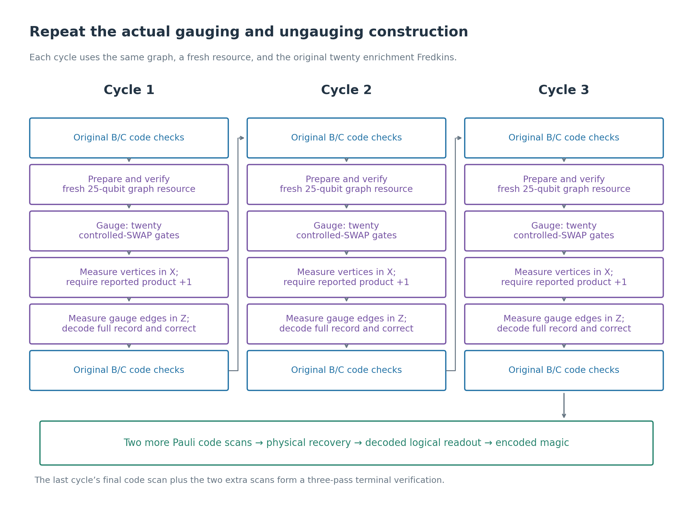
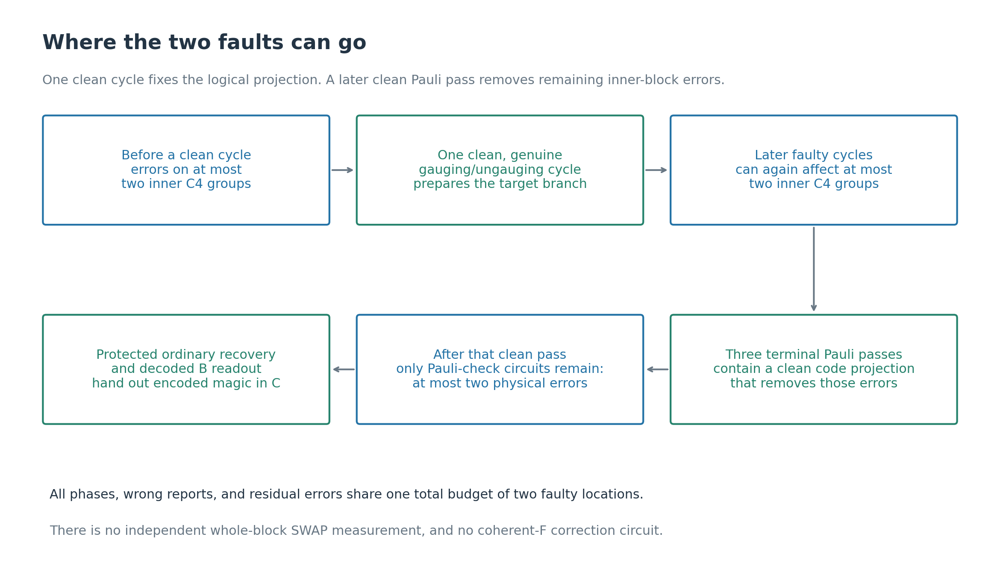

# Protecting the original C4-Helix gauging by repeating complete cycles

The previous construction added an independent, verified whole-block SWAP
measurement. That measurement could prepare the desired state by itself.
Its proof concerned an augmented factory, and did not solve the intended
problem of protecting the gauging/ungauging construction with small additions.

This note returns to the original graph circuit. **Repeat that actual
gauging/ungauging cycle three times, with fresh graph resources and Pauli
code checks between cycles.** Decode the entire gauge record before applying
the ordinary SWAP corrections. After the last cycle, complete a three-pass
Pauli verification before ordinary recovery.

There is no independent whole-block SWAP verifier and no quantum-controlled
frame-removal circuit F. All sixty controlled-SWAP gates belong to three
copies of the original twenty-gate enrichment circuit.

Repeated gauging measurements with postselection are an established strategy;
see [Hetényi, Brown and Williamson, arXiv:2603.05429](https://arxiv.org/html/2603.05429v1).
That paper studies a color-code Clifford measurement. The C4-Helix graph,
decoder, controller-support argument, and two-fault proof below are our
specific adaptation, not a theorem imported from that paper.

## 1. What changes, and what is preserved?

We retain the five-vertex, doubled-K5 graph and its twenty gauge edges from
[the first gauging note](c4-helix-five-vertex-swap-gauging.md). We use the
block-aligned controller assignment introduced in
[the verification note](c4-helix-verified-gauging-and-ungauging.md):

| Controller | Physical data-pair labels |
|---|---|
| a | \(J_a=\{0,1,2,3\}\) |
| b | \(J_b=\{4,5,6,7\}\) |
| c | \(J_c=\{8,9,10,11\}\) |
| d | \(J_d=\{12,13,14,15\}\) |
| e | \(J_e=\{16,17,18,19\}\) |

Let \(T_v=\prod_{q\in J_v}\mathrm{SWAP}(B_q,C_q)\), so
\(U=\prod_vT_v\). Each controller is reused for only its own inner C4 block.
This changes the original scattered assignment; it is essential to the
error-support proof. The graph connectivity itself is unchanged.

For ungauging we restore the **gauge-Z measurement and classical offset
correction** from [the ungauging note](c4-helix-ungauging-and-magic.md).
The correction uses ordinary two-qubit SWAP gates, not Fredkins.

The protection added to this circuit consists of:

- Verified stabilizer preparations for the inputs and each fresh graph
  resource, using Pauli checks only.
- Two additional complete gauging/ungauging cycles.
- Original B/C code checks before and after each completed cycle, and two
  additional code scans at the end.
- Full-word decoding of the gauge-Z readout and protected final recovery
  and logical readout.

We do not measure bare B/C code checks inside the gauged portion of a cycle.
They are used only before gauging or after ungauging has restored the
original code frame. No dressed non-Pauli check measurement is assumed.

## 2. One cycle is the original construction

Let \(\phi(q)=v\) for \(q\in J_v\). Each cycle performs:

1. Measure all original B/C X and Z checks with protected Pauli-measurement
   gadgets; require every reported sign to be +1.
2. Prepare a fresh twenty-five-qubit graph resource: vertices in +, gauge
   qubits in 0, then the forty endpoint-to-edge CNOTs. Verify its twenty-five
   independent Pauli stabilizers in three complete positive passes.
3. Apply the original enrichment
   \(\Omega=\prod_q\operatorname{CSWAP}(\phi(q);B_q,C_q)\).
4. Measure the five vertices in X. Require reported
   \(r=\prod_v x_v=+1\).
5. Measure all twenty gauge qubits in Z. Decode their complete word as in
   Section 3. Reject if decoding fails.
6. Reconstruct the root-zero vertex offset \(t_0\), and apply
   \(V_{t_0}=\prod_vT_v^{t_{0,v}}\) using ordinary physical SWAPs. Discard
   the graph registers.
7. Measure all original B/C checks again; require +1.

Use fresh resources and fresh measurement helpers in each cycle. Within a
code scan, order B then C, X then Z, and the ten Table I checks in their
listed order, retaining the redundant checks. Within each gate family,
order physical labels increasingly. Resource preparation applies each edge's
two CNOTs in alphabetical endpoint order.

After three cycles, add **two further full Pauli code scans**, demanding +1.
Together with the third cycle's final scan these form three consecutive
terminal code scans, with no intervening enrichment or offset SWAPs.

All code and resource Pauli measurements use the verified-cat gadget:
prepare a cat by a CNOT chain, verify adjacent ZZ parities in three complete
scans using fresh target ancillas, use one cat leaf per measured physical
qubit, and measure the leaves in X. Failed cat verification rejects the
attempt. The cats here control **Pauli factors only**; there is no cat
controlling a whole-block SWAP measurement.

Known B/C inputs can be prepared by three positive passes of their eighteen
independent code stabilizers and two known logical stabilizers. B uses
\(\overline Z_0,\overline Z_1\), and C uses
\(\overline X_0,\overline Z_1\). Starting from all-zero physical qubits
gives a simple, possibly inefficient, offline source with nonzero acceptance.

## 3. Use the graph redundancy to protect ungauging

For a vertex bit pattern t, define

\[
(\delta t)_q=t_u+t_v\pmod2
\quad\text{for edge }q:u-v.
\]

The sixteen possible words \(\delta t\), identifying t and its complement,
form the graph's classical cut code. A nonzero cut separating k vertices
from the other five minus k has

\[
2k(5-k)\ge8
\]

edges, because every vertex pair has two parallel edges. The cut code
therefore has distance eight.

**Decoder.** Given the reported twenty-bit word m, find a cut-code word w
at Hamming distance at most two. Reject if there is none. There is at most
one: two candidates would be separated by at most four, contradicting
distance eight.

Recover its root-zero offset using the same tree as before:

\[
t_{0,a}=0,\quad t_{0,b}=w_7,\quad t_{0,c}=w_{11},
\quad t_{0,d}=w_3,\quad t_{0,e}=w_0.
\tag{1}
\]

Use w, not the four uncorrected measurement bits, in this formula.

Why is radius two enough for the physical circuit? After three-pass graph
verification, residual graph errors have at most one erroneous physical
qubit per surviving fault. There are no vertex-to-gauge CNOTs afterwards.
A gauge X/Y component flips only that gauge bit; a faulty Z readout changes
only its own reported bit. Vertex faults and enrichment faults do not
change other gauge qubits. Thus every Pauli-expansion term has

\[
m=\delta t+e,\qquad |e|\le2.
\tag{2}
\]

The decoder returns that term's original \(\delta t\). If several coherent
terms lead to the same reported m, they must have the same underlying cut
word, since their radius-two balls are disjoint. Feedforward is consequently
consistent across the coherent expansion, not merely correct for a sampled
classical error.

Graph preparation verification matters here. A fault in the raw forty-CNOT
preparation can spread into many gauge bits. It is the accepted full
resource verification that supplies the local residual-error guarantee.

## 4. Why one or two cycles are insufficient

A physical Z fault on a vertex before enrichment changes the relation
between its reported X sign and the actual symmetry sector. A reported
positive cycle can then implement \(\Pi_-=(I-U)/2\) rather than
\(\Pi_+=(I+U)/2\). Ordinary B/C checks do not detect this, because both
sectors are encoded states.

With two cycles, put one such fault in each. The accepted logical operation
can be

\[
\Pi_-\Pi_-=\Pi_-.
\tag{3}
\]

All original code checks can pass. The final logical extraction can accept
the wrong state. Thus **two cycles cannot provide the desired two-fault
guarantee for this repeat-and-postselect strategy**.

With three cycles and at most two faults total, one complete cycle is
fault-free. Its positive projection rejects an earlier negative sector:

\[
\Pi_+\Pi_-=0.
\]

Repeating X measurements on the same old vertex would not provide this
protection. A fresh cycle repeats the whole physical gauging measurement.

Three is therefore the smallest sufficient count in this simple strategy.
This is not a lower bound on all possible flagged or redesigned single-cycle
constructions.

## 5. The two-fault composition argument

Use the same local fault model as in
[the composition note, Section 1](c4-helix-two-fault-composition-proof.md):
arbitrary faults on the qubits of a gate, preparation, idle, or physical
measurement, including incorrect reported bits; at most two locations total;
reliable classical computation. Fredkins touch only their controller and
data pair. All live-qubit idle slots are counted.

A complete cycle includes its fresh-resource preparation and all helper
preparations and data idles. No graph or cat prepared in an earlier cycle
is reused. These are disjoint scheduled intervals. Thus a fault can spoil
only one complete cycle.

### 5.1 Two code facts and the Pauli-measurement guarantee

Let \(\mathcal P\) project onto the two original code spaces, and define
\(\mathcal A_W\) as all operators supported on the B/C copies of the inner
groups in W. The C4-Helix property is

\[
|W|\le2\quad\Longrightarrow\quad
\mathcal P E\mathcal P=c_E\mathcal P\quad(E\in\mathcal A_W).
\tag{4}
\]

The short algebraic proof is in
[Section 3 of the composition note](c4-helix-two-fault-composition-proof.md):
the five inner blocks' three nonzero four-bit syndrome vectors partition
all fifteen nonzero vectors. No nontrivial logical Pauli fits in any two
whole inner groups. Also, distance six corrects the entire coherent error
space of at most two physical qubits per block.

The Pauli-only parts of the earlier proof remain applicable. A verified-cat
Pauli gadget with f faults has Kraus terms
\(D(aI+bS)\), where S is the measured Pauli, and D touches at most f
target qubits, including separately charged data idles. Coefficients may
contain arbitrary cat phases, false reports, and environmental operations.
There is no assumption that a faulty sign implements a correct projector.

One clean cat-verification scan projects onto the two uniform cat branches;
later faults add at most one leaf bit flip apiece, since the parity verifier
is always a CNOT target. Phases change a and b. One leaf per target bounds
data spread. Likewise, one clean full resource-verification pass projects
onto its unique stabilizer state; later errors stay local. These are the
Pauli special cases of Lemmas 1–2 in the earlier note and require no
controlled-SWAP verifier.

### 5.2 A faulty original cycle preserves a bounded-support invariant

For the intended encoded input \(|\psi\rangle\), consider states in the
linear span

\[
\sum_\nu |c_\nu\rangle_E\otimes E_\nu U^{b_\nu}|\psi\rangle,
\quad E_\nu\in\mathcal A_{W_\nu},\quad |W_\nu|\le f,
\quad b_\nu=0,1.
\tag{5}
\]

Each term may have its own support set and auxiliary coefficient. The bound
f counts faults already charged to data regions, and is no greater than the
number of faults so far.

Suppose a cycle adds g faults. Its accepted output has form (5), with at
most f+g inner groups per term. Here is the propagation argument.

The verified graph starts, up to local residual faults, as

\[
2^{-5/2}\sum_t |t\rangle_V|\delta t\rangle_A.
\]

Resolve control trajectories. A vertex bit fault or an arbitrary enrichment
Fredkin fault can alter only its one assigned inner group. A target error
on a data pair remains in its group, even if it affects control phases.
An ordinary SWAP correction fault touches just one data pair. Each such
fault therefore charges at most one new inner group. Vertex phases and
wrong X reports enter auxiliary coefficients.

By Section 3 the gauge decoder recovers the original cut word. For a
trajectory t its offset is \(t_0=t+t_a\mathbf1\). Away from charged groups,
enrichment applies \(T_v^{t_v}\) and classical correction applies
\(T_v^{t_v+t_a}\). Their product is \(T_v^{t_a}\) everywhere outside those
groups. The whole data operation can therefore be written
\(E_{W'}U^{t_a}\), with at most one additional group per fault.

Incoming local operators are conjugated only by swaps within their own
groups. An incoming U factor merely changes the final exponent of U.
Summing trajectories proves closure of (5), including coherent faults and
the arbitrary measurement instruments. Gauge bit errors do not require
additional data corrections: the classical cut-code decoder already removed
them from the reconstructed offset.

Pauli code scans also preserve (5). For an original stabilizer S,

\[
(I+yS)E U^b|\psi\rangle
=\bigl(E+ySES\bigr)U^b|\psi\rangle.
\tag{6}
\]

S conjugates E without enlarging its support, and stabilizes \(U^b|\psi\rangle\).
Faulty Pauli gadgets add only the groups of their local target errors.
Thus all earlier scans, including false accepted signs, fit the same
invariant. No incoming original stabilizer needs to be propagated through
enrichment: it has already been absorbed on the right into the encoded input.

### 5.3 One clean original cycle fixes the intended logical state

Choose a fault-free cycle among the three. Its first code scan applies
\(\mathcal P\). Equations (4)–(5) reduce the surviving logical component to

\[
|a\rangle_E|\psi\rangle+|b\rangle_E U|\psi\rangle.
\tag{7}
\]

Its fault-free **original gauging and classical ungauging** apply
\(\Pi_+\), giving

\[
(|a\rangle+|b\rangle)_E\otimes\Pi_+|\psi\rangle.
\tag{8}
\]

A zero vector rejects; otherwise the data are exactly the intended
\(|M_2\rangle_L=(2|00\rangle_L+|01\rangle_L+|10\rangle_L)/\sqrt6\),
with both spectator logical qubits zero. Its final code scan changes nothing.
This logical projection is produced by a genuine cycle, not by an added
measurement gadget.

### 5.4 Why the terminal Pauli passes are needed

Later faulty cycles can still spread an error over one whole inner group
per fault. Therefore ordinary distance-six recovery cannot be invoked
immediately on the basis of a two-physical-error promise.

However, apply the invariant to \(|M_2\rangle\), for which
\(U|M_2\rangle=|M_2\rangle\). The state after all three cycles lies in
the span of \(E_W|M_2\rangle\) with \(|W|\le2\).

The last cycle's final scan and the two extra scans contain a complete clean
Pauli scan. It applies \(\mathcal P\), so (4) removes these inner-group
errors as scalars and restores exactly \(|M_2\rangle\), or rejects.

After that clean scan, there are no more enrichment or offset SWAP gates.
Only safe Pauli-check circuits remain. Each subsequent fault therefore adds
at most one physical qubit per block. This supplies the ordinary correctable
error promise required at the recovery interface.

### 5.5 Physical recovery and logical readout share the same budget

Use the explicit recovery from
[Sections 9–10 of the composition note](c4-helix-two-fault-composition-proof.md):
fresh-cat measurements of the joint thirty-six-bit independent B/C syndrome,
no intermediate corrections, stop at the first three identical consecutive
rounds, at most nine rounds, then apply a weight-at-most-two Pauli correction
per block. Reject if cat verification fails or decoding has no candidate.

That stopping triple contains a clean full round. Its syndrome was genuine;
at that instant all surviving errors of weight at most two per block differ
only by stabilizers. The chosen correction removes that representative.
Faults after the reference round, including faults in the physical correction,
leave only their own local residual errors. A run of three clean rounds
must occur among nine rounds with at most two bad rounds, proving the bound.

Finally measure B physically in Z and decode the complete word using its
Z checks. Candidate corrections of weight at most two cannot disagree on
logical Z: their difference is an undetectable X Pauli of weight at most
four, hence a stabilizer. Keep decoded \(\overline Z^B_0=+1\), using Table I
support \(\{0,3,6,7,18,19\}\). B's local readouts do not spread to C;
its accompanying C errors and output idles remain correctable.

There is a single budget throughout. If f faults occurred before the last
clean terminal Pauli pass, only \(2-f\) remain for its later scans, recovery,
and readout. All their combined incoming-error and circuit-fault counts
are at most two. No stage receives a new independent two-fault allowance.

**Result.** Under the stated location model, every accepted branch with at
most two faults has decoded C state
\((2|0\rangle+|1\rangle)/\sqrt5\), with spectator zero. Physical output
errors may remain, but lie in the code's correctable error space. The ideal
decoder in this statement defines logical correctness; physical recovery
and readout have already been implemented within the fault budget.

## 6. Cost, minimality, and the scope of this repair

| Item | This construction |
|---|---:|
| Complete original gauging/ungauging cycles | 3 |
| Enrichment Fredkins per cycle | 20 |
| Total Fredkins | 60 |
| Independent whole-block SWAP verifiers | 0 |
| Coherent-F Fredkins | 0 |
| Ordinary feedforward SWAPs | At most 16 per cycle |
| Original-code Pauli check measurements before final recovery | 320 |

The sixty Fredkins implement the original enrichment three times. Ancillary
verification, code scans, and recovery add Clifford gates and Pauli
measurements. A graph register can be reset and reused between cycles.
There are not three graph resources coupled to the data simultaneously.

Conditioned on successful known-input preparation, the fault-free yield
remains 5/8: the first positive projection succeeds with probability 3/4,
the later positive cycles succeed deterministically on that state, and
final logical extraction succeeds with probability 5/6. No noisy acceptance
rate is claimed.

This is a concrete repair using temporal redundancy of the original
construction. Three cycles are necessary within this simple repetition
strategy, but the numerous Pauli checks and source-verification passes are
conservative. We have not proved globally minimal qubit, gate, or time cost.
Flags or a more economical source circuit could reduce those costs and
would require a separate support analysis.

The result protects the complete gauging/ungauging measurement. It does not
construct a fault-tolerant memory for arbitrarily long evolution in the
gauged non-Abelian code, and does not assume perfect gauge invariance after
every noisy gate. Its checks are used in the code frame appropriate to
each stage; the measured gauge information is decoded before leaving that
frame.

The [certificate script](check-c4-helix-repeated-gauging.py) verifies all
3,376 radius-two gauge records, the root-frame reconstruction, and the
two-cycle phase-fault counterexample. Its
[JSON output](../output/c4-helix-repeated-gauging-certificates.json) records
the results. Those are finite certificates; the arbitrary-phase and
multi-stage fault claims follow from the analytical support argument above.
