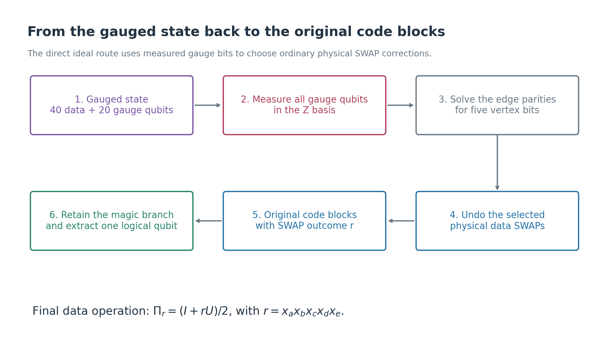
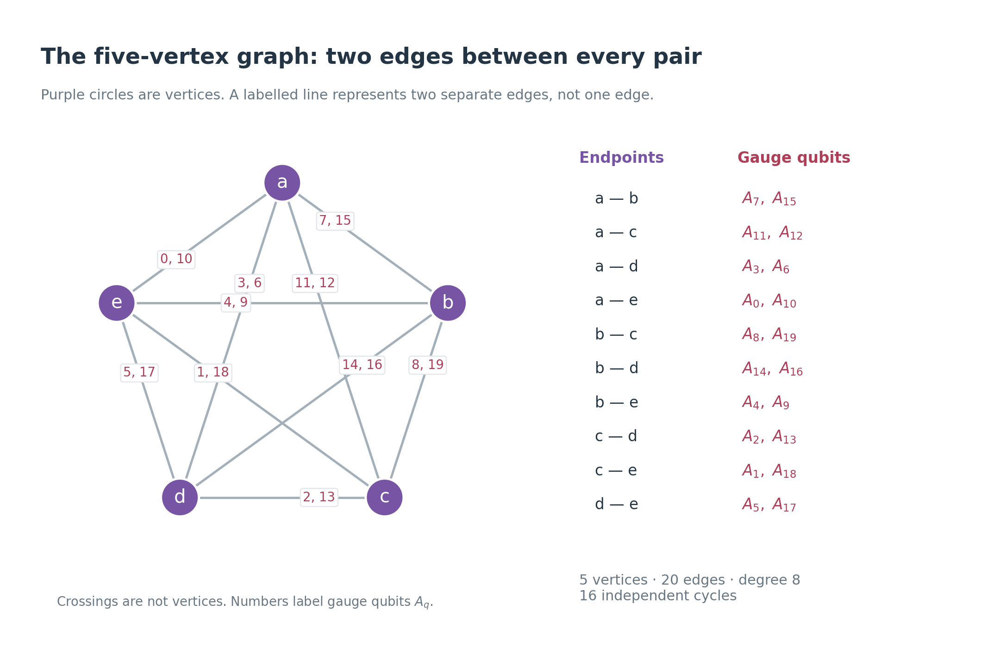
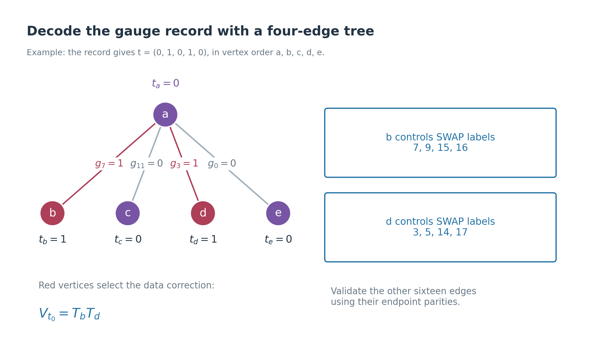
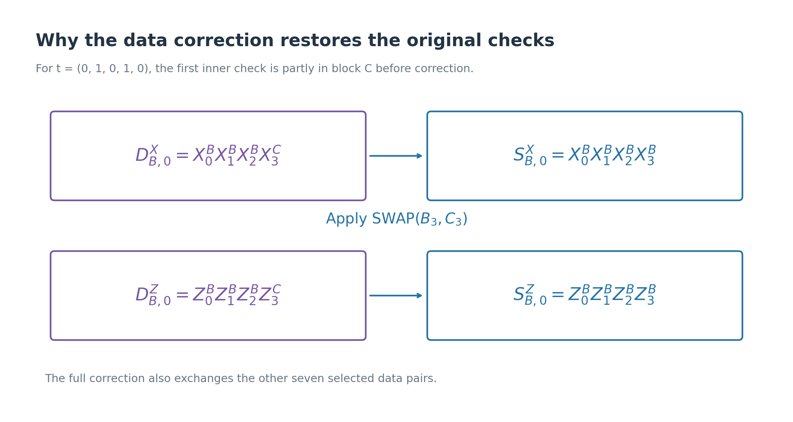
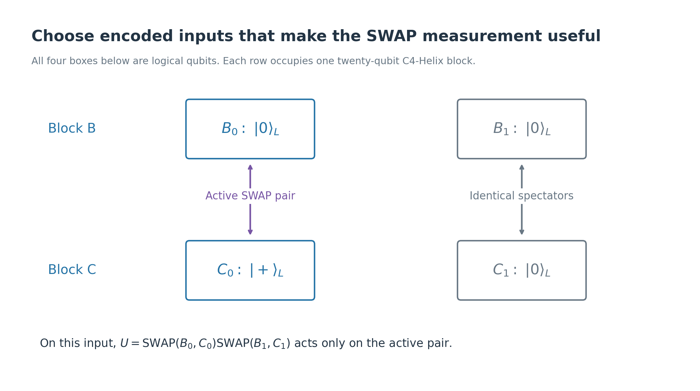
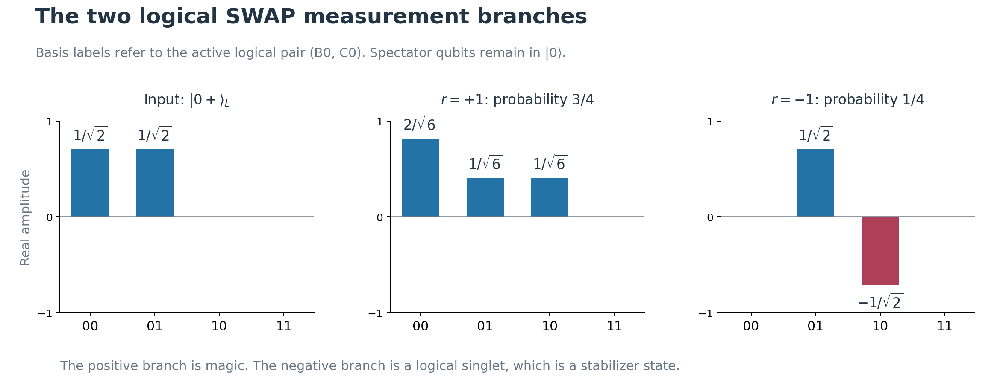
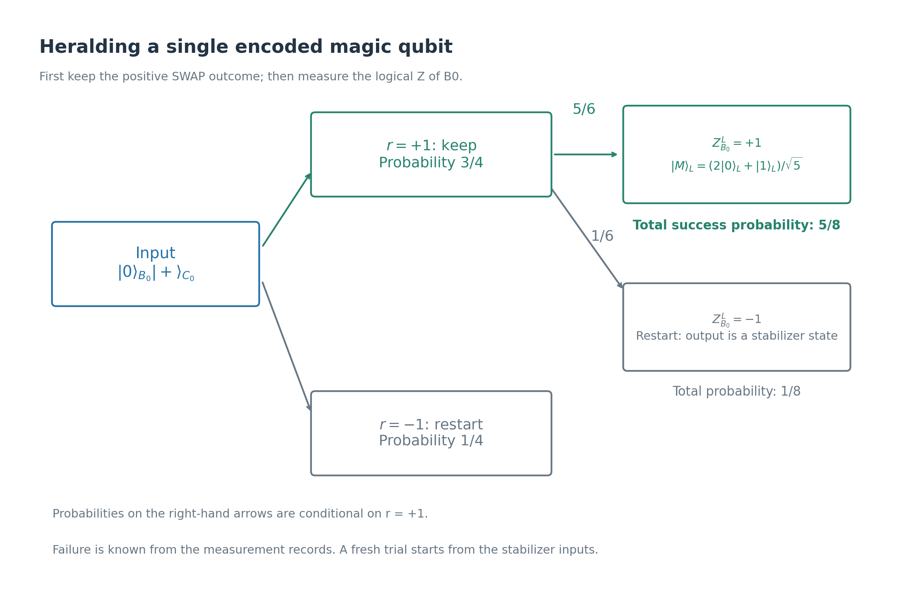
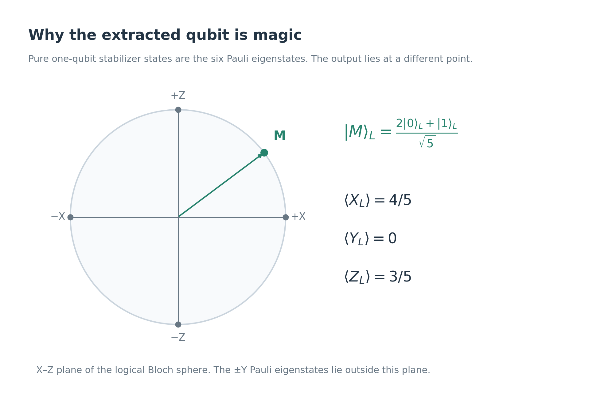
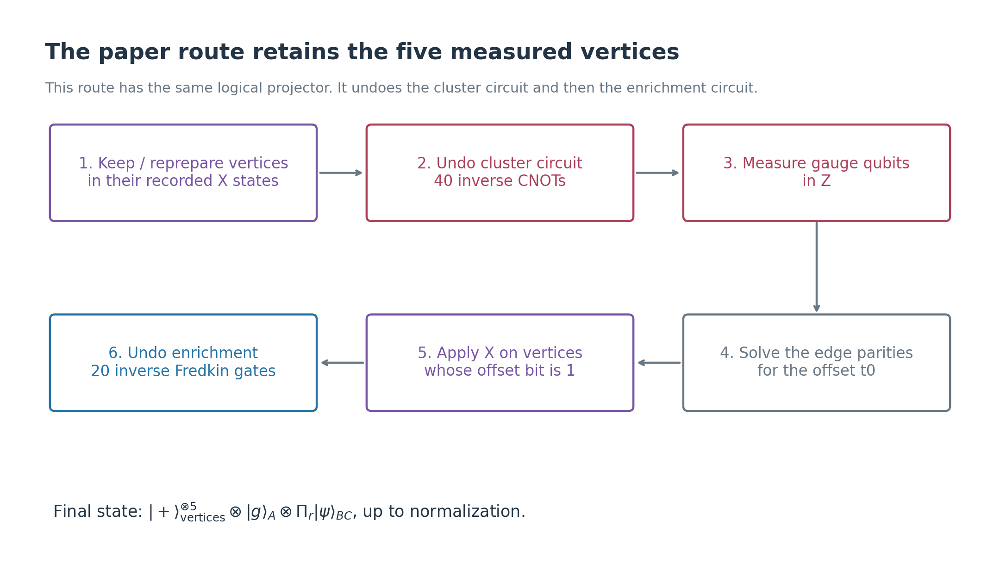

# From C4-Helix SWAP gauging to encoded magic

This is the second note in the sequence. It starts with the gauged state
constructed in [the five-vertex gauging note](c4-helix-five-vertex-swap-gauging.md),
removes the gauge qubits, derives the required corrections, and gives a
concrete encoded magic state at the end. Fault tolerance is reserved for
the third note.

**Source:** “Logical Clifford Measurement from Gauging and Ungauging,”
Section VI.A of [arXiv:2602.12228v1](../arXiv-2602.12228v1/main.tex), and the
corresponding section of the
[companion note](non-abelian-anyons-from-gauging-v2.md).
The input code and logical operators are taken from Table I of the
[C4-Helix manuscript](../arXiv-2609.03194v1/appendix.tex).

We first give a direct ungauging circuit derived from the previous note's
wavefunction. We then relate it to the paper's circuit, which retains the
temporary vertices and reverses the cluster entangler and enrichment.
Both implement the same ideal logical measurement. The SWAP-specific
magic-state example below is derived here; the paper illustrates its
magic-state discussion with CZ.

## 1. What should ungauging accomplish?

After gauging we have forty data qubits in B and C, twenty surviving gauge
qubits \(A_0,\ldots,A_{19}\), and a classical record of the five vertex
measurements:

\[
x=(x_a,x_b,x_c,x_d,x_e),\qquad x_v\in\{+1,-1\}.
\]

The measured whole-block symmetry is

\[
U=\prod_{q=0}^{19}\operatorname{SWAP}(B_q,C_q),
\qquad r=x_ax_bx_cx_dx_e.
\]

**Definition — ungauging in this note.** Remove the gauge register and
its associated rearrangement of the data, returning B and C to their
original C4-Helix code spaces. The retained data state should be

\[
\boxed{
|\psi_r\rangle_{BC}
=\frac{\Pi_r|\psi\rangle_{BC}}{\sqrt{\langle\psi|\Pi_r|\psi\rangle}},
\qquad \Pi_r:=\frac{I+rU}{2}.
}
\tag{1}
\]

Here \(|\psi\rangle\) is the encoded input state before gauging. A branch
with zero probability is absent. The projector \(\Pi_r\) keeps the
SWAP-eigenvalue-r component and removes the other component.

Thus ungauging restores the original **code spaces**, not the original
**state**: the logical symmetry measurement is retained.

## 2. Recall the graph and the controller assignment

The graph has five vertices a,b,c,d,e, with two edges between every pair.
The twenty edge labels are the same as in the first note.

Define the physical partial-SWAP operators

\[
T_v=\prod_{q:\phi(q)=v}\operatorname{SWAP}(B_q,C_q),
\]

using the same controller map \(\phi\):

| v | Labels q exchanged by \(T_v\) |
|---|---|
| a | 0, 6, 11, 12 |
| b | 7, 9, 15, 16 |
| c | 2, 8, 13, 19 |
| d | 3, 5, 14, 17 |
| e | 1, 4, 10, 18 |

These operators exchange disjoint data pairs, so they commute, square to
I, and satisfy \(T_aT_bT_cT_dT_e=U\).

**Definition — vertex pattern t.** This is a list of five classical bits
\(t=(t_a,t_b,t_c,t_d,t_e)\). Its corresponding data operation is

\[
V_t:=T_a^{t_a}T_b^{t_b}T_c^{t_c}T_d^{t_d}T_e^{t_e}.
\tag{2}
\]

In the first note this operator was called \(U_t\). We use \(V_t\) here
to distinguish the general partial SWAP from the full symmetry U.
A partial SWAP need not preserve the original code spaces on its own.

The gauge configuration produced by t is the twenty-bit list \(\delta t\),
defined by

\[
(\delta t)_q=t_u\oplus t_v
\qquad\text{for edge q with endpoints u,v}.
\tag{3}
\]

The symbol \(\oplus\) means addition modulo two. It is the graph
coboundary map \(d_0^a\) in the companion note, written without matrices.

For example, edge 7 joins a and b, so \((\delta t)_7=t_a\oplus t_b\).
Changing both endpoint bits leaves the edge bit unchanged.

## 3. The starting gauged state

**Definition:** \(\delta t\) is the list of twenty edge bits obtained by adding the endpoint bits modulo two:
\[
(\delta t)_q=t_u\oplus t_v
\quad\text{when edge }q\text{ connects }u\text{ and }v.
\]

Thus the ket is shorthand for
\[
|\delta t\rangle_A
=
|(\delta t)_0\rangle_{A_0}\otimes\cdots\otimes
|(\delta t)_{19}\rangle_{A_{19}}.
\]

For example, edge 7 connects **a and b**, so its gauge qubit appears in the state
\[
|t_a\oplus t_b\rangle_{A_7}.
\]
If \(t_a=0\) and \(t_b=1\), this is \(|1\rangle_{A_7}\). If both bits are 1, it is \(|0\rangle_{A_7}\).

This comes directly from the preparation circuit: \(A_7\) starts in \(|0\rangle\), and the two endpoint-controlled CNOTs flip it according to \(t_a\) and \(t_b\).

So **\(t\) labels five vertex bits; \(\delta t\) labels the twenty gauge bits that those vertices produce.**

For an arbitrary encoded input \(|\psi\rangle_{BC}\), the unnormalized
post-vertex-measurement state from the first note is

\[
|\Psi_x\rangle_{A,BC}
=\frac1{32}\sum_{t\in\{0,1\}^5}
\chi_x(t)\,|\delta t\rangle_A V_t|\psi\rangle_{BC},
\qquad
\chi_x(t):=\prod_v x_v^{t_v}.
\tag{4}
\]

The scalar \(\chi_x(t)\) is +1 or −1. The gauge register is correlated
with which physical data pairs have been exchanged.

On a connected graph, exactly two patterns produce a given allowed gauge
configuration: t and its complement \(t\oplus\mathbf1\), where
\(\mathbf1=(1,1,1,1,1)\). 

-----
It means that **the edge bits determine the vertex bits, except that they cannot tell whether every vertex bit has been flipped simultaneously.**

Let us prove this using our graph. Fix one allowed gauge record \(g\).

**Choose \(t_a=0\).** The edges from a to the other four vertices then determine their bits:
\[
t_b=g_7,\qquad
t_c=g_{11},\qquad
t_d=g_3,\qquad
t_e=g_0.
\]
There is no further choice. Since \(g\) is allowed, these bits also satisfy all the other edge equations.

**Choose \(t_a=1\) instead.** To preserve the same edge bits, we must now have
\[
t_b=1\oplus g_7,\qquad
t_c=1\oplus g_{11},\qquad
t_d=1\oplus g_3,\qquad
t_e=1\oplus g_0.
\]
Every vertex bit is therefore the opposite of its previous value.

These two patterns give identical edge bits because flipping both endpoints preserves their parity:
\[
(t_u\oplus1)\oplus(t_v\oplus1)=t_u\oplus t_v.
\]

For example,
\[
t=(0,1,0,0,0)
\quad\text{and}\quad
t\oplus\mathbf1=(1,0,1,1,1)
\]
produce exactly the same gauge configuration.

**There cannot be a third pattern:** \(t_a\) can only be 0 or 1, and either choice fixes every other vertex bit.

For a general connected graph, the same argument propagates along paths from a chosen starting vertex. That is where connectedness enters.

-----

They obey

\[
V_{t\oplus\mathbf1}=V_tU,
\qquad
\chi_x(t\oplus\mathbf1)=r\,\chi_x(t).
\tag{5}
\]

These two terms will interfere to produce \(I+rU\) during ungauging.

## 4. Measure the twenty gauge qubits in Z

Measure \(Z_{A_q}\) for every q. Write the recorded eigenvalues as
\(z_q\in\{+1,-1\}\), and convert them to bits:

\[
\boxed{g_q:=\frac{1-z_q}{2}.}
\tag{6}
\]

Thus outcome +1 means bit 0 and outcome −1 means bit 1. This is a new
measurement record: the signs \(x_v\) came from vertex X measurements;
the bits \(g_q\) now come from gauge Z measurements.

In the ideal circuit, the record must satisfy all sixteen flux constraints
from the first note. Equivalently, there is a vertex pattern \(t_0\)
such that

\[
g=\delta t_0.
\tag{7}
\]

**Definition — offset \(t_0\).** This is one reconstructed vertex pattern
whose endpoint parities reproduce the measured gauge bits. It tells us
which partial physical SWAP remains on the data.

We do not postselect the all-zero gauge record. Every one of the sixteen
allowed records has a correction.

### Reconstruct the offset from four edges

Fix \(t_{0,a}=0\). This chooses one of the two equivalent solutions.
Using the four edges of a tree centred at a gives

\[
\boxed{
t_{0,b}=g_7,\quad
t_{0,c}=g_{11},\quad
t_{0,d}=g_3,\quad
t_{0,e}=g_0.
}
\tag{8}
\]

For instance, \(g_7=t_{0,a}\oplus t_{0,b}=t_{0,b}\).
The remaining sixteen edges check consistency: for every edge q:u—v,
verify \(g_q=t_{0,u}\oplus t_{0,v}\). The parallel edges must give equal
bits, and each triangle must have even bit parity.

This is an exact reconstruction for ideal records. Choosing a best offset
from inconsistent, noisy records belongs to the fault-tolerance note.

## 5. Correct the data with ordinary physical SWAPs

The gauge measurement keeps only the two terms
\(t_0,t_0\oplus\mathbf1\) in (4). The unnormalized data state becomes

\[
\begin{aligned}
|\psi_{x,g}^{\rm raw}\rangle
&=\frac{\chi_x(t_0)}{32}
V_{t_0}(I+rU)|\psi\rangle\\
&=\frac{\chi_x(t_0)}{16}
V_{t_0}\Pi_r|\psi\rangle.
\end{aligned}
\tag{9}
\]

**The correction is \(V_{t_0}^{\dagger}=V_{t_0}\).** Apply one physical
\(\operatorname{SWAP}(B_q,C_q)\) for every q whose controller has offset
bit \(t_{0,\phi(q)}=1\). This operation uses classical measurement
information; it does not require controlled-SWAP gates.

Because \(V_{t_0}^2=I\), the corrected data state is

\[
\boxed{
|\psi_{x,g}^{\rm corrected}\rangle
=\frac{\chi_x(t_0)}{16}\Pi_r|\psi\rangle.
}
\tag{10}
\]

The factor \(\chi_x(t_0)\) is a global phase, so it requires no correction.
After normalization, the remaining state is exactly (1).

With \(t_{0,a}=0\), this correction uses between zero and sixteen
physical SWAPs. The measured gauge qubits can be discarded or reset.
The five measured vertex qubits need not be retained for this direct route.

### A complete example

Suppose the reconstructed pattern is
\(t_0=(0,1,0,1,0)\). Its negative gauge outcomes are

\[
q\in\{2,3,4,5,6,7,8,9,13,15,17,19\}.
\]

The correction is \(V_{t_0}=T_bT_d\), namely physical SWAPs at labels

\[
q\in\{3,5,7,9,14,15,16,17\}.
\]

**The correction labels are not the negative gauge-edge labels.** First
reconstruct the vertex pattern, then use the controller table to select
the data pairs. For example, gauge bit \(g_{14}=0\), yet data pair
\(B_{14},C_{14}\) is exchanged because its controller d has offset bit 1.

If x has negative outcomes at b and c only, then \(r=+1\) and
\(\chi_x(t_0)=-1\). The corrected result is \(-\Pi_+|\psi\rangle/16\),
which is physically the same state as \(+\Pi_+|\psi\rangle/16\).

### Does the choice of solution matter?

The other solution is \(t_0\oplus\mathbf1\). Its correction differs by U.
But \(U\Pi_r=r\Pi_r\), so it changes the corrected state only by the
global phase r. Fixing the root bit therefore loses no logical information.

## 6. Why B and C return to their original code spaces

The original encoded input lies in \(\mathcal C_B\otimes\mathcal C_C\).
The full block SWAP U preserves that space, so both terms in
\(\Pi_r|\psi\rangle\) lie in it. Every original X and Z check is therefore
restored with eigenvalue +1 after the correction.

One can also see this directly in the dressed checks. In a fixed gauge
record, a path from controller \(\phi(q)\) to check anchor \(r_s\) has
parity

\[
t_{0,\phi(q)}\oplus t_{0,r_s}.
\]

The dressed check puts its q-th factor in B or C according to this parity.
Conjugating by \(V_{t_0}\) exchanges the factor once more if
\(t_{0,\phi(q)}=1\). The remaining placement depends only on the anchor:

\[
V_{t_0}D^Q_{B,s}(g)V_{t_0}
=\begin{cases}
S^Q_{B,s},&t_{0,r_s}=0,\\
S^Q_{C,s},&t_{0,r_s}=1,
\end{cases}
\qquad Q=X,Z.
\tag{11}
\]

The C-check transforms into the other copy. Both original checks are
therefore recovered, even when the anchor bit is 1.

There is no need to decode the logical information into bare physical
qubits. It remains encoded in the forty data qubits throughout the final
logical measurement and extraction described below.

## 7. Distinguish the three uses of “correction”

| Operation | What it does | Required for this direct route? |
|---|---|---|
| Gauge Z strings from the first note | Pair or relocate negative vertex-constraint signs | May be deferred |
| Data correction \(V_{t_0}\) | Undo the partial data SWAP selected by the gauge record | Yes |
| Retain a desired logical outcome r | Select a symmetry sector for the magic-state preparation | This is heralding, not an error correction |

Gauge Z strings do not change the product r. If they were already applied,
measuring the gauge qubits in Z turns their action into a record-dependent
global phase. They leave g and the required data correction unchanged.
Thus the direct route works whether or not we performed that optional
sign correction; keep the original vertex outcome record to compute r.

A gauge correction cannot convert the negative logical SWAP branch into
the positive branch. For the input below, the negative branch is a
stabilizer state and is discarded. This is a known preparation outcome,
not evidence of a fault.

Conditional on a nonzero-probability vertex record x, the sixteen ideal
gauge records are uniformly distributed. Equation (10) shows that their
only differences after correction are global phases. The net logical
measurement has probabilities

\[
\Pr(r)=\langle\psi|\Pi_r|\psi\rangle.
\tag{12}
\]

The correction must be applied, or consistently incorporated into all
subsequent operations, before reading an original-block logical observable.
A recorded partial SWAP does not automatically preserve the original
block-check interpretation.

## 8. Choose logical inputs that give magic

Each C4-Helix block encodes two qubits. To distinguish them from physical
data qubits, write \(B_0^L,B_1^L\) and \(C_0^L,C_1^L\).
For example, \(B_0^L\) is an encoded degree of freedom supported across
block B; it is not the physical data qubit \(B_0\).

On these four logical qubits,

\[
\overline U=
\operatorname{SWAP}(B_0^L,C_0^L)
\operatorname{SWAP}(B_1^L,C_1^L).
\tag{13}
\]

Prepare the encoded stabilizer inputs

\[
\boxed{
|\psi_{\rm in}\rangle=
|\overline{00}\rangle_B\otimes|\overline{+0}\rangle_C.
}
\tag{14}
\]

The active pair \(B_0^L,C_0^L\) is in \(|0\rangle_L|+\rangle_L\).
The two spectator logical qubits \(B_1^L,C_1^L\) are both in
\(|0\rangle_L\), so swapping them acts as identity.

Operationally, these inputs are specified by the ordinary code checks
together with

\[
\overline Z^B_0=\overline Z^B_1=+1,
\qquad
\overline X^C_0=\overline Z^C_1=+1.
\]

These are commuting Pauli constraints selecting encoded stabilizer states.
A preparation circuit for them is an additional implementation choice;
the note assumes they have been prepared ideally.

For the next calculations, suppress the spectator factor
\(|0\rangle_{B_1^L}|0\rangle_{C_1^L}\), and define

\[
|ij\rangle_L:=|i\rangle_{B_0^L}|j\rangle_{C_0^L}.
\]

These two indices now refer to the active logical pair across the two
blocks. Its initial state is

\[
|0+\rangle_L=\frac{|00\rangle_L+|01\rangle_L}{\sqrt2},
\qquad
\overline U|0+\rangle_L
=\frac{|00\rangle_L+|10\rangle_L}{\sqrt2}.
\]

Identical inputs such as \(|00\rangle_B|00\rangle_C\) would already have
SWAP eigenvalue +1 and would produce no new magic in this procedure.

## 9. Compute both logical SWAP outcomes

### Positive outcome: an encoded two-qubit magic state

Applying \(\Pi_+=(I+\overline U)/2\) gives

\[
\Pi_+|0+\rangle_L
=\frac{2|00\rangle_L+|01\rangle_L+|10\rangle_L}{2\sqrt2}.
\]

Its squared norm is \((4+1+1)/8=3/4\). Thus

\[
\boxed{
\Pr(r=+1)=\frac34,\qquad
|M_2\rangle_L=
\frac{2|00\rangle_L+|01\rangle_L+|10\rangle_L}{\sqrt6}.
}
\tag{15}
\]

This is a non-stabilizer state, hence a magic resource. In a logical
computational basis, a pure stabilizer state has nonzero amplitudes of
equal magnitude on a support of power-of-two size. Here there are three
nonzero components, with unequal magnitudes 2,1,1.

### Negative outcome: a logical singlet

Similarly,

\[
\Pi_-|0+\rangle_L
=\frac{|01\rangle_L-|10\rangle_L}{2\sqrt2},
\]

giving

\[
\boxed{
\Pr(r=-1)=\frac14,\qquad
|\Psi^-\rangle_L=
\frac{|01\rangle_L-|10\rangle_L}{\sqrt2}.
}
\tag{16}
\]

This singlet is a stabilizer state: it has logical \(X\otimes X=-1\)
and \(Z\otimes Z=-1\). We restart the preparation for this outcome.

The factor 2 in the positive branch has a simple origin: \(|00\rangle_L\)
appears in both the original and swapped state and adds constructively.
It cancels in the negative branch. The \(|01\rangle_L\) and
\(|10\rangle_L\) components distinguish the two terms.

## 10. Extract one magic qubit in block C

The state \(|M_2\rangle_L\) is already an encoded magic resource. To
obtain a single logical magic qubit, measure \(\overline Z^B_0\), the
logical Z of the active qubit in block B, after ungauging and correction.

**Definition — logical Z readout.** Measure the encoded observable as
one joint Pauli parity. Table I supplies the physical representative

\[
\boxed{
\overline Z^B_0=Z^B_0Z^B_3Z^B_6Z^B_7Z^B_{18}Z^B_{19}.
}
\tag{17}
\]

This means measuring the product, not measuring its six physical factors
separately and revealing extra information. An ideal nondestructive parity
measurement leaves the data encoded. Its noisy implementation belongs to
the third note.

Write its outcome as \(m\in\{+1,-1\}\).

For \(m=+1\), the logical B qubit is 0 and the retained components are

\[
2|00\rangle_L+|01\rangle_L
=|0\rangle_{B_0^L}
\bigl(2|0\rangle_{C_0^L}+|1\rangle_{C_0^L}\bigr).
\]

Their conditional probability is \((4+1)/6=5/6\). The resulting state
of the full C block is

\[
\boxed{
|\overline{M0}\rangle_C,
\qquad
|M\rangle_L:=\frac{2|0\rangle_L+|1\rangle_L}{\sqrt5}.
}
\tag{18}
\]

Logical qubit \(C_0^L\) holds the magic state, while \(C_1^L\) remains in
\(|0\rangle_L\). Block B is left in \(|\overline{00}\rangle_B\).

For \(m=-1\), only \(|10\rangle_L\) remains, with conditional probability
\(1/6\). The C block is then a stabilizer state, and this trial is restarted.

The full success probability for a single-qubit output is therefore

\[
\boxed{\Pr(\text{single-qubit magic})=
\frac34\times\frac56=\frac58.}
\tag{19}
\]

This is **heralded preparation**: success is known from r and m.
There is no postselection on a particular individual vertex record or
gauge record. All their allowed values are handled by the corrections.
If a two-qubit resource is sufficient, stop at (15), with success probability
\(3/4\), instead of performing the extraction.

### Verify directly that the extracted qubit is magic

For \(|M\rangle_L\), the logical Bloch vector is

\[
\bigl(\langle\overline X_0\rangle,
\langle\overline Y_0\rangle,
\langle\overline Z_0\rangle\bigr)
=\left(\frac45,0,\frac35\right).
\tag{20}
\]

Its squared length is one, so the state is pure. A pure single-qubit
stabilizer state is a Pauli eigenstate: its Bloch vector points along
one of the six signed coordinate axes. This vector points elsewhere,
so \(|M\rangle_L\) is non-stabilizer.

This is the specific magic state delivered by the chosen SWAP protocol.
It is not a claim that we have prepared a standard T state or supplied
a particular injection or distillation circuit.

## 11. How this relates to the paper's ungauging circuit

The direct route above measured the gauge register of the previous note's
state and corrected the data. It did not need to reverse the cluster
circuit or quantum enrichment. This simplification follows from their
known action for the SWAP controller assignment.

The paper instead keeps the measured vertex register, reverses the
cluster entangler, corrects a vertex offset, and reverses enrichment.
The following comparison assumes we defer the optional gauge-Z sign
correction, so the retained vertex state is still the one associated
with the original x record.

The operations are:

1. Keep the vertices after nondestructive X measurements, in their
   recorded states \(|x_v\rangle_X\). If readout destroyed them,
   reprepare those same X-eigenstates.
2. Apply \(C_A^\dagger\), the inverse forty-CNOT cluster circuit.
3. Measure the twenty gauge qubits in Z and reconstruct \(t_0\) from
   their new record using the same tree equations.
4. Apply \(X^{\rm vertices}_{t_0}=\prod_v X_v^{t_{0,v}}\).
5. Apply \(\Omega^\dagger\), the inverse enrichment circuit, and discard
   the ancillary registers.

For our disjoint controlled-SWAP gates, each Fredkin gate is self-inverse
and the twenty factors commute, so \(\Omega^\dagger=\Omega\).
In this route the cluster inverse uses the measured vertices as quantum
controls; it cannot be applied to vertices that were discarded without
repreparation.

### Derive why the vertex-offset correction works

Let s denote a five-bit computational-basis label of the retained vertex
register. Its measured X-eigenstate has amplitude \(\chi_x(s)/\sqrt{32}\).
Combining this expansion with (4), the state before the inverse cluster
circuit is proportional to

\[
\sum_{s,t}\chi_x(s)\chi_x(t)
|s\rangle\,|\delta t\rangle_A\,V_t|\psi\rangle.
\]

The inverse cluster circuit changes the gauge string to
\(\delta(t\oplus s)\). A gauge record \(g=\delta t_0\) then keeps precisely

\[
t=s\oplus t_0\quad\text{or}\quad
t=s\oplus t_0\oplus\mathbf1.
\]

Their two coefficients are \(\chi_x(t_0)\) and
\(r\chi_x(t_0)\), independent of s. The remaining state is proportional to

\[
\chi_x(t_0)\sum_s |s\rangle\,V_{s\oplus t_0}(I+rU)|\psi\rangle.
\tag{21}
\]

Applying the vertex X correction replaces \(|s\rangle\) by
\(|s\oplus t_0\rangle\). Relabel the sum by \(s'=s\oplus t_0\):

\[
\chi_x(t_0)\sum_{s'} |s'\rangle V_{s'}(I+rU)|\psi\rangle.
\]

Now \(\Omega^\dagger\) applies \(V_{s'}^\dagger\) in each vertex branch,
removing that data operation. The final state factors as

\[
|+\rangle_{\rm vertices}^{\otimes5}\otimes|g\rangle_A
\otimes\Pi_r|\psi\rangle_{BC},
\tag{22}
\]

up to a global phase and normalization. The gauge record may be reset to
\(|0\rangle^{\otimes20}\) with X gates if those qubits are to be reused.

**The criterion for a vertex X correction is \(t_{0,v}=1\)**, independently
of whether \(\chi_x(t_0)\) is positive or negative. That scalar is only
a global phase; skipping the offset correction generally leaves a
partial SWAP on the data.

The two routes use different measured gauge records, since the paper's
record is obtained after \(C_A^\dagger\). Each route uses its own record
and applies its corresponding correction. They have the same final logical
instrument \(\rho\mapsto\Pi_r\rho\Pi_r\); this ideal equivalence does not
assert that their behaviour under faults is the same.

## 12. A complete ideal preparation recipe

For the direct route, one trial consists of:

1. Prepare B in \(|\overline{00}\rangle\) and C in
   \(|\overline{+0}\rangle\).
2. Prepare the five-vertex, twenty-edge ancillary resource with forty
   CNOTs, as in the first note.
3. Apply its twenty controlled-SWAP enrichment gates.
4. Measure the five vertices in X; retain their record and compute r.
5. Measure all twenty gauge qubits in Z, reconstruct \(t_0\), and
   verify its consistency with all edge records.
6. Apply \(V_{t_0}\) to the physical data pairs selected by the controller
   table. B and C now satisfy their original code checks.
7. If \(r=-1\), restart. If \(r=+1\), keep the two-qubit magic state or
   measure \(\overline Z^B_0\) to extract one magic qubit.
8. For single-qubit extraction, retain the C block if \(m=+1\); otherwise
   restart. The successful C block is \(|\overline{M0}\rangle_C\).

The logical SWAP is a Clifford unitary, but its **measurement** is not
generally a stabilizer operation. Here the physical non-Clifford ingredient
is the controlled-SWAP enrichment. Resource preparation, ordinary SWAP
corrections and final Pauli readout do not supply magic by themselves.

## 13. Exact checks accompanying this note

The [audit script](check-c4-helix-ungauging-and-magic.py) verifies:

- the offset reconstruction for all sixteen ideal gauge records;
- the corrected projector for all \(32\times16=512\) combinations of
  vertex and gauge records;
- the retained-vertex route independently, including all 16,384 vertex
  components of those record combinations;
- restoration of every dressed X and Z check;
- the Table I physical representative of logical \(Z_0\);
- both logical SWAP branches, extraction probabilities, and the final
  non-stabilizer Bloch vector.

The [saved results](../output/c4-helix-ungauging-and-magic.json) include
the worked correction example. The
[drawing script](plot-c4-helix-ungauging-and-magic.py) produces PNG and SVG
versions of the eight new figures; the full-graph image is reused from
the first note.

This note establishes the ideal encoded output and all required
record-dependent corrections. The third note will address whether
preparation, measurements and corrections remain reliable in the presence
of faults.
