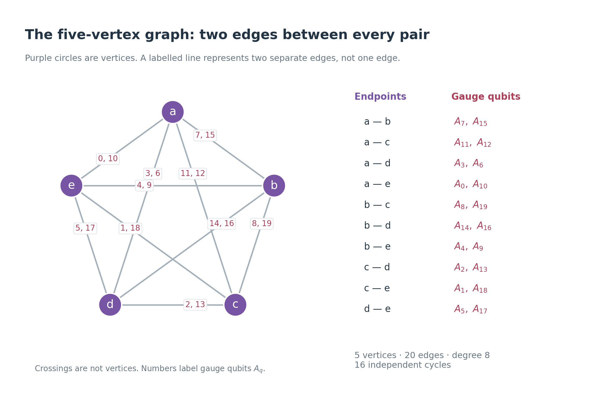
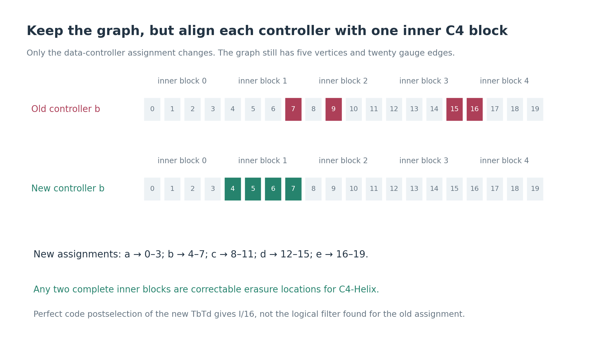
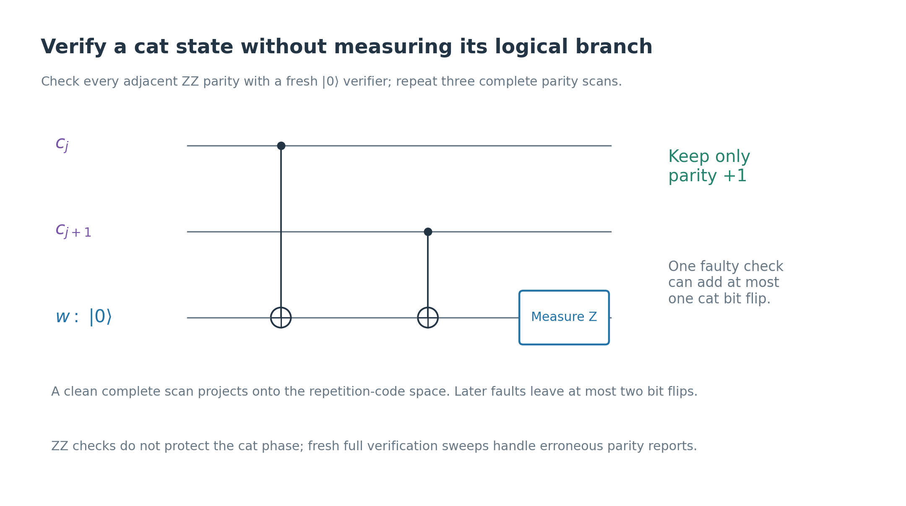
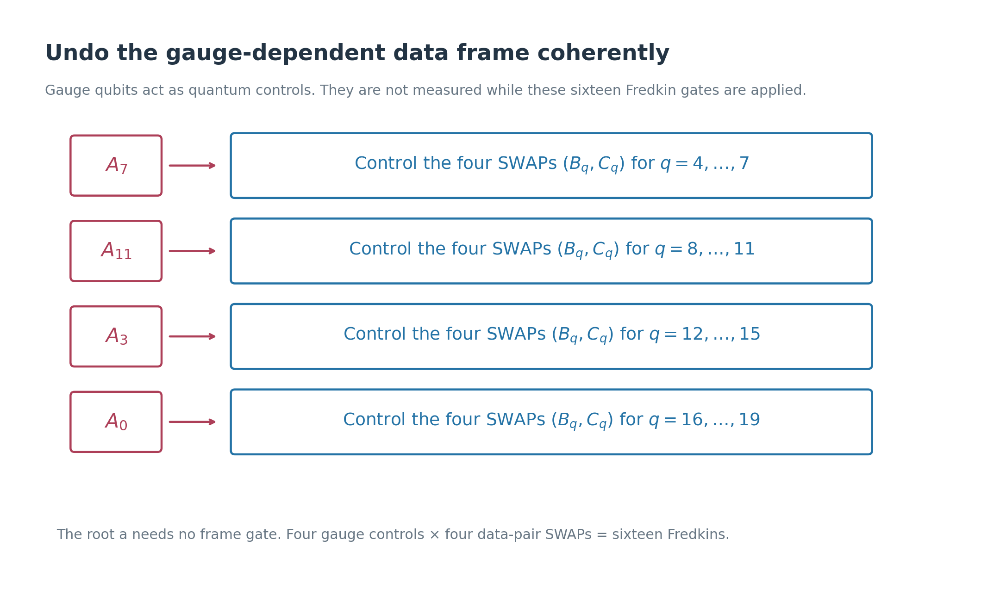
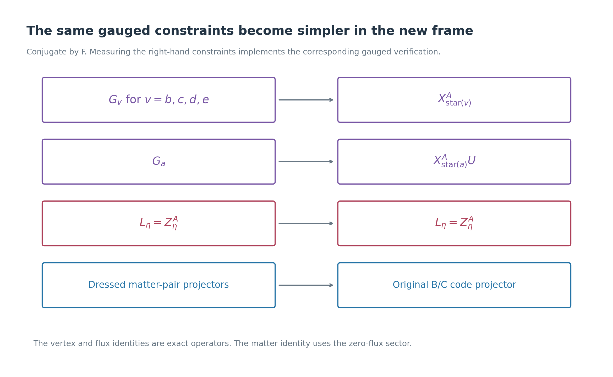
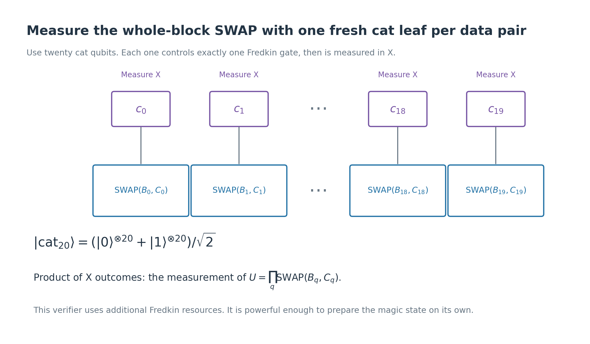
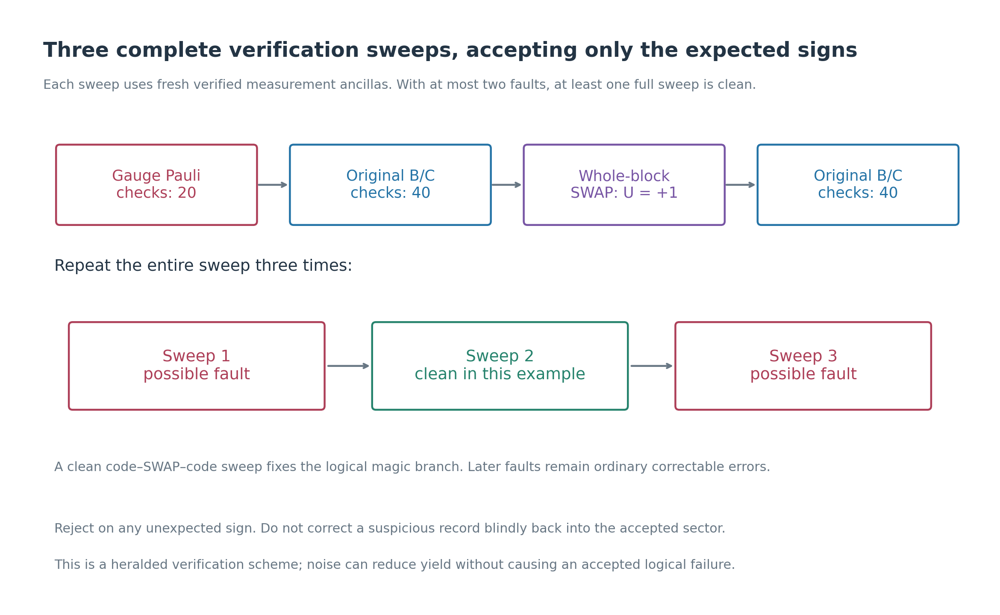
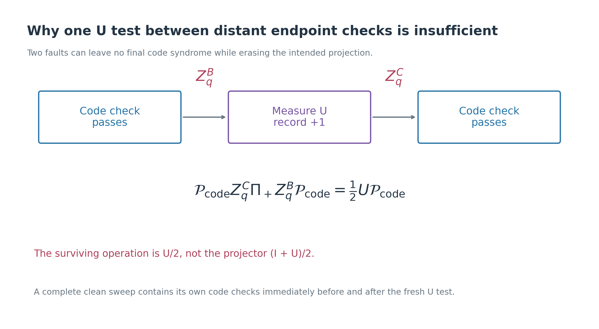
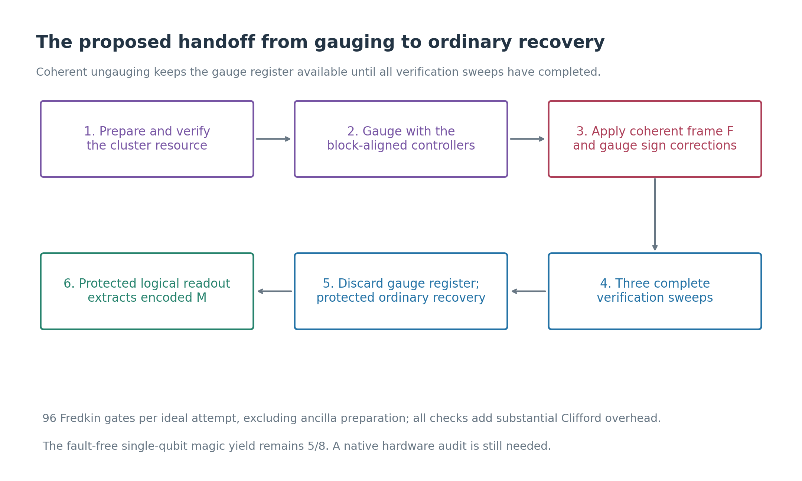

# Verifying C4-Helix gauging before handing the magic state to recovery

> **Scope correction.** This construction adds an independent whole-block
> SWAP verifier that can itself prepare the target magic state. It is an
> augmented factory, rather than the requested economical protection of
> the original gauging/ungauging circuit. For the revised construction that
> repeats the actual graph circuit without that verifier, see
> [Protecting the original gauging by repeating complete cycles](c4-helix-repeated-gauging-fault-tolerance.md).

This note investigates your proposed route: **verify the ancillary resource,
verify the gauging, and verify the return to the original codes before ordinary
recovery**. There is a promising construction along these lines. Its essential
changes are to align each controller with an inner C4 block, retain the gauge
register during verification, and check the intended logical SWAP sector as
well as the ordinary code constraints.

The result is a **conditional two-fault-tolerance argument**, with explicit
measurement circuits and finite algebraic checks. It is not a completed audit
of every location in a hardware circuit. The qualifications and remaining
work are specified in Section 11.

We use the same five-vertex, twenty-edge graph as in
[the gauging note](c4-helix-five-vertex-swap-gauging.md), and the encoded inputs
of [the ungauging note](c4-helix-ungauging-and-magic.md). The controller
assignment and ungauging circuit below replace their earlier choices.
The previous [fault-tolerance note](c4-helix-fault-tolerance.md) supplies
counterexamples motivating this construction.

**Sources.** The graph construction is based on “Example: Gauging transversal
SWAP gate” in [the gauging manuscript](../arXiv-2602.12228v1/main.tex).
The physical checks are Table I of
[the C4-Helix manuscript](../arXiv-2609.03194v1/appendix.tex).
The verification scheme below is our proposed extension, rather than a
fault-tolerance result claimed by either manuscript.

## 1. What must be protected?

There are two C4-Helix code blocks, B and C, each with twenty physical qubits
and two logical qubits. There are also five temporary vertex qubits
\(a,b,c,d,e\), and twenty gauge qubits \(A_0,\ldots,A_{19}\).

**Definition — fault.** A failure at one preparation, gate, measurement, or
idle location. It may act on all qubits touched by that location. A fault is
counted where it occurs, even if later gates spread its error.

For this argument, a Fredkin is a three-qubit primitive; CNOTs and
single-qubit operations have their usual local fault supports. Readout
bits may flip, and idle faults act on the idling qubit. Converting this
model to native physical gates is a remaining implementation check.

**Definition — accepted preparation.** An attempt for which every required
verification result has the prescribed sign. Rejected attempts are discarded.

Our target is: **with at most two faults in one attempt, either reject it or
leave an output that ideal ordinary recovery turns into the correct magic
state**. A physical implementation must then supply fault-tolerant recovery
and final logical readout, with their faults included in the overall budget.

The intended symmetry is the whole-block SWAP

\[
U=\prod_{q=0}^{19}\mathrm{SWAP}(B_q,C_q),
\qquad \Pi_+=\frac{I+U}{2}.
\]

On the encoded inputs
\(|\overline{00}\rangle_B|\overline{+0}\rangle_C\), this projection prepares

\[
|M_2\rangle_L=\frac{2|00\rangle_L+|01\rangle_L+|10\rangle_L}{\sqrt6}
\]

on the active logical pair; both spectator logical qubits remain zero.

**Passing B/C code checks alone does not identify this state.** The wrong
SWAP sector and many other logical states satisfy exactly the same physical
code checks. Consequently, we must verify the symmetry projection itself.
Even code checks plus U=+1 do not uniquely specify \(|M_2\rangle_L\).
The argument also needs the protected known inputs and the bound on early
error spread established below.

## 2. Keep the graph, but change which data a vertex controls

The parallel edge pairs are

| Endpoints | Gauge-edge labels | Endpoints | Gauge-edge labels |
|---|---|---|---|
| ab | 7, 15 | bc | 8, 19 |
| ac | 11, 12 | bd | 14, 16 |
| ad | 3, 6 | be | 4, 9 |
| ae | 0, 10 | cd | 2, 13 |
| ce | 1, 18 | de | 5, 17 |

**Definition — inner block \(J_v\).** One of the five four-qubit groups
used in the C4 concatenation, with corresponding groups in B and C.
Choose the controller map \(\phi(q)\) as follows:

| Vertex v | \(J_v=\{q:\phi(q)=v\}\) |
|---|---|
| a | 0, 1, 2, 3 |
| b | 4, 5, 6, 7 |
| c | 8, 9, 10, 11 |
| d | 12, 13, 14, 15 |
| e | 16, 17, 18, 19 |

Define \(T_v=\prod_{q\in J_v}\mathrm{SWAP}(B_q,C_q)\). Each vertex controls
the four gates in its own \(T_v\), and \(\prod_vT_v=U\).

The gauge-edge number and the controlled data-pair number now have independent
roles. For example, \(A_4\) lies between b and e, but vertex b also controls
data pair 5, whose gauge edge lies between d and e. This is allowed: the
paper permits a controller at bounded hypergraph distance, with being an
endpoint given as a stronger optional choice. Here every upper check meets
the corresponding inner block, giving a data–inner-check–data–upper-check
path of length at most three. Controller degree stays four, and dressing
paths on the complete five-vertex graph remain short.

### Why this change helps

**Definition — code projector \(\mathcal P\).** The orthogonal projector
onto \(\mathcal C_B\otimes\mathcal C_C\), the simultaneous +1 eigenspace
of every original B/C check.

For C4-Helix, **any one or two complete inner blocks contain no nontrivial
logical Pauli operator**. This is stronger than the generic statement about
distance six: these particular eight-qubit regions are correctable erasure
locations. Direct enumeration of Table I verifies all fifteen choices.

Thus any operator E supported within these regions in B and C satisfies

\[
\mathcal P E\mathcal P=c_E\mathcal P.
\tag{1}
\]

To see why, expand E in Pauli products. A term that anticommutes with a code
check is removed by the two projectors. Any surviving term in these regions
is a stabilizer, and acts as a scalar. This also covers coherent errors and
operators entangling B with C.

For example, the new partial SWAPs obey

\[
\mathcal P T_b\mathcal P=\tfrac14\mathcal P,
\qquad
\mathcal P T_bT_d\mathcal P=\tfrac1{16}\mathcal P.
\tag{2}
\]

Their accepted components change the success amplitude, but do not filter
the encoded information. With the earlier scattered assignment, two
controller faults could instead survive as a damaging logical filter.

## 3. First stage: verify the ancillary resource offline

Prepare vertices in \(|+\rangle\), gauge qubits in \(|0\rangle\), and apply
the same forty vertex-to-edge CNOTs. For edge q with endpoints u and v, the
resource checks are

\[
K_v=X_v\prod_{q\in\mathrm{star}(v)}X_{A_q},
\qquad K_q=Z_uZ_{A_q}Z_v.
\tag{3}
\]

**Definition — star(v).** The eight graph edges touching vertex v.

The five \(K_v\) and twenty \(K_q\) are independent commuting Pauli
operators. Their common +1 eigenspace is one-dimensional: they specify the
whole resource state, not merely a code containing unknown logical data.

Measure all twenty-five checks in **three complete passes**, with fresh
verified measurement ancillas for each check. Reject on any −1 result.
With at most two faults, at least one pass has no faults, including its
ancilla preparations. An accepted clean pass projects onto the exact
resource state, even if the earlier forty-CNOT preparation was poor.

There can still be faults after that clean pass. The measurement circuit
must ensure that each such fault deposits errors on at most one resource
qubit. Section 4 gives the ancilla construction for this purpose. Thus an
accepted resource is exact up to a small residual error, rather than assumed
perfect because its recorded signs happened to pass once.

The B/C inputs need the same protection. They are known stabilizer states:
the eighteen independent code checks plus
\(\overline Z_0,\overline Z_1\) specify B, and the code checks plus
\(\overline X_0,\overline Z_1\) specify C. Each set has rank twenty.
They can likewise be prepared offline and verified by three complete passes,
using the safe Pauli-measurement circuit below. Residual input faults count
toward the same two-fault budget.

## 4. An explicit verified ancilla for measuring a product

**Definition — cat state.** For n qubits,

\[
|\mathrm{cat}_n\rangle=(|0\rangle^{\otimes n}+|1\rangle^{\otimes n})/\sqrt2.
\]

Prepare it with H on the first qubit and a chain of CNOTs. This preparation
alone is unsafe: an early bit flip can spread along the chain.
Before using the cat, measure every adjacent \(Z_{c_j}Z_{c_{j+1}}\) parity,
using the following circuit and a new verifier qubit w for each parity.
Perform **three complete parity scans** and accept only +1 results.

There is a clean scan if there are at most two faults. Its accepted outcomes
project the cat onto the span of \(|0^n\rangle,|1^n\rangle\). After that
scan, a fault in a parity circuit can introduce a bit flip on at most one
cat qubit. In particular, an X error on w does not propagate back to another
cat qubit: w is the CNOT target. A global cat bit flip merely exchanges
the two branches.

The resulting useful guarantee is **at most f cat bit errors, modulo a
global bit flip, for f faults**. Phase errors are not removed by these ZZ
checks. They can reverse or corrupt the later measurement result, which is
why the complete verification sweeps in Section 7 must use fresh ancillas.

To measure a Pauli product \(S=P_1\cdots P_n\), let cat leaf j control
\(P_j\) on exactly one target qubit, then measure all cat leaves in X.
Their product is the S outcome. A cat bit error causes a local target error;
a faulty interaction touches only one target. Each leaf interacts once,
so this circuit avoids spreading one ancillary fault across a whole check.

This is the standard verified-cat strategy for controlling error spread,
adapted here to our checks and rejection rule; see
[Gottesman's textbook, Chapter 12](https://www.cs.umd.edu/~dgottesm/QECCbook-2024.pdf).

## 5. Second stage: gauge, then undo the data frame coherently

Apply the twenty enrichment gates

\[
\Omega=\prod_q\operatorname{CSWAP}(\phi(q);B_q,C_q),
\]

using the new controller table. Measure vertices in X, recording signs
\(x_v\), and initially retain only reported \(r=\prod_vx_v=+1\).
We will verify this sector independently; this classical record is not
trusted as the sole evidence for it.

**Definition — coherent frame removal F.** The quantum-controlled version
of the offset SWAP correction in the previous ungauging note. Use the four
root-tree gauge qubits as controls, without measuring them:

\[
F=\prod_{q\in J_b}\operatorname{CSWAP}(A_7;B_q,C_q)
\prod_{q\in J_c}\operatorname{CSWAP}(A_{11};B_q,C_q)
\prod_{q\in J_d}\operatorname{CSWAP}(A_3;B_q,C_q)
\prod_{q\in J_e}\operatorname{CSWAP}(A_0;B_q,C_q).
\tag{4}
\]

This uses sixteen additional Fredkin gates. The root a needs none.
Every reused control still touches only one complete inner block, which
keeps a control fault within the regions of Equation (1).

### What F does in the ideal circuit

Write a vertex bit pattern as t, and its gauge field as
\((\delta t)_q=t_u\oplus t_v\) for edge q:u—v. Also define

\[
V_t=\prod_vT_v^{t_v},\qquad \chi_x(t)=\prod_vx_v^{t_v}.
\]

The state after vertex measurement, before normalization, is

\[
|\Psi_x\rangle=\frac1{32}\sum_t\chi_x(t)|\delta t\rangle_A V_t|\psi\rangle.
\]

For each gauge field, choose its representative \(t_0\) with \(t_{0,a}=0\).
Then \(t_{0,b}=g_7,t_{0,c}=g_{11},t_{0,d}=g_3,t_{0,e}=g_0\).
F applies \(V_{t_0}\) in that branch. Pairing t and \(t\oplus\mathbf1\)
therefore gives

\[
F|\Psi_x\rangle=\frac14|\eta_x\rangle_A\Pi_r|\psi\rangle,
\qquad
|\eta_x\rangle=\frac14\sum_{t_a=0}\chi_x(t)|\delta t\rangle_A.
\tag{5}
\]

Thus the gauge register and the intended projected data factorize, while
the gauge register remains available for checks.

Finally apply the gauge-only Pauli correction

\[
C_x=Z_{A_7}^{(1-x_b)/2}Z_{A_{11}}^{(1-x_c)/2}
Z_{A_3}^{(1-x_d)/2}Z_{A_0}^{(1-x_e)/2}.
\tag{6}
\]

It sends \(|\eta_x\rangle\) to the fixed state
\(|\eta_+\rangle=\frac14\sum_{t_a=0}|\delta t\rangle\), and commutes with F.
An incorrect sign record is diagnosed by subsequent checks rather than
used to decide that the data must already be correct.

## 6. What becomes of the full gauged constraints?

The gauged vertex operators are now
\(G_v=X^A_{\mathrm{star}(v)}T_v\), where
\(X^A_{\mathrm{star}(v)}=\prod_{q\in\mathrm{star}(v)}X_{A_q}\).
They are Clifford involutions, rather than Pauli products.

Conjugation by F gives exact operator identities:

\[
FG_vF^\dagger=X^A_{\mathrm{star}(v)}\quad(v=b,c,d,e),
\qquad FG_aF^\dagger=X^A_{\mathrm{star}(a)}U.
\tag{7}
\]

Flipping a nonroot star changes just its own tree bit, and the associated
\(T_v\) cancels. Flipping the root star changes all four tree bits, giving
\(T_aT_bT_cT_dT_e=U\).

After \(C_x\), the nonroot gauge stars should all have sign +1.
The root constraint has reported sign r. Since the product of all five
gauge stars is I, the missing part of the vertex constraints is precisely
**the requirement \(U=+1\)** for our accepted branch.

The flux constraints \(L_\eta=\prod_{q\in\eta}Z_{A_q}=+1\) commute with F
and are unchanged. A complete list is:

| Type | Edge labels of each check |
|---|---|
| Parallel pairs | (7,15), (11,12), (3,6), (0,10), (8,19), (14,16), (4,9), (2,13), (1,18), (5,17) |
| Triangles | (7,8,11), (7,14,3), (7,4,0), (11,2,3), (11,1,0), (3,5,0) |

These sixteen Z checks and four nonroot X stars specify the unique
twenty-qubit gauge state \(|\eta_+\rangle\).

In the zero-flux sector, F also converts the **joint +1 projector for each
dressed B/C check pair** into the joint projector for the original check
pair. An individual dressed check may become the B check or the C check,
depending on the anchor bit. Requiring both removes that ambiguity.

Concretely, in a gauge branch the dressing swaps data labels according to
\(t_{\phi(q)}\oplus t_{\mathrm{anchor}}\). F cancels the first bit. The
remaining anchor bit uniformly exchanges the two copies of that check.
Their joint constraint is unchanged.

For reference, the original Table I checks are
\(S^P_{B,s}=\prod_{q\in R_s}P_{B_q}\), and likewise for C, for P=X,Z:

| s | \(R_s\) |
|---|---|
| 0–4 | \(J_a,J_b,J_c,J_d,J_e\), respectively |
| 5 | 0, 3, 6, 7, 10, 11, 12, 15 |
| 6 | 4, 7, 8, 9, 14, 15, 16, 19 |
| 7 | 1, 2, 8, 11, 12, 13, 18, 19 |
| 8 | 2, 3, 5, 6, 13, 14, 16, 17 |
| 9 | 0, 1, 4, 5, 9, 10, 17, 18 |

We measure all forty listed B/C checks, including their redundancies.
The dictionary implements your idea of checking the full gauged constraints
in a reversible frame where most measurements are familiar Pauli checks.

### The remaining SWAP check needs its own safe circuit

Prepare a fresh verified twenty-qubit cat. Let leaf \(c_q\) control exactly
one \(\operatorname{CSWAP}(c_q;B_q,C_q)\), and measure every leaf in X.
The product of the outcomes measures U.

In the fault-free circuit, the two cat branches apply I and U, so outcome y
implements \((I+yU)/2\). A faulty leaf can cause a partial SWAP at its own
data pair; a faulty Fredkin touches only that pair. Thus one helper fault
does not reach four pairs, as it could with a reused vertex controller.
Cat phase faults can corrupt the sector result and must be handled by
complete fresh sweeps.

This measurement costs twenty additional Fredkins each time. **A controlled
Clifford measurement is not automatically a circuit of Clifford gates.**
Here controlled-SWAP remains a non-Clifford resource.

## 7. Third stage: three complete verification sweeps

After F and \(C_x\), perform this sequence three times:

1. Measure the sixteen flux checks and four nonroot gauge stars; require +1.
2. Measure all forty original B/C checks; require +1.
3. Measure U with a fresh verified twenty-qubit cat; require +1.
4. Measure all forty original B/C checks again; require +1.

Every check uses fresh verified ancillas. Ancilla preparation faults belong
to the sweep using that ancilla. Any unexpected sign rejects the attempt;
we do not apply a guessed correction that might conceal a logical error.

With two faults total, at least one **complete** sweep is fault-free.
The other sweeps may reject good attempts, but cannot be allowed to undo
the logical protection provided by the clean sweep.

### Why repeated U tests alone are insufficient

Suppose we check the codes only at distant endpoints. A fault \(Z^B_q\)
before the U test and a fault \(Z^C_q\) afterwards give

\[
\begin{aligned}
\mathcal P Z^C_q\Pi_+Z^B_q\mathcal P
&=\tfrac12\mathcal P(Z^C_qZ^B_q+U)\mathcal P\\
&=\tfrac12U\mathcal P.
\end{aligned}
\tag{8}
\]

The first term has a nonzero syndrome in each block and disappears.
The second survives. Both endpoint checks can pass, but the accepted
operation was U/2 instead of the desired projector. Repeating U while the
first error persists does not fix this: \(\Pi_+^2=\Pi_+\).

A complete clean sweep includes its own code checks **before and after**
the fresh U measurement. The first detects the pre-existing single-qubit
error in this example. If an earlier faulty sweep has already left an
encoded U component, the clean U measurement instead restores the intended
projection. Both protections are needed.

## 8. Why this can reject or neutralize damaging logical errors

The following is the conditional proof argument. It assumes local faults
and the verified-cat error-spread guarantee of Section 4.

### A. Early spread is confined to at most two inner blocks

After accepted offline verification, each remaining resource or input fault
has a local error. During enrichment, a vertex bit error can spread through
four SWAPs, all in its own \(J_v\). An arbitrary fault in one enrichment
Fredkin also stays in that group under the remaining enrichment gates.

A gauge bit error before F affects a tree control only if it is on one of
the four chosen tree edges. It then spreads only within the corresponding
\(J_v\). Likewise a fault in F touches one such control and one data pair,
and can affect the remaining gates of that same inner block. Phase errors
can change amplitudes and the inferred global sector.

Consequently, for at most two early faults, data errors are supported within
at most two inner groups, possibly accompanied by the global U action.
More formally, after selecting a gauge branch, each term has the form
\(E(\alpha I+\beta U)|\psi\rangle\), with E in those regions. Coefficients
can depend on the gauge register and environment; no stochastic Pauli
approximation is needed.

### B. The clean code check removes the damaging local filter

Before the first clean sweep, other verification circuits may have inserted
local errors, Pauli-check projectors, and I/U combinations from faulty sector
measurements. They do not introduce an additional reused data controller.
Their affected regions are charged to the faults that caused them.

Original stabilizers can be absorbed into \(\mathcal P\); U exchanges the
B/C stabilizer groups and preserves \(\mathcal P\). Equation (1) then says
that the accepted logical component at the clean sweep's first code check
has the form

\[
(\alpha I+\beta U)|\psi\rangle.
\tag{9}
\]

It cannot contain an arbitrary logical filter produced by the partial
controller SWAPs. This is exactly where aligning controllers with inner
blocks matters. Perfect code checks alone would not establish (9) for the
earlier controller assignment.

### C. The clean U check fixes the desired logical branch

The next measurement in the clean sweep gives

\[
\Pi_+(\alpha I+\beta U)|\psi\rangle
=(\alpha+\beta)\Pi_+|\psi\rangle.
\tag{10}
\]

If \(\alpha+\beta=0\), it rejects. Otherwise, normalization leaves exactly
the desired \(|M_2\rangle_L\), independent of the erroneous coefficients.
This also works with operator-valued gauge/environment coefficients.

For example, the single vertex-Z fault from the previous note prepares the
actual negative sector despite a reported positive sector. A clean U=+1
test rejects that state. Ordinary B/C checks could never diagnose it.
An earlier error that removed the projection entirely can instead be
neutralized by applying the correct projection in this clean sweep.

### D. Later faults leave only ordinary correctable errors

After that clean sweep, there are no more reused vertex controls or F gates.
The remaining circuits are safe Pauli checks and fresh-cat U checks.
Each later fault affects at most one data qubit in a Pauli check or one
physical B/C pair in a U check.

U can exchange which block contains an error, but preserves its physical
label q. Since \(U|M_2\rangle_L=|M_2\rangle_L\), a later I/U combination
does not change the logical state; it only modifies the local error terms
or the success amplitude. With two faults, the residual state lies in the
span of errors on at most two physical qubits per code block.

Distance six corrects this error space, including coherent combinations.
Tracing out an imperfect gauge register does not enlarge the data error
space. Thus ordinary protected recovery becomes appropriate **after this
verification**, when the remaining errors have the required support.

## 9. The handoff and the final magic extraction

Once all three sweeps accept, discard the gauge register. The earlier
gauge-Z readout and classical offset SWAPs are unnecessary: F has already
removed the data frame coherently. Do not apply F again after verification;
that would reintroduce the controller spread we have just checked.

Perform protected ordinary B/C recovery, followed by protected measurement
of \(\overline Z^B_0\). Keep its +1 outcome. The remaining active qubit in C
is

\[
|M\rangle_L=\frac{2|0\rangle_L+|1\rangle_L}{\sqrt5}.
\]

There is a simple protected **destructive** readout of B, since we no longer
need that block. Measure each of its twenty physical qubits separately in Z,
and decode the entire bit string using the original Z checks. A valid word
w has even parity on every \(R_s\). For a noisy record, find a bit-flip
pattern of weight at most two that restores those parities; reject if none
exists. The logical result is then

\[
\overline z^B_0=(-1)^{w_0+w_3+w_6+w_7+w_{18}+w_{19}},
\]

using the Table I representative of \(\overline Z_0\). Different admissible
corrections of weight at most two give the same logical result: their
difference has weight at most four and, if undetectable, must be an X
stabilizer rather than a logical X. It therefore cannot reverse this parity.
Local faults in these separate readouts do not spread to C. C still needs
the protected ordinary-recovery interface to remove its residual errors.

In an ideal attempt, the positive SWAP branch has probability 3/4 and the
last accepted logical-Z result has conditional probability 5/6. The ideal
yield is therefore 5/8. Verification adds no ideal rejection on that branch;
noise lowers the yield by rejecting suspicious attempts.

## 10. What is the cost, and what does this teach us?

The construction uses twenty enrichment Fredkins, sixteen F Fredkins, and
three sets of twenty sector-verification Fredkins: **ninety-six in a full
accepted attempt**. Each sweep also measures twenty gauge Pauli constraints
and two sets of forty B/C constraints. Cat preparation and verification add
substantial Clifford gates, measurements, and storage time. Early rejection
can shorten unsuccessful attempts.

There is a useful limitation to acknowledge: the fresh-cat U verifier is
already powerful enough to prepare \(\Pi_+|\psi\rangle\) directly. Repeating
code–U–code sweeps on protected inputs would provide a simpler candidate
factory without the five-vertex gauging stages. This proposal shows how to
verify those stages while retaining the graph; it does **not** establish an
efficiency advantage for doing so.

Your three-stage intuition is therefore useful, with two additions:
the gauging checks must include the logical symmetry sector, and ungauging
must be verified while its potentially spreading corrections are still
inside the checked part of the circuit. Ordinary stabilizer recovery then
handles the bounded residual errors, rather than being asked to identify
the desired logical magic state.

## 11. What has been checked, and what remains conditional?

The reproducible [audit script](check-c4-helix-verified-gauging.py) writes
[this JSON report](../output/c4-helix-verified-gauging-audit.json). It checks:

- The code stabilizer ranks and all fifteen one/two-inner-block erasure sets;
  the coefficients in Equation (2) are exact.
- The rank-25 ancillary resource, rank-20 normalized gauge state, and
  rank-20 known encoded inputs.
- The vertex-constraint conjugations in Equation (7), and the matter-pair
  identity on all sixteen flat gauge configurations.
- An auxiliary enumeration of early resource X-component patterns and
  pairs, including propagation through the raw forty-CNOT preparation.
  Every surviving flat pattern in that enumeration is confined to at most
  two controller groups, up to U. Offline verification supplies the stronger
  resource guarantee used in the argument above.
- Single- and two-location X-component faults in the explicit chain-cat
  preparation and three adjacent-ZZ verification scans, for the ancilla
  sizes used here. Accepted cats obey the bit-error support bound.
- The encoded reset identity (10) on the full sixteen-dimensional logical
  input space, not only on our chosen input state.
- The consistency of the destructive logical-Z readout decoder for all
  211 bit-flip patterns of weight zero, one, or two.

These finite checks support the proof argument, but do not exhaustively
simulate the complete verification circuit with arbitrary faults at every
location. The principal remaining work is to compile the cat measurements
and Fredkins into a specified gate set, validate the local error-spread
contracts for that implementation, include idle and readout locations, and
join the construction to protected final recovery and logical extraction.
Leakage and a persistent correlated-noise model require their own treatment.

**Current finding:** under the stated local-gate and verified-measurement
contracts, the scheme has an argument that every one- or two-fault accepted
path is logically correct after ideal recovery. A complete hardware claim,
a numerical acceptance rate, and a logical error rate require the remaining
circuit audit. The graph's expansion or the data distance alone would not
supply those results.

The eight new diagrams are also available as editable SVGs alongside their
PNGs in [the figure directory](figures/c4-helix/verified-gauging/).
