# Full circuit: a graphical companion to the full procedure

This is the same **single-cycle, postselected 80-Fredkin circuit** as
[full_procedure.md](full_procedure.md), drawn using LaTeX `quantikz`.
The diagrams are embedded as images because Markdown math renderers
generally cannot execute TikZ circuit environments.

[Read the compiled PDF](../output/pdf/full_circuit.pdf) or edit the
[LaTeX source](full-circuit-latex/main.tex). Each image below is cropped
from a page of that PDF. The [build script](build-full-circuit.py) generates the
source and this companion from the source-backed decoder's support data.

Read left to right. A **|0⟩ box resets** its qubit; a meter measures Z;
**H followed by a meter measures X**. Solid wires carry qubits, double
wires carry classical reports. Turquoise labels are gauge qubits and
gold labels are cat leaves. A dot plus two crosses is a coherent Fredkin;
a double-wire control on two crosses is a classically chosen ordinary SWAP.

Split panels share **one** cat whenever the caption says so. Every check
uses a fresh cat, with the preparation and verification on the first page.
The drawings show port connections; the exact circuit schedule remains
serial. A meter shown on a port is read only after all that check's
controlled factors. This also applies to the five vertex readouts after
all twenty enrichment Fredkins.

## Shared gadget: reset, cat preparation, and verification

Every later check starts with this fresh-cat circuit. Reset the parity helper before each adjacent pair; perform three complete verification scans. Reject any nonzero raw verification bit.

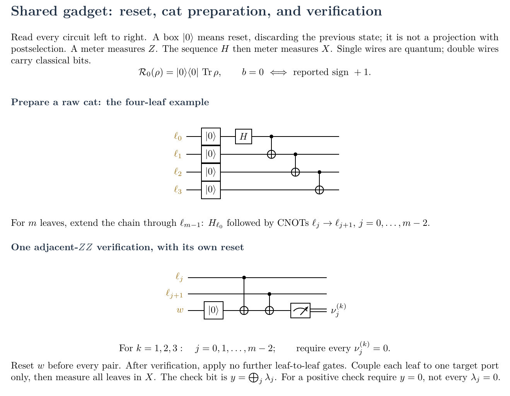

## 1. Prepare the encoded B and C inputs

Reset the 40 data qubits. Run the X/Z check circuits on the support lists, including the logical input checks: three positive rounds per block, B before C. The two panels are alternatives for the type of check being measured.

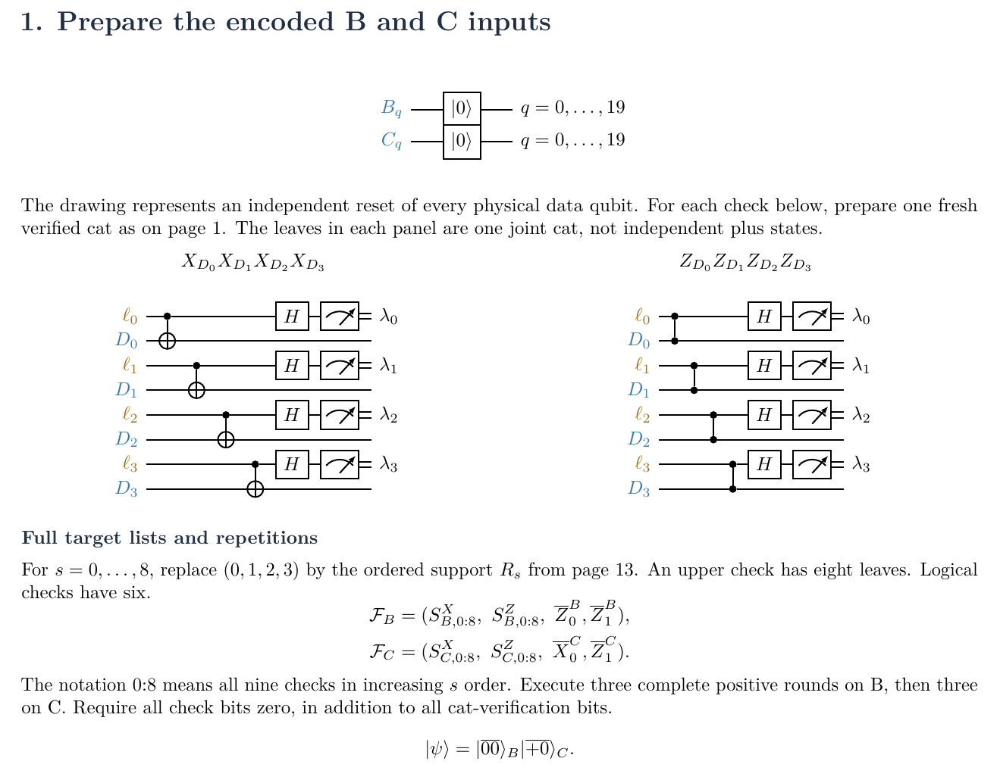

## 2. Prepare the graph resource and verify its edge checks

Prepare all five vertices in plus and all twenty gauge qubits in zero. Apply the forty incidence CNOTs using the endpoint dictionary. Edge checks use a three-leaf cat and CZs.

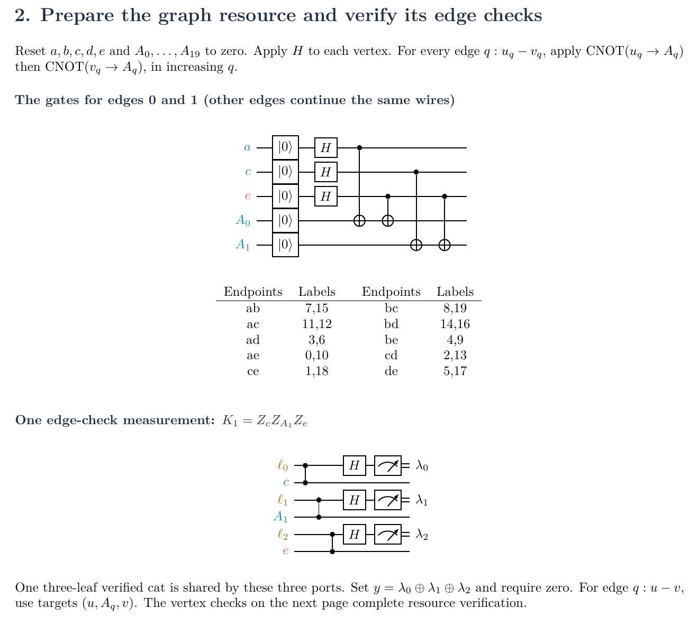

## 2 continued. Verify a resource vertex check

The resource vertex check has nine targets, including the still-live vertex. The two panels belong to one nine-leaf cat and produce one check bit. Together with the edge checks, measure the 25 resource checks in three positive rounds.

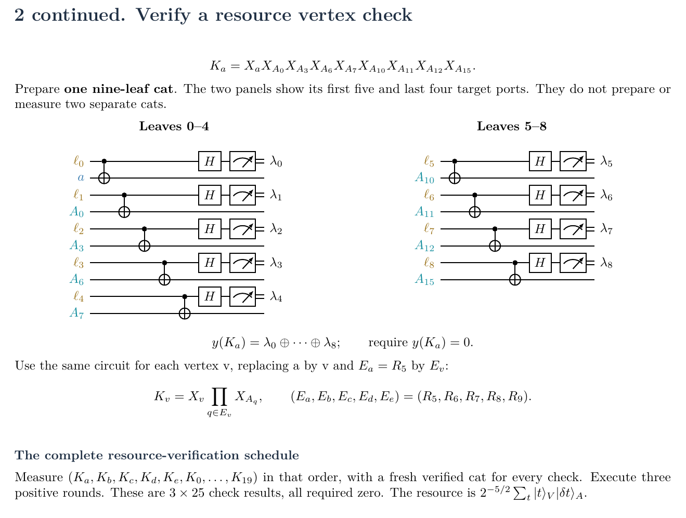

## 3. Enrich the symmetry and measure the temporary vertices

Apply twenty Fredkins, with the temporary vertex controlling its four data pairs. After all twenty gates, measure all five vertices in X. Keep only even parity of their five reported bits.

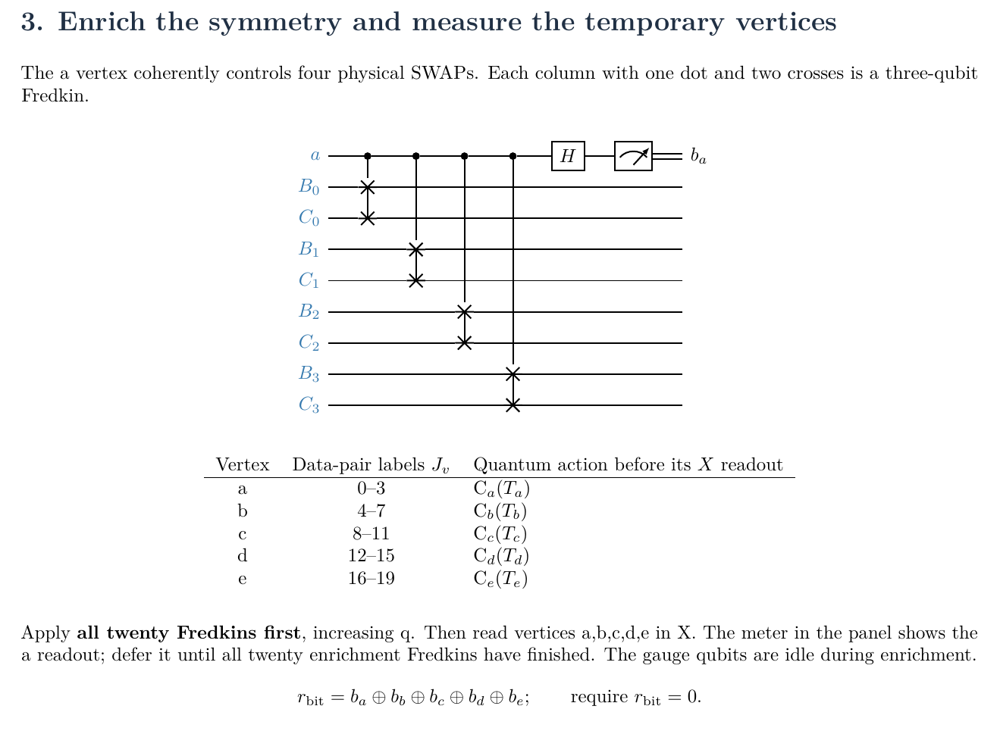

## 4. Use the vertex reports to fix the gauge signs

The vertex reports classically control physical Z gates on gauge qubits 7, 11, 3, and 0. Reset the measured vertices for reuse. The vertex readout is not repeated in this step.

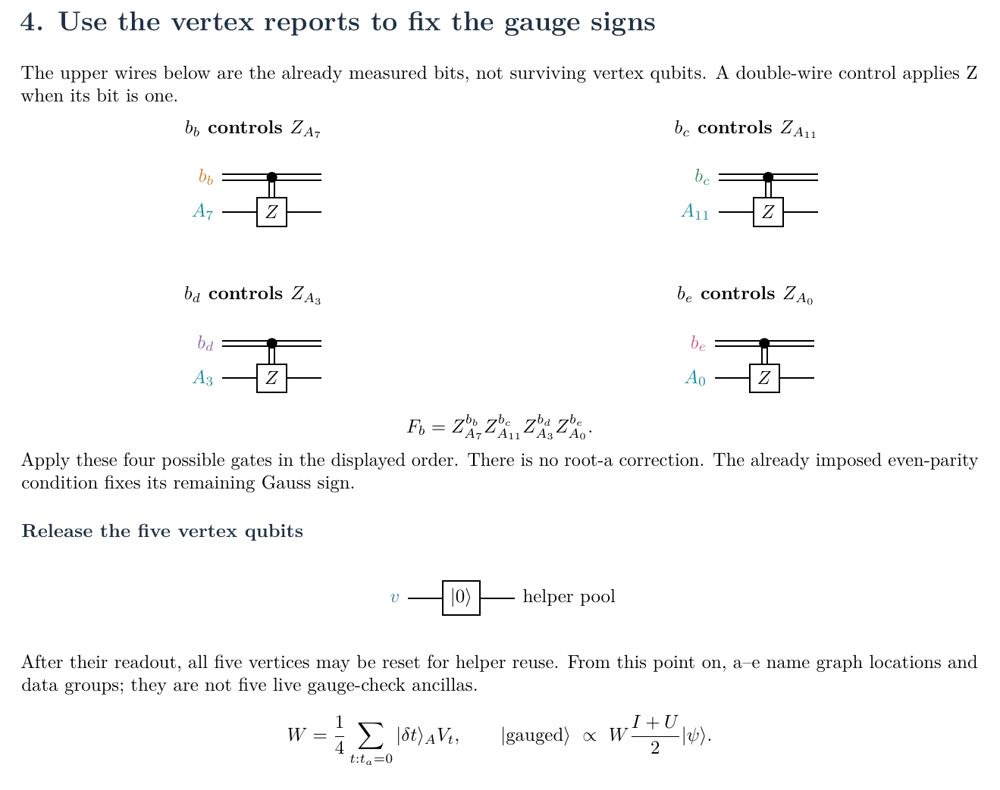

## 5a. While gauged: measure the paired code checks

Measure 18 paired checks using one cat across both blocks for each check. The example shows all eight ports of the inner paired X check. For paired Z checks use CZs. All check parities must be zero.

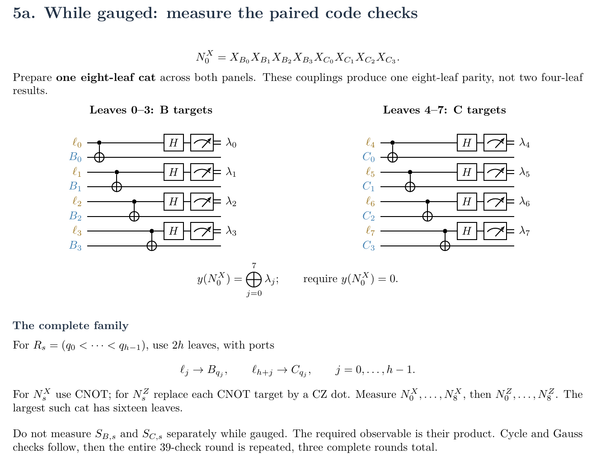

## 5b. While gauged: measure the sixteen cycle checks

Measure ten parallel-edge checks and six triangle checks, in the listed order. Each uses its own cat; retain only a zero leaf-X parity. The former graph vertices are absent.

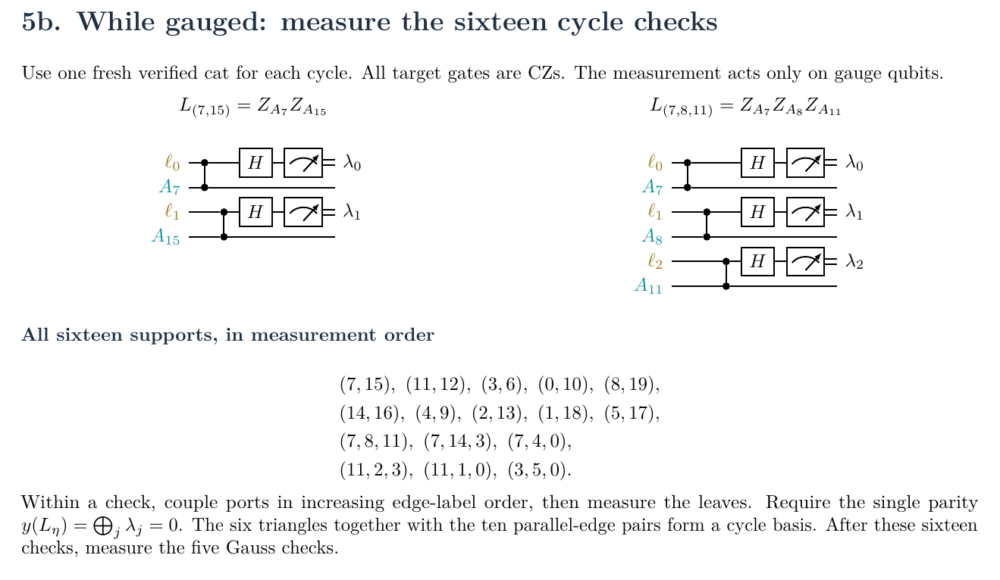

## 5c. While gauged: the full local Gauss-check circuit

The four panels belong to one twelve-leaf Gauss-check cat. Read out only after all controlled factors. Measure Ga through Ge after the paired and cycle checks; repeat the full 39-check round three times.

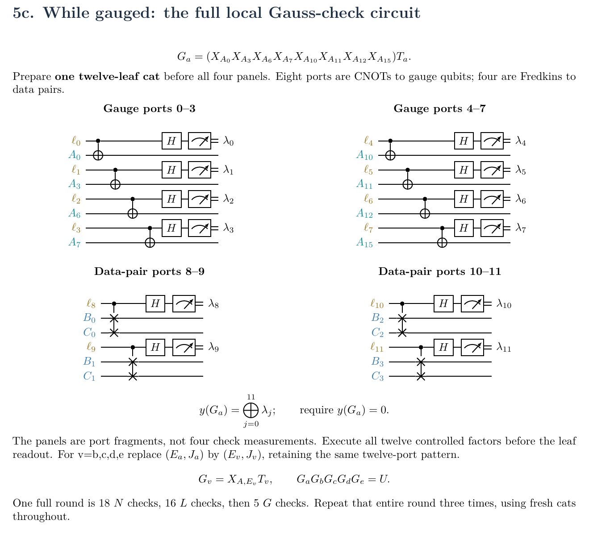

## 6. Ungauge: read all edges, decode, and correct

Measure all gauge qubits in Z. The classical decoder chooses a valid cut word within distance two, then derives the five group bits. Each decoded bit controls ordinary SWAPs in its four-qubit data group. Reject a word outside the decoding radius.

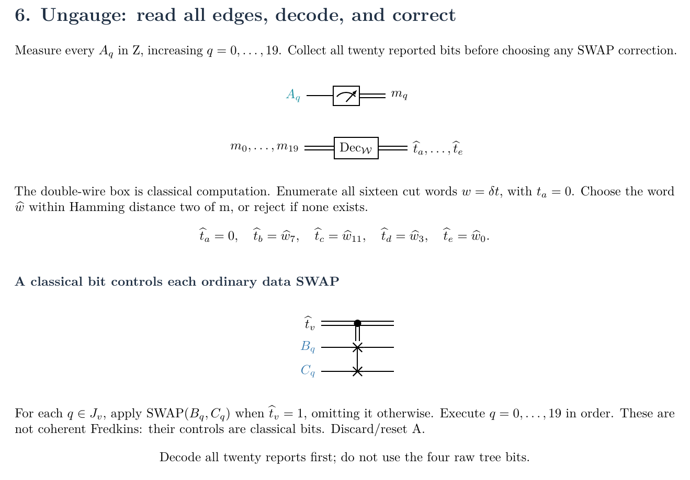

## 7--8. Filter the original code, then recover

First take three positive rounds of original-code checks. Then perform syndrome recovery, which accepts either check sign and stops at the first identical triple, within nine rounds. Apply the selected Pauli through single-qubit gates, B then C.

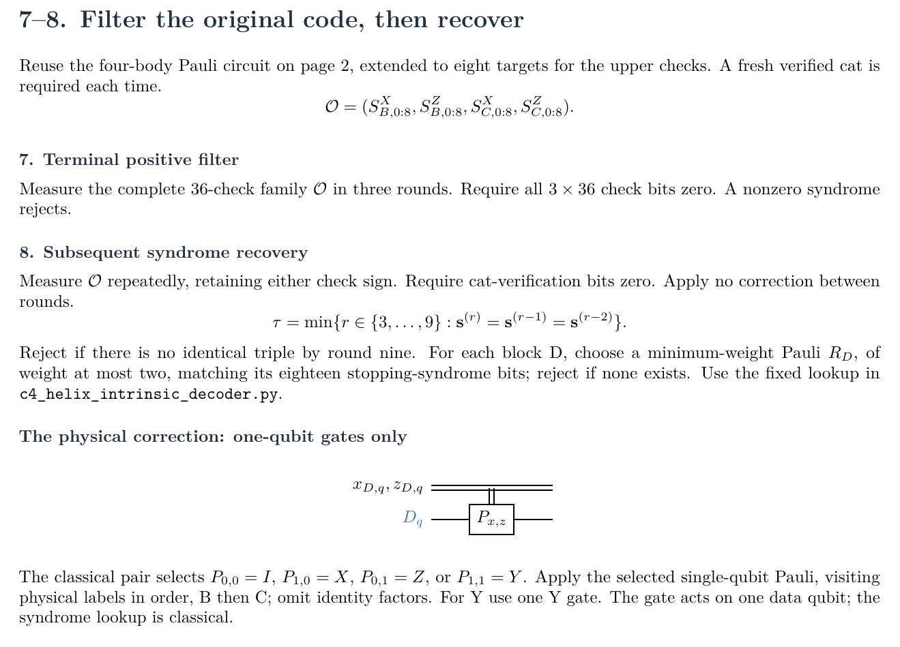

## 9. Decode the final B readout and retain magic in C

Measure all twenty B qubits in Z and decode the complete report. Keep logical Z0 equal to +1, discard B, and retain C. The final correction is to the classical word, not to already measured qubits.

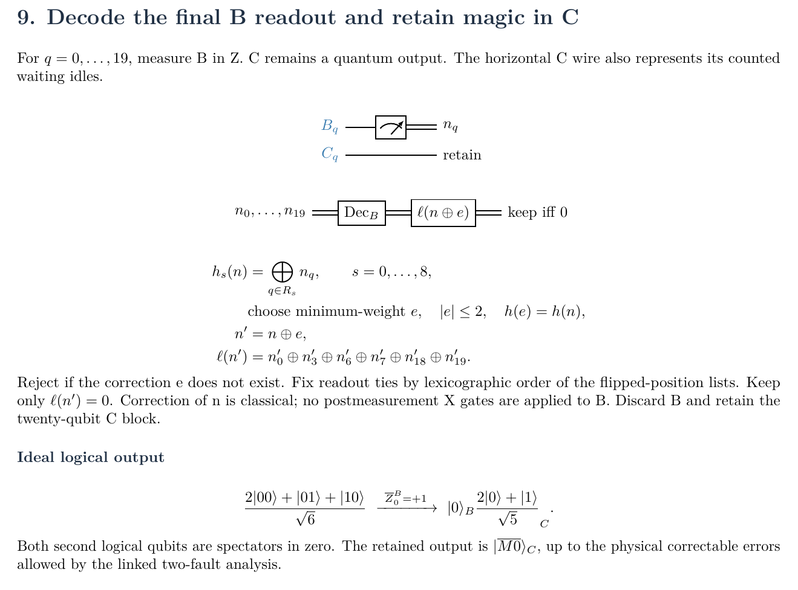

## Reference: supports, order, and resources

Complete support lists and the execution ledger. The protocol uses 77 physical qubits with serial helper reuse and 80 Fredkins. All rejection rules, waiting idles, recovery, and readout belong to the same attempt.

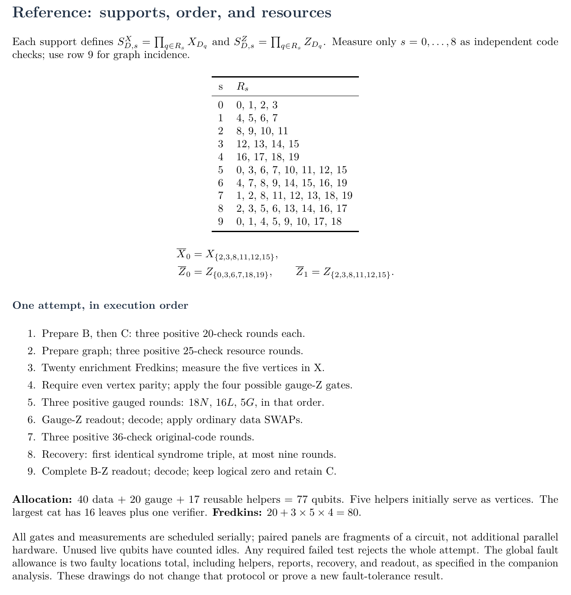

The diagrams specify the operations and acceptance rules; the
[intrinsic-verification analysis](c4-helix-intrinsic-gauged-verification.md)
contains the associated fault-tolerance argument. The equations and
state-normalization checks remain in [full_procedure.md](full_procedure.md).
