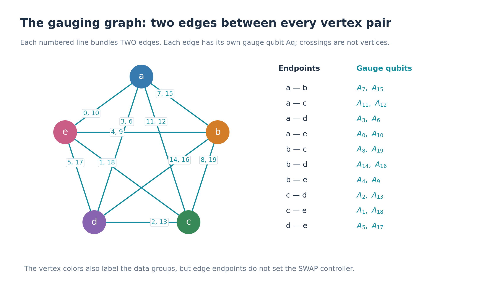
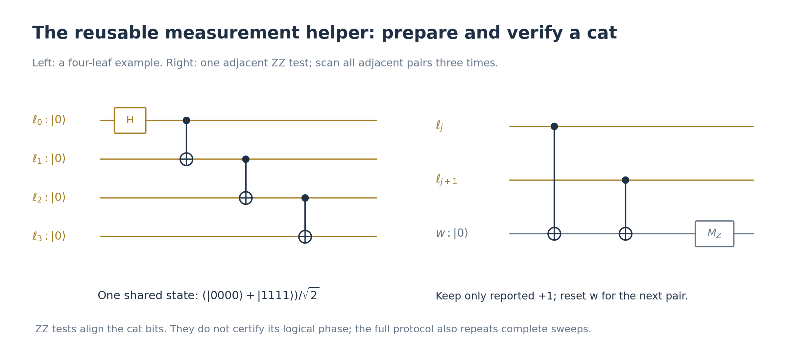
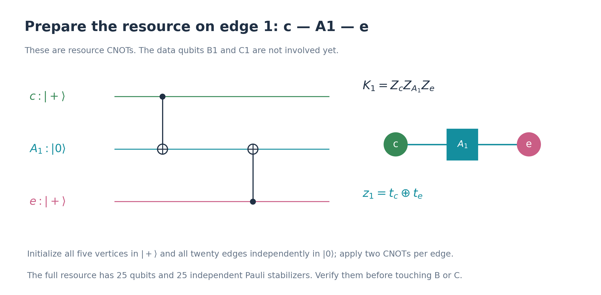
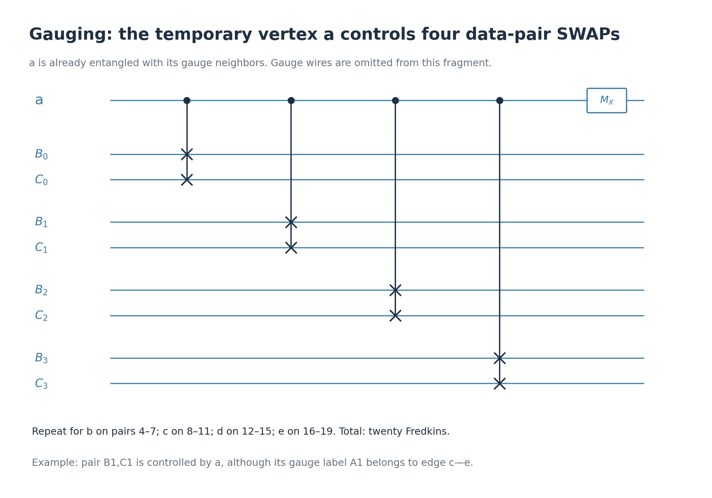
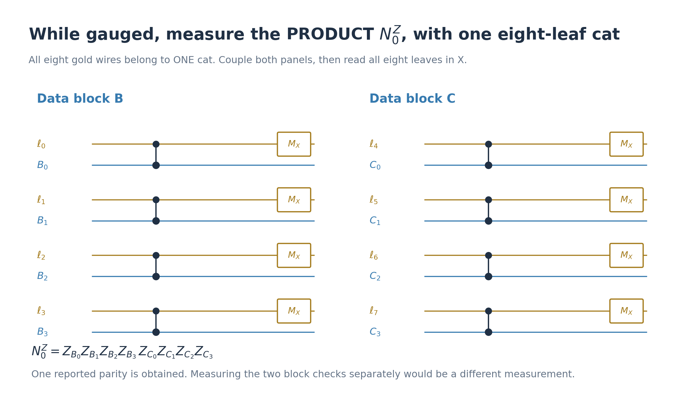
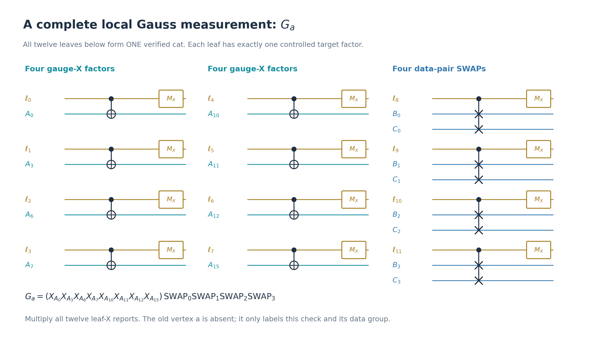
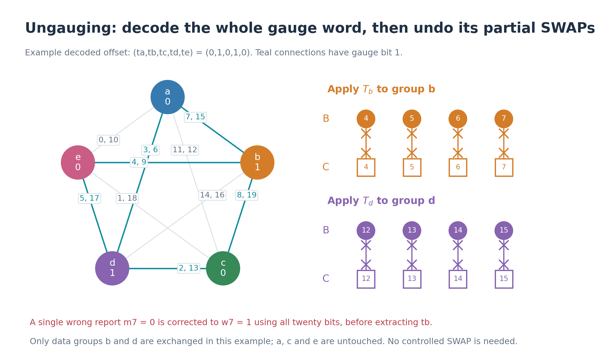

# Full procedure: equations for C4-Helix SWAP gauging and magic preparation

This note specifies the **single-cycle, postselected 80-Fredkin protocol**
from [Synthesis](Synthesis.md). Each step gives the physical circuit and
its acceptance rule, followed where useful by its ideal action. The
diagrams use the same labels and colors as that note.
Turquoise denotes gauge qubits, gold denotes cat leaves, and blue,
orange, green, purple, and pink identify groups a through e.

The output is a C4-Helix block whose two logical qubits contain

\[
|\overline{M0}\rangle_C,
\qquad |M\rangle=\frac{2|0\rangle+|1\rangle}{\sqrt5}.
\]

The circuit equations define what to execute. Identities involving
projectors describe the **fault-free action**; they do not assume that a
faulty measurement report is the true eigenvalue. The
[fault analysis](c4-helix-intrinsic-gauged-verification.md) is separate.

## 1. Registers, notation, and the complete support lists

There are two data blocks \(B_q,C_q\), twenty gauge qubits \(A_q\),
and five temporary vertex qubits \(a,b,c,d,e\). Here \(q=0,\ldots,19\)
always labels a physical qubit. Overbars denote logical states and
operators. Measurement helpers are fresh cat leaves \(\ell_j\) and a
resettable parity helper \(w\).

**Circuit ordering.** Write

\[
\operatorname{Run}[F_1;F_2;\ldots;F_n]:=F_n\cdots F_2F_1.
\tag{1}
\]

Thus operations inside Run are executed **from left to right**. A
measurement or a classical instruction can also appear in this list;
then Run denotes a circuit with classical control, rather than a unitary.
An ordered loop runs through the displayed list in its stated order.

A reported measurement bit \(b\) means the reported eigenvalue
\((-1)^b\). In particular, bit zero means +1. Define

\[
|b_X\rangle=\frac{|0\rangle+(-1)^b|1\rangle}{\sqrt2},
\qquad
\Pi_y(Q)=\frac{I+(-1)^yQ}{2}
\tag{2}
\]

for a Hermitian operator \(Q\) with \(Q^2=I\).

### The original code

For either block \(D=B,C\), its checks are

\[
S^P_{D,s}=\prod_{q\in R_s}P_{D_q},\qquad P=X,Z.
\tag{3}
\]

Each support specifies **one all-X check and one all-Z check**:

| s | \(R_s\) |
|---|---|
| 0 | 0, 1, 2, 3 |
| 1 | 4, 5, 6, 7 |
| 2 | 8, 9, 10, 11 |
| 3 | 12, 13, 14, 15 |
| 4 | 16, 17, 18, 19 |
| 5 | 0, 3, 6, 7, 10, 11, 12, 15 |
| 6 | 4, 7, 8, 9, 14, 15, 16, 19 |
| 7 | 1, 2, 8, 11, 12, 13, 18, 19 |
| 8 | 2, 3, 5, 6, 13, 14, 16, 17 |
| 9 | 0, 1, 4, 5, 9, 10, 17, 18 |

Use \(s=0,\ldots,8\) in code-check measurements. Row 9 is redundant
as a code check, but is needed in the graph below. The code projector is

\[
P_D=\prod_{s=0}^{8}\Pi_0(S^X_{D,s})\Pi_0(S^Z_{D,s}).
\tag{4}
\]

The logical representatives needed here are

\[
\begin{aligned}
\overline X^D_0&=\prod_{q\in\{2,3,8,11,12,15\}}X_{D_q},\\
\overline Z^D_0&=\prod_{q\in\{0,3,6,7,18,19\}}Z_{D_q},\\
\overline Z^D_1&=\prod_{q\in\{2,3,8,11,12,15\}}Z_{D_q}.
\end{aligned}
\tag{5}
\]

### The graph and the data controllers

Name the upper supports \(R_5,\ldots,R_9\) by a,b,c,d,e. A label q
occurring in two of them is an edge between those two vertices. Its
physical gauge qubit is \(A_q\).

The complete endpoint dictionary is

| Endpoints | Edge labels | Endpoints | Edge labels |
|---|---|---|---|
| ab | 7, 15 | bc | 8, 19 |
| ac | 11, 12 | bd | 14, 16 |
| ad | 3, 6 | be | 4, 9 |
| ae | 0, 10 | cd | 2, 13 |
| ce | 1, 18 | de | 5, 17 |

Write the endpoints of edge q as \(u_q<v_q\), using alphabetic order.
The incident-edge sets are

\[
E_a=R_5,\quad E_b=R_6,\quad E_c=R_7,\quad E_d=R_8,\quad E_e=R_9.
\tag{6}
\]

The **data-controller assignment** is a different list:

\[
\begin{aligned}
J_a&=\{0,1,2,3\},&J_b&=\{4,5,6,7\},\\
J_c&=\{8,9,10,11\},&J_d&=\{12,13,14,15\},\\
J_e&=\{16,17,18,19\}.&&
\end{aligned}
\tag{7}
\]

Let \(\phi(q)\) be the vertex for which \(q\in J_{\phi(q)}\). Define

\[
T_v=\prod_{q\in J_v}\operatorname{SWAP}(B_q,C_q),
\qquad U=\prod_{v=a}^{e}T_v,
\qquad V_t=\prod_{v=a}^{e}T_v^{t_v}.
\tag{8}
\]

For example, edge 1 has endpoints c,e, but \(\phi(1)=a\).
\(A_1,B_1,C_1\) are three distinct physical qubits.

## 2. The full measurement circuit used throughout

This definition expands every check measurement appearing later. Suppose

\[
Q=Q_0Q_1\cdots Q_{m-1},
\tag{9}
\]

where the factors act on disjoint target ports and each factor is a
Hermitian involution. A port is either one physical Pauli target or,
for a SWAP factor, one pair \((B_q,C_q)\).

Define the controlled gate explicitly by

\[
\mathrm C_{\ell}(Q_j)
=|0\rangle\!\langle0|_{\ell}\otimes I
+|1\rangle\!\langle1|_{\ell}\otimes Q_j.
\tag{10}
\]

For \(Q_j=X\), this is CNOT; for Z, it is CZ; for SWAP, it is
Fredkin. These three cases specify all target couplings in this note.

### 2a. Prepare and verify one fresh cat

Prepare \(\ell_0,\ldots,\ell_{m-1}\) in zero and execute

\[
U_{\mathrm{cat},m}
=\operatorname{Run}\big[
H_{\ell_0};
\mathrm{CNOT}(\ell_0\!\to\!\ell_1);
\mathrm{CNOT}(\ell_1\!\to\!\ell_2);\ldots;
\mathrm{CNOT}(\ell_{m-2}\!\to\!\ell_{m-1})
\big].
\tag{11}
\]

In the ideal case this gives
\(|\mathrm{cat}_m\rangle=(|0^m\rangle+|1^m\rangle)/\sqrt2\).

For each adjacent pair j,j+1, use the following complete parity circuit:

\[
\mathsf V_j:
\operatorname{Run}\big[
|0\rangle_w;
\mathrm{CNOT}(\ell_j\!\to w);
\mathrm{CNOT}(\ell_{j+1}\!\to w);
M_Z(w)\to\nu_j
\big].
\tag{12}
\]

Reset w before the next pair. Perform **three complete scans**,
\(j=0,\ldots,m-2\) in each scan. Require every reported
\(\nu_j^{(k)}=0\), for \(k=1,2,3\); otherwise reject the attempt.

For reference, the fault-free branch operator of (12) on the leaves is

\[
\langle\nu|_w\,
\mathrm{CNOT}(\ell_{j+1}\!\to w)
\mathrm{CNOT}(\ell_j\!\to w)|0\rangle_w
=\Pi_\nu(Z_{\ell_j}Z_{\ell_{j+1}}).
\tag{13}
\]

No leaf-to-leaf gates are applied after (11).

### 2b. Couple the cat, then read its X parity

The complete gadget \(\mathsf M(Q)\) is

\[
\begin{aligned}
\mathsf M(Q):\quad\operatorname{Run}\big[
&|0^m\rangle_{\ell};U_{\mathrm{cat},m};\\
&\underbrace{
\mathsf V_0;\ldots;\mathsf V_{m-2};
\mathsf V_0;\ldots;\mathsf V_{m-2};
\mathsf V_0;\ldots;\mathsf V_{m-2}
}_{\text{require all raw verification bits zero}};\\
&\mathrm C_{\ell_0}(Q_0);\ldots;\mathrm C_{\ell_{m-1}}(Q_{m-1});\\
&M_X(\ell_0)\to\lambda_0;\ldots;M_X(\ell_{m-1})\to\lambda_{m-1};\\
&y\leftarrow\lambda_0\oplus\cdots\oplus\lambda_{m-1}
\big].
\end{aligned}
\tag{14}
\]

Each leaf has exactly one target port. Reset/discard all leaves after
this gadget. A new check uses a fresh verified cat.

**Positive measurement** \(\mathsf M_+(Q)\) means run (14) and require
\(y=0\). It does **not** require every \(\lambda_j=0\).

The exact fault-free target operator for a specified leaf-X record is

\[
\begin{aligned}
K_{\lambda}(Q)
&=\langle\lambda_X|\,
\Big[\prod_{j=0}^{m-1}\mathrm C_{\ell_j}(Q_j)\Big]
|\mathrm{cat}_m\rangle\\
&=2^{-(m+1)/2}\big(I+(-1)^yQ\big)
=2^{(1-m)/2}\Pi_y(Q).
\end{aligned}
\tag{15}
\]

Summing over the \(2^{m-1}\) leaf records with parity y gives the
unnormalized measurement map

\[
\rho\longmapsto\Pi_y(Q)\rho\Pi_y(Q).
\tag{16}
\]

The raw ZZ records and the parity y remain distinct acceptance tests.
In particular, ZZ verification alone does not certify the cat's logical
phase. Equations (15)–(16) are ideal identities, not assumptions about
faulty cats or wrong reports.

### 2c. A measured family

For an **ordered** list \(\mathcal F=(Q_1,\ldots,Q_n)\), abbreviate

\[
\begin{aligned}
\mathsf C_+(\mathcal F)
&:=\operatorname{Run}[\mathsf M_+(Q_1);\ldots;\mathsf M_+(Q_n)],\\
\mathsf C(\mathcal F)\to\mathbf y
&:=\operatorname{Run}[\mathsf M(Q_1)\to y_1;\ldots;
\mathsf M(Q_n)\to y_n].
\end{aligned}
\tag{17}
\]

The second line keeps either check sign, but still requires every cat's
raw verification bits to be zero. Repetitions of \(\mathsf C\) mean
new physical circuits with fresh helpers, even when their ideal projectors
are idempotent. Pauli target lists are always in increasing physical
label order; paired checks use B targets first, then C targets.

## 3. Prepare the two encoded inputs

Define the ordered families

\[
\begin{aligned}
\mathcal F_B={}&(
S^X_{B,0},\ldots,S^X_{B,8},
S^Z_{B,0},\ldots,S^Z_{B,8},
\overline Z^B_0,\overline Z^B_1),\\
\mathcal F_C={}&(
S^X_{C,0},\ldots,S^X_{C,8},
S^Z_{C,0},\ldots,S^Z_{C,8},
\overline X^C_0,\overline Z^C_1).
\end{aligned}
\tag{18}
\]

The full source circuits, executed B first and C second, are

\[
\boxed{
\mathsf{Source}_D=
\operatorname{Run}\big[
|0^{20}\rangle_D;
\mathsf C_+(\mathcal F_D);
\mathsf C_+(\mathcal F_D);
\mathsf C_+(\mathcal F_D)
\big],\quad D=B,C.
}
\tag{19}
\]

For example, measuring \(S^X_{B,0}\) means four cat leaves with
\(\mathrm{CNOT}(\ell_j\to B_j)\), \(j=0,1,2,3\). Measuring
\(S^Z_{B,0}\) uses four CZs instead. All the other factors are fixed
by (3), (5), and the support table.

The ideal positive projectors of one source round are

\[
\begin{aligned}
P_{\mathrm{src},B}&=P_B\Pi_0(\overline Z^B_0)\Pi_0(\overline Z^B_1)
=|\overline{00}\rangle\!\langle\overline{00}|_B,\\
P_{\mathrm{src},C}&=P_C\Pi_0(\overline X^C_0)\Pi_0(\overline Z^C_1)
=|\overline{+0}\rangle\!\langle\overline{+0}|_C.
\end{aligned}
\tag{20}
\]

After successful preparation and normalization, write

\[
|\psi\rangle=|\overline{00}\rangle_B|\overline{+0}\rangle_C.
\tag{21}
\]

## 4. Prepare and verify the graph resource

For each edge, execute its two CNOTs in endpoint order, with q increasing:

\[
\begin{aligned}
F_{\mathrm{graph}}
&=\operatorname{Run}\big[
\{\mathrm{CNOT}(u_q\!\to A_q);
\mathrm{CNOT}(v_q\!\to A_q)\}_{q=0}^{19}
\big],\\
|\Gamma\rangle_{VA}
&=F_{\mathrm{graph}}
\Big(\prod_{v=a}^{e}H_v\Big)|0^5\rangle_V|0^{20}\rangle_A\\
&=\frac1{\sqrt{32}}\sum_{t\in\{0,1\}^5}|t\rangle_V|\delta t\rangle_A,
\qquad (\delta t)_q=t_{u_q}\oplus t_{v_q}.
\end{aligned}
\tag{22}
\]

Here V denotes the five temporary vertices. There are forty CNOTs.
This is the CNOT representation of the resource used throughout these
notes; its stabilizers follow directly by conjugating the initial X
and Z operators.

Those stabilizers and their ordered family are

\[
\begin{aligned}
K_v&=X_v\prod_{q\in E_v}X_{A_q},
&K_q&=Z_{u_q}Z_{A_q}Z_{v_q},\\
\mathcal K&=(K_a,K_b,K_c,K_d,K_e,K_0,\ldots,K_{19}).
\end{aligned}
\tag{23}
\]

The full resource circuit is

\[
\boxed{
\begin{aligned}
\mathsf{Resource}=\operatorname{Run}\big[
&|0^5\rangle_V|0^{20}\rangle_A;\\
&H_a;H_b;H_c;H_d;H_e;F_{\mathrm{graph}};\\
&\mathsf C_+(\mathcal K);
\mathsf C_+(\mathcal K);
\mathsf C_+(\mathcal K)
\big].
\end{aligned}
}
\tag{24}
\]

For \(K_v\), the gadget has nine leaves, coupled by CNOTs to v and
the eight \(A_q\) in \(E_v\). For \(K_q\), it has three leaves,
coupled by CZs to \(u_q,A_q,v_q\), in that order. These 25 independent
checks specify \(|\Gamma\rangle\) uniquely. Their ideal positive
projector is \(|\Gamma\rangle\langle\Gamma|\).

## 5. Enrich, measure the vertices, and fix their individual signs

The enrichment circuit is exactly twenty Fredkins:

\[
\Omega=\operatorname{Run}\big[
\{\mathrm C_{\phi(q)}(\operatorname{SWAP}(B_q,C_q))\}_{q=0}^{19}
\big].
\tag{25}
\]

Measure vertices in order a,b,c,d,e in X and call the reported bits
\(b_a,\ldots,b_e\). The acceptance and frame correction are

\[
\begin{aligned}
r_{\mathrm{bit}}&=b_a\oplus b_b\oplus b_c\oplus b_d\oplus b_e,
&\text{require }r_{\mathrm{bit}}=0,\\
F_b&=Z_{A_7}^{b_b}Z_{A_{11}}^{b_c}Z_{A_3}^{b_d}Z_{A_0}^{b_e}.
\end{aligned}
\tag{26}
\]

Thus the full step is

\[
\boxed{
\begin{aligned}
\mathsf{Gauge}=\operatorname{Run}\big[
&\Omega;\\
&M_X(a)\to b_a;\ldots;M_X(e)\to b_e;\\
&\text{require }r_{\mathrm{bit}}=0;\\
&Z_{A_7}^{b_b};Z_{A_{11}}^{b_c};Z_{A_3}^{b_d};Z_{A_0}^{b_e}
\big].
\end{aligned}
}
\tag{27}
\]

An exponent zero means omit that gate. The Z corrections here are
physical quantum gates. The measured vertices can now be reset and reused
as measurement helpers.

To see the full ideal action, retain the individual vertex outcome b.
Before the frame correction the unnormalized state is

\[
\langle b_X|_V\Omega\big(|\Gamma\rangle_{VA}|\psi\rangle\big)
=\frac1{32}\sum_t(-1)^{b\cdot t}|\delta t\rangle_AV_t|\psi\rangle.
\tag{28}
\]

The tree edges 7,11,3,0 join a to b,c,d,e. Therefore \(F_b\) adds
the phase
\((-1)^{\sum_{v\ne a}b_v(t_a+t_v)}\). Combining it with (28) leaves
only \((-1)^{r_{\mathrm{bit}}t_a}\). On an accepted record it is one.

Define the isometry and positive SWAP projector

\[
W=\frac14\sum_{t:t_a=0}|\delta t\rangle_AV_t,
\qquad W^\dagger W=I,
\qquad \Pi_+=\frac{I+U}{2}.
\tag{29}
\]

Pairing t with its complement in (28) gives the useful branch identity

\[
\boxed{
F_b\langle b_X|_V\Omega\big(|\Gamma\rangle_{VA}|\psi\rangle\big)
=\frac14W\Pi_+|\psi\rangle,
\quad r_{\mathrm{bit}}=0.
}
\tag{30}
\]

There are sixteen accepted b records. Their probabilities sum to
\(\|\Pi_+\psi\|^2\). Their individual values have been removed from
the corrected state, but the positive SWAP projection remains.

## 6. Verify the gauged state: three complete rounds

Define these three kinds of checks:

\[
\begin{aligned}
N_s^P&=S^P_{B,s}S^P_{C,s},&&s=0,\ldots,8,\quad P=X,Z,\\
L_\eta&=\prod_{q\in\eta}Z_{A_q},\\
G_v&=\Big(\prod_{q\in E_v}X_{A_q}\Big)T_v.
\end{aligned}
\tag{31}
\]

For cycles, use the following ordered list:

\[
\begin{aligned}
\mathcal E=(&
(7,15),(11,12),(3,6),(0,10),(8,19),\\
&(14,16),(4,9),(2,13),(1,18),(5,17),\\
&(7,8,11),(7,14,3),(7,4,0),\\
&(11,2,3),(11,1,0),(3,5,0)).
\end{aligned}
\tag{32}
\]

The complete ordered family and circuit are

\[
\begin{aligned}
\mathcal I=(&N_0^X,\ldots,N_8^X,
N_0^Z,\ldots,N_8^Z,
\{L_\eta\}_{\eta\in\mathcal E},G_a,G_b,G_c,G_d,G_e),\\[2pt]
\boxed{\mathsf{VerifyGauged}
=\operatorname{Run}[\mathsf C_+(\mathcal I);
\mathsf C_+(\mathcal I);\mathsf C_+(\mathcal I)].}
\end{aligned}
\tag{33}
\]

There are 39 reported check bits per round. All must be zero, and all
cat-verification bits must be zero.

### Explicit coupling circuits for every check type

For a paired check, let \(R_s=(q_0<\cdots<q_{h-1})\). Use **one**
cat with \(m=2h\) leaves and the coupling unitary

\[
C(N_s^P)=\operatorname{Run}\big[
\{\mathrm C_{\ell_j}(P_{B_{q_j}})\}_{j=0}^{h-1};
\{\mathrm C_{\ell_{h+j}}(P_{C_{q_j}})\}_{j=0}^{h-1}
\big].
\tag{34}
\]

The leaf-X parity is one measurement of the product N. It does not
reveal the two individual original-code stabilizer signs.

For a cycle, sort its edge labels \(q_0<\cdots<q_{h-1}\), use h leaves,
and apply

\[
C(L_\eta)=\operatorname{Run}\big[
\{\mathrm{CZ}(\ell_j,A_{q_j})\}_{j=0}^{h-1}
\big].
\tag{35}
\]

For \(G_v\), sort \(E_v=(e_0<\cdots<e_7)\) and
\(J_v=(j_0<\cdots<j_3)\). Use **one twelve-leaf cat** with

\[
\boxed{
C(G_v)=\operatorname{Run}\big[
\{\mathrm{CNOT}(\ell_k\!\to A_{e_k})\}_{k=0}^{7};
\{\mathrm C_{\ell_{8+k}}(\operatorname{SWAP}(B_{j_k},C_{j_k}))\}_{k=0}^{3}
\big].
}
\tag{36}
\]

Complete each of (34)–(36) with the cat preparation, three verification
scans, and leaf-X readout in (14).

All checks in \(\mathcal I\) commute, and

\[
\prod_{v=a}^{e}G_v=U.
\tag{37}
\]

One ideal positive round applies

\[
P_{\mathcal I}=
\Big[\prod_v\Pi_0(G_v)\Big]
\Big[\prod_{\eta\in\mathcal E}\Pi_0(L_\eta)\Big]
\Big[\prod_{P=X,Z}\prod_{s=0}^{8}\Pi_0(N_s^P)\Big].
\tag{38}
\]

It leaves \(W\Pi_+|\psi\rangle\) unchanged. This is the measured
subset used by this factory; (38) is not a claim that all stabilizers
of the full gauged memory have been measured. Three physical rounds
remain necessary in the specified fault-tolerant schedule even though
\(P_{\mathcal I}^3=P_{\mathcal I}\).

## 7. Ungauge: measure, decode, and undo the partial SWAPs

Measure \(A_0,\ldots,A_{19}\) in Z. Define the **reported measurement
word**

\[
m=(m_0,\ldots,m_{19})\in\{0,1\}^{20},\qquad
m_q=\begin{cases}
0,&\text{if the reported Z outcome on }A_q\text{ is }+1,\\
1,&\text{if the reported Z outcome on }A_q\text{ is }-1.
\end{cases}
\]

Thus m is the actual classical record supplied to the decoder, possibly
corrupted by faults; it need not be an ideal cut word. Define the set of
sixteen ideal cut words

\[
\mathcal W=\{\delta t:t\in\{0,1\}^5,\ t_a=0\}.
\tag{39}
\]

Choose \(\widehat w\in\mathcal W\) with
\(d_H(m,\widehat w)\le2\), where

\[
d_H(m,\widehat w)=\#\{q\in\{0,\ldots,19\}:m_q\ne\widehat w_q\}
\]

counts the positions where the reported word m differs from the candidate
valid word \(\widehat w\). The hat denotes the decoder's estimate of the
ideal word.
Reject if none exists. A candidate is unique because distinct cut words
differ in at least eight bits. Then set

\[
\widehat t_a=0,\qquad
\widehat t_b=\widehat w_7,\quad
\widehat t_c=\widehat w_{11},\quad
\widehat t_d=\widehat w_3,\quad
\widehat t_e=\widehat w_0.
\tag{40}
\]

The physical circuit is

\[
\boxed{
\begin{aligned}
\mathsf{Ungauge}=\operatorname{Run}\big[
&\{M_Z(A_q)\to m_q\}_{q=0}^{19};\\
&\text{decode m using (39)–(40), or reject};\\
&\{\operatorname{SWAP}(B_q,C_q)^{\widehat t_{\phi(q)}}\}_{q=0}^{19}
\big].
\end{aligned}
}
\tag{41}
\]

These are ordinary SWAP gates. Discard/reset the measured gauge register.
Decode the complete word before using the four tree bits.

For a fault-free Z measurement with outcome m, its corrected branch
operator is

\[
K_m^{\mathrm{ungauge}}=V_{\widehat t(m)}\langle m|_A.
\tag{42}
\]

In the ideal gauged state, m is exactly \(\delta t\), so

\[
\langle\delta t|_AW|\chi\rangle=\frac14V_t|\chi\rangle,
\qquad
K_{\delta t}^{\mathrm{ungauge}}W|\chi\rangle=\frac14|\chi\rangle.
\tag{43}
\]

Combining (30) and (43), a fixed accepted vertex record b and ideal
gauge record m leave the unnormalized data state

\[
\boxed{|\psi_{b,m}\rangle=\frac1{16}\Pi_+|\psi\rangle.}
\tag{44}
\]

There are \(16\times16\) such pairs. Forgetting these records gives
the ideal map \(\rho\mapsto\Pi_+\rho\Pi_+\), on original-code
inputs. With a wrong report, the actual measurement outcome and the
reported m need not agree: the implemented feedforward still uses the
reported m in (41), as required by the fault analysis.

## 8. Apply the terminal original-code filter

After ungauging, we can measure the original B and C stabilizers again.
Their signs tell us whether the state has returned to the original code
spaces. The list of these signs, recorded as bits, is called the
**syndrome**. A nonzero syndrome detects an error; it does not necessarily
tell us which error occurred. A logical error commuting with every
stabilizer would remain invisible, so this stage also relies on the
checks performed earlier while gauged.

Return to the independent original stabilizers, in this order:

\[
\mathcal O=(
S^X_{B,0},\ldots,S^X_{B,8},S^Z_{B,0},\ldots,S^Z_{B,8},
S^X_{C,0},\ldots,S^X_{C,8},S^Z_{C,0},\ldots,S^Z_{C,8}).
\tag{45}
\]

Execute

\[
\boxed{
\mathsf{FilterOriginal}=\operatorname{Run}\big[
\mathsf C_+(\mathcal O);
\mathsf C_+(\mathcal O);
\mathsf C_+(\mathcal O)
\big].
}
\tag{46}
\]

Every one of the 108 reported check bits must be zero. Its ideal action
on a density operator is \(\rho\mapsto P\rho P\), where
\(P=P_BP_C\). The three physical rounds provide the clean terminal
projection used in the two-fault argument.

**Here we reject a nonzero syndrome rather than trying to correct it.**
The reason is that errors entering this stage may be correlated across
several physical qubits. Distance six guarantees correction of two
physical-qubit errors, but two faults during the earlier circuit need
not mean only two erroneous physical qubits. The analysis at this stage
allows errors supported on two entire inner groups.

Here is why that distinction matters. On either one of the blocks,
consider the two Pauli errors

\[
E=X_2X_3X_8X_{11},\qquad F=X_{12}X_{15}.
\]

Their product is the logical operator from (5):

\[
EF=X_2X_3X_8X_{11}X_{12}X_{15}=\overline X_0.
\]

Consequently E and F have exactly the same stabilizer syndrome: their
difference is invisible to every stabilizer. An ordinary decoder would
choose the weight-two correction F. That repairs an actual F error,
but an actual E error would instead become \(FE=\overline X_0\):
the state returns to the code space with a logical error. E occupies
two inner groups, whereas F occupies a third. This example illustrates
the ambiguity in decoding that larger error class; it does not assert
that this particular E occurs in the scheduled circuit.

The positive filter avoids having to resolve these nonzero-syndrome
ambiguities. The two-fault argument establishes that a clean accepted
round removes the inherited group errors without changing the intended
logical state. After the last clean filtering round, subsequent faults
leave only the smaller errors that ordinary recovery can handle.

Correction at this stage is possible in principle. To accept nonzero
syndromes safely, however, we would need a decoder using the preceding
gauging records and a proof that its corrections cannot introduce a
logical error. That could improve the acceptance rate; it is an
additional construction beyond the filter specified here.

## 9. Recover using repeated syndromes, with either sign allowed

**Recovery is still needed because the filter itself is a noisy physical
circuit.** Its gates, ancillas, measurements, and waiting periods can
introduce errors. For example, an \(X_{C_q}\) error just after the last
check that could detect it in step 8 can escape that filter: all the
recorded signs may still be positive. Step 9 measures its syndrome and
applies a correction.

The difference in acceptance rules is deliberate. Step 8 rejects the
larger inherited errors when they produce a nonzero syndrome. Step 9
accepts either syndrome sign and corrects the small residual errors
allowed by the preceding argument. If the filter and everything
following it were perfect, this recovery stage would be unnecessary.

Repeat the syndrome measurements because their reports can also be
wrong. Under the global two-fault budget, the stopping rule below
protects the correction decision. Execute rounds

\[
\mathbf s^{(r)}\leftarrow\mathsf C(\mathcal O),\qquad
r=1,2,\ldots,
\tag{47}
\]

with fresh verified cats and **no data correction between rounds**.
Stop at

\[
\tau=\min\{r\in\{3,\ldots,9\}:
\mathbf s^{(r)}=\mathbf s^{(r-1)}=\mathbf s^{(r-2)}\}.
\tag{48}
\]

Reject if no such r occurs by round nine, or if any cat verification
fails. Nonzero syndrome bits alone do not reject this stage.

For clarity, define a Pauli's syndrome by its commutation signs:

\[
E S^P_{D,s} E^\dagger
=(-1)^{\operatorname{syn}(E)_{P,s}}S^P_{D,s}.
\tag{49}
\]

For each block D, take its eighteen bits from the stopping record and
choose a minimum-weight physical Pauli \(R_D\) with that syndrome and
weight at most two. Weight counts nonidentity physical factors. Reject
if there is no candidate. Fix ties deterministically; the
[decoder](c4_helix_intrinsic_decoder.py) provides one explicit lookup.
Apply its nonidentity single-qubit Pauli factors in physical-label order,
B before C:

\[
\boxed{
\begin{aligned}
\mathsf{Recover}=\operatorname{Run}\big[
&\{\mathsf C(\mathcal O)\to\mathbf s^{(r)}\}_{r=1}^{\tau};\\
&\text{choose }R_B,R_C\text{ from }\mathbf s^{(\tau)}\text{ or reject};\\
&R_B;R_C
\big].
\end{aligned}
}
\tag{50}
\]

The notation \(R_D\) in (50) means that ordered list of single-qubit
gates, not an additional many-qubit primitive.

For a fault-free record, define

\[
P_{\mathbf s}
=\prod_{i=1}^{36}\Pi_{s_i}(\mathcal O_i).
\]

After summing over the unused leaf-X information, the corresponding
conditional recovery branch has operator

\[
K_{\mathrm{rec}}
=R_BR_C P_{\mathbf s^{(\tau)}}\cdots P_{\mathbf s^{(1)}}.
\tag{51}
\]

Equation (51) specifies the ideal measurement action for the scheduled
records; faults are inserted in the physical gadgets (14), not modeled
by assuming their reported projectors were applied correctly. With no
faults anywhere, this stage has three zero syndromes and identity correction.

## 10. Decode B's logical Z readout and retain C

Measure **all twenty** B qubits in Z, obtaining reports
\(n=(n_0,\ldots,n_{19})\). For any binary word x, define its nine
Z-check parities

\[
h_s(x)=\bigoplus_{q\in R_s}x_q,\qquad s=0,\ldots,8.
\tag{52}
\]

Find a bit-flip word e of weight at most two satisfying
\(h(e)=h(n)\). Reject if none exists. Choose minimum weight, with ties
in lexicographic order of the flipped-position lists. Form the corrected
classical word and its logical parity:

\[
n'=n\oplus e,\qquad
\ell(n')=n'_0\oplus n'_3\oplus n'_6\oplus n'_7\oplus n'_{18}\oplus n'_{19}.
\tag{53}
\]

The full last step is

\[
\boxed{
\begin{aligned}
\mathsf{Extract}=\operatorname{Run}\big[
&\{M_Z(B_q)\to n_q\}_{q=0}^{19};\\
&\text{decode n using (52)–(53), or reject};\\
&\text{require }\ell(n')=0;\\
&\text{discard B and retain C}
\big].
\end{aligned}
}
\tag{54}
\]

Correction of n is classical. It does not apply a quantum gate after
B has been measured. In particular, with ideal measurements the accepted
map is

\[
\mathcal E_{\mathrm{keep}}(\rho_{BC})
=\sum_{\substack{n:\text{decoder exists}\\\ell(n\oplus e(n))=0}}
\langle n|_B\rho_{BC}|n\rangle_B.
\tag{55}
\]

The physical measurement bra is \(\langle n|\), not
\(\langle n\oplus e|\). The decoder changes the decision attached to
that record. Readout faults can corrupt the reported n; the fault-tolerance
argument includes those corruptions.

The ideal logical calculation, omitting the two spectators in zero, is

\[
\begin{aligned}
\Pi_+|0\rangle_B|+\rangle_C
&=\frac{2|00\rangle+|01\rangle+|10\rangle}{2\sqrt2},\\
\frac{\Pi_+|0+\rangle}{\|\Pi_+|0+\rangle\|}
&=\frac{2|00\rangle+|01\rangle+|10\rangle}{\sqrt6},\\
\langle0|_B\frac{2|00\rangle+|01\rangle+|10\rangle}{\sqrt6}
&=\frac{2|0\rangle+|1\rangle}{\sqrt6}
=\sqrt{\frac56}\,|M\rangle_C.
\end{aligned}
\tag{56}
\]

A complete physical B readout refines this logical projection; summing
over its accepted physical records gives the same normalized encoded
state in C.

## 11. The entire circuit in one equation

Every symbol on the following line has a physical circuit and classical
rule above:

\[
\boxed{
\begin{aligned}
\mathsf{Factory}=\operatorname{Run}\big[
&\mathsf{Source}_B;\mathsf{Source}_C;\mathsf{Resource};\\
&\mathsf{Gauge};\\
&\mathsf{VerifyGauged};\\
&\mathsf{Ungauge};\\
&\mathsf{FilterOriginal};\\
&\mathsf{Recover};\\
&\mathsf{Extract}
\big].
\end{aligned}
}
\tag{57}
\]

Reject immediately when a required condition fails. A fresh attempt
restarts the sources and resource; it does not continue a failed branch.

To check the normalization of the central construction, for each accepted
b and ideal flat m the data branch before extraction is

\[
\begin{aligned}
&P^3\,V_{\widehat t(m)}\langle m|_A
P_{\mathcal I}^{\,3}F_b\langle b_X|_V\Omega
\big(|\Gamma\rangle_{VA}|\psi\rangle\big)\\
&\hspace{35mm}=\frac1{16}\Pi_+|\psi\rangle.
\end{aligned}
\tag{58}
\]

Source and check-helper records have been summed over in this ideal
identity; sources are conditioned on successful preparation. The ideal
recovery acts trivially on its right-hand side. Summing over the 256
pairs (b,m) gives exactly the positive SWAP measurement, without an
extra normalization factor. For the input (21),

\[
p_{\mathrm{gauge},+}=\frac34,\qquad
p_{\mathrm{extract}\mid+}=\frac56,\qquad
p_{\mathrm{magic}\mid\mathrm{sources}}=\frac58.
\tag{59}
\]

The last number excludes the postselection cost of preparing the input
sources. It is not a noisy acceptance-rate estimate.

### Repetition and hardware ledger

| Circuit | Execution per attempt |
|---|---|
| Cat adjacent-ZZ verification | Three scans for every fresh cat |
| \(\mathsf{Source}_B,\mathsf{Source}_C\) | Three 20-check rounds per block |
| Graph-resource verification | Three 25-check rounds |
| Enrichment \(\Omega\) | Once; 20 Fredkins |
| \(\mathsf{VerifyGauged}\) | Three 39-check rounds; 20 Fredkins each |
| \(\mathsf{Ungauge}\) | Once; at most 16 ordinary SWAPs |
| \(\mathsf{FilterOriginal}\) | Three positive 36-check rounds |
| \(\mathsf{Recover}\) | First identical syndrome triple; at most nine rounds |
| \(\mathsf{Extract}\) | One complete B readout and classical decoding |

Execute the displayed schedule serially, including the order of
measurements and single-qubit corrections. Helpers are prepared inside
their own gadget and reset before reuse. In a circuit-level fault model,
every unused live qubit has an idle location at each gate slot; waiting
data blocks are included. Boundary idles belong to the following interval.

The peak allocation is **77 qubits**: 40 data, 20 gauge, and a reusable
17-qubit helper pool. Five pool qubits initially serve as vertices. During
resource verification a nine-leaf cat plus w fits in the remaining pool;
after vertex measurement, the largest paired check uses sixteen leaves
plus w. The number of Fredkins is \(20+3\times5\times4=80\).

The linked analysis concerns **at most two faulty locations in the entire
attempt**, including preparation, reports, idles, recovery, and readout,
with reliable classical processing. Fredkins are local three-qubit
locations, or decompositions confined to those same qubits. Its conclusion
is correctness of the accepted **decoded** C output; physical correctable
errors can remain. These equations do not add a separate noiseless recovery
after the factory.

Sources: [C4-Helix check table](../arXiv-2609.03194v1/appendix.tex),
[SWAP gauging](../arXiv-2602.12228v1/main.tex), and
[Magic Quantum Code Surgery](../arXiv-2610.03920v1/spacetime.tex).
The specific verification schedule and its scope are in
[the intrinsic-verification note](c4-helix-intrinsic-gauged-verification.md);
the operational acceptance and decoding rules are implemented in
[the decoder](c4_helix_intrinsic_decoder.py). The figures are reused from
[Synthesis](Synthesis.md).
