# One-block C4-Helix CZ magic preparation by gauging and ungauging

**Optional graph-assisted local-Gauss recovery:** the
[new circuit and decoder](single_block_cz_graph_assisted_root_recovery.md)
use cycle syndromes to recover some previously rejected root flags while
retaining the four-data local Gauss measurement. Enable
`--root-recovery joint --conditional-checks dual_flags` with the compact
round-trip/bare-star/screen schedule. Clean compact13 costs remain
**1889 CX / 256 T/Tdg / 39 peak qubits**; two conditional diagnostic records
add 370 CX when needed. The [composition proof](single_block_cz_graph_assisted_root_recovery_proof.md)
handles coherent W hooks and the same global two-fault budget.
The shared dual conditional gadgets also save 208 H per minimal data-flag
repair in both gauging and the genuine-cat baseline. The seven-arm
benchmark separates this improvement from the graph decoder's effect.

**Optional persistent coordinates (fused version 2):** the
[new integrated schedule](single_block_cz_persistent_coordinates.md) keeps
one coordinate frame, transports the root observable, and proves an
intrinsically protected tail without cut decoding or a terminal screen.
Its `tree4` graph uses **1421 CX / 160 T/Tdg / 30 peak qubits** with decoded
source and compact checks. Compact13 in the same frame costs 1574 / 160 / 39.
The [new proof](single_block_cz_persistent_coordinates_proof.md) explains
the different graph requirements and global two-fault composition. The
GHZ20 and direct-global-flagged comparators remain separate benchmark arms.

**Optional compact intermediate checks:** the executable recovery schedule
now also supports `--data-checks compact_flags`. The
[integrated replacement note](single_block_cz_compact_checks.md) gives
actual circuits, fault cones, recovery certificates and a matched four-arm
benchmark. With decoded source, bare stars and the existing terminal screen,
compact13 costs **1889 CX / 803 one-qubit Cliffords / 256 T/Tdg**, peak 39;
the equally optimized genuine-cat baseline costs **1476 / 686 / 120**, peak 41.
The original modes and schedules below remain available.

This is a construction on **one twenty-qubit data block**, with a
conservative reference and a default flagged recovery implementation.
It prepares encoded |++>, gauges the internal
logical CZ, checks the resulting Clifford-decorated code, certifies all
five Gauss constraints, ungauges with decoded classical feedback, and
retains

\[
|\overline{CZ_{\rm magic}}\rangle
=\frac{|\overline{00}\rangle+|\overline{01}\rangle+|\overline{10}\rangle}{\sqrt3}.
\]

Ideal acceptance is 3/4. The accompanying
[accepted-output proof](full_procedure_single_block_cz_proof.md) covers
**two arbitrary faulty locations in the entire physical schedule** and
leaves at most a correctable weight-two physical error span at output.
It includes T/T† gates, wrong reports, corrections, retries and idles.

The reference protection is deliberately conservative: nonzero data or
cycle syndromes after enrichment reject; graph phase syndromes are
repaired; unused flagged cats are rebuilt locally; all thirteen edge
reports are decoded. The construction does not claim optimum rejection.
The new source files, figures and certificates are additive. The
existing two-block SWAP implementation and notes are preserved.

**Graph preparation now uses one-helper direct Z-parity scans (Section 6),
with no graph-verification cats.** The [simulation recovery profile](../src/SINGLE_BLOCK_CZ_SIMULATION.md)
uses this same verifier with less rejecting source/data rules; its retained cat-extraction
compact13 count is 4,810 CX. Section 12 below retains the conservative
source/data schedule, whose updated count is 8,724 CX.

**The current default recovery profile also removes the remaining
verification-cat preparation.** It uses one syndrome ancilla with up to
three live flags, and direct edge-Z cycle meters. Its compact13 cost is
**3,217 CX and 39 peak qubits**; current20 uses **3,459 CX and 46 qubits**.
The preceding 4,810-CX mode remains available with
`--verification-extraction cats`. The complete
[flagged accepted-output proof](single_block_cz_flagged_verification_proof.md)
extends the same global two-fault guarantee. Nonzero flags on magic data
reject; no magic block is reset or passed to a hidden cat fallback.

**Optional flag-dependent data recovery:** `--flag-recovery data` replaces
strict rejection for the eighteen Pauli data checks with a flag/syndrome
unique-class decoder. Its fallback uses a single flag per check and two
matching whole records, justified by at least one already-spent global
fault. Source retries and Gauss/star rejection remain unchanged. See the
[procedure, proof extension, commands and pilot](single_block_cz_flag_dependent_recovery.md).
Clean-path counts are unchanged; the same option is available to the
genuine-cat baseline for a matched comparison.

**Optional bare graph stars:** `--graph-stars bare` removes all nonroot
star flags and defers cycle certification to just before edge readout.
Certified cycle corrections use non-tree edges only and act on no data.
With `decoded_flags` source, compact13 falls from 2809 to **2665 CX**;
current20 falls from 3051 to **2835 CX**, with unchanged T counts and peaks.
See the [new schedule, proof, circuits and commands](single_block_cz_bare_graph_stars.md).
The original flagged-star schedule remains the default.

**Optional ordered terminal screen:** `--terminal-policy screen` uses
outer-Z, outer-X, inner-Z, inner-X checks on the original data code after
ungauging. It retains the same global two-fault output guarantee with
conditional flag repair, post-repair verification, and the matched full
syndrome recovery as fallback. With decoded source and bare stars,
compact13 falls from 2665 to **2129 CX**; current20 from 2835 to **2299 CX**.
See the [new terminal proof, circuits, counterexamples and comparison](single_block_cz_terminal_screen.md).
The certified terminal history remains the default.

| Circuit stage | Proof link |
|---|---|
| Signed gates and ideal projector | [A](full_procedure_single_block_cz_proof.md#a-signed-logical-action-and-exact-measurement) |
| Gauged check family and distance | [B](full_procedure_single_block_cz_proof.md#b-gauged-checks-algebra-and-distance) |
| Cat flags and one-target coupling | [C1/C2](full_procedure_single_block_cz_proof.md#c1-three-scan-cat-with-local-retry) |
| Known data/graph preparation | [C3](full_procedure_single_block_cz_proof.md#c3-known-source-and-graph-verification) |
| Enrichment and gauged circuits | [D/E](full_procedure_single_block_cz_proof.md#d-enrichment-and-vertex-measurement) |
| Actual ordered measurement history | [F](full_procedure_single_block_cz_proof.md#f-conditional-histories-without-a-false-commuting-projector-assumption) |
| Edge decoder and byproduct | [G](full_procedure_single_block_cz_proof.md#g-edge-readout-decoding-and-physical-byproducts) |
| Terminal recovery and late faults | [H](full_procedure_single_block_cz_proof.md#h-terminal-recovery-and-late-faults) |
| Negative branch and composition | [I/J](full_procedure_single_block_cz_proof.md#i-negative-sector-and-rejection) |

## 1. Sources, conventions, and what is actually new here

The [C4-Helix paper](https://arxiv.org/abs/2609.03194v1),
[Appendix A](../arXiv-2609.03194v1/appendix.tex), proposes measuring CZ
between the two logical qubits in one block, starting from |++>.
It describes a twenty-qubit cat and possible flag alternatives. Its
experimental results do not implement this graph-gauging factory.

[Magic Quantum Code Surgery](https://arxiv.org/abs/2610.03920v1),
[gauging procedure](../arXiv-2610.03920v1/Gauging-procedure.tex), already
gives single-block Clifford gauging, including the alternating-S/S†
[[4,2,2]] example and normalized order-two local factors. This note
specializes that principle to the signed C4-Helix logical convention
and supplies a physical schedule and a separate finite-size proof.
The [earlier graph-gauging paper](https://arxiv.org/abs/2602.12228v1)
also distinguishes a code-space symmetry from symmetry of a particular
chosen check Hamiltonian. U here preserves the code projector; it
does not commute with each individual original X check globally.

Inter-block product_q CZ(B_q,C_q) is a different forty-data-qubit
construction. In this convention it implements CZ(B0,C1) CZ(B1,C0).
Freezing spectators does not turn it into the one-block protocol here.
Two equal code copies always have a SWAP symmetry; a useful internal
Clifford symmetry depends on the code. Historical extrapolated gate
counts for those alternatives are not costs for this construction.

## 2. Register dictionary and complete code specification

| Role | Labels | Size | Lifetime |
|---|---|---:|---|
| Data | D0,...,D19 | 20 | Source through accepted handoff |
| Vertex controllers | a_a,...,a_e (`a0`...`a4`) | 5 | Graph preparation through destructive vertex readout |
| Edge gauge qubits | A0,...,A12 | 13 | Graph preparation through destructive edge readout |
| Cat leaves | L0,...,L9 on gauging route | ≤10 | One check at a time |
| Default syndrome helper | s | 1 | One flagged check at a time |
| Default reused flags | f0,f1,f2 | ≤3 live | Prepare, couple, decode and Z-read before reuse |
| Parity verifier | w | 1 | Fresh preparation and measurement for each cat or graph Z parity |

Inner blocks are a:0–3, b:4–7, c:8–11, d:12–15, e:16–19.
All physical labels are zero based. The data are a **single** [[20,2,6]]
block, even while we refer to its five inner blocks.

For P=X or Z, S_s^P=product_(q in R_s) P_q, with

```text
R0 = 0,1,2,3
R1 = 4,5,6,7
R2 = 8,9,10,11
R3 = 12,13,14,15
R4 = 16,17,18,19
R5 = 0,3,6,7,10,11,12,15
R6 = 4,7,8,9,14,15,16,19
R7 = 1,2,8,11,12,13,18,19
R8 = 2,3,5,6,13,14,16,17

Xbar0 = X(2,3,8,11,12,15)       Zbar0 = Z(0,3,6,7,18,19)
Xbar1 = X(0,3,6,7,18,19)       Zbar1 = Z(2,3,8,11,12,15)
```

The source has the eighteen code checks and both logical X operators
equal to +1. Its twenty independent stabilizers specify a unique state.
The verifier parses the authoritative TeX table and independently checks
agreement with the current `c4_helix_noiseless.py` constants.

**Fault model.** Preparations, individual one-qubit gates, CX gates,
destructive Z measurements, and single-qubit idles are locations. A
faulty location has arbitrary action on its participants; a meter can
also report the wrong bit. Classical control is reliable. Gates are
serial; every unused live qubit idles during every physical operation.
Boundary and final handoff idles are included. There is no fresh fault
allowance at stage transitions. See the proof's theorem for the exact
environment and leakage interpretation.

## 3. The normalized physical CZ representative

The native phase pattern is

\[
F=\prod_{j=0}^4 S^\dagger_{4j}S_{4j+1}S_{4j+2}S^\dagger_{4j+3}.
\]

Its logical phases in order 00,01,10,11 are (+,-,+,+):
F=CZbar Zbar1 on the code. The residual Zbar1 cannot be dropped when
defining a measurement. Normalize local gates and conjugate by Xbar0:

\[
W_\epsilon=e^{-i\epsilon\pi/4}XS^\epsilon
=\frac{X-\epsilon Y}{\sqrt2}=T^{-\epsilon}XT^\epsilon,
\qquad U=D(X_{\rm all}F)D=\prod_qW'_{q},\quad D=\overline X_0.
\]

W'_q=W_(s_q), with the following **final signs**, in physical order:

| Inner block | s at its four sites |
|---|---|
| a | -,+,-,+ |
| b | -,+,+,- |
| c | +,+,+,+ |
| d | +,+,+,+ |
| e | -,+,+,- |

Each W is a one-qubit Clifford involution on the full Hilbert space.
X_all is a code stabilizer; hence U is exactly logical CZ, with positive
global sign, on the code. Define U_v=product_(q in J_v) W'_q.

For control c and target Dq the exact gate list is

```text
T^(s_q)(Dq)
CX(c,Dq)
T^(-s_q)(Dq)
```

These are three distinct faulty locations. Replacing the normalized
gate by XS^s would introduce a control-branch phase. The initial
enrichment therefore costs twenty CX and forty T/T† gates, before any
protection is counted. **Proof A** verifies the signed action and exact
decomposition; the saved cyclotomic audit retains coherent Pauli sums.

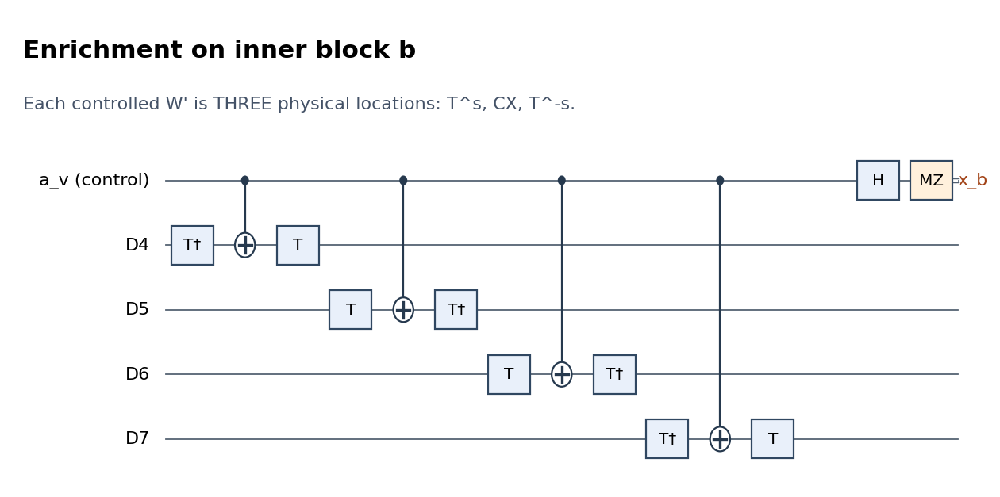

## 4. Primitive options: flags by default, cats as a reference

The default simulator measures X/Z/W products using the physical gate
list in `src/single_cz_flagged.py`. For a uniform four-qubit Pauli check,
one flag brackets the two middle controlled ports: six CX total. For
other m-port checks, prepare syndrome s in plus; open flags f0,f1 with
CX(s,f0), CX(s,f1). Couple port j, open f_(j+2), close and Z-read f_j,
then proceed to port j+1. After the last port, close/read the two remaining
flags and X-read s. At most three flags are live; measured flag slots are
reset and reused. Ideal flags are zero and the syndrome Kraus operator is
(I+(-1)^b Q)/2. The rolling circuit costs 3m+2 CX, plus each actual
T/T† rotation or Z-basis H. Small flag ancillas are temporarily entangled;
there is no separately prepared many-leaf verification cat.

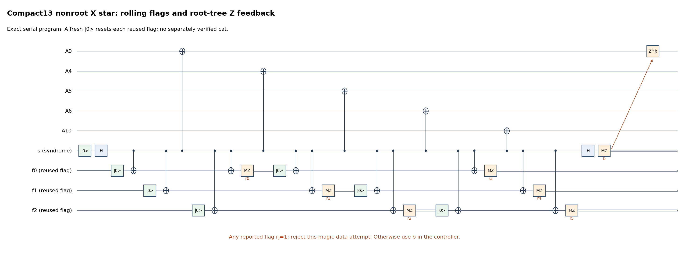

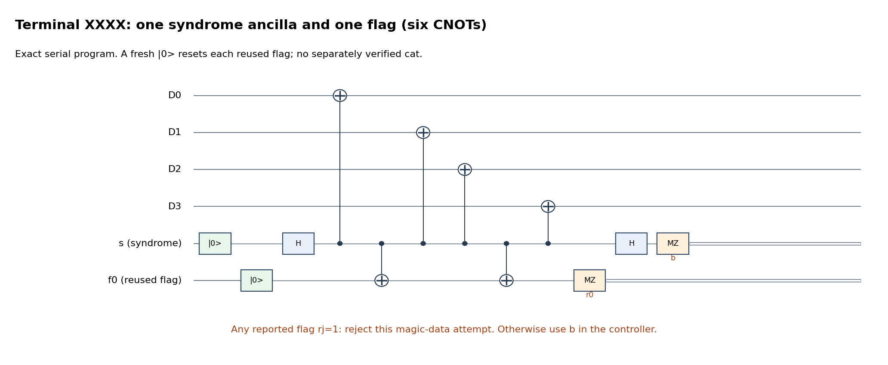

All reported flags must be zero to continue on magic data. A flag on the
known source instead permits a bounded source rebuild before enrichment.
Noisy flag reports are included in the same two-fault budget. The finite
certificate checks all one-/two-fault flag ambiguities, including masked
flags and faults at individual T/CX/T† locations, via opaque local-port
operators. It does not XOR Pauli errors across T gates. The
[flagged proof](single_block_cz_flagged_verification_proof.md) derives the
accepted spread bound modulo the measured product, preserving phases.

Graph cycle Z checks use PREP0(w), CX(edge,w) on each edge, MZ(w).
Their broad Z hooks remain allowed graph phases; this shortcut is never
used on data Z stabilizers or X stars. A nonzero cycle syndrome still
enters certified cycle recovery. Nonzero data syndromes with zero flags
still enter the existing certified one-block decoder.

The following cat primitive is the retained conservative/reference option
(`--verification-extraction cats`), not the default flagged implementation.

Every product check uses a fresh cat. Its m leaves have **one leaf per
physical target**, including separate leaves for every W target. No
leaf controls all four data qubits of an inner block in a check gadget.

```text
prepare L0,...,L(m-1) in |0>
H(L0)
for j=0,...,m-2: CX(Lj,L(j+1))

repeat THREE complete scans:
    for j=0,...,m-2:
        prepare w in |0>
        CX(Lj,w)
        CX(L(j+1),w)
        f[scan,j] = reported MZ(w)

if any f is 1:
    measure/discard all unused leaves in Z
    spend one shared retry token; prepare a new cat; repeat
```

There are **two retry tokens for the entire factory attempt**, shared
by unused cats and known data/graph resources. Every local resource
has at most three attempts. If a further retry is needed, reject the
factory. Cat retries are always before coupling, so only that unused
cat is rebuilt; an existing magic-bearing block is retained.

After zero flags, couple leaf j to its one target using

| Port | Chronological physical gates |
|---|---|
| X | CX(Lj,target) |
| Z | H(target), CX(Lj,target), H(target) |
| W'_q | T^(s_q)(Dq), CX(Lj,Dq), T^(-s_q)(Dq) |

Finally H then MZ on each leaf; XOR **reported** leaf bits to obtain
the check bit r. A clean gadget projects onto eigenvalue (-1)^r of
the product observable. A true quantum measurement result and the
reported result may differ at a faulty meter. All acceptance and
feedback rules use reports, not hidden true outcomes.

For each full leaf word of parity r its Kraus operator is
2^((1-m)/2) times that projector. Its probability is 2^(1-m) times
the projector's Born probability; summing the 2^(m-1) leaf words of
each parity gives the complete measurement probabilities.

Three clean-reported cat scans do not prove the cat's phase was +.
A Z fault can pass every flag and reverse a check report. The proof
allows arbitrary coherent phase and either actual check projector
inside a faulty gadget. Three full factory rounds supply a genuinely
clean reference. This is why a Pauli-only XOR audit of enrichment
would not suffice.

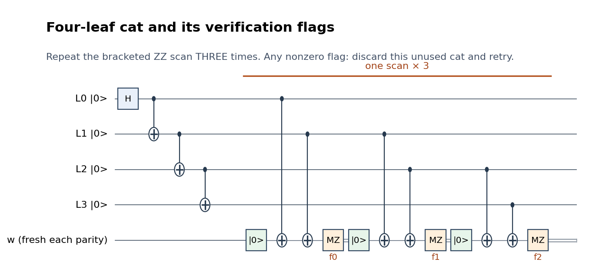

For m disjoint targets, z Z ports and w W ports, a successful check uses

\[
\begin{array}{c|c}
\text{CX}&8m-7\\
\text{preparations and measurements, each}&4m-3\\
\text{H}&m+1+2z\\
\text{T/T†}&2w
\end{array}
\]

and at most m+1 simultaneous helpers. An unsuccessful cat attempt
before coupling uses 7(m-1) CX, one H, and 4m-3 preparations and
measurements (including leaf disposal). **Proof C1/C2** establishes
the flag and local-spread guarantees for arbitrary faults.

**Flag-dependent repair example.** A bit flip on L2 of a four-leaf cat
can give adjacent-ZZ flags (0,1,1). Discard this unused cat and rebuild
it, keeping the data untouched. This is the chosen safe repair; it
consumes one retry token. The implementation does not transplant the
old compact-cat four-target repair table into this new Clifford check.

## 5. Source preparation, a nonzero syndrome, and verification

In the default flagged recovery implementation, run the encoder below,
then acquire a certified commuting history of all twenty source checks
with the flagged primitive. Apply the signed source Pauli correction.
Three equal complete records stop the default history; the cap is nine.
A source flag or unstable history discards/rebuilds only this known
unused source, consuming the shared retry budget. The source logical-X
checks never occur again after enrichment. The rest of this section
spells out the conservative acquisition-plus-verification reference.

Start all twenty D qubits in zero. The unitary encoder applies H to
0,1,2,4,5,6,8,9,10,12,16. Then, in increasing control order, apply
the following 51 CNOTs, with each row's target list in the shown order:

| Control | Targets |
|---|---|
| 0 | 3,13,14,17,19 |
| 1 | 3,13,15,18,19 |
| 2 | 3,14,15,17,18 |
| 4 | 7,13,15,17,19 |
| 5 | 7,14,15,18,19 |
| 6 | 7,13,14,17,18 |
| 8 | 11,13,15,17,18 |
| 9 | 11,14,15,17,19 |
| 10 | 11,13,14,18,19 |
| 12 | 13,14,15 |
| 16 | 17,18,19 |

The ideal state is the positive uniform superposition of all 2048
computational strings satisfying the nine Z checks. This signed state
was independently checked, rather than inferred from encoder rank.

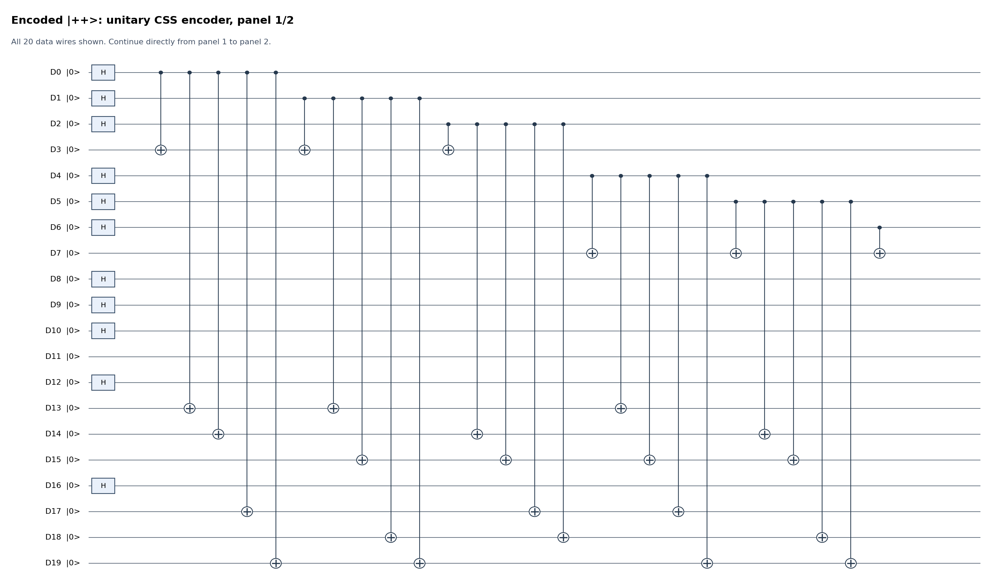
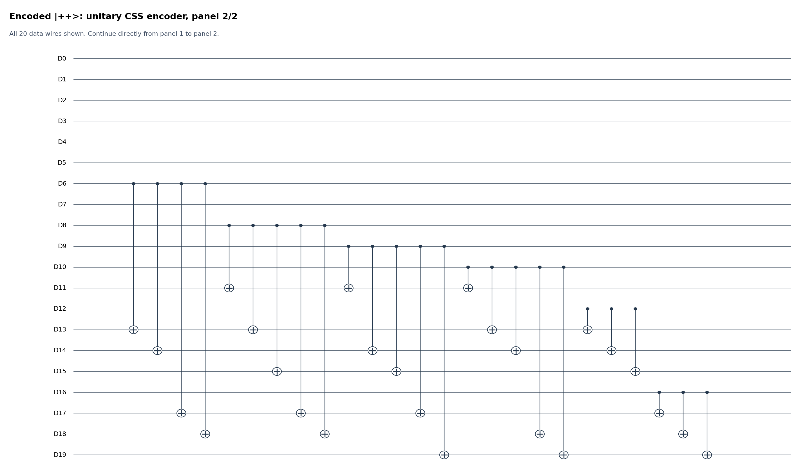

Measure, in order, the nine Z checks, nine X checks, Xbar0 and Xbar1,
using Section 4. Accept either source-syndrome sign at this acquisition.
Solve [C_source,g_j]=reported_bit_j over GF(2), using the fixed
right inverse `source_correction`. Apply its physical Pauli on each
nonidentity site in increasing q order. This is at most twenty
one-qubit gates, which can themselves fail.

Then measure **three complete twenty-check records**, requiring every
reported bit to be zero. A nonzero verification record discards and
rebuilds this known unused data source, spending a shared retry token.
All old helpers have already been measured before this restart.

**Worked source syndrome.** A physical X on D0 after encoding gives
Z-check bits (1,0,0,0,0,1,0,0,0), with all eleven X bits zero.
The specified right inverse selects physical X on D0. Applying it
restores |++> in the fault-free correction example. A corrupted
acquisition can choose a broader wrong correction; one clean rank-one
verification round removes that error or rejects it. Only faults after
the source reference leave residual local physical errors. **Proof A/C3.**

## 6. Graph preparation and local resource recovery

Use compact13 with the following exact edge order:

```text
0 ab   1 ac   2 ad   3 ae   4 bc   5 bd   6 be
7 cd   8 ce   9 de  10 ab  11 cd  12 ae

root tree: 0,1,2,3
cycle basis:
(0,1,4) (0,2,5) (0,3,6) (1,2,7) (1,3,8)
(2,3,9) (0,10) (1,2,11) (3,12)
```

Compact13 means **thirteen edges plus five vertices**, eighteen graph
resource qubits. The last cd cycle above is a triangle through a,
not a two-edge cycle. Its length is included in the recomputed counts.

Prepare a_v in plus (PREP0,H) and all edges in zero. For e=(u,v), in
increasing e and endpoint order, apply CX(a_u,Ae), CX(a_v,Ae). The
ideal state is

\[
|R\rangle=2^{-5/2}\sum_{t\in\{0,1\}^5}|t\rangle_a|dt\rangle_A.
\]

The ideal resource has stabilizers

\[
K_v=X_{a_v}\prod_{e\ni v}X_{A_e}\ (v=a,...,e),\qquad
L_e=Z_{a_u}Z_{A_e}Z_{a_v}\ (e=0,...,12).
\]

The full eighteen-check family specifies |R> uniquely, but preparation
needs only its **thirteen L_e parities**. Do not measure K_v here and do
not prepare a verification cat. For e=0,...,12, execute:

```text
PREP0(w)
CX(a_u -> w)
CX(Ae  -> w)
CX(a_v -> w)
MZ(w) -> reported bit ell_e
```

One complete scan costs 39 CX, thirteen preparations and thirteen
measurements. Require **three complete all-zero scans**, with a physical
idle boundary after each. At the first nonzero complete scan, discard
only the unused graph and rebuild it using a shared retry token; at most
two tokens are available over the whole factory. There is no graph sign
correction or adaptive history in this preparation stage. The data are
retained and all their actual idles count as faulty-location opportunities.

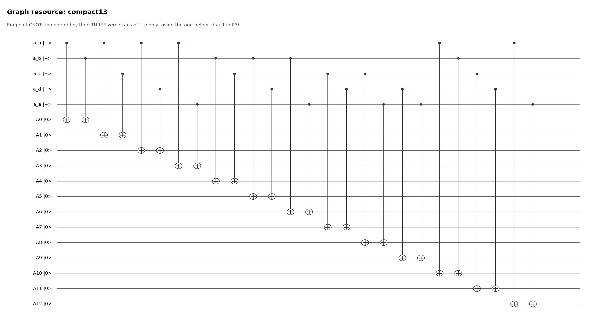

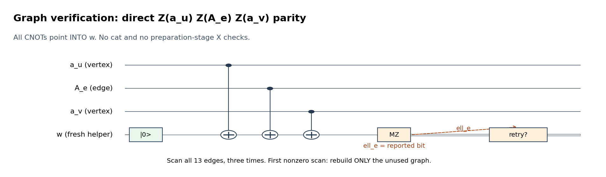

With no faults these nondestructive checks leave |R> unchanged. With
faults, a clean zero scan puts the graph in span{|t,dt>}, not necessarily
the unique |R>. This is the same distinction as cat ZZ verification:
bit consistency is certified while phases may remain wrong. Such a state
has arbitrary coefficients c_t, but V Omega sends every |t,dt>|psi> to
|t,dt> U^(t_a)|psi>. Only I/U logical branches occur; the later combined
Gauss rounds certify the desired positive sector. Do not discard these
phases in the simulator or treat them as an incoherent Pauli mixture.

All CNOTs point **into** w. A meter fault may spread several Z errors,
which remain graph phases, but adds at most one resource bit-error site
per faulty location. Three accepted scans contain a fault-free complete
scan under the global two-fault assumption. Earlier broad bit errors
are absorbed into that cut-subspace reference; later bit errors propagate
to at most one data inner block each. This is the new **Proof C3** lemma.

For example, a raw preparation X on a vertex after only some of its
endpoint CNOTs produces inconsistent L_e parities and can trigger a local
rebuild. A Z on w between parity couplings can leave correlated resource
Z errors with all zero parity reports; these are allowed phases, not a
reason to claim the graph is perfect. Three bare parity scans plus raw
preparation cost **143 CX**, rather than the former 1,328-CX conservative
full-stabilizer/cat graph stage (or 1,016 in the recovery profile).

Degrees are (6,5,5,5,5); the cut code has distance five; cycle rank is
nine and the filled graph has H1=0. The generalized Z2 expansion is
three. All original-check vertex pairs have a one-edge path. The
new gauged code has distance six by **Proof B**, not merely by reusing
the old SWAP graph's cut-distance claim. No graph repair is needed.

## 7. Enrichment and vertex readout

After both resources are verified, apply controlled W'_q from a_(q//4)
to Dq, in increasing q order. Before readout the ideal joint state is

\[
|\Phi\rangle=2^{-5/2}\sum_t|t\rangle|dt\rangle U_t|\overline{++}\rangle.
\]

Measure every vertex in X by H then MZ; retain its reported bit b_v.
The vertices are now **gone**. Do not reuse them as though an inverse
enrichment could still access their quantum state.

Reject if reported XOR_v b_v=1. Otherwise apply Z_(A_(v-1)) for every
nonroot v with b_v=1. These physical, fallible Z gates standardize the
four nonroot Gauss signs. A false early negative report can waste a
good attempt; a false positive parity still must pass the later
physical Gauss certificate.

The resource checks transform as K_v -> X_(a_v) U_v Xstar_v. After
vertex readout, the surviving Gauss operators are

\[
G_v=U_v Xstar_v,\qquad \prod_vG_v=U.
\]

Ideally after the frame correction the state is

\[
V\bigl(|C_G\rangle_A\otimes |\psi_x\rangle_D\bigr),
\quad |C_G\rangle=\tfrac14\sum_{\eta_a=0}|d\eta\rangle,
\quad |\psi_x\rangle=P_x|++\rangle/\|P_x|++\rangle\|,
\]

with x=+ on the retained ideal branch. This is a measurement of U,
not deterministic application of U. The physical controlled-W gates
supply the non-Clifford interactions needed to produce magic.

**Dangerous controller example.** X on a_b after the D4 port propagates
through the D5,D6,D7 ports as X_(a_b) W'_5 W'_6 W'_7. This affects
three physical data sites, despite being one fault. Its odd parity in
inner block b triggers S_1^Z. A controller error before all four ports
can affect the whole block; zero-syndrome components are handled by
two-block detection and later clean projection, not a claim that the
fault has weight one. **Proof D/E.**

## 8. Complete gauged checks and their explicit decorations

Define the **shared coordinate pass**

\[
V=\prod_{v=b,c,d,e} C_{A_{av}}(U_v).
\]

Its control for block b,c,d,e is A0,A1,A2,A3 respectively. Each of
the sixteen data targets gets T^s, CX, T^-s. V is its own inverse.
There is no control for block a. The following 31 checks commute on
the full Hilbert space:

\[
S_s^Z,\quad Q_s=V S_s^X V\ (s=0,...,8),\quad
B_f=\prod_{e\in f}Z_{A_e}\ (f\text{ in the nine listed cycles}),\quad
G_v=V Xstar_v V\ (v=b,c,d,e).
\]

All original Z checks remain bare: every R_s meets every inner block
in an even number of sites, and W anticommutes with the local Z.
No B/C paired stabilizer is present.

For explicit X decorations write C_e(c) for c controlled on edge e.
The following table specifies Q_s=X_(R_s) times its displayed factors;
the root a has no edge decoration. `Z(positions)` is a physical product.

| s | Factors multiplying X_(R_s) |
|---|---|
| 0 | I |
| 1 | C0[Z(4,5,6,7)] |
| 2 | C1[Z(8,9,10,11)] |
| 3 | C2[Z(12,13,14,15)] |
| 4 | C3[Z(16,17,18,19)] |
| 5 | C0[Z(6,7)] C1[-Z(10,11)] C2[-Z(12,15)] |
| 6 | C0[-Z(4,7)] C1[-Z(8,9)] C2[-Z(14,15)] C3[-Z(16,19)] |
| 7 | C1[-Z(8,11)] C2[-Z(12,13)] C3[Z(18,19)] |
| 8 | C0[-Z(5,6)] C2[-Z(13,14)] C3[Z(16,17)] |

The minus signs are relative controlled phases: C_e(-Z_R) includes a
Z on that edge. They are not optional globals. All paths are the
one-edge paths (a,b)=0,(a,c)=1,(a,d)=2,(a,e)=3. In particular this
common path choice makes every Q_s commute with every other Q_t
globally. The shared-V implementation measures exactly these operators
without compiling their controlled-CZ decorations into CCZ gadgets.

Add the root Gauss check

\[
G_a=W'_0W'_1W'_2W'_3 X_{A0}X_{A1}X_{A2}X_{A3}X_{A10}X_{A12}.
\]

It commutes globally with the Z checks, cycles and other Gauss checks.
Its group commutator with Q_s is S_s^Z, so it commutes with the X
decorations **only in the Z-positive sector**. The complete 32
constraints have a three-dimensional positive codespace. They are
not a set of 32 independent commuting Pauli generators. Product G_v=U
is the logical-sector relation; product of all graph X stars is I.

Under V the first 31 constraints are eighteen code stabilizers plus
thirteen independent graph stabilizers. The root becomes U Xstar_a.
On the four nonroot-star-positive subspace Xstar_a is +, so the root
measurement certifies U. This is the algebra used in the proof.

## 9. Three protected gauged rounds and graph-phase recovery

Execute exactly three complete rounds, in this order:

```text
V                                      # sixteen controlled-W ports
measure nine bare code Z checks; reject if any reported bit is 1
measure nine bare code X checks; reject if any reported bit is 1
measure nine cycle Z checks; reject if any reported bit is 1
for v=b,c,d,e:
    measure edge-only Xstar_v           # increasing incident-edge ports
    if reported bit r_v=1: apply physical Z(A_(v-1))
V                                      # restore the gauged frame
measure G_a using ten separate leaves   # four W data + six edge X ports
reject if its reported bit is 1
boundary idles on all live qubits
```

Thus the middle bare X measurements are measurements of Q_s in the
gauged frame. The bare-star measurements are G_b,...,G_e. The two V
passes are actual gates and both are counted; they are not additional
destructive ungauging and no edge is measured out yet.

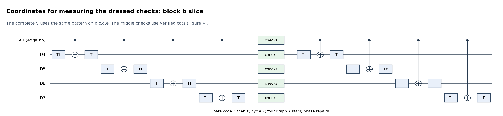

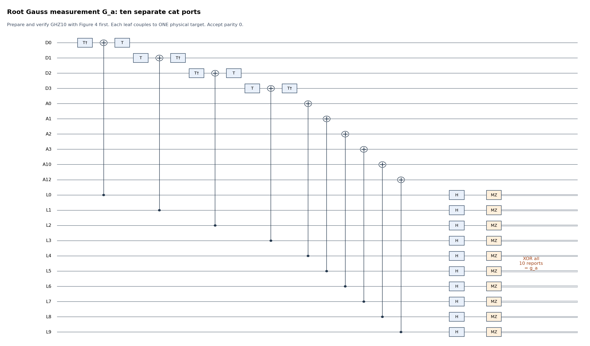

**What is protected?** Code checks detect data damage, cycles certify
flat gauge configurations, and Gauss checks tie gauge X stars to local
Clifford action. In a clean round, code and graph projection followed
by root + produces precisely the positive logical sector. The proof
uses the actual ordering outside this sector; it does not assume the
root commutes with X checks on an erroneous Z syndrome.

**Recovery example.** Z on edge A0 flips G_a and G_b but does not change
U or any edge Z readout. The nonroot b report is 1; Z(A0) repairs both
signs, so root Gauss is + again. This retains a good magic resource
instead of rejecting a harmless graph phase defect.

**Noisy history example, within two total faults.** Start with good
magic. In round 1 a wrong b-star report says 1 instead of 0. Its Z(A0)
repair creates G_b=G_a=-. A second wrong report hides the negative
root sign. Round 2 is clean: b-star correctly reports 1 and Z(A0)
removes the graph phase defect; root is +. Round 3 reports all +.
The b-star history is (1,1,0), with root reports (0,0,0); it is accepted.
The data remained positive throughout. This example uses **both**
faults in round 1, leaving none for subsequent operations.

There is no attempt to infer an unobserved clean round from equality
of records. At most two full rounds can contain faults, so a clean
one exists. **Proof F** establishes this under the constrained algebra
and retains coherent error sums. Nonzero data/cycle records currently
reject; that is a conservative policy, not a claim that all such
records are fundamentally unrecoverable.

## 10. Ungauging: edge readout and the exact physical correction

Now measure **all thirteen** edge qubits in Z, destructively, in
increasing edge order. Given the reported word z, enumerate all sixteen
root-zero eta. Accept its cut decoding only if exactly one satisfies
Hamming(z,d eta)≤2. Otherwise reject. This table has 1472 accepted
records and 6720 rejected records; all zero/one/two flips around every
cut are included. The full record is required, even though the final
eta can be read from the corrected root-tree bits.

For each v with eta_v=1, apply W'_q to every q in J_v. Physically use
S^(s_q) then X on each site, in increasing v,q order. The product is
the normalized U_eta up to the known record-global phase
(-1)^(eta_c+eta_d), which can be retained in a trajectory manifest.
There is no relative control-branch phase left to discard at this stage.
These are one-qubit Clifford corrections; they add no T cost.

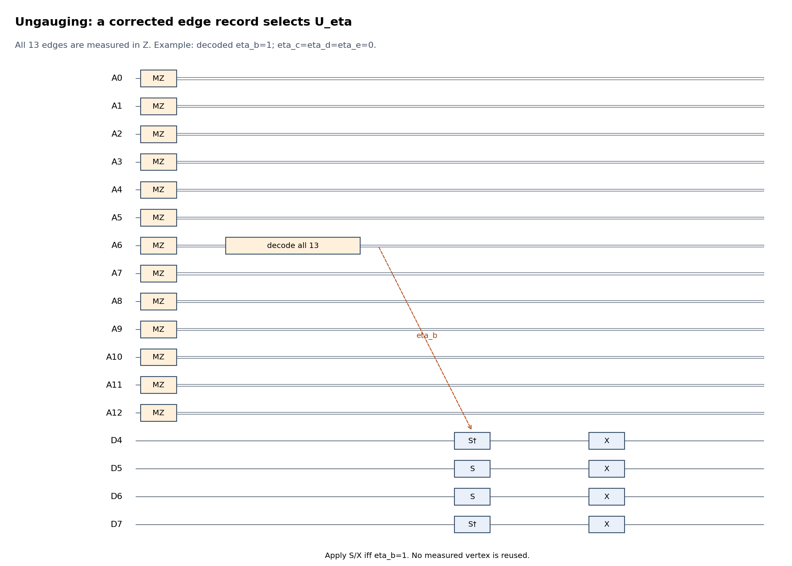

**Worked readout correction.** Let eta_b=1 and the other nonroot eta
bits be zero. The true cut support is {0,4,5,6,10}. Flip reports 0 and
7, yielding {4,5,6,7,10}. The radius-two decoder recovers the original
cut and selects only block b. Apply S†(D4),X(D4), S(D5),X(D5),
S(D6),X(D6), S†(D7),X(D7). Decoding the raw root bit alone would
have selected the wrong byproduct. The two bad reports have already
used the whole fault budget in this example.

For arbitrary input |psi>, the **bare graph circuit**, before the
Gauss-sign frame Zs and using normalized U_eta†, has corrected
Kraus operator for a fixed valid ideal record (b,z)

\[
\boxed{2^{-4}(-1)^{b\cdot\eta}P_x,\qquad
P_x=(I+xU)/2.}
\]

Each fixed full record has probability ||P_x psi||²/256; there are
256 records of each parity. On |++>, all 256 positive records have
probability 3/1024 and all 256 negative ones 1/1024. Every ideal
edge record is retained on the positive branch. **Proof A/G** derives
the factors, every branch and the cut/byproduct fault bound.

In the chosen physical schedule the Gauss-sign frame contributes the
same (-1)^(b·eta), cancelling that sign. Implementing the normalized
byproduct with S/X instead contributes kappa=(-1)^(eta_c+eta_d).
Thus its accepted graph-record Kraus operator is **kappa P_+/16**,
times the positive scalar for the individual helper-meter records.
Both conventions and their exact global signs are saved in
`ideal-records.json`; neither changes the normalized output or record
probabilities. No such phase is discarded inside a controlled gate.

## 11. Terminal recovery and the accepted resource

The default recovery profile uses the same eighteen original checks with
flagged gadgets, a certified commuting history, and the unique-class
physical correction. It measures no source logical X. A terminal flag
rejects; it does not reset the data or invoke a cat fallback. The clean
path costs 804 CX for three complete records, compared with 1602 using
the previous protected cats. The late-error bound is proved by the
zero-flag physical-port lemma in the companion flagged proof.

The ideal state is now |CZ_magic> in the original twenty-qubit code.
Faults may instead have left errors spanning up to two inner blocks.
Do **not** use a physical-weight-two decoder on such an inherited error.

Measure the eighteen code checks, Z first then X, for three complete
rounds with one leaf per physical target; require every reported bit
zero. Any nonzero data record rejects this attempt. Unused flagged
cats can still be rebuilt with a remaining shared retry token. The
data themselves are never reset or re-encoded. Neither source logical
X operator is measured after the source stage.

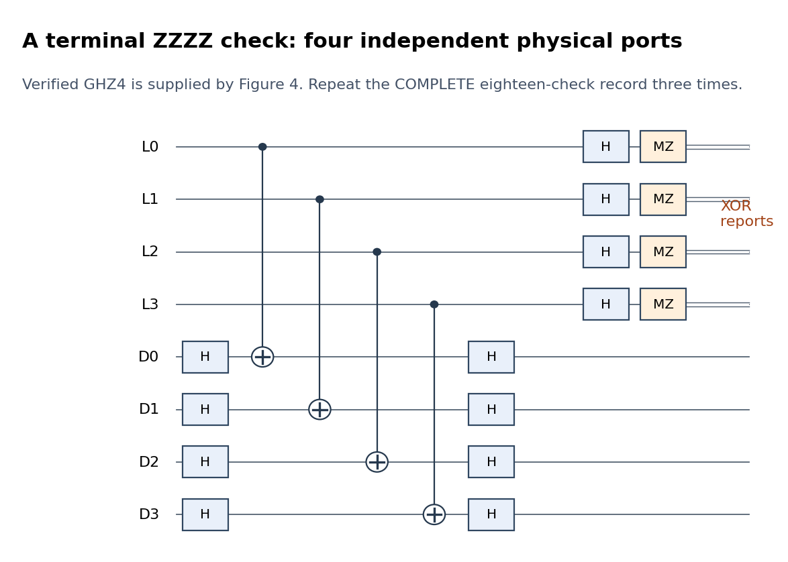

At a clean terminal round the code projector removes the inherited
two-block error or rejects it. All faults after the last clean round
have only one-target coupling and therefore leave an error in the
weight-two physical span. The final boundary idle is included. A
standard distance-six recovery then decodes to the exact desired
logical resource. This recovery is the mathematical decoder defining
the accepted-output guarantee, not a hidden noiseless gate in the
factory. **Proof H/J.**

**Why rejection is necessary for this decoder.** Physical X(2,3) and
X(8,11,12,15) share a syndrome, but differ by Xbar0. They are admissible
one-block and two-block errors. Correcting all unknown two-block
syndromes would therefore corrupt some logical states. The conservative
zero-syndrome rule accepts only the certified stabilizer class. The
finite table checks this for every Pauli on every two-block set.

**Genuine negative branch.** Ideally |++> projects to |11> with
probability 1/4. Its vertex parity is negative and the attempt stops.
If faults hide that parity, a clean gauged round still rejects a pure
negative component. Repeating the measurement cannot flip its actual
eigenvalue. No sign repair is applied to manufacture magic from |11>.

## 12. Reproducible resources and the fair direct-cat baseline

Current **default flagged recovery** clean counts, generated from actual
elementary lists, are:

| Schedule | CX | T/T† | PREP | MZ | Fixed 1q Clifford | Peak live |
|---|---:|---:|---:|---:|---:|---:|
| compact13 gauging | **3217** | 256 | 1172 | 1152 | 1323 | **39** |
| current20 gauging | **3459** | 256 | 1263 | 1243 | 1323 | **46** |
| Direct flagged CZ measurement | 1965 | 120 | 734 | 714 | 869 | 24 |
| Actual twenty-leaf-cat CZ, matched flagged source/data checks | 2124 | 120 | 842 | 822 | 926 | 41 |

Ideal mean gauging feedback adds eighteen one-qubit Cliffords. The direct
comparator retains historical CLI route name `direct_cat`; with flag
extraction it uses a twenty-port rolling-flag measurement and no large
cat. The [separate actual-cat runner](../src/SINGLE_BLOCK_CZ_CAT_BASELINE.md)
forces GHZ20 for CZ while preserving those flagged source/data checks;
its noise model and output format are shared with the gauging runner.
These schedules use the same source, gate/noise set and global
two-fault accepted-output guarantee. Small flagged circuits are not claimed
to improve stochastic acceptance: the [pilot results](single_block_cz_simulation_results.md)
show substantial rejection from flags. The remaining tables below are
the explicitly retained **conservative cat-extraction reference**, whose
graph preparation also uses the new direct Z-parity verifier.

These are physical **successful clean-attempt** counts. All cat scans,
readouts and code checks are included. The zero feedback record gives
the fixed counts below; ideal branch-dependent Cliffords are stated
separately. A preparation of a previously used physical slot is a
reset/reinitialization, not a free operation.

| Stage | PREP | MZ | 1-qubit Clifford | T/T† | CX |
|---|---:|---:|---:|---:|---:|
| Raw CSS encoder | 20 | 0 | 11 | 0 | 51 |
| Source acquisition | 404 | 404 | 240 | 0 | 788 |
| Three source verification rounds | 1,212 | 1,212 | 720 | 0 | 2,364 |
| Raw graph | 18 | 0 | 5 | 0 | 26 |
| Three direct graph Z-parity scans | 39 | 39 | 0 | 0 | 117 |
| Enrichment and vertex readout | 0 | 5 | 5 | 40 | 20 |
| Three gauged rounds, including six V passes and three root checks | 1,620 | 1,620 | 1,035 | 216 | 3,240 |
| Edge readout | 0 | 13 | 0 | 0 | 0 |
| Three terminal rounds | 1,086 | 1,086 | 678 | 0 | 2,118 |
| **Fixed total** | **4,399** | **4,379** | **2,694** | **256** | **8,724** |

Each gauged round has 32 checks: 31 commuting constraints measured
through V plus the ten-port root Gauss. It costs 1080 CX, 72 T/T†,
345 H, and 540 preparations/measurements each. An original-code
eighteen-check terminal round costs 706 CX, 226 H, 362 preparations
and measurements each. No multi-qubit gate is atomic beyond CX.

On an ideal accepted branch, add 0–4 vertex-frame Zs (mean 2) and
0–32 byproduct S/X gates (mean 16). Ideal source corrections and
graph-phase repairs are zero. Thus the mean clean Clifford total is
2712, with range 2694–2730. CX and T counts do not depend on these
ideal measurement records.

| Qubit quantity | Gauging route | Direct-cat comparator |
|---|---:|---:|
| Data | 20 | 20 |
| Edge/vertex resource | 13+5 | 0 |
| Maximum simultaneous check helpers | 11 | 21 |
| Peak at source checks | 29 | 29 |
| Peak at graph verification | 39 | — |
| Peak while gauged | **44** | — |
| Peak at terminal | 29 | **41** |
| Physical slots allocated with reuse | **44** | **41** |
| Distinct symbolic roles if every role has a dedicated slot | 49 | 41 |
| Clean reinitializations after first use | 4,355 | 2,912 |

The gauging peak is the eleven-helper root check after all five
vertices have been destroyed: 20+13+10+1=44. Graph preparation uses
20 data + 18 graph + one parity helper =39; it has no check cats. Reusing freed
physical slots needs no state-moving SWAP. Twenty data qubits remain
live at handoff. Total slot allocation and peak live counts are distinct
from the number of symbolic roles and the thousands of preparations.

The direct comparator uses the **same normalized W'_q**, the same
three-gate controlled implementation, source, cat protection, retry
rules, physical gate set and two-fault accepted-output guarantee.
After the source it executes three rounds of eighteen code checks
then one twenty-leaf U measurement; all signs must be +. The first U
measurement prepares magic and a negative result immediately rejects.
There is no extra redundant fourth U measurement in its budget.
This is our reconstructed complete comparator, not a published cost
claimed for the C4-Helix experiment.

| Clean accepted attempt | Gauging | Direct cat |
|---|---:|---:|
| CX | 8,724 | 5,780 |
| T/T† | 256 | 120 |
| 1-qubit Cliffords, ideal mean | 2,712 | 1,712 |
| Preparations | 4,399 | 2,953 |
| Measurements | 4,379 | 2,933 |
| Peak physical qubits | 44 | 41 |

For this conservative pair of constructions the direct cat costs less
on the listed clean metrics. This is neither an optimality statement
nor a noisy rejection comparison. In particular a simpler enrichment
representation also benefits the direct-cat baseline.

The serial zero-feedback gauging path has **614,062** single-qubit
idle locations, including boundaries; ideal mean feedback adds 368.
The comparator has 353,342. This is a precise scheduling convention,
not a proposed high-performance parallel schedule or a duration model.
The primitive schedule generator can be rescheduled later, but a new
schedule must expose its own idles and preserve the proof hypotheses.

There are three clean source-verification, three graph-verification,
three gauged, and three terminal rounds, plus source acquisition.
Local retries are bounded by two shared tokens, and source correction
uses at most twenty Pauli gates per source attempt. Across a complete
bounded execution there are at most three source attempts, at most
three graph attempts, at most twelve intermediate graph-phase Z repairs,
four vertex-frame Zs, and thirty-two ungauging Cliffords. The shared
token bound prevents all per-resource maxima being reached together.
`resources.json` also gives a deliberately loose bounded-operation
upper envelope: CX≤15,130, PREP≤7,671, MZ≤7,651, T/T†=256 on a full
accepted gauging path, with separately bounded correction axes and
idles. It is an upper bound, not a reachable worst-case gate profile.

Zero-noise repeat-until-success cost includes early negative attempts.
Exactly C_positive_mean + C_negative/3 operations are needed per ideal
accepted output. Including negative-attempt disposal, CX totals are
**9,846** for this gauging schedule and **7,134** for the comparator;
T/T† totals are 808/3 and 400/3 respectively. These are exact **ideal**
costs, not future noisy matched-fidelity results.

For future benchmarking expose r2≈10^-3, readout-report flips q≈10^-3,
one-qubit Clifford/T/T† noise, memory noise and physical gate durations.
Under the project's uniform two-qubit Pauli convention,
p_nonidentity=(5/4)r2. The [simulation guide](../src/SINGLE_BLOCK_CZ_SIMULATION.md) describes
an exact coherent depolarizing backend and the recovery profile. That
profile uses the same new graph verifier and 4,810 clean CX on compact13;
the table above deliberately retains the conservative source/data rules.
Saved pilot results must be identified by graph-verifier version. Clean
gate counts alone do not predict noisy yield or matched-fidelity cost.

## 13. Commands, certificates, and exact scope of verification

Run from the repository root:

```sh
python3 -B src/check_single_block_cz.py
python3 -B src/check_single_cz_graph_parity.py --output output/single-cz-graph-parity-certificates.json
python3 -B src/check_single_block_cz_cyclotomic.py
python3 -B src/run_single_block_cz_controller.py --control-flow-check
python3 -B src/c4_helix_single_block_cz.py \
    --schedule output/single-block-cz/schedule-zero-record.json

MPLCONFIGDIR=/private/tmp/c4-cz-mpl \
    /Users/kevinhemery/pytket-venv/bin/python -B notes/build-single-block-cz.py
```

The mathematical/gadget checks require only the Python standard library.
Only figure generation requires matplotlib. SVGs are editable vector
circuits; their PNG counterparts were rendered and visually inspected.
Aligned gates in a figure are a drawing convenience; the executable
gate lists specify the serial order used for fault and idle accounting.
The complete 20,469-operation/boundary zero-record gate list is saved
alongside the certificates. Its implicit live-qubit idles are expanded
by the accounting rule, not hidden from the physical model.

| Artifact | What it establishes |
|---|---|
| [certificates.json](../output/single-block-cz/certificates.json) | Signed code/source action, 655,360 two-block Paulis, all 1,771 radius-two physical errors (1,726 syndrome classes), graph conditions, local cat certificates |
| [ideal-records.json](../output/single-block-cz/ideal-records.json) | All 512 ideal vertex/edge records, phases, probabilities and byproducts |
| [physical-recovery-table.json](../output/single-block-cz/physical-recovery-table.json) | All 1,726 physical-radius-two syndrome corrections; used to define the output decoder |
| [edge-decisions.json](../output/single-block-cz/edge-decisions.json) | Every one of 8,192 edge records: root-zero eta or rejection (-1) |
| [cyclotomic.json](../output/single-block-cz/cyclotomic.json) | Exact W and controlled-W matrices; 27 single and 234 two-location port basis faults per sign; all ideal leaf branches of two mixed-port gadgets |
| [graph parity certificates](../output/single-cz-graph-parity-certificates.json) | Cut-subspace rank, complete Walsh phase span, bare-meter support/phase-spread audit, both emitted graph schedules |
| [resources.json](../output/single-block-cz/resources.json) | Counts from elementary gate lists, per stage, with live-qubit accounting and retry envelopes |
| [recovery-resources.json](../output/single-block-cz/recovery-resources.json) | Current simulator's conservative/recovery schedules on both graphs and the direct-cat comparator, with per-stage costs |
| [controller.json](../output/single-block-cz/controller.json) | Executable reported-record control flow agrees with the independent clean builder; flag retry, negative rejection and edge-report correction |
| [ideal-cost.json](../output/single-block-cz/ideal-cost.json) | Exact ideal early-rejection and repeat-until-success costs |
| [run_single_block_cz_controller.py](../src/run_single_block_cz_controller.py) | Complete executable preparation/measurement/feedback controller for a supplied quantum backend |

The code/graph/cat statements are exhaustive finite certificates in
their stated domains. The arbitrary-local-fault factory theorem is
the **analytical composition proof**, not exhaustive full-factory
enumeration or Monte Carlo evidence. No floating-point spot check is
used to establish a central identity. The controller's fake record
backend checks classical flow only; it is explicitly not a quantum
or noisy simulator. The implemented [complex-phase simulation backend](../src/SINGLE_BLOCK_CZ_SIMULATION.md)
keeps the phases of T/T† and W in exact cyclotomic arithmetic. The older
real/integer sparse SWAP representation is not used unchanged.

## 14. Optional single-logical-qubit outputs, outside the main theorem

The primary handoff remains the encoded two-qubit resource. From the
ideal state, measuring its first logical qubit in X and retaining +
gives (2|0>+|1>)/sqrt5 on the other, with conditional probability 5/6
and overall probability 5/8.

Measuring first logical Y instead gives ((1-i)|0>+|1>)/sqrt3 for +,
or ((1+i)|0>+|1>)/sqrt3 for -. Apply a logical S on the retained
qubit for the latter outcome (or track that Clifford frame). Both
outcomes are retained, so the overall ideal probability remains 3/4.

This readout is not free. The canonical physical Ybar0 word has Y
on site 3, X on 2,8,11,12,15 and Z on 0,6,7,18,19, with positive
sign: i Xbar0 Zbar0 is precisely that eleven-body Hermitian word.
One three-scan eleven-leaf extraction of it would use 81 CX, 41
preparations and measurements each, and 24 one-qubit Cliffords,
using S†/CX/S for the Y port. This is a cost for **one extraction**;
protected logical-sign history, subsequent recovery and any physical
implementation of the logical Clifford correction need additional
circuits and proof. They are not included in the primary totals or
accepted-output theorem.
