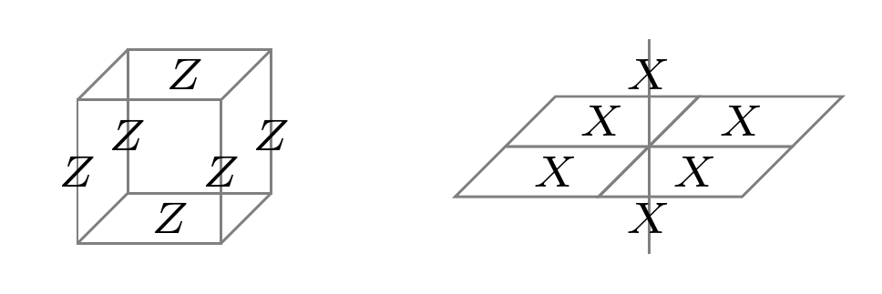
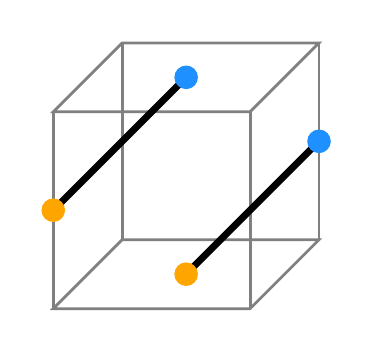
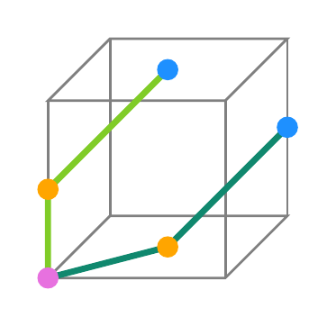

# Non-Abelian anyons from gauging logical gates

**Source:** [arXiv:2602.12228v1](../arXiv-2602.12228v1/main.tex),
*Non-Abelian Quantum Low-Density Parity Check Codes and Non-Clifford
Operations from Gauging Logical Gates via Measurements*.

**Background assumed:** basic qubit states, tensor products, and quantum
measurement. The note introduces stabilizer codes, anyons, gauge fields,
and the group theory it uses. Chains and cochains are developed from binary
linear algebra in the discussion of Section III.

The paper connects two descriptions of the same quantum system. In quantum
error correction, a set of constraints defines a space in which information
can be encoded. In many-body physics, those same constraints define a
Hamiltonian's ground space, and violations of the constraints are
excitations. Gates acting on the encoded information can then be used to
construct new phases with different excitations.

The opening follows Section II of the paper. We first understand the toric
code and the action of a controlled-Z gate on its excitations. We then
explain gauging, derive its circuit and measurement implementation, and
show how to correct random measurement outcomes. Finally, we unpack the
name \(\mathcal D(D_4)\) for the resulting phase. Section III will reuse
this construction when there is no ordinary spatial lattice.

## Before the construction: states, codes, and anyons

### A constraint can define both a code and a ground state

For a qubit, the Pauli operators act as

\[
X|0\rangle=|1\rangle,\quad X|1\rangle=|0\rangle,
\qquad Z|0\rangle=|0\rangle,\quad Z|1\rangle=-|1\rangle.
\]

They obey \(X^2=Z^2=I\) and \(XZ=-ZX\). Pauli operators on different
qubits commute. The states \(|\pm\rangle=(|0\rangle\pm|1\rangle)/\sqrt2\)
are eigenstates of \(X\), with eigenvalues \(\pm1\).

A **stabilizer** is an operator whose \(+1\) eigenspace we require the
state to occupy. For example, \(Z_1Z_2|\psi\rangle=|\psi\rangle\)
restricts two qubits to the span of \(|00\rangle\) and \(|11\rangle\).
It fixes their parity without fixing the coefficients in
\(\alpha|00\rangle+\beta|11\rangle\). Those coefficients can carry
one encoded qubit. In a Pauli stabilizer code, the defining operators
are commuting Pauli products, also called **checks**.

The Hamiltonian \(-S\), for a check \(S\) with eigenvalues \(\pm1\),
assigns energy \(-1\) to its \(+1\) eigenspace and \(+1\) to its
\(-1\) eigenspace. Thus a sum \(-\sum_j S_j\) of compatible checks
has the code space as its lowest-energy, or **ground**, space. A violated
check costs energy. Measuring the checks gives a list of signs called the
**syndrome**, which tells us which constraints are violated without
reading out the encoded coefficients.

### What topological order and non-Abelian anyons mean here

A **phase of matter** describes properties shared by a family of systems,
not the exact value of every microscopic coupling. For the phases considered here, there is an **energy gap**: a nonzero
energy cost to leave the ground space, persisting as the system grows.
Small local changes that keep this gap open do not change the
topological order. The characteristic data
include the kinds of excitations, their fusion and braiding, and the ground
states allowed by the topology of the space.

An **anyon** is a particle-like excitation in two spatial dimensions with
a definite topological charge, or *type*. It need not be an added physical
particle: in the toric code it is a localized pattern of violated checks.
One can create a pair, separate its members, move one around another, and
bring them together again. Moving them around one another is **braiding**;
bringing them together and measuring their combined charge is **fusion**.
The label \(1\), called the **vacuum**, means that no topological charge
remains. It does not mean that the underlying lattice qubits are absent.

For **Abelian anyons**, two specified types have a unique fusion outcome.
Braiding fixed types on a plane changes their state by a phase. That phase
can be \(-1\), or another nontrivial complex number; Abelian does not mean
that braiding has no effect.

For **non-Abelian anyons**, specifying the positions, individual types,
and total charge can still leave a multidimensional space of states. For
example, with four anyons and total vacuum charge, the first pair may
fuse through different intermediate charges, with the second pair
compensating to keep the same total charge. These alternatives label a
**fusion space**. Braiding can mix its states, and different sequences of
braids can act differently. This information belongs to the collection of
anyons; it is not generally a freely accessible qubit attached to each
particle.

The word *non-Abelian* refers to noncommuting operations. For two suitable
braid operations \(U_1,U_2\), it is possible that
\(U_1U_2\ne U_2U_1\). We will first see how gauging makes such a richer
description necessary, then identify the resulting theory more precisely.

## Section II.A: from a logical symmetry to non-Abelian anyons

Section II.A motivates the construction before giving its circuit. Its
starting point is two copies of an Abelian phase, the toric code. A
controlled-Z circuit changes certain excitation types into composites of
the two copies. Applying that circuit in only part of the system creates
a line across which the labels change. Gauging makes the associated
defects part of the new quantum system's excitations.

The paper identifies the resulting phase as \(\mathcal D(D_4)\).
Here \(D_4\) is the eight-element symmetry group of a square and
\(\mathcal D(G)\) denotes the quantum-double topological order associated
with a finite group \(G\). We will define that construction after the
circuit derivation; for now, the name specifies the phase we aim to build.

## Starting point: two decoupled toric codes

The toric code gives us a model in which both error syndromes and moving
excitations can be calculated with Pauli operators. Take a square lattice
with periodic boundary conditions: opposite sides are identified, making
a torus. Put one qubit on each edge. A vertex \(v\) is where four edges
meet, and a plaquette \(p\) is one elementary square. Introduce

\[
A_v=\prod_{e\ni v} X_e,
\qquad
B_p=\prod_{e\in\partial p} Z_e.
\]

The notation \(e\ni v\) selects the four edges touching \(v\), and
\(e\in\partial p\) selects the four sides of the square \(p\).
Thus \(A_v\) is an \(X\)-product shaped like a star and \(B_p\) is a
\(Z\)-product around a square. A star and a plaquette share either zero
or two edges. On each shared edge, exchanging \(X\) and \(Z\) gives a
minus sign, so their total sign is always positive. All these checks
therefore commute.

The Hamiltonian can be written

\[
H_{\mathrm{TC}}=-\sum_v A_v-\sum_p B_p.
\]

The ground space is the simultaneous \(+1\) eigenspace of every \(A_v\)
and \(B_p\). It contains several states: these local constraints do not
fix all global information. This is what lets the toric code encode qubits.
The checks have bounded size—four qubits each—and each qubit participates
in two stars and two plaquettes. This is also an example of the low-density
check structure generalized in Section III.

We take two independent copies, called \(B\) and \(C\), with Pauli
operators

\[
X_e^{B},Z_e^{B},
\qquad
X_e^{C},Z_e^{C}.
\]

Their decoupled Hamiltonian is \(H_{\mathrm{TC}}^{B}+H_{\mathrm{TC}}^{C}\).
The superscripts are labels of the two codes, not powers. In particular,
\(B_p^C\) means a plaquette check of copy \(C\): the letter \(B\)
in \(B_p\) names the type of check, while the superscript names the copy.

### Excitations and string operators

We now identify the excitations by the checks they violate and show how
Pauli strings create and move them. This will let us infer the anyon action
of a gate by conjugating its string operators.

An \(e\) anyon is a vertex where \(A_v=-1\). If \(\gamma\) is a path on the
direct lattice, then

\[
W_e^B(\gamma)=\prod_{e\in\gamma} Z_e^B
\]

commutes with all \(B_p^B\) and anticommutes only with the two star
stabilizers at the endpoints of \(\gamma\). Acting on a ground state, it
therefore creates a pair of \(e_B\) anyons at those endpoints. At an
interior vertex the path uses two edges, so the two anticommutation signs
cancel; at each endpoint there is only one. Appending a \(Z\) on the next
edge moves the endpoint excitation by one step. Applying the same string
twice gives identity and annihilates the pair.

The symbol \(e\) in a product over edges is an edge label; the italic
anyon name \(e_B\) instead denotes an electric charge. Neither charge nor
flux here refers to an actual electron or an electromagnetic field.

The **dual lattice** places one vertex at the centre of every square,
with a dual edge crossing each original edge. A path \(\gamma^\star\)
on it connects plaquettes rather than original vertices. The operator

\[
W_m^B(\gamma^\star)=\prod_{e\perp\gamma^\star} X_e^B
\]

creates a pair of \(m_B\) anyons at the two endpoint plaquettes, where
\(B_p^B=-1\). The subscript \(e\perp\gamma^\star\) selects original
edges crossed by the dual path. The same cancellation explains why only
the endpoints violate checks. The same statements hold for code \(C\).

These excitations have nontrivial braiding even before gauging. Transport
an electric charge around a closed direct-lattice loop bounding a region.
The \(Z\)-string around that loop is the product of the plaquette checks
inside: interior edges cancel in pairs. If precisely one magnetic flux
lies inside, that product has eigenvalue \(-1\). The charge therefore
acquires a minus sign on circling the flux. This is **mutual Abelian
statistics**: the types stay fixed, and the braid supplies a scalar phase.

The notation \(e_B^2=1\) means that fusing two \(e_B\) charges leaves
vacuum. This matches the cancellation of two identical Pauli strings.
The four elementary charges and fluxes satisfy

\[
e_B^2=m_B^2=e_C^2=m_C^2=1.
\]

For example, \(m_Be_C\) is a composite excitation carrying an \(m\) flux of
code \(B\) and an \(e\) charge of code \(C\). Before gauging, every excitation
of the two-copy theory has a unique fusion outcome: this is an Abelian anyon
theory.

### Logical operators and the bar

A closed string has no endpoint syndrome. If it encloses a disk, it can be
written as a product of checks inside that disk, and acts as identity on
the ground space. A loop winding around a torus need not bound such a
region: it cannot be shrunk to a point and is not a product of checks. It acts nontrivially within the ground-state subspace and is a
logical operator. A bar distinguishes such an encoded operation from a
single-qubit Pauli. For a selected encoded pair, we write

\[
\bar X_B,\ \bar Z_B,\ \bar X_C,\ \bar Z_C.
\]

For instance, \(\bar X_B\) is a noncontractible \(X^B\)-string (with the
precise direct/dual choice depending on convention). It acts as Pauli \(X\) on
one encoded qubit of code \(B\). The bar does **not** mean complex
conjugation. It means "logical operator."

One toric code on a torus encodes **two** qubits, corresponding to its two
independent directions of winding. For either encoded qubit, choose a
\(Z\) loop and a dual \(X\) loop crossing once. The operators
anticommute, just like one physical qubit's \(X\) and \(Z\), but both
preserve every check. The single \(B,C\) pair of bars displayed below
suppresses the other winding label; it does not mean each toric code
encodes only one qubit.

## The controlled-Z symmetry

The two codes are placed with a small relative displacement. The circuit
\(U_{\mathsf{CZ}}\) in the paper is a product of physical controlled-Z gates:
each horizontal edge qubit of one copy is coupled to a nearby vertical edge
qubit of the other copy, and conversely. The geometry is chosen so that the
extra \(Z\) factors produced by these gates form plaquette stabilizers of the
other code.

For bits \(b,c\in\{0,1\}\), controlled-Z acts as
\(\mathsf{CZ}|bc\rangle=(-1)^{bc}|bc\rangle\): only \(|11\rangle\)
gets a minus sign. To follow a check or string through a circuit \(U\),
we calculate its **conjugate** \(USU^\dagger\). If \(S|\psi\rangle=
|\psi\rangle\), then \((USU^\dagger)U|\psi\rangle=U|\psi\rangle\),
so this is the check satisfied by the transformed state. Here everything
follows from the one-pair identities

\[
\mathsf{CZ}_{12}\,(X_1)\,\mathsf{CZ}_{12}=X_1Z_2,
\qquad
\mathsf{CZ}_{12}\,(X_2)\,\mathsf{CZ}_{12}=Z_1X_2,
\]

\[
\mathsf{CZ}_{12}\,(Z_1)\,\mathsf{CZ}_{12}=Z_1,
\qquad
\mathsf{CZ}_{12}\,(Z_2)\,\mathsf{CZ}_{12}=Z_2.
\]

There is no dagger on the right in these equations because
\(\mathsf{CZ}^{\dagger}=\mathsf{CZ}=\mathsf{CZ}^{-1}\).

### Why it preserves the ground space

Consider a \(B\)-code star operator. Conjugating each of its \(X^B\) factors
by the nearby controlled-Z gates produces a pattern of \(Z^C\) factors. For
the pairing shown in the paper, that pattern is precisely a neighboring
\(C\)-code plaquette operator. Schematically,

\[
U_{\mathsf{CZ}} A_v^B U_{\mathsf{CZ}}^\dagger
=A_v^B B_{p(v)}^C.
\]

Similarly, a \(C\)-code star is sent to itself times a \(B\)-code plaquette.
Plaquette stabilizers themselves are unchanged because controlled-Z commutes
with every \(Z\).

Thus \(U_{\mathsf{CZ}}\) does *not* leave each term of the microscopic
Hamiltonian fixed. Nevertheless, if \(\lvert\psi\rangle\) is a ground state,
then \(A_v^B\lvert\psi\rangle=B_p^C\lvert\psi\rangle=\lvert\psi\rangle\), so

\[
\bigl(A_v^B B_{p(v)}^C\bigr)\lvert\psi\rangle
=\lvert\psi\rangle.
\]

All transformed stabilizers still have eigenvalue \(+1\). Therefore
\(U_{\mathsf{CZ}}\) maps the ground-state subspace to itself. This is what the
paper means by an **emergent symmetry of the ground-state subspace**.

### Its logical action

The same local conjugation rule applied along noncontractible strings gives

\[
\begin{aligned}
U_{\mathsf{CZ}}\bar X_B U_{\mathsf{CZ}}^\dagger
  &=\bar X_B\bar Z_C, &
U_{\mathsf{CZ}}\bar Z_B U_{\mathsf{CZ}}^\dagger
  &=\bar Z_B,\\
U_{\mathsf{CZ}}\bar X_C U_{\mathsf{CZ}}^\dagger
  &=\bar Z_B\bar X_C, &
U_{\mathsf{CZ}}\bar Z_C U_{\mathsf{CZ}}^\dagger
  &=\bar Z_C .
\end{aligned}
\]

These are exactly the Heisenberg-picture conjugation rules of a controlled-Z
gate acting on the two encoded qubits. Since every physical
\(\mathsf{CZ}\) squares to identity,

\[
U_{\mathsf{CZ}}^2=1.
\]

The generated symmetry group is consequently \(\mathbb Z_2\): its two
elements are \(I\) and \(U_{\mathsf{CZ}}\), and applying the nontrivial
one twice returns to identity. The notation names this composition rule.
A gate that sends Pauli products to Pauli products under conjugation is
called a **Clifford gate**; CZ is one example.

## From the logical gate to an anyon permutation

The logical equation already suggests the local anyon action. More directly,
take an \(m_B\) string. It is made from \(X^B\) operators. Under conjugation
by \(U_{\mathsf{CZ}}\), every \(X^B\) in the string acquires a nearby
\(Z^C\). Symbolically,

\[
U_{\mathsf{CZ}}W_m^B(\gamma^\star)U_{\mathsf{CZ}}^\dagger
=W_m^B(\gamma^\star)\,W_e^C(\gamma).
\]

Explicitly, if \(\phi(e)\) is the \(C\)-edge paired with \(B\)-edge
\(e\), then conjugation distributes over the product:

\[
U_{\mathsf{CZ}}\left(\prod_{e\in\Gamma}X_e^B\right)
U_{\mathsf{CZ}}^\dagger
=\prod_{e\in\Gamma}(X_e^BZ_{\phi(e)}^C)
=\left(\prod_{e\in\Gamma}X_e^B\right)
 \left(\prod_{e\in\Gamma}Z_{\phi(e)}^C\right).
\]

The extra factors therefore form a second string, rather than isolated
charges in its interior. The exact path \(\gamma\) is set by the
shifted edge pairing, but its endpoints are at the same physical locations as the endpoints of the \(m_B\) string.
Thus each endpoint now carries both an \(m_B\) and an \(e_C\) excitation:

\[
g(m_B)=m_Be_C.
\]

Repeating the argument with \(B\) and \(C\) exchanged gives

\[
g(m_C)=m_Ce_B,
\qquad
g(e_B)=e_B,
\qquad
g(e_C)=e_C.
\]

The map \(g\) is an **anyon automorphism**: an invertible relabelling
that preserves fusion and braiding. An anyon type is also called a
**superselection sector**. This means that an operation confined near one
isolated excitation cannot change its total topological charge without
supplying another charge. The symmetry circuit acts throughout the system,
so its relabelling is compatible with this rule. The labels distinguish
excitations physically: for instance, a loop of \(m_C\) detects the
additional \(e_C\) in \(m_Be_C\) through a minus sign.

It is useful to write the complete action once. Every two-copy toric-code
anyon can be labeled as

\[
x=e_B^a m_B^b e_C^c m_C^d,
\qquad a,b,c,d\in\{0,1\}.
\]

All exponents are understood modulo two. The symmetry acts as

\[
g(x)=e_B^{a+d}m_B^b e_C^{c+b}m_C^d.
\]

This formula makes two facts transparent:

1. \(g\) respects fusion. Since fusion adds the four exponents modulo two,
   \(g(xy)=g(x)g(y)\).
2. \(g^2=1\). Applying the map twice adds \(2b\) and \(2d\), both zero modulo
   two. In full,
   \((a,b,c,d)\mapsto(a+d,b,c+b,d)\mapsto(a+2d,b,c+2b,d)
   =(a,b,c,d)\).

An **orbit** is the set of labels reached by repeated symmetry actions.
For example, the two-element orbit of \(m_B\) is

\[
\mathcal O_{m_B}=\{m_B,\ m_Be_C\}.
\]

## A symmetry patch is a defect line

Until now, \(U_{\mathsf{CZ}}\) was applied everywhere. A **symmetry patch**
means applying the same circuit only in a finite region \(R\). Denote this
partial operation by \(U_{\mathsf{CZ}}(R)\).

Inside \(R\), an anyon label is related to the outside label by \(g\). Thus an
\(m_B\) anyon crossing the boundary has the following description:

\[
m_B\quad\xrightarrow{\text{cross }\partial R}\quad m_Be_C.
\]

The boundary \(\partial R\) is therefore not an ordinary boundary between two
materials. It is a line across which anyon labels are *twisted* by the
permutation \(g\). Such a line is called a **symmetry domain wall** or **branch cut**.
An endpoint of an open wall, when the defect construction permits one,
is called a twist defect. The boundary of a finite patch itself is closed
and has no endpoints.

**Extrinsic** means imposed from outside. At this stage we chose \(R\)
by hand and applied an external operation. The defect line is not yet a fluctuating degree of freedom
of the Hamiltonian. This distinction is exactly what gauging changes.

## What gauging does

Gauging a global \(\mathbb Z_2\) symmetry means two related things:

1. Add new gauge degrees of freedom, called the \(A\) sublattice in the paper.
2. Replace the global symmetry by a local redundancy, so that a symmetry
   transformation can be applied independently in different regions.

A redundancy means that different assignments of local variables describe
the same physical state. A useful binary example is to give every vertex a
local frame bit \(t_v\) and every edge \(\langle v,w\rangle\) a
comparison bit \(a_{vw}\). Changing frames by bits \(\lambda_v\) acts as

\[
t_v\mapsto t_v+\lambda_v,\qquad
a_{vw}\mapsto a_{vw}+\lambda_v+\lambda_w\pmod2.
\]

The combination \(t_v+a_{vw}+t_w\) is unchanged. The gauge field lets
neighbouring matter descriptions be compared even if their local frames
are chosen independently. In the paper the matter transformation is CZ
rather than a single-bit flip, but the role of the added edge variables is
the same.

Around a closed loop, the \(\lambda\)'s cancel in pairs. The sum of edge
bits modulo two—or the product of their signs—is gauge invariant. This
loop quantity detects **flux**. A local change of frame can move the
chosen string representing a flux, but cannot erase the flux detected by
a surrounding loop.

After gauging, the choice of region \(R\) is no longer externally specified.
The information formerly carried by the imposed branch cut \(\partial R\) is
carried by a configuration of the \(A\) gauge field. In the language of the
paper, a closed \(A\)-gauge-field loop realizes the boundary of a
controlled-Z symmetry patch.

Consequently, crossing the gauge-field loop has the same effect as crossing
the old defect line:

\[
\text{A-gauge loop}:
\qquad
m_B\longmapsto m_Be_C,
\qquad
m_C\longmapsto m_Ce_B.
\]

The loop may be opened into a string. Its endpoints are now genuine
point-like excitations of the gauged theory; the paper calls such a gauge-flux
excitation \(m_A\). The string is the dynamical descendant of the old extrinsic defect line.
Its drawn path depends on a gauge convention; the endpoint flux is
physical and can be detected by braiding around it. “Dynamical” means
that gauge configurations and their superpositions are now included in
the quantum system, rather than being an externally fixed modification.

Section II.B will show how the \(A\) qubits, a cluster state, a
symmetry-enrichment circuit, and projection implement this statement in a
commuting-projector lattice model. Section II.A only needs the physical
consequence: an \(A\) flux is an endpoint of a line that performs \(g\).

## Why the resulting braiding is non-Abelian

Take an \(m_B\) anyon around an \(m_A\) flux once. Topologically, its path
crosses the \(m_A\) defect string once. Therefore

\[
m_B
\quad\xrightarrow{\text{braid once around }m_A}\quad
m_Be_C.
\]

For comparison, in an Abelian anyon theory a full braid of two fixed anyon
types changes a state only by a complex number:

\[
\lvert\psi\rangle\longmapsto e^{i\theta}\lvert\psi\rangle.
\]

In the description inherited from the ungauged codes, the braid exchanges
\(m_B\) and \(m_Be_C\). On that two-label bookkeeping space it has the
permutation part

\[
P=\begin{pmatrix}0&1\\1&0\end{pmatrix}.
\]

This is more than a scalar phase. However, after gauging, those two old
labels are related by a gauge transformation. The braid does not change
one gauge-invariant anyon type into another: it acts on the components
used to describe a single new type. In this construction, the two-element
orbit gives a dimension-two non-Abelian excitation.

The matrix \(P\) illustrates the mechanism but is not alone a proof of
noncommuting braids: \(P\) commutes with itself. Nor should its two labels
be read as an independently measurable local qubit on an isolated anyon.
The physical protected information is described by fusion spaces of
several excitations. Identifying the full gauged theory as
\(\mathcal D(D_4)\) supplies its fusion rules and the braid operations
on those spaces. The quantum-double discussion below will make this
identification more concrete.

## The torus diagnostic mentioned in the paper

A torus has two independent noncontractible directions. In the process
illustrated in the paper, one creates an anyon pair from vacuum, winds one
member around one direction, and brings the pair together. A second pair
is used for the other direction. The winding strings cross, so the second
process can detect the first even though neither process is confined to a
small disk.

For Abelian anyons the crossing contributes a phase; each pair still has
its unique fusion outcome. In the non-Abelian construction the winding
operations can change a pair's fusion channel. The second pair need not
annihilate to vacuum, and a single localized excitation can remain where
it fuses. The state also carries global information around the torus: it
was not created by an operator confined to a small neighbourhood of that
one excitation.

This is why the diagnostic does not mean that a single charge can be
created locally from vacuum. It uses the nontrivial topology and the
non-Abelian fusion structure together. Later the paper seeks an analogous
effect in qLDPC codes without an ordinary spatial torus.

## Where \(D_4\) enters

The anyon relabelling explains why a richer fusion space can appear, but
it is not a complete classification of the output phase. The paper uses
the gauging construction and its established identification with
\(\mathcal D(D_4)\). The full symmetry and gauging data matter; a list
of permutations alone is not a general recipe for identifying every
possible gauged phase.

We will return to the finite group \(D_4\) after deriving the lattice
constraints. That order lets us connect its abstract flux and charge
labels to operators already constructed on qubits.

# Section II.B in detail: gauging on the lattice

Section II.A explained what gauging is meant to achieve.  Section II.B is
the constructive part: it gives a local circuit and measurements whose
remaining degrees of freedom realize that gauging.  The construction has
three ingredients:

1. an auxiliary cluster state, built from new qubits \(a\) and \(A\);
2. a controlled-controlled-\(Z\) circuit that couples this cluster state to
   the two toric codes; and
3. \(X\)-measurements of all the \(a\) qubits.

The notation is deliberately suggestive: lower-case \(a\) denotes qubits
which will be measured away, while upper-case \(A\) denotes the gauge qubits
which remain.  The original two toric codes continue to be called \(B\) and
\(C\).

## The auxiliary lattice and its cluster state

An **ancilla** is an additional qubit used to assist a construction or
measurement. Here some ancillas are discarded and others become part of
the output code. A **cluster state** is an entangled state made by
preparing \(|+\rangle\)'s and applying CZ gates along a specified
connection graph. We use it because its correlations will turn an
operation over a region into an operation along the region's boundary.

Put an \(a\) qubit at every vertex of the square lattice and an \(A\) qubit
at the midpoint of every edge.  This vertex--edge lattice is often called a
Lieb lattice.  An \(A\) edge \(e\) has two endpoint vertices; write them as
\(v\) and \(w\).

Initially put every new qubit in \(\lvert+\rangle\).  The stabilizer of an
individual \(\lvert+\rangle\) is \(X=+1\).  Apply a controlled-\(Z\) gate
between every incident \(a\)--\(A\) pair, and then apply a Hadamard to every
\(A\) qubit.  The resulting state is a slightly rotated form of the usual
two-dimensional cluster state.  Its stabilizers are

\[
K_v^a=X_v^a\prod_{e\ni v}X_e^A,
\qquad
K_e^A=Z_v^a Z_e^A Z_w^a.
\tag{1}
\]

Here and below, \(\prod_{e\ni v}\) means the product over the four square
lattice edges touching vertex \(v\).

### Deriving Eq. (1), rather than memorising it

Two elementary conjugation rules are enough:

\[
\operatorname{CZ}_{ij}X_i\operatorname{CZ}_{ij}=X_iZ_j,
\qquad
H X H=Z,\quad H Z H=X.
\tag{2}
\]

Before the final Hadamards, the stabilizer which began as \(X_v^a\) has
passed through one controlled-\(Z\) for each neighbouring edge.  It is
therefore

\[
X_v^a\prod_{e\ni v}Z_e^A.
\]

The Hadamards on the \(A\) qubits exchange their \(Z\)'s for \(X\)'s.  This
gives the first operator in Eq. (1).  Similarly, the \(X_e^A\) stabilizer
acquires a \(Z^a\) at each endpoint under the two controlled-\(Z\) gates:

\[
X_e^A Z_v^aZ_w^a.
\]

The final Hadamard changes its \(X_e^A\) into \(Z_e^A\), giving the second
operator in Eq. (1).  This short calculation is useful: all later
stabilizer bookkeeping is just this same idea applied to a larger circuit.

## Why this cluster state is the correct resource for gauging

The needed resource is a precise relation between vertex flips and edge
operators. We derive it from the cluster checks. The paper describes this
state using “0-form” and “1-form” symmetry; here those terms distinguish
a symmetry acting on all vertices from symmetries supported on loops.  The first is an ordinary, or
``0-form'', global symmetry,

\[
G_a=\prod_v X_v^a.
\tag{3}
\]

The second is a loop, or ``1-form'', symmetry.  For every closed collection
of \(A\) edges \(\gamma\), it is

\[
G_A(\gamma)=\prod_{e\in\gamma}Z_e^A.
\tag{4}
\]

For example, \(G_a\) commutes with \(K_e^A\) because that stabilizer has two
\(Z^a\) factors, each of which anticommutes with its corresponding \(X^a\).
The two minus signs cancel.  A closed \(A\) loop meets each vertex an even number of times, so the same even-number-of-minus-signs argument shows that
\(G_A(\gamma)\) commutes with every \(K_v^a\).

The key identity is obtained by multiplying the vertex stabilizers in any
connected region \(R\):

\[
\prod_{v\in R}K_v^a
=
\left(\prod_{v\in R}X_v^a\right)
\left(\prod_{e\in\partial R}X_e^A\right).
\tag{5}
\]

Every \(A\)-edge strictly inside \(R\) occurs in two vertex stabilizers and
therefore contributes \((X_e^A)^2=1\).  Exactly the edges crossing the
boundary occur once, which proves Eq. (5).

Each stabilizer in the product has eigenvalue \(+1\), so Eq. (5) implies

\[
G_a(R)X_A(\partial R)|\mathrm{cluster}\rangle
=|\mathrm{cluster}\rangle,
\qquad
G_a(R)|\mathrm{cluster}\rangle
=X_A(\partial R)|\mathrm{cluster}\rangle.
\]

Here \(G_a(R)=\prod_{v\in R}X_v^a\) and
\(X_A(\partial R)=\prod_{e\in\partial R}X_e^A\). The boundary in this
formula is the **cut**: edges with exactly one endpoint in \(R\).
Drawn on the dual lattice, it follows the perimeter of the vertex region.
For one vertex, it is the four incident edges; for two neighbouring
vertices, their shared edge cancels and six edges remain.

These operators are equal in their action on the cluster state, not as
operators on arbitrary states. That distinction will also matter when
we simplify the enriched checks after measurement.

The paper calls the resource an SPT, or **symmetry-protected topological**,
state. Roughly, its entanglement cannot be removed by a constant-depth
circuit built from local gates that each respect the protecting symmetries,
although it can be removed if that restriction is dropped. No general SPT classification is needed here:
the property used in the derivation is exactly the region-to-boundary
identity above. The \(X^A\) boundary strings and \(Z^A\) strings
anticommute on an odd overlap. A closed direct-lattice loop crosses the
boundary of a finite vertex region an even number of times, consistent
with the global symmetries commuting; individual open segments can have
one crossing.

## The general gauging move

Let \(U\) be a global symmetry of a matter state \(\lvert\psi\rangle\), so

\[
U\lvert\psi\rangle=\lvert\psi\rangle.
\tag{6}
\]

This is stronger than saying that \(U\) preserves the code space:
a symmetry can move one code state to another. For this preparation we
choose an invariant input, for example logical computational-basis zero
states in both toric codes for the logical CZ action. This choice will
also explain the parity of the measurement outcomes in Section II.C.

The role of the additional circuit \(\Omega\) is to *attach* that matter
symmetry to the cluster-state symmetry.  The required algebraic condition is

\[
\Omega G_a\Omega^\dagger=G_aU.
\tag{7}
\]

Conjugating the original ancilla symmetry through the coupling circuit
therefore attaches \(U\) to it. To relate this global equation to a patch,
we use the *controlled-symmetry form* of the circuit constructed below.
Let \(\mathcal P(v)\) be the local set of \(B,C\) qubit pairs whose
CZ gates are controlled at vertex \(v\), as specified in the next
subsection. Define

\[
U_v=\prod_{(b,c)\in\mathcal P(v)}\mathsf{CZ}_{bc},
\qquad U(R)=\prod_{v\in R}U_v.
\]

Each temporary qubit \(a_v\) controls the factor \(U_v\). Thus the
local calculation will give

\[
\Omega G_a(R)\Omega^\dagger=G_a(R)U(R).
\]

This property follows from the explicit controls; the global identity (7)
and locality alone would not specify this precise patch action.

Let \(|\Psi_{\mathrm{enr}}\rangle=\Omega(|\mathrm{cluster}\rangle
\otimes|\psi\rangle)\). The circuit acts on \(a,B,C\), leaving the
\(A\) boundary operator unchanged. Conjugating the cluster identity
therefore yields

\[
G_a(R)U(R)X_A(\partial R)|\Psi_{\mathrm{enr}}\rangle
=|\Psi_{\mathrm{enr}}\rangle.
\]

Now measure every temporary qubit in the \(X\) basis. First consider
**postselection**: keep the branch in which every result is \(+1\).
This means applying the corresponding projectors and, in that branch,
using

\[
X_v^a=+1\quad\text{for every }v.
\tag{8}
\]

On the surviving state the preceding relation becomes

\[
U(R)X_A(\partial R)|\Psi_{\mathrm{gauged}}\rangle
=|\Psi_{\mathrm{gauged}}\rangle.
\]

Applying the matter symmetry in \(R\) now has the same action as the
\(A\)-operator on its boundary. This realizes the symmetry-defect
relation described in Section II.A using physical gauge qubits. The
\(a\) qubits have been measured away; the \(A\) qubits remain.
Section II.C will replace postselection by corrections for every allowed
measurement outcome.

For a simpler check on the direction of the controls, take a matter
symmetry \(U=\prod_v X_v^{\mathrm{matter}}\). Then
\(\Omega=\prod_v\mathsf{CNOT}_{a_v\to\mathrm{matter}_v}\) works,
because conjugation sends \(X^a_v\) to
\(X^a_vX_v^{\mathrm{matter}}\). The ancilla is the control. In our actual
construction, the target operation is CZ, so its controlled version is CCZ.

## Attaching the controlled-\(Z\) symmetry with CCZ gates

For the present problem \(U=U_{\mathrm{CZ}}\), the finite-depth circuit that
implements the anyon relabelling described in Section II.A.  The appropriate
three-qubit gate is

\[
\operatorname{CCZ}_{abc}\lvert x_a x_b x_c\rangle
=(-1)^{x_ax_bx_c}\lvert x_a x_b x_c\rangle.
\tag{9}
\]

It is diagonal, and it has the following especially important conjugation
identities:

\[
\begin{aligned}
\operatorname{CCZ}_{abc}X_a\operatorname{CCZ}_{abc}
 &=X_a\operatorname{CZ}_{bc},\\
\operatorname{CCZ}_{abc}X_b\operatorname{CCZ}_{abc}
 &=X_b\operatorname{CZ}_{ac}.
\end{aligned}
\tag{10}
\]

The first follows directly by comparing the phase before and after flipping
\(x_a\): their ratio is \((-1)^{x_bx_c}\), which is exactly the phase of a
\(\operatorname{CZ}_{bc}\).  The second identity is the same statement with
the labels exchanged.  Every \(Z\) operator is unchanged because CCZ is
diagonal.

The paper chooses a local pattern of CCZ gates.  Each gate has one \(a\)
vertex as its control and targets one nearby \(B\) edge and one nearby \(C\)
edge.  Denote the set of \(B\)--\(C\) pairs coupled to vertex \(v\) by
\(\mathcal P(v)\), and write

\[
\Omega_{aBC}=
\prod_v\prod_{(b,c)\in\mathcal P(v)}
\operatorname{CCZ}_{vbc}.
\tag{11}
\]

The diagrams in the paper specify \(\mathcal P(v)\).  What matters for the
derivation is that, across all vertices, each controlled-\(Z\) gate in
\(U_{\mathrm{CZ}}\) occurs exactly once.  Equation (10) then gives

\[
\Omega_{aBC}X_v^a\Omega_{aBC}^\dagger
=X_v^a\prod_{(b,c)\in\mathcal P(v)}\operatorname{CZ}_{bc}.
\tag{12}
\]

Multiplying Eq. (12) over all vertices yields the promised symmetry
enrichment condition,

\[
\Omega_{aBC}G_a\Omega_{aBC}^\dagger
=G_aU_{\mathrm{CZ}}.
\tag{13}
\]

This is the central derivation of Section II.B.  A CCZ gate is not chosen by
analogy: it is chosen because conjugating its \(X\) on the \(a\) leg literally
creates the desired CZ on the \(B,C\) legs.

## What survives the \(X^a\) measurements

The enriched state still includes the temporary qubits. To identify the
output code, we must derive constraints that survive their measurement.
The useful criterion follows directly from projection: if
\(S|\Psi\rangle=|\Psi\rangle\) and \(S\) commutes with the measurement
projector \(P\), then \(SP|\Psi\rangle=P|\Psi\rangle\).
This gives two immediate cases.

- A stabilizer with no \(a\)-support commutes with the measurement and is
  retained immediately.
- A stabilizer containing \(X_v^a\) also commutes with the \(X_v^a\)
  measurement; after projection its \(X_v^a\) can be replaced by \(+1\).

An operator containing a lone \(Z_v^a\) anticommutes with that measurement,
so it cannot be retained by itself.  We must multiply such relations
together, or rewrite them using other stabilizers, until their \(a\)
dependence cancels.

### Diagonal plaquette relations

The plaquette constraints provide the simplest case and will also be
needed to simplify the stars. Recall that a **plaquette** \(p\) is one
elementary square. Its boundary, written \(\partial p\), is the closed loop
made from its four sides. Hence \(e\in\partial p\) means that \(e\) is one of
the four lattice edges lying along the perimeter of \(p\), and
\(\prod_{e\in\partial p}\) means to multiply one operator for each of those
four edges.

For corners \(v_1,v_2,v_3,v_4\), name the four sides
\(\partial p=\{e_{12},e_{23},e_{34},e_{41}\}\). Then the compact notation
expands to

\[
\prod_{e\in\partial p}Z_e^B
=Z_{e_{12}}^B Z_{e_{23}}^B Z_{e_{34}}^B Z_{e_{41}}^B.
\tag{14a}
\]

The superscript specifies the layer. Each layer has its own corresponding
squares; their positions are shifted relative to one another as in the
paper. The same boundary notation applies to each.

We also need a precise meaning of “survives the measurements.” Let
\(\lvert\Psi\rangle\) be the state immediately before measuring the \(a\)
qubits. Conditioning on a \(+1\) result for every \(X_v^a\) applies

\[
P_+=\prod_v\frac{1+X_v^a}{2}.
\tag{14b}
\]

Thus the unnormalised post-measurement state is \(P_+\lvert\Psi\rangle\).
If a pre-measurement stabilizer \(S\) obeys
\(S\lvert\Psi\rangle=\lvert\Psi\rangle\) and commutes with \(P_+\), then

\[
S P_+\lvert\Psi\rangle
=P_+S\lvert\Psi\rangle
=P_+\lvert\Psi\rangle.
\tag{14c}
\]

So \(S\) remains a \(+1\) constraint on the projected state. This, rather
than simply being “left over,” is what we mean by *survives*.

CCZ is diagonal in the computational basis and therefore commutes with every
\(Z\) operator. The enrichment circuit \(\Omega_{aBC}\) leaves the old
\(B\)- and \(C\)-plaquette stabilizers unchanged. They act only on \(B\) or
\(C\) qubits, while \(P_+\) acts only on \(a\) qubits, so they commute with
\(P_+\). Equation (14c) therefore proves that the projected state obeys

\[
B_p^B=\prod_{e\in\partial p}Z_e^B,
\qquad
B_p^C=\prod_{e\in\partial p}Z_e^C.
\tag{14}
\]

The \(A\)-layer relation needs one more step. The pre-measurement cluster
stabilizer on an \(A\) edge \(e=(v,w)\) is

\[
K_e^A=Z_v^aZ_e^AZ_w^a.
\tag{14d}
\]

It too is unchanged by \(\Omega_{aBC}\), because CCZ is diagonal. But
\(K_e^A\) does **not** survive by itself: it contains \(Z_v^a\) and
\(Z_w^a\), which anticommute with the \(X^a\) measurements at their
respective vertices. Equivalently, it does not commute with \(P_+\).

Now multiply these edge relations around the closed boundary of a single
plaquette. With the labels introduced above,

\[
\begin{aligned}
\prod_{e\in\partial p}K_e^A
&=(Z_{v_1}^aZ_{e_{12}}^AZ_{v_2}^a)
  (Z_{v_2}^aZ_{e_{23}}^AZ_{v_3}^a)
  (Z_{v_3}^aZ_{e_{34}}^AZ_{v_4}^a)
  (Z_{v_4}^aZ_{e_{41}}^AZ_{v_1}^a)\\
&=(Z_{v_1}^a)^2(Z_{v_2}^a)^2
  (Z_{v_3}^a)^2(Z_{v_4}^a)^2\,
  Z_{e_{12}}^AZ_{e_{23}}^AZ_{e_{34}}^AZ_{e_{41}}^A\\
&=\prod_{e\in\partial p}Z_e^A.
\end{aligned}
\tag{14e}
\]

Every corner lies on exactly two sides of the square. Hence every \(Z_v^a\)
appears twice and cancels because \((Z_v^a)^2=1\). The final operator has no
\(a\)-support, hence it commutes with \(P_+\). The criterion in Eq. (14c)
therefore proves that the projected state satisfies

\[
B_p^A=\prod_{e\in\partial p}Z_e^A.
\tag{15}
\]

This is the magnetic-flux, or plaquette, constraint for the newly created
\(A\) gauge field. The contrast is essential: an open edge relation
\(K_e^A\) is incompatible with the \(X^a\) measurement, but the closed
product of four such relations is compatible because all dependence on the
discarded \(a\) qubits cancels exactly.

### The dressed \(A\)-star constraint

The enriched version of the first cluster stabilizer in Eq. (1) is immediate
from Eq. (12):

\[
\widetilde K_v^a
=X_v^a\left(\prod_{e\ni v}X_e^A\right)
\left(\prod_{(b,c)\in\mathcal P(v)}\operatorname{CZ}_{bc}\right).
\tag{16}
\]

It commutes with the measurement, so applying Eq. (8) gives the surviving
constraint

\[
\widetilde A_v^A
=\left(\prod_{e\ni v}X_e^A\right)
\left(\prod_{(b,c)\in\mathcal P(v)}\operatorname{CZ}_{bc}\right).
\tag{17}
\]

Without the second factor, this is the usual toric-code star: it flips the
four gauge bits adjacent to \(v\).  The product of CZ gates dresses that flip
by a local transformation of the \(B,C\) matter.  This is the microscopic
form of the slogan that an \(A\)-gauge transformation carries the old
controlled-\(Z\) symmetry along with it.

### Why the \(B\)- and \(C\)-star constraints take more work

This is the only genuinely delicate measurement update in the construction,
so we now do it completely for one representative \(B\)-star.  Every other
\(B\)-star is a translate or rotation of this calculation.  The \(C\)-star
calculation is the same with \(B\) and \(C\) interchanged.

Let \(A_v^B\) be the ordinary \(B\)-code star centered at \(v\).  Near it,
label the four \(C\)-edge qubits on the relevant neighbouring \(C\)
plaquette by \(c_1,c_2,c_3,c_4\), in cyclic order.  The CCZ incidence pattern
in the paper has three nearby disposable vertex qubits:

\[
\begin{array}{c|c}
\text{vertex ancilla} & \text{controlled-Z factors attached after CCZ conjugation}\\
\hline
a_{12} & \operatorname{CZ}_{a_{12},c_1}\operatorname{CZ}_{a_{12},c_2}\\
a_3 & \operatorname{CZ}_{a_3,c_3}\\
a_4 & \operatorname{CZ}_{a_4,c_4}.
\end{array}
\tag{18}
\]

The subscripts are labels, not powers.  They describe the local pattern:
\(a_{12}\) is attached to the two \(C\) edges \(c_1,c_2\), while \(a_3\) and
\(a_4\) are attached to \(c_3\) and \(c_4\), respectively.  Let \(A_3\) and
\(A_4\) be the two \(A\)-edge qubits connecting \(a_{12}\) to \(a_3\) and to
\(a_4\).  This is exactly the part of the incidence diagram used in the
paper's rewrite.

For any qubit \(q\), define its computational-basis occupation number by

\[
n_q=\frac{1-Z_q}{2}.
\tag{19}
\]

This is a projector, with eigenvalue \(0\) on \(|0\rangle\) and
\(1\) on \(|1\rangle\), rather than a classical number already known
before measurement. For an operator \(W\) on another qubit,

\[
W^{n_q}:=(I-n_q)\otimes I+n_q\otimes W.
\]

It applies \(W\) only in the \(|1\rangle_q\) component and remains a
coherent controlled operation on a superposition. Therefore

\[
\operatorname{CZ}_{r,s}=Z_r^{\,n_s}.
\tag{20}
\]

The enriched \(B\)-star is consequently

\[
\begin{aligned}
S_v^B
&=A_v^B
\operatorname{CZ}_{a_{12},c_1}
\operatorname{CZ}_{a_{12},c_2}
\operatorname{CZ}_{a_3,c_3}
\operatorname{CZ}_{a_4,c_4}\\
&=A_v^B
Z_{a_{12}}^{\,n_{c_1}+n_{c_2}}
Z_{a_3}^{\,n_{c_3}}
Z_{a_4}^{\,n_{c_4}}.
\end{aligned}
\tag{21}
\]

The first line is the post-CCZ stabilizer; the second line is only the
identity (20) applied four times.  At this stage the operator cannot be
kept after an \(X^a\) measurement: it contains \(Z\)'s on the measured
qubits \(a_{12},a_3,a_4\).

The cluster state supplies the way to remove them.  Its edge stabilizers on
\(A_3\) and \(A_4\) impose the following relations on the enriched
state (they are unchanged by the diagonal CCZ circuit):

\[
Z_{a_{12}}^a Z_{A_3}^A Z_{a_3}^a=1,
\qquad
Z_{a_{12}}^a Z_{A_4}^A Z_{a_4}^a=1.
\tag{22}
\]

We write \(\doteq\) for equality **on the subspace satisfying these
cluster constraints**. It is not equality on every state. Then

\[
Z_{a_3}^a\doteq Z_{a_{12}}^aZ_{A_3}^A,
\qquad
Z_{a_4}^a\doteq Z_{a_{12}}^aZ_{A_4}^A.
\tag{23}
\]

Substitute Eq. (23) into Eq. (21).  The two endpoint \(a\)-variables are
moved onto the two \(A\) edges, and all remaining \(a\)-dependence collects
at the single vertex \(a_{12}\):

\[
S_v^B
\doteq A_v^B
\left(Z_{a_{12}}^a\right)^{n_{c_1}+n_{c_2}+n_{c_3}+n_{c_4}}
\left(Z_{A_3}^A\right)^{n_{c_3}}
\left(Z_{A_4}^A\right)^{n_{c_4}}.
\tag{24}
\]

The first factor in Eq. (24) looks troublesome, but it is actually the
existing \(C\)-plaquette constraint in disguise.  Write
\(n_{a_{12}}=(1-Z_{a_{12}}^a)/2\).  On a computational-basis state,

\[
\begin{aligned}
\left(Z_{a_{12}}^a\right)^{\sum_{i=1}^4n_{c_i}}
&=(-1)^{n_{a_{12}}\sum_{i=1}^4n_{c_i}}\\
&=\prod_{i=1}^4\left(Z_{c_i}^C\right)^{n_{a_{12}}}\\
&=\left(\prod_{i=1}^4Z_{c_i}^C\right)^{n_{a_{12}}}
=\left(B_p^C\right)^{n_{a_{12}}}=1.
\end{aligned}
\tag{25}
\]

The penultimate equality uses the fact that \(c_1,\ldots,c_4\) form the
boundary of that \(C\) plaquette \(p\).  The final equality is legitimate on
the code state because \(B_p^C=+1\); Eq. (14c) also proves that this
plaquette stabilizer survives the \(a\)-measurements. All operators used
in the substitution are diagonal on the relevant ancilla and \(C\)
qubits, so the replacements remain valid inside the controlled powers.

Removing the identity factor in Eq. (25) leaves an operator with no
\(a\)-support:

\[
\begin{aligned}
\widetilde A_v^B
&=A_v^B
\left(Z_{A_3}^A\right)^{n_{c_3}}
\left(Z_{A_4}^A\right)^{n_{c_4}}\\
&=A_v^B\,
\operatorname{CZ}_{A_3,c_3}
\operatorname{CZ}_{A_4,c_4}.
\end{aligned}
\tag{26}
\]

Equation (26) is the explicit final dressed \(B\)-star represented by the
paper's diagram.  It commutes with every \(X^a\) measurement because it
contains no \(a\) qubit at all.  The old \(B\)-star is therefore not
discarded; it is converted into a gauge-invariant local constraint whose
two control qubits are now physical \(A\)-gauge-field edges.

For a different \(B\)-star, the names \(A_3,A_4,c_3,c_4\) change according to
translation or rotation.  A notation that covers every location is

\[
\widetilde A_v^B
=A_v^B\prod_{(A_e,c)\in\mathcal Q_B(v)}
\operatorname{CZ}_{A_e,c},
\tag{27}
\]

where \(\mathcal Q_B(v)\) is the local pair of \(A\)- and \(C\)-edge qubits
read from the translated incidence pattern.  In the representative above,
\(\mathcal Q_B(v)=\{(A_3,c_3),(A_4,c_4)\}\).

Repeating the same four steps for a \(C\)-star gives

\[
\widetilde A_w^C
=A_w^C\prod_{(A_e,b)\in\mathcal Q_C(w)}
\operatorname{CZ}_{A_e,b}.
\tag{28}
\]

Here the opposite-code edges \(b\) belong to the \(B\) layer, and the
residual \(a\)-factor is removed by the neighbouring \(B\)-plaquette
constraint \(B_p^B=+1\).  Thus the two derivations are exact layer-swapped
copies of each other.

## The final stabilizer structure and what is unusual about it

After the projection, the state is characterized locally by three diagonal
plaquette families,

\[
B_p^A,\qquad B_p^B,\qquad B_p^C,
\tag{29}
\]

and three dressed star families,

\[
\widetilde A_v^A,\qquad
\widetilde A_v^B,\qquad
\widetilde A_v^C.
\tag{30}
\]

The tildes matter.  These are no longer Pauli stabilizers in the elementary
toric-code sense, because they contain controlled-\(Z\) factors.  In
particular, two bare-looking \(X\)-type constraints need not commute as
literal operators.  Instead, as the paper notes, interchanging two of them
can produce a product \(Q\) of the diagonal plaquette constraints:

\[
S_iS_j=S_jS_iQ.
\tag{31}
\]

On a physical ground state, every such \(Q\) has eigenvalue \(+1\), so the
two orders act identically there.  This is why the construction is
consistent even though its local terms are not simply a mutually commuting
Pauli stabilizer group.  These formulas specify compatible ground-space constraints. They should
not be inserted unmodified into a Hamiltonian and called mutually
commuting terms on the full Hilbert space. To obtain commuting projectors,
one must incorporate the flux constraints appropriately. For example,
if \(P_{\mathrm{flat}}\) projects onto the required plaquette-\(+1\) sector
and commutes with the stars, then \(P_{\mathrm{flat}}(I+S_i)/2\) and
\(P_{\mathrm{flat}}(I+S_j)/2\) commute whenever their only commutation
obstruction is a \(Q\) fixed to \(+1\) in that sector. A local
Hamiltonian uses the corresponding local flux projectors.

The output is the lattice realization of the gauged phase discussed in
Section II.A: the \(A\) field supplies dynamical symmetry-defect strings,
and its flux endpoints enact the controlled-\(Z\)-induced relabelling of
\(B,C\) anyons.  The construction is therefore a preparation of the
\(\mathcal D(D_4)\) topological order, not merely three independent toric
codes.

## The construction in one line per stage

\[
\begin{array}{rcl}
\text{cluster resource} && \text{encodes ``symmetry patch = }A\text{ boundary''},\\
\Omega_{aBC} && \text{changes that symmetry into }G_aU_{\mathrm{CZ}},\\
X^a\text{ measurement} && \text{removes }a\text{ and leaves }A\text{ as the gauge field}.
\end{array}
\]

The first stage supplies the geometry, the second supplies the desired anyon
automorphism, and the third turns the formerly imposed symmetry patch into a
dynamical gauge configuration.  That is the entire logical skeleton of
Section II.B.  We now replace its ideal postselection by the actual,
random-outcome measurement procedure of Section II.C.

## Section II.C: preparation by measurement and feedforward

### What has to be fixed

Up to now we pretended that every measurement of \(X_v^a\) gave the outcome
\(+1\).  That is useful for deriving the code, but it is not a preparation
protocol: quantum measurements do not allow us to choose their outcomes.
Section II.C makes the construction deterministic:

1. Measure all disposable \(a\) qubits in the \(X\) basis.
2. Treat the pattern of negative outcomes as a syndrome.
3. Apply a Pauli correction on the unmeasured \(A\) qubits.

The correction removes *only Abelian electric charges* of the new \(A\)
gauge field.  It does not have to undo, or even identify, any non-Abelian
excitation.  This is why ordinary decoder-style feedforward is enough.

### Keep the measurement record instead of postselecting it

Write the outcome at \(a\)-vertex \(v\) as a bit \(s_v\in\{0,1\}\):

\[
X_v^a=(-1)^{s_v}.
\tag{32}
\]

Thus \(s_v=0\) denotes the old \(+1\) branch, whereas \(s_v=1\) denotes a
\(-1\) outcome.  The projector onto the complete outcome record
\(s=\{s_v\}\) is

\[
P_s=\prod_v\frac{1+(-1)^{s_v}X_v^a}{2}.
\tag{33}
\]

If \(\lvert\Psi\rangle\) is the state immediately before these
measurements, write the normalised branch state as
\(\lvert\psi_s\rangle\propto P_s\lvert\Psi\rangle\).  The outcome bits are
classical information; the \(a\) qubits do not remain part of the code.

### A negative outcome is exactly an \(e_A\) excitation

Before measuring, Eq. (16) gave the enriched vertex stabilizer

\[
\widetilde K_v^a=X_v^a\widetilde A_v^A,
\qquad
\widetilde K_v^a\lvert\Psi\rangle=\lvert\Psi\rangle.
\tag{34}
\]

Here \(\widetilde A_v^A\) is the dressed \(A\)-star from Eq. (17).  It acts
only on retained qubits, so it commutes with \(P_s\).  Use this and Eq. (34):

\[
\begin{aligned}
\widetilde A_v^A P_s\lvert\Psi\rangle
 &=X_v^a\widetilde K_v^aP_s\lvert\Psi\rangle\\
 &=X_v^aP_s\lvert\Psi\rangle\\
 &=(-1)^{s_v}P_s\lvert\Psi\rangle.
\end{aligned}
\tag{35}
\]

After normalisation,

\[
\widetilde A_v^A\lvert\psi_s\rangle
=(-1)^{s_v}\lvert\psi_s\rangle.
\tag{36}
\]

This is the complete syndrome calculation.  In a toric code, an electric
anyon \(e\) at a vertex is defined by a \(-1\) eigenvalue of the star
constraint at that vertex.  Equation (36) is the identical definition for
the new, dressed gauge field: every \(s_v=1\) marks an \(e_A\) charge at
\(v\).  No \(A\)-plaquette, \(B\)-plaquette, or \(C\)-plaquette eigenvalue is
flipped.  In particular, the random measurements do not create an
\(m_A\) flux, the excitation responsible for the type-changing braiding in
Section II.A.

The new \(e_A\) is the electric charge of the gauged \(\mathbb Z_2\)
symmetry. That group has a one-dimensional nontrivial charge action: the
nontrivial group element acts by \(-1\). Two such charges combine to the
trivial action, so \(e_A\times e_A=1\). This is the reason these
byproducts are Abelian. A binary check eigenvalue alone would not prove
that an arbitrary excitation is Abelian.

### The correction string, derived operator by operator

Choose a collection \(\gamma\) of \(A\)-edges.  Its boundary
\(\partial\gamma\) is the set of vertices incident on an odd number of
chosen edges:

\[
(\partial\gamma)_v=
\sum_{e\ni v}\gamma_e\pmod 2,
\qquad \gamma_e\in\{0,1\}.
\tag{37}
\]

If \(\gamma\) is a path, every interior vertex touches two chosen edges and
drops out modulo two; only its endpoints lie in \(\partial\gamma\).  Apply
the Pauli string

\[
R_\gamma=\prod_{e:\,\gamma_e=1}Z_e^A.
\tag{38}
\]

Each \(Z_e^A\) anticommutes with the \(X_e^A\) in the dressed star at the
endpoints of \(e\), and commutes with all CZ dressing factors because they
are diagonal.  Hence

\[
\widetilde A_v^A R_\gamma
=(-1)^{(\partial\gamma)_v}R_\gamma\widetilde A_v^A.
\tag{39}
\]

Read Eq. (39) literally: \(R_\gamma\) flips the star eigenvalue precisely at
the vertices in \(\partial\gamma\), and nowhere else.  It commutes with the
plaquette constraints because they are products of \(Z\)'s (or do not act on
\(A\)).  It also commutes with the dressed \(B\)- and \(C\)-stars: their
\(A\)-dependent parts are diagonal CZ gates, while their \(X\)'s act on
\(B\) or \(C\), not on \(A\).

A **decoder** is a classical rule that takes the syndrome and chooses a
correction. In this ideal preparation problem, it need only choose
\(\gamma\) so that

\[
\partial\gamma=s.
\tag{40}
\]

In words: pair the vertices with negative measurement outcomes and draw an
\(A\)-edge path for each pair.  Then

\[
\begin{aligned}
\widetilde A_v^A R_\gamma\lvert\psi_s\rangle
&=(-1)^{(\partial\gamma)_v}R_\gamma
  \widetilde A_v^A\lvert\psi_s\rangle\\
&=(-1)^{s_v}(-1)^{s_v}R_\gamma\lvert\psi_s\rangle\\
&=R_\gamma\lvert\psi_s\rangle.
\end{aligned}
\tag{41}
\]

Thus \(R_\gamma\lvert\psi_s\rangle\) has the desired \(+1\) \(A\)-star
eigenvalue at every vertex.  Since the other final constraints were
unaffected, it is the desired \(\mathcal D(D_4)\) ground state in the chosen
global sector.

### Why the charges can be paired

The even parity of the measurement record follows from the symmetry of
the input state in Eq. (6), rather than from the star shape alone. Initially
\(G_a=+1\). After enrichment, \(G_aU\) stabilizes the state. For the
controlled-CZ circuit, \(U\) also commutes with \(\Omega\), so an input
with \(U=+1\) leaves \(G_a=+1\). The measurement outcomes therefore obey

\[
\prod_v(-1)^{s_v}=+1,
\qquad \sum_v s_v=0\pmod2.
\]

There are an even number of negative vertices, so on a connected lattice
we can pair them and choose paths joining each pair. This constructs a
solution of \(\partial\gamma=s\).

This restriction applies to the sector prepared here. Multiplying the
dressed \(A\)-stars over the closed lattice cancels their edge \(X\)'s
and gives \(\prod_v\widetilde A_v^A=U\), not an unconditional identity.
Other matter sectors can therefore have different total gauge charge.
This distinction is consistent with the later single-anyon diagnostic.

For a finite lattice with boundaries, a path may instead end at a boundary
that condenses \(e_A\).  On a torus, two pairing choices can differ by a
closed noncontractible \(Z_A\) loop.  This is a logical operator, so a
decoder must use a convention (or track a logical frame) to prepare a
specified ground-state sector.

The paper calls this a finite-depth adaptive circuit.  Once a correction is
chosen, every factor in Eq. (38) is a single-qubit \(Z\) gate, so all of them
can be applied simultaneously in one quantum layer, irrespective of path
length.  Finding a good pairing from a noisy syndrome is the separate
classical decoding problem.

### The deterministic adaptive circuit

Section II.C is therefore the following procedure:

\[
\begin{array}{rcl}
\text{prepare cluster state and the two toric-code states}
&\longrightarrow& \Omega_{aBC}\\
&\longrightarrow& \text{measure all }X_v^a\text{ and record }s\\
&\longrightarrow& \text{classically choose }\gamma\text{ with }\partial\gamma=s\\
&\longrightarrow& R_\gamma=\prod_{e\in\gamma}Z_e^A.
\end{array}
\tag{42}
\]

Given the input toric-code states, cluster preparation and enrichment have
fixed quantum depth, and all \(X^a\) measurements are parallel. Preparing
the input topological states themselves is a separate resource; one
cannot prepare them from a product state by a constant-depth local unitary
circuit alone.  The final operation depends on the recorded
outcomes: that dependence is the *feedforward*.  It replaces the
unphysical instruction “keep only the all-\(+1\) branch” with a procedure
that succeeds for every allowed record in the ideal measurement model.
The classical calculation may use results from distant parts of the
lattice; constant quantum depth does not imply constant total processing
or communication time.

This completes Section II.C.  Its role is narrow but crucial: Section II.B
constructs the desired phase in an ideal measurement branch; Section II.C
shows that branch randomness only creates correctable Abelian \(e_A\)
excitations, so the preparation is deterministic.

## What exactly is the \(\mathcal D(D_4)\) quantum double?

This section fills in the name that has appeared throughout the discussion.
The short answer is that \(\mathcal D(D_4)\) is a particular non-Abelian
topological order: it is the quantum-double gauge theory whose finite gauge
group is the eight-element symmetry group of a square.  It has 22 anyon
types on the plane and consequently 22 ground states on a torus.

There are two closely related uses of the phrase *quantum double*, which are
worth separating.

- Kitaev's **quantum-double lattice model** is a solvable gauge-theory
  Hamiltonian built from a finite group \(G\).
- \(\mathcal D(G)\), also called the Drinfeld double of \(G\), denotes the
  topological order — equivalently, the complete fusion and braiding data —
  of that model.

Thus the statement “the construction gives \(\mathcal D(D_4)\)” does *not*
mean that every displayed local term has to look like the textbook
group-element Hamiltonian.  It means that, at long distances, the
superselection sectors and their fusion and braiding are those of the
\(D_4\) quantum double.

### Building a gauge model from a finite group

This is the finite-group construction introduced in
[Kitaev’s quantum-double model](https://arxiv.org/abs/quant-ph/9707021).
We spell out its ingredients to connect the group labels to the star and
plaquette constraints already derived.

A **group** is a set of operations with a composition rule: composing any
two gives another member, composition is associative, there is an identity
\(1_G\), and every operation has an inverse. A group is **Abelian** if
\(gh=hg\) for all pairs. “Finite” means it has finitely many elements;
\(|G|\) denotes that number. For example, \(\mathbb Z_2\) has the two
operations “do nothing” and “flip,” with two flips cancelling.

For a finite group \(G\), put a \(G\)-valued degree of freedom
\(\lvert h_e\rangle\), \(h_e\in G\), on each oriented lattice edge.  Reversing
the orientation replaces \(h_e\) by \(h_e^{-1}\). Each edge thus has
\(|G|\) basis states, and a quantum state can superpose different group
assignments. The orientation is a convention for recording products. The standard
quantum-double Hamiltonian has two kinds of local constraints:

\[
H_{D(G)}=-\sum_v A_v-\sum_p B_p.
\tag{43}
\]

The plaquette term \(B_p\) checks **flatness**.  If the oriented boundary
edges of \(p\) carry \(h_1,\ldots,h_n\), it keeps precisely the states with

\[
h_1h_2\cdots h_n=1_G.
\tag{44}
\]

To evaluate the loop product, follow the boundary in order, using
\(h_e^{-1}\) whenever an edge is traversed against its arrow. In a
non-Abelian group the order is essential. “Flatness” means that this
product is identity, so there is no magnetic flux through that plaquette.
The operator \(B_p\) is a projector: it returns the configuration if the
condition holds and gives zero otherwise.

The vertex term \(A_v\) imposes **gauge invariance**.  More precisely,
\(A_v\) is the average over all local gauge transformations:

\[
A_v=\frac{1}{|G|}\sum_{g\in G}A_v^g.
\tag{45}
\]

Under \(A_v^g\), an outgoing edge changes as \(h_e\mapsto gh_e\), and
an incoming edge changes as \(h_e\mapsto h_eg^{-1}\). Left versus right
multiplication matters when the group is non-Abelian. Averaging over all
\(g\) projects onto states unchanged by every local transformation: acting
with one more transformation merely permutes the terms in the average.
The two requirements, flatness and gauge invariance, generalize the toric
code's plaquette and star conditions.

For \(G=\mathbb Z_2=\{1,-1\}\), multiplication by the nontrivial element
flips an edge bit. The quantum-double operators in (43) are therefore
\(A_v=(I+A_v^{\mathrm{TC}})/2\) and \(B_p=(I+B_p^{\mathrm{TC}})/2\), where the
superscript identifies the earlier Pauli checks. The projectors have
values 0 or 1, while the Pauli checks have values \(\pm1\); they select
the same ground space. Thus

\[
\text{toric code}=\mathcal D(\mathbb Z_2).
\tag{46}
\]

This is the reason it was natural to describe the two \(B,C\) toric codes
as an Abelian \(\mathbb Z_2\times\mathbb Z_2\) starting point.

### Flux and charge labels in \(\mathcal D(G)\)

We can now classify excitations by how they depart from flatness and gauge
invariance. A flux records the group product around a small surrounding
loop. A charge records how a state transforms under local group actions.
In the untwisted quantum double, the combined label is

\[
\boxed{\quad \text{anyon type} =([h],\pi).\quad}
\tag{47}
\]

The first label \([h]\) is the **conjugacy class** of a group element \(h\):

\[
[h]=\{ghg^{-1}:g\in G\}.
\tag{48}
\]

For example, choosing a different local frame at the starting point of a
loop changes its product from \(h\) to \(ghg^{-1}\): all transformations
at intermediate vertices cancel. Such products represent the same physical
flux type. A conjugacy class collects precisely these equivalent labels.
It is a set of group elements, not a quantum superposition of them.

The second label \(\pi\) is an irreducible representation of the
**centralizer**

\[
C_h=\{g\in G:gh=hg\}.
\tag{49}
\]

It is a **subgroup**, a subset closed under the same group operations:
the transformations that leave the chosen representative
\(h\) fixed, since \(ghg^{-1}=h\) is equivalent to \(gh=hg\).
These are the transformations under which a charge can transform while
we keep that flux representative fixed.

A **representation** \(\pi\) assigns an invertible complex matrix \(\pi(g)\)
to every group element, satisfying
\(\pi(g_1g_2)=\pi(g_1)\pi(g_2)\) and \(\pi(1_G)=I\). Its dimension
is the number of components on which those matrices act. It is
**irreducible** when there is no smaller nonzero proper subspace preserved
by all of them; it describes one indivisible charge type rather than a
collection of charge types. Equivalent representations related by one
common basis change describe the same charge.

For \(\mathbb Z_2=\{1,t\}\), the two irreducible representations are
\(\pi(t)=+1\) and \(\pi(t)=-1\). Both are one-dimensional. They are
the neutral and nontrivial electric charge. For a non-Abelian group, an
irreducible charge can require matrices rather than scalar signs.

The representation of \(C_h\) is the allowed electric charge attached to
that flux.  A particle with
no flux has \(h=1\), hence \(C_1=G\), so its pure electric charges are the
ordinary irreducible representations of \(G\).

The **quantum dimension** measures the asymptotic growth of fusion spaces
when many copies of an anyon are present. It need not be an integer in a
general anyon theory, and is not the dimension of an ordinary independent
qubit located on one excitation. Abelian anyons have quantum dimension
one. In an untwisted finite-group quantum double, it is the integer

\[
d_{([h],\pi)}=|[h]|\,\dim\pi.
\tag{50}
\]

This formula identifies the non-Abelian types in this model.  A dimension
larger than one can arise because a flux has several gauge-related
representatives (\(|[h]|>1\)), because it carries a multidimensional charge
representation (\(\dim\pi>1\)), or both.

For an Abelian group all conjugacy classes have one element, every
centralizer is the whole group, and every irreducible representation is
one-dimensional.  Equation (50) then gives \(d=1\) for every anyon.  This
recovers the fact that all toric-code anyons are Abelian.

### The group \(D_4\)

We can now evaluate those labels explicitly for the output phase.
Think of a square with labelled corners. A quarter-turn \(r\) cycles
the corners; a reflection \(s\) reverses their order. Four quarter-turns
or two reflections return every corner to its original position. Reflecting,
rotating, and reflecting again reverses the direction of rotation. These
facts are written compactly as

\[
D_4=\langle r,s\mid r^4=s^2=1,\ srs=r^{-1}\rangle.
\tag{51}
\]

The angle-bracket notation means “the group generated by these operations,
subject to these relations.” Multiplication composes operations, with the
rightmost acting first. The relation \(srs=r^{-1}\) implies
\(sr=r^{-1}s\ne rs\), demonstrating noncommutativity. Every element can
be written as \(r^ks^\epsilon\), for \(k=0,1,2,3\) and
\(\epsilon=0,1\), giving

\[
\{1,r,r^2,r^3,s,rs,r^2s,r^3s\}.
\tag{52}
\]

The notation varies in the literature: some authors call this eight-element
group \(D_8\), because it has eight elements.  This note follows the
notation of the two local papers: \(D_4\) means the symmetry group of the
four-sided square, hence \(|D_4|=8\).

Here is one row of the classification before listing the whole table.
Conjugating \(r\) by a reflection gives \(srs^{-1}=r^{-1}=r^3\).
Conjugating by a rotation leaves it fixed. Hence its class is
\([r]=\{r,r^3\}\), and its centralizer consists only of rotations:
\(C_r=\{1,r,r^2,r^3\}\cong\mathbb Z_4\). This cyclic group has four
one-dimensional irreducible representations, with
\(\pi(r)=1,i,-1,-i\). Each choice gives an anyon of dimension
\(2\times1=2\).

For the identity flux, the centralizer is all of \(D_4\). Its four
one-dimensional representations choose \(\pi(r)=\pm1\) and
\(\pi(s)=\pm1\). There is also a two-dimensional representation, given
by the square's rotation and reflection matrices:

\[
\pi(r)=\begin{pmatrix}0&-1\\1&0\end{pmatrix},\qquad
\pi(s)=\begin{pmatrix}1&0\\0&-1\end{pmatrix}.
\]

The rotation has two complex eigenvector directions, with eigenvalues
\(+i\) and \(-i\); reflection interchanges them. Thus no
one-dimensional subspace is preserved by both matrices, and this
representation is irreducible. The squared dimensions
\(1+1+1+1+4=8\) exhaust \(|D_4|\), as required by the representation
theory of a finite group. These five choices explain the identity-flux
row; the other rows are obtained in the same way:

\[
\begin{array}{c|c|c|c|c}
\text{flux class }[h] & |[h]| & C_h
&\text{number of irreps of }C_h
&\text{anyon dimensions in this row}\\
\hline
\{1\} &1&D_4&5&1,1,1,1,2\\
\{r^2\}&1&D_4&5&1,1,1,1,2\\
\{r,r^3\}&2&\mathbb Z_4&4&2,2,2,2\\
\{s,r^2s\}&2&\mathbb Z_2^2&4&2,2,2,2\\
\{rs,r^3s\}&2&\mathbb Z_2^2&4&2,2,2,2
\end{array}
\tag{53}
\]

Counting the allowed charge choices for each flux class gives
\(5+5+4+4+4=22\) pairs \(([h],\pi)\), so
\(\mathcal D(D_4)\) has **22 anyon types**.  As a check, their dimensions
satisfy

\[
\sum_a d_a^2=|D_4|^2=8^2=64.
\tag{54}
\]

There are eight dimension-one types and fourteen dimension-two types,
so the sum is \(8\times1^2+14\times2^2=64\). The **total quantum
dimension**, defined as \(\sqrt{\sum_a d_a^2}\), is therefore
\(\mathcal D_{\mathrm{total}}=8\). This script letter is distinct from
\(\mathcal D(G)\), the name of the theory.  On a
torus, the ground-state degeneracy of a quantum double equals the number of
anyon types, explaining the number 22 that appears in the paper and in the
trapped-ion experiment.

The two-dimensional entries in Eq. (53) are already enough to establish
non-Abelian order.  For example, the pure charge associated with the unique
two-dimensional irrep of \(D_4\) has \(d=2\), even though its flux is
trivial.  The word “flux” should therefore not be used as a synonym for
“non-Abelian anyon”: \(\mathcal D(D_4)\) contains non-Abelian charges,
non-Abelian fluxes, and flux-charge composites.

### How the Section II.A--II.C derivation reaches this phase

The derivation in this note does not begin by putting eight-level \(D_4\)
variables on edges.  Instead it starts from qubits and proceeds through

\[
\underbrace{\mathcal D(\mathbb Z_2)\times\mathcal D(\mathbb Z_2)}
_{\text{two Abelian toric codes}}
\quad\xrightarrow[\text{anyon-permuting }\,\mathbb Z_2]{\text{gauge}}
\quad
\mathcal D(D_4).
\tag{55}
\]

The circuit derivation has already established the local mechanism:
plaquettes impose flux constraints, and each dressed star ties a gauge
transformation to the old CZ action. The comparison with
\(\mathcal D(D_4)\) is a statement about the phase's anyon data, not an
assertion that each lattice edge has become an eight-level degree of
freedom. In particular, the orbit \(\{m_B,m_Be_C\}\) discussed above
is consistent with a dimension-two type in the table.

The semidirect-product identity

\[
D_4\cong(\mathbb Z_2\times\mathbb Z_2)\rtimes\mathbb Z_2
\tag{57}
\]

uses the **semidirect product** symbol \(\rtimes\). For comparison,
\(\mathbb Z_2\times\mathbb Z_2\) describes two independent flips that
commute. In a semidirect product, performing the extra flip can change
which of the first operations is being performed. Here the added
\(\mathbb Z_2\) does not remain an independent commuting factor.  A useful
explicit realization takes two distinct commuting operations \(x,y\)
and a third operation \(t\), each squaring to identity. Conjugating by
\(t\) exchanges \(x\) and \(y\):

\[
x^2=y^2=t^2=1,\qquad xy=yx,\qquad txt=y,\quad tyt=x.
\tag{58}
\]

Set \(r=xt\) and \(s=t\). Then
\(r^2=xtxt=xy\ne1\), \(r^4=(xy)^2=1\), and
\(srs=t(xt)t=tx=r^{-1}\). These are precisely the square-symmetry
relations in Eq. (51). This realizes the semidirect product as \(D_4\).

Equation (57) should not be read too literally as a statement about an
individual \(B\)- or \(C\)-edge variable: the original action
\(m_B\mapsto m_Be_C\), \(m_C\mapsto m_Ce_B\) mixes magnetic and
electric labels in the *anyon theory*.  The
precise conclusion of the lattice derivation is that, after gauging, the
resulting topological order has the \(\mathcal D(D_4)\) anyon data.  The
semidirect product describes the resulting group; identifying this
anyon theory requires the specified gauging data, not merely a count of
the three input binary labels.

Section II.B provides the microscopic constraints that realize this arrow:
the diagonal plaquettes are the flatness-type constraints, while the dressed
stars are the gauge-invariance-type constraints.  Their CZ decorations are
the local implementation of that anyon action.  Section II.C then makes the preparation
deterministic: a \(-1\) \(X^a\) result gives only an Abelian \(e_A\) charge,
and a \(Z_A\) string removes it.  In particular, the feedforward corrects
preparation byproducts; it does not remove the intended non-Abelian
\(A\)-flux sectors.

### Relationship to arXiv:2305.03766

The local paper [arXiv-2305.03766v2](../arXiv-2305.03766v2/main.tex),
*Non-Abelian Topological Order and Anyons on a Trapped-Ion Processor*, is an
experimental realization of the same \(\mathcal D(D_4)\) topological order.
It prepared a 27-qubit kagome-lattice state on Quantinuum's H2 trapped-ion
processor and used braiding and torus-sector tests to probe its non-Abelian
properties. See also the [published-paper entry](https://arxiv.org/abs/2305.03766).  The connection is direct at the level of the phase, but the
two works use different microscopic presentations:

\[
\begin{array}{c|c|c}
&\text{this note / arXiv:2602.12228}&\text{arXiv:2305.03766}\\
\hline
\text{starting point}
&\text{two toric codes plus an }A\text{ gauge field}
&\text{a type-III }\mathbb Z_2^3\text{ SPT construction}\\
\text{geometrical lattice}
&\text{three square-lattice sublattices}
&\text{kagome lattice}\\
\text{nontrivial local factor}
&\text{CCZ enrichment, then CZ-dressed stars}
&\text{CZ-dressed 12-body stars}\\
\text{measurement byproduct}
&e_A\text{ charges corrected by }Z_A\text{ strings}
&\text{Abelian star excitations corrected by }Z\text{ strings}\\
\text{long-distance order}
&\mathcal D(D_4)
&\mathcal D(D_4)
\end{array}
\tag{59}
\]

The word *twisted* in this comparison means that extra configuration-dependent
phases modify the gauge transformations. The designation *type III* names
the particular twist written below. The apparently different gauge-group
language is not a contradiction.
The experimental paper writes its kagome Hamiltonian as a **type-III twisted
quantum double**

\[
\mathcal D^\alpha(\mathbb Z_2^3),\qquad
\alpha(a,b,c)=(-1)^{\rho_a\gamma_b\beta_c},
\tag{60}
\]

where \(a=R^{\rho_a}G^{\gamma_a}B^{\beta_a}\).  Without the CZ factors in
its star operators, its three colours would be three decoupled toric codes,
namely an untwisted \(\mathbb Z_2^3\) gauge theory.  Here each superscript bit records whether a colour generator is present;
\(\alpha\) is \(-1\) only when \(\rho_a=\gamma_b=\beta_c=1\).
This phase is additional data in the gauge theory. The phrase *type III*
classifies this particular coupling among three binary factors; the sign
function shown in Eq. (60) specifies the twist needed here.

A twist changes the charge rule in a flux sector from an ordinary
representation to a **projective representation**:

\[
\pi(g)\pi(h)=\omega(g,h)\pi(gh),
\]

where \(\omega(g,h)\) is a prescribed phase. Even when \(g\) and \(h\)
commute as group elements, their representing matrices can anticommute if
\(\omega(g,h)=-\omega(h,g)\). In the experiment's red-flux sector, the
green and blue operations are represented by Pauli \(X\) and \(Z\),
which anticommute. No nonzero scalar matrices can do this, so the charge
space in that flux sector needs dimension at least two.  Thus an Abelian-looking input group can nevertheless
produce non-Abelian anyons.

Crucially, the experimental paper gives an explicit anyon table identifying
its \(\mathcal D^\alpha(\mathbb Z_2^3)\) anyons with the
\(\mathcal D(D_4)\) labels of Eq. (47).  This is a **braided equivalence**: after matching the labels,
the two descriptions have the same quantum dimensions, fusion rules, and
braiding data. A fusion or braiding experiment cannot distinguish the
phases merely by choosing one naming convention over the other.  It is not a claim that
\(\mathbb Z_2^3\cong D_4\); those groups are plainly different, since the
former is Abelian and the latter is not.

For instance, the experiment uses three dimension-two non-Abelian bosons
\(m_R,m_G,m_B\).  One of its characteristic fusion rules is

\[
m_B\times m_B
=1+e_R+e_G+e_Re_G.
\tag{61}
\]

The plus signs list **alternative fusion channels**, not four particles
produced at once. A measurement of the fused charge selects one of these
outcomes; their probabilities depend on the state before fusion. The
vacuum \(1\) means complete annihilation, while \(e_Re_G\) means a
composite of two Abelian charges. The four outcomes have total quantum
dimension four, matching
\(d_{m_B}^2=2^2\).  Braiding \(m_G\) around \(m_B\) changes their fusion
channel; after the pairs are fused, it can leave Abelian \(e_R\) charges.
This is the same qualitative phenomenon that motivated the “single anyon
on a torus” discussion in Section II.A.

Finally, the measurement-and-feedback logic of arXiv:2305.03766 is almost
the same as Section II.C.  There, \(-1\) outcomes of measured SPT ancillas
signal **Abelian** star excitations, which are paired by conditional
\(Z\)-strings.  Here, Eq. (36) showed that \(-1\) outcomes signal Abelian
\(e_A\) charges, again paired by \(Z_A\)-strings.  Both protocols exploit
the same crucial separation: random measurement outcomes create only
correctable Abelian byproducts, whereas the desired non-Abelian topological
order remains in the unmeasured system.

### What to retain

1. \(\mathcal D(D_4)\) is the non-Abelian quantum double of the eight-element
   dihedral group; it has 22 anyon types and 22 ground states on a torus.
2. Anyons of \(\mathcal D(G)\) are labelled by a flux conjugacy class and a
   charge representation of its centralizer.
3. Dimension-two anyons are the sharp algebraic signature of the
   non-Abelian fusion structure anticipated by the defect-gauging argument.
4. The present derivation and arXiv:2305.03766 realize the same phase by
   different local circuits and lattices.
5. The experimental paper's twisted
   \(\mathcal D^\alpha(\mathbb Z_2^3)\) description is braided-equivalent to
   \(\mathcal D(D_4)\), not an assertion that the two underlying groups are
   isomorphic.

## Section III: from 2D gauging to non-Abelian qLDPC codes

Sections II.A--II.C used two toric codes on a square lattice. Vertices,
edges, and plaquettes told us where to put the qubits and how to couple
them. Section III asks how to carry out gauging when the input code has no
such spatial description. We still know which qubits each check acts on;
that incidence data will replace the lattice.

We will proceed from the physical ingredients to the mathematical notation,
then work through gauging the transversal SWAP gate. The binary algebra is
introduced from scratch, and the same small code will illustrate chains,
cochains, and logical operators.

**Reading guide.** The subsection letters below retain this note's existing
organization; they do not all coincide with the paper's letters. In the
paper, the toy model is III.A, the general formalism is III.B, Poincaré-duality
gauging is III.C, graph gauging is III.D, and measurement preparation is
III.E. Here we explain the homological route at the level of its required
structure, then develop the graph route in detail. Equation numbers in this
note are also independent of the paper's equation numbers.

### What a qLDPC code supplies, and what it does not

A **quantum error-correcting code** stores information in a subspace of the
physical qubits' Hilbert space. In a stabilizer code, that subspace is
specified by equations \(S_j|\psi\rangle=|\psi\rangle\), where the
\(S_j\)'s are commuting Pauli products called **checks** or **stabilizers**.
Measuring a check gives \(+1\) or \(-1\). A \(-1\) result signals a violated
constraint; the list of results is the **syndrome**. It reveals information
about errors without measuring the encoded information itself.

A **CSS code** has generators made entirely of \(X\)'s or entirely of
\(Z\)'s. For example, \(X_1X_2\) and \(Z_1Z_2\) commute: moving one past
the other produces two minus signs, which cancel. By contrast, \(X_1X_2\)
and \(Z_2Z_3\) anticommute because they overlap on only one qubit. This
even-overlap rule is the algebra we will package into a chain complex.

For the purposes of this paper, an Abelian CSS qLDPC code supplies:

- physical qubits;
- a sparse family of \(X\)-type checks and a sparse family of \(Z\)-type
  checks;
- commutation between every \(X\)-check and every \(Z\)-check;
- logical operators and, sometimes, transversal logical Clifford gates.

**qLDPC** stands for *quantum low-density parity-check*. “Low density” means that each check acts on only \(O(1)\) qubits and each
qubit occurs in only \(O(1)\) checks as the code grows.  This is the
coding-theory analogue of locality. Here \(O(1)\) means bounded by a constant
independent of the total number of physical qubits. It does **not** mean
that the qubits must lie near one another in a plane or in three-dimensional space.

The 2D toric-code picture had a convenient dictionary:

\[
\begin{array}{c|c}
\text{square-lattice toric code}&\text{general CSS qLDPC code}\\
\hline
\text{edge}&\text{physical qubit}\\
\text{vertex/star}&X\text{-check}\\
\text{plaquette}&Z\text{-check}\\
\text{which qubits touch a vertex or plaquette}
&\text{the check--qubit incidence pattern}\\
\text{edges bounding a set of plaquettes}&\text{support of a product of }Z\text{-checks}
\end{array}
\tag{63}
\]

The final row is the subtle one.  On a square lattice, “the boundary of a
boundary is zero” is visibly why stars and plaquettes commute and why
closed strings have no endpoints.  In a qLDPC code, the same statements are
encoded algebraically.  The formalism below introduces chain
complexes precisely to record this incidence data without drawing a lattice.

Thus the two notions of locality differ:

\[
\text{qLDPC locality} \neq \text{ordinary spatial locality}.
\tag{64}
\]

That distinction is the source of both the difficulty and the novelty of the
paper.  The authors cannot simply copy the red \(A\)-sublattice of the
square-lattice construction.  They must decide what the new gauge degrees
of freedom should be connected to.

### The input is an emergent logical symmetry, not necessarily a Hamiltonian symmetry

The 2D prototype gauged a controlled-\(Z\) circuit \(U_{\mathrm{CZ}}\).
As stressed earlier, this circuit need not leave each microscopic
Hamiltonian term unchanged.  Rather, it maps stabilizers to products of
stabilizers and hence preserves the code subspace.  Such a circuit is an
**emergent symmetry of the encoded information**.

Exactly the same is true here.  Start with two copies, called \(B\) and
\(C\), of an Abelian CSS qLDPC code.  The desired input is a transversal
Clifford gate \(U\) between them:

\[
U=\bigotimes_j U_j,
\tag{65}
\]

where each \(U_j\) has bounded support, often on the corresponding qubits of
the two copies.  “Transversal” is important operationally: even though the
logical action of \(U\) can be global, the physical circuit has constant
depth. Such a circuit enlarges a check by at most a constant factor.
The later measurement and rewriting steps require additional care: their
gauge-field strings must also have bounded support.

The paper distinguishes these gates from the code's usual logical Pauli
operators.  Logical \(X\)- and \(Z\)-operators are often described
algebraically as cycles and cocycles.  They are important symmetries, but
they are **not** the symmetries being gauged here.  The construction instead
gauges a finite-depth transversal *Clifford* operation which acts on the
encoded degrees of freedom, such as:

\[
\mathsf{CZ},\qquad \mathsf{SWAP},\qquad
\text{or, in a different qudit example, charge conjugation.}
\tag{66}
\]

For example, SWAP exchanges the two encoded blocks. On physical qubits it
is a collection of two-qubit swaps; on logical operators it exchanges the
\(B\) and \(C\) labels. Gauging makes this exchange part of the local
constraints of a larger system containing both matter and gauge qubits.

### The same three-stage mechanism survives

Although the geometry changes, the logical skeleton from Section II remains
unchanged:

\[
\begin{array}{rcl}
\text{ancilla resource state}
&\longrightarrow&
\text{a system with an ancilla symmetry},\\
\text{symmetry enrichment }\Omega
&\longrightarrow&
\Omega G_a\Omega^\dagger=G_aU,\\
X^a\text{ measurement}
&\longrightarrow&
\text{constraints on the surviving matter and gauge qubits}.
\end{array}
\tag{68}
\]

Here \(G_a\) denotes a symmetry of the ancilla resource state, and \(U\) is
the transversal gate of the \(B,C\) code pair that we intend to gauge.  The
second line is the same symmetry-enrichment equation encountered in
Eq. (13), now written without assuming a square lattice.

The new ancillary qubits play the role previously held by the \(a\)-vertex
and \(A\)-edge qubits:

- the measured \(a\)-type qubits carry the ancilla symmetry;
- the unmeasured \(A\)-type qubits retain the gauge information after
  measurement;
- \(\Omega\) ties local changes of that ancilla symmetry record to the
  logical gate \(U\) on the code.

There are two useful ancilla choices. **Homological gauging** copies the
input code's incidence structure and uses additional algebraic structure to
match a family of transversal gates to the ancilla symmetries. **Graph
gauging** uses a separately chosen connected graph and matches its one global
vertex-flip symmetry to one transversal gate. The toy model below shows why
these choices gauge different symmetries. We will compare their mathematical
requirements after introducing chains and cochains.

### What “non-Abelian qLDPC code” means here

The phrase should be read with care.  For the toric code, the non-Abelian
claim could be visualized directly through particles moving in a plane and
braiding.  For a generic qLDPC code, there may be no ambient plane in which
to define a conventional braid.  The paper does not claim that every such
code literally realizes a 2D gas of mobile \(D_4\) anyons.

Instead, it constructs codes with non-Pauli, controlled-Clifford dressed
constraints whose ground-state and logical-operator algebra has a
non-Abelian character inherited from gauging \(U\). Non-Pauli
constraints alone do not establish non-Abelian physics; the later
excitation and logical-operator analysis supplies that evidence. In
Section V of the paper, the authors provide an operational diagnostic: suitable logical operations
can create a state with a single violated gauge-charge constraint in a
subsystem-symmetry sector.  This is the qLDPC analogue of the “single anyon
on a torus” phenomenon from Section II.A.

So the logical order of the paper is:

\[
\begin{array}{rcl}
\text{Section III} && \text{construct the gauged qLDPC codes},\\
\text{Section IV} && \text{work out concrete code families},\\
\text{Section V} && \text{show their non-Abelian-like physical signatures},\\
\text{Section VI} && \text{use gauging and ungauging as logical-gate measurement.}
\end{array}
\tag{72}
\]

The present introduction promises the construction; it does not yet prove
all those later physical claims.

## Section III.A: toy model — the ancilla chooses which symmetry is gauged

The paper's first example is deliberately familiar: take \(N\) independent
two-dimensional toric-code layers, and take two identical stacks of them.
Call the stacks \(B\) and \(C\).  Thus each layer \(\ell=1,\ldots,N\)
contains a pair

\[
\bigl(\text{toric code }B_\ell\bigr)
\quad\text{and}\quad
\bigl(\text{toric code }C_\ell\bigr).
\tag{74}
\]

Nothing initially couples distinct layers.  The full Hamiltonian is simply

\[
H_{\mathrm{in}}
=\sum_{\ell=1}^{N}
\left(H_{\mathrm{TC}}^{B_\ell}+H_{\mathrm{TC}}^{C_\ell}\right).
\tag{75}
\]

This is not yet a non-Abelian model; it is just \(2N\) independent Abelian
toric codes.  The advantage of this example is that we already know how to
gauge a controlled-\(Z\) symmetry for one pair of layers.  We can now ask
the new question in its simplest form:

\[
\text{Should we gauge each layer's symmetry separately, or only one
symmetry acting on the entire stack?}
\tag{76}
\]

The authors show that both choices are legitimate, but they require
different ancillary gauge structures and lead to different physics.

### The symmetry content of the input stack

For each layer, let

\[
U_\ell=U_{\mathrm{CZ}}^{(\ell)}
\tag{77}
\]

denote the controlled-\(Z\) circuit between \(B_\ell\) and \(C_\ell\).  It is
the direct layer-by-layer analogue of the circuit in Section II: within that
layer it permutes the appropriate anyon labels and is an emergent symmetry
of the encoded subspace.

Because the layers are decoupled, the \(N\) operations \(U_\ell\) commute:

\[
[U_\ell,U_{\ell'}]=0\qquad(\ell\ne\ell').
\tag{78}
\]

Each has order two, \(U_\ell^2=1\).  Consequently the stack has a whole
family of possible \(\mathbb Z_2\) symmetries:

\[
\left\{\,\prod_{\ell=1}^{N}U_\ell^{\,q_\ell}
\ \middle|\ q_\ell\in\{0,1\}\right\}
\cong\mathbb Z_2^N.
\tag{79}
\]

Two choices within this family will matter:

\[
\begin{aligned}
\text{layer-resolved generators:}\qquad
&U_1,U_2,\ldots,U_N,\\
\text{one stack-wide product:}\qquad
&U_{\mathrm{all}}=\prod_{\ell=1}^{N}U_\ell.
\end{aligned}
\tag{80}
\]

The first list allows us to apply the symmetry to one selected layer.
The second applies it to every layer simultaneously. Whether a particular
state changes depends on that state; a symmetry can also leave a state fixed.  They are not interchangeable pieces of
information, even though \(U_{\mathrm{all}}\) is the product of the first list.

This distinction is the whole toy model in one sentence:

\[
\boxed{
\begin{gathered}
\text{independent ancilla symmetry generators}\\
\Longleftrightarrow\\
\text{independent input symmetries that can be gauged}
\end{gathered}}
\tag{81}
\]

### Choice 1: one ancillary cluster layer per toric-code layer

First give every physical toric-code layer its own copy of the two-dimensional
ancilla resource used in Section II.  In each ancillary layer there are
\(a\)-qubits at vertices and \(A\)-qubits on edges; together they form a
Lieb-lattice cluster state.  The picture is therefore

\[
\begin{array}{ccccc}
(B_1,C_1)&\longleftrightarrow&\text{ancilla layer }1
&\longleftrightarrow&U_1,\\
(B_2,C_2)&\longleftrightarrow&\text{ancilla layer }2
&\longleftrightarrow&U_2,\\
\vdots&&\vdots&&\vdots\\
(B_N,C_N)&\longleftrightarrow&\text{ancilla layer }N
&\longleftrightarrow&U_N.
\end{array}
\tag{82}
\]

For a connected two-dimensional cluster layer, the relevant 0-form symmetry
is the simultaneous \(X\) flip of all its \(a\)-vertex qubits.  Write it as

\[
G_\ell^a=\prod_{v\text{ in ancilla layer }\ell}X_{v,\ell}^a.
\tag{83}
\]

Because the ancillary layers are disconnected from one another, these are
\(N\) independent symmetries:

\[
\mathcal G_{\mathrm{anc}}^{\mathrm{layer}}
=\langle G_1^a,\ldots,G_N^a\rangle
\cong\mathbb Z_2^N.
\tag{84}
\]

This independence is physical.  Applying \(G_3^a\), for example, changes
only the \(a\)-qubits in layer 3.  It does not have to be accompanied by an
operation in layers 1, 2, 4, and so on.

The enrichment circuit is chosen independently in every layer:

\[
\Omega_{\mathrm{layer}}=\prod_{\ell=1}^N\Omega_\ell,
\qquad
\Omega_\ell G_\ell^a\Omega_\ell^\dagger
=G_\ell^aU_\ell.
\tag{85}
\]

Equation (85) is just the Section II relation
\(\Omega G_a\Omega^\dagger=G_aU_{\mathrm{CZ}}\), repeated \(N\) times.
After measuring all \(a\)-qubits, the \(A\)-qubits in each layer become that
layer's gauge field.  Thus the procedure gauges every \(U_\ell\)
independently.

For this decoupled toy input, the output is correspondingly a stack of
independently gauged two-dimensional systems: each layer has the same local
\(\mathcal D(D_4)\)-type construction discussed in Section II.  The
important word is *independently*.  A defect or gauge transformation can be
specified separately in each layer, because the ancilla resource had one
symmetry per layer.

The paper calls this the prototype of **homological gauging** because the
ancilla inherits the same layer-by-layer structure as the input code.  In
the later qLDPC generalization, “same structure” becomes “the ancilla and
input are described by closely related chain complexes.”

### Choice 2: one connected three-dimensional ancillary graph

Now keep exactly the same \(B,C\) stack, but choose a completely different
ancilla resource: a connected three-dimensional cubic cluster state spanning
all layers.  The \(a\)-qubits live at cubic-lattice vertices and the
\(A\)-qubits live on cubic-lattice edges.  The crucial structural difference
is that the ancillas are now connected *between* layers.

A connected cluster resource of this kind has one relevant global 0-form
symmetry,

\[
G_{\mathrm{3D}}^a=\prod_{v\text{ in the full 3D ancilla}}X_v^a.
\tag{86}
\]

There is no independent factor analogous to \(G_\ell^a\) for an individual
horizontal slice.  Flipping only one slice is not a symmetry of this
three-dimensional cluster state, because the vertical ancilla-edge
constraints link that slice to neighbouring slices.

Hence the symmetry matching condition can tie this sole ancilla symmetry
only to one input operation:

\[
\Omega_{\mathrm{3D}}G_{\mathrm{3D}}^a\Omega_{\mathrm{3D}}^\dagger
=G_{\mathrm{3D}}^aU_{\mathrm{all}}
=G_{\mathrm{3D}}^a\prod_{\ell=1}^{N}U_\ell.
\tag{87}
\]

The procedure now gauges the single stack-wide controlled-\(Z\), not the
\(N\) layer-resolved controlled-\(Z\) gates.  Measuring the \(a\)-qubits
leaves a three-dimensional \(A\) gauge system, because the unmeasured
\(A\)-qubits occupy the edges of the connected cubic ancillary lattice.

It is tempting to say that Eq. (87) is merely a simultaneous version of
Eq. (85), but that would miss the point.  The two outputs differ because
their gauge fields have different connectivity:

\[
\begin{array}{c|c|c}
&\text{layer-resolved choice}&\text{connected-3D choice}\\
\hline
\text{ancilla 0-form symmetry}&\mathbb Z_2^N&\mathbb Z_2\\
\text{gauged input operation}&U_1,\ldots,U_N\text{ separately}&U_{\mathrm{all}}\text{ only}\\
\text{unmeasured }A\text{ field}&N\text{ independent 2D gauge fields}
&\text{one connected 3D gauge field}\\
\text{resulting interpretation}&\text{stack of 2D non-Abelian layers}
&\text{hybrid 3D/2D non-Abelian system}
\end{array}
\tag{88}
\]

The source paper summarizes the second output by saying that its
three-dimensional gauge field has non-Abelian mutual statistics with
two-dimensional gauge fields of restricted mobility.  The toy subsection
does not derive those statistics, and neither do we need to derive them yet.
The safe conclusion at this point is simply that this is **not** a stack of
independent \(\mathcal D(D_4)\) layers: the connected ancillary field
correlates what happens in different layers.

### What the toy model tells us

For two layers, independent gauging has four group elements:
\(I,U_1,U_2,U_1U_2\). Gauging only the stack-wide product has two:
\(I,U_1U_2\). Performing a simultaneous operation does not supply the two
independent gauge transformations. The ancillary connectivity determines
which of these groups the construction uses.

This observation carries over to codes with no layers. A code may have one
transversal gate without admitting separately addressable pieces of it.
Graph gauging needs only that one gate. Homological gauging uses additional
structure to match a larger family when one is available.

As a check, imagine adding a vertical ancilla edge between two previously
disconnected layers. Flipping the temporary vertices of just one layer now
anticommutes with that edge's \(Z^A Z^a Z^a\) constraint: it flips one
endpoint. Flipping both layers gives two sign changes and preserves the
constraint. This is the local reason their independent vertex-flip
symmetries merge into one.

## Interlude: binary linear algebra over \(\mathbb F_2\)

The next subsection replaces the visible edges, vertices, and plaquettes of
the toric code by matrices.  The required mathematics is ordinary linear
algebra, with one change: all numbers belong to the two-element field

\[
\mathbb F_2=\{0,1\}.
\tag{B1}
\]

Its addition and multiplication are performed modulo two:

\[
\begin{array}{c|cc}
 +&0&1\\ \hline
 0&0&1\\
 1&1&0
\end{array}
\qquad
\begin{array}{c|cc}
 \cdot&0&1\\ \hline
 0&0&0\\
 1&0&1
\end{array}.
\tag{B2}
\]

Thus \(1+1=0\).  Subtraction is exactly the same operation as addition,
because \(-1=1\) in \(\mathbb F_2\).  The word *field* means that the usual
rules of linear algebra still apply: addition and multiplication distribute,
and every nonzero number has an inverse (here, the inverse of \(1\) is
\(1\)).

### Vectors are subsets, and addition is XOR

The vector space \(\mathbb F_2^n\) consists of binary strings
\(v=(v_1,\ldots,v_n)\).  Choose labels \(e_1,\ldots,e_n\) for some objects
(for example, qubits).  The vector

\[
v=\sum_{i=1}^n v_i e_i
\tag{B3}
\]

can be read as the subset of labels for which \(v_i=1\).  Adding two vectors
is bitwise XOR, so it takes the **symmetric difference** of their subsets:
an element included twice disappears.  For instance,

\[
(1,0,1,1)+(0,1,1,0)=(1,1,0,1).
\tag{B4}
\]

This cancellation is the algebraic form of the Pauli facts \(X_i^2=Z_i^2=I\).
If a binary vector records the support of a product of \(Z\)'s, then adding
support vectors records multiplication of those Pauli products, with repeated
factors cancelling.

### Linear maps are binary matrices

A linear map \(M:\mathbb F_2^n\to\mathbb F_2^m\) is an \(m\times n\)
matrix with entries 0 or 1.  It acts by the usual matrix multiplication, but
every sum is reduced modulo two.  In particular,

\[
(Mv)_a=\sum_{i=1}^n M_{ai}v_i\pmod 2.
\tag{B5}
\]

The entry \(M_{ai}=1\) says that input label \(i\) is incident on, or is
selected by, output label \(a\).  Hence such a matrix is often called an
**incidence matrix**.  The value \((Mv)_a=1\) means that output \(a\) sees an
odd number of selected input labels; value 0 means that it sees an even
number.

Three familiar linear-algebra notions will recur:

- The **image** \(\operatorname{im}M\) is the set of outputs \(Mv\) that can
  be produced.
- The **kernel** \(\ker M=\{v:Mv=0\}\) is the set of input patterns invisible
  to the map.
- The **rank** is \(\dim\operatorname{im}M\).  Rank--nullity still holds:
  \(\dim\ker M+\operatorname{rank}M=n\).

As over the real numbers, these quantities can be found by Gaussian
elimination. Besides swapping rows, the operation needed is “add one row to another,”
which is again XOR; there is no distinction between adding and subtracting a
row.

### The mod-two dot product and transpose

For \(u,v\in\mathbb F_2^n\), define

\[
u\mathbin{\cdot}v=\sum_{i=1}^n u_i v_i\pmod2.
\tag{B6}
\]

It equals 1 precisely when the two corresponding subsets overlap in an odd
number of labels.  We call \(u\) and \(v\) **orthogonal** when
\(u\mathbin{\cdot}v=0\), i.e. when their overlap is even.  This is the CSS
commutation test: the \(X\)-product with support \(u\) and the \(Z\)-product
with support \(v\) commute exactly when \(u\mathbin{\cdot}v=0\).

The transpose \(M^{\mathsf T}:\mathbb F_2^m\to\mathbb F_2^n\) reverses the
direction of an incidence matrix and obeys

\[
u\mathbin{\cdot}(Mv)=(M^{\mathsf T}u)\mathbin{\cdot}v.
\tag{B7}
\]

This identity lets us translate freely between “which checks contain this
qubit?” and “which qubits are selected by this collection of checks?”

### The one equation to watch for

If two maps can be composed,

\[
\mathbb F_2^r\xrightarrow{\;N\;}\mathbb F_2^n
\xrightarrow{\;M\;}\mathbb F_2^m,
\tag{B8}
\]

then \(MN=0\) means: every column of \(N\), after being tested by every row
of \(M\), has even overlap.  Equivalently, \(\operatorname{im}N\subseteq
\ker M\).  In the next section this becomes
\(\partial_1\partial_2=0\).  It is simultaneously the abstract statement
“a boundary has no boundary” and the concrete CSS statement that every
\(X\)-check and \(Z\)-check overlap an even number of times.

Nothing deeper than this binary bookkeeping is being assumed.  The new names
(*chains*, *cochains*, *boundary maps*) organize these same vectors and
matrices so that the toric-code construction can be stated without relying on
a lattice picture.

## Section III.B: generalizing gauging to a qLDPC code

The toy model made the central design choice visible by drawing layers:
independent ancilla layers gave independent symmetries, whereas one connected
ancilla gave one global symmetry.  A general qLDPC code need not come with
layers, surfaces, or any other useful picture.  This subsection replaces the
picture with an algebraic description that works for any CSS code.

The paper needs this description for two reasons. It must identify what
information the input code encodes, so that a transversal gate has a
well-defined logical action. It must also identify relations among checks,
because those relations will determine the ancilla symmetries available for
gauging. We will build the necessary dictionary in that order: check
supports and commutation, logical operators, then relations among checks.

### From labelled qubits to a CSS chain complex

A check is specified by the qubits on which it acts. To record all these
supports, we need three lists of labels: the physical qubits \(Q\), the
\(X\)-check generators \(C_X\), and the \(Z\)-check generators \(C_Z\).
A binary vector on any one of these lists selects a subset of its labels.  For a finite set \(S\), write
\(\mathbb F_2[S]\) for the free \(\mathbb F_2\)-vector space on \(S\): it has
one **canonical basis vector** \([s]\) for every \(s\in S\).  Thus the
three spaces in this paper are, precisely,

\[
D_2=\mathbb F_2[C_Z],\qquad
D_1=\mathbb F_2[Q],\qquad
D_0=\mathbb F_2[C_X].
\tag{92}
\]

For example, an element \(b\in D_1\) is a formal binary sum

\[
b=\sum_{q\in Q} b_q\,[q],\qquad b_q\in\mathbb F_2.
\tag{93}
\]

It is not a sum of physical qubits: it is a vector whose coefficient \(b_q\)
records whether the label \(q\) is selected.  In particular,
\(\sum_{q\in S}[q]\) means the vector with coefficient one on the
subset \(S\subseteq Q\) and zero elsewhere.  This is exactly the XOR/symmetric-
difference addition introduced in the interlude.

Choose two binary incidence matrices \(H_Z\) and \(H_X\), or equivalently
two linear maps,

\[
0\longrightarrow D_2
\xrightarrow{\ \partial_2\ }D_1
\xrightarrow{\ \partial_1\ }D_0
\longrightarrow0,
\qquad
\begin{aligned}
\partial_2[z]&=\sum_{q\in Q}(H_Z)_{qz}\,[q],\\
\partial_1[q]&=\sum_{x\in C_X}(H_X)_{xq}\,[x].
\end{aligned}
\tag{94}
\]

Here \([z]\) and \([x]\) are canonical basis vectors labelled by
\(z\in C_Z\) and \(x\in C_X\).  Therefore \((H_Z)_{qz}=1\) means that qubit
\(q\) belongs to \(Z\)-check \(z\), while \((H_X)_{xq}=1\) means that qubit
\(q\) belongs to \(X\)-check \(x\).  The arrows in Eq. (94) are simply the
two incidence matrices written as linear maps.

To turn a binary list into an operator, put a Pauli on every selected
qubit. We use a plain symbol \(b\) for a \(Z\)-support vector and a bold
symbol \(\mathbf a\) for an \(X\)-support vector:

\[
\mathsf Z(b):=\prod_{q\in Q}Z_q^{b_q},
\qquad
\mathsf X(\mathbf a):=\prod_{q\in Q}X_q^{a_q}.
\tag{95}
\]

Exponent zero means identity, and exponent one means the indicated Pauli.
The bold notation anticipates the cochains defined below; at this point,
\(\mathbf a\) is simply another list of bits. The notation
\(\mathsf Z(b)\) and \(Z_b\) will mean the same operator, as will
\(\mathsf X(\mathbf a)\) and \(X_{\mathbf a}\).

Our convention places \(Z\)-check supports in the **columns** of \(H_Z\)
and \(X\)-check supports in the **rows** of \(H_X\). Some coding texts
put both kinds of check in rows; their matrix called \(H_Z\) is the
transpose of ours.

### Why the chain condition is exactly CSS commutation

An arbitrary pair of incidence matrices need not define a quantum code:
their proposed checks might anticommute. The equation that makes them a
chain complex will enforce precisely the commutation condition needed for
the code space to exist.

Let \(d_0=H_X^{\mathsf T}\). Applied to a vector selecting one
\(X\)-check label \(x\), it returns that check's support. Denote that
label-selector by \(\mathbf x\). The actual checks are

\[
S^Z_z=\mathsf Z(\partial_2[z]),
\qquad
S^X_x=\mathsf X(d_0\mathbf x),
\tag{96}
\]

and a CSS stabilizer Hamiltonian is

\[
H_{\mathrm{CSS}}=-\sum_{x\in C_X}S^X_x-\sum_{z\in C_Z}S^Z_z.
\tag{97}
\]

The paper writes the natural pairing of a cochain with a chain as evaluation:
\(\mathbf a(b)=\sum_q a_qb_q\pmod2\).  The Pauli commutation rule is
exactly

\[
\mathsf X(\mathbf a)\mathsf Z(b)
=(-1)^{\mathbf a(b)}
\mathsf Z(b)\mathsf X(\mathbf a).
\tag{98}
\]

Thus \(S_x^X\) and \(S_z^Z\) commute precisely when
\((d_0\mathbf x)(\partial_2[z])=0\).  By the
transpose identity from Eq. (B7), this pairing is the \((x,z)\) entry of
the product \(H_XH_Z\), equivalently the coefficient of \([x]\) in
\(\partial_1\partial_2[z]\).  All CSS checks commute if and only if

\[
\partial_1\partial_2=0
\qquad\text{(equivalently, \(H_XH_Z=0\) over \(\mathbb F_2\)).}
\tag{99}
\]

Read Eq. (99) from right to left.  For one \(Z\)-check \(z\),
\(\partial_2[z]\) is its binary support vector.  Applying
\(\partial_1\) then counts, modulo two, how many qubits of that support
belong to each \(X\)-check.  The zero vector says that all those numbers are
even.

The toric code is the standard geometric realization:

\[
\begin{array}{c|c|c}
&\text{basis label}&\text{support vector and operator}\\
\hline
C_X&v\text{ (vertex)}&d_0\mathbf v=\sum_{e\ni v}\mathbf e,
\quad S_v^X=\prod_{e\ni v}X_e\\
C_Z&p\text{ (plaquette)}&\partial_2[p]=\sum_{e\in\partial p}[e],
\quad S_p^Z=\prod_{e\in\partial p}Z_e
\end{array}
\tag{100}
\]

The equality \(\partial_1\partial_2=0\) says that a vertex and a square
plaquette share zero or two edges.  For a general CSS qLDPC code there may be
no geometric vertex or plaquette, but the same matrix equation remains the
complete commutation condition.

### A five-qubit example to use throughout

The following small code lets us check each new definition directly on
Pauli operators. We will first verify commutation, then return to these
same checks to identify stabilizers and logical actions.

Let \(Q=\{e_1,\ldots,e_5\}\), \(C_Z=\{\beta\}\), and
\(C_X=\{\alpha_1,\alpha_2,\alpha_3\}\).  Bracketed symbols below are the
canonical basis vectors introduced above, whereas unbracketed symbols are
labels.
Choose the \(Z\)-check support vector to be

\[
\partial_2[\beta]
=[e_1]+[e_2]+[e_4]+[e_5].
\tag{101}
\]

The corresponding physical stabilizer is not the vector on the left; it is
the Pauli operator obtained from it using Eq. (95):

\[
S^Z_\beta=\mathsf Z(\partial_2[\beta])
=Z_{e_1}Z_{e_2}Z_{e_4}Z_{e_5}.
\tag{102}
\]

Assume the other incidence map has the values

\[
\begin{aligned}
\partial_1[e_1]&=[\alpha_1]+[\alpha_2], &
\partial_1[e_2]&=[\alpha_2]+[\alpha_3],\\
\partial_1[e_4]&=[\alpha_1]+[\alpha_3], &
\partial_1[e_5]&=0,\qquad \partial_1[e_3]=0.
\end{aligned}
\tag{103}
\]

Linearity over \(\mathbb F_2\) now gives

\[
\begin{aligned}
\partial_1\partial_2[\beta]
&=([\alpha_1]+[\alpha_2])
+([\alpha_2]+[\alpha_3])
+([\alpha_1]+[\alpha_3])+0\\
&=2[\alpha_1]+2[\alpha_2]+2[\alpha_3]=0
\qquad\text{in }D_0\text{ over }\mathbb F_2.
\end{aligned}
\tag{104}
\]

This says that every \(X\)-check overlaps the support of \(S^Z_\beta\) an
even number of times.  For example, \(\alpha_1\) sees \(e_1,e_4\), and
\(\alpha_2\) sees \(e_1,e_2\).  Let \(\boldsymbol{\alpha}_i\in D^0\)
denote the indicator cochain for the label \(\alpha_i\), as defined
generally below.  Consequently the physical \(X\)-check operators
\(S^X_{\alpha_i}=\mathsf X(d_0\boldsymbol{\alpha}_i)\) commute with
\(S^Z_\beta\).  Explicitly, the three checks are
\(X_{e_1}X_{e_4}\), \(X_{e_1}X_{e_2}\), and \(X_{e_2}X_{e_4}\).
Their product is identity, so only two are independent. This small example
illustrates the algebra; it is not a useful error-correcting code, since
qubit \(e_3\) is unchecked.

### Cochains describe the complementary parity tests

The map \(\partial_1\) already tells us which \(X\)-checks detect a
chosen \(Z\)-operator. We also need to ask which \(Z\)-checks detect a
chosen \(X\)-operator. The paper uses the dual, or cochain, description
for this second calculation. It reuses the same incidence data with the
arrows reversed.

A chain selects objects; a cochain asks a parity question about that
selection. For example, if a chain selects qubits \(e_1,e_2,e_4\), the
coordinate cochain \(\mathbf e_2\) returns 1, while \(\mathbf e_3\)
returns 0. The sum \(\mathbf e_1+\mathbf e_2\) returns \(1+1=0\): it
asks whether an odd number of those two qubits were selected.

Because the value on a sum is determined by the values on its individual
labels, this is a linear function. All such functions form the cochain
space. The paper denotes these spaces by upper indices:

\[
D^0,\qquad D^1,\qquad D^2,
\tag{105}
\]

and defines them by

\[
D^n=\operatorname{Hom}_{\mathbb F_2}(D_n,\mathbb F_2).
\tag{106}
\]

Read \(\operatorname{Hom}\) as “the set of homomorphisms,” which in this
vector-space setting means **linear maps**.  Thus \(\mathbf a\in D^n\) is a
function \(\mathbf a:D_n\to\mathbb F_2\) satisfying

\[
\mathbf a(u+v)=\mathbf a(u)+\mathbf a(v),
\qquad
\mathbf a(cu)=c\,\mathbf a(u)
\quad (u,v\in D_n,\ c\in\mathbb F_2).
\tag{107}
\]

Such functions form a vector space, with addition defined pointwise.  For
example, \((\mathbf a+\mathbf b)(u)=\mathbf a(u)+\mathbf b(u)\).  The paper
uses boldface for cochains: for every qubit label \(q\), the 1-cochain
\(\mathbf q\in D^1\) is the indicator function
\(\mathbf q([q'])=\delta_{q,q'}\).  Hence
\(\mathbf a=\sum_q a_q\mathbf q\) is a row-vector way to select qubits,
whereas \(b=\sum_qb_q[q]\) is the corresponding column-vector chain.

In precisely the paper's notation, the associated cochain complex is

\[
0\longleftarrow D^2
\xleftarrow{\ d_1\ }D^1
\xleftarrow{\ d_0\ }D^0
\longleftarrow0,
\qquad
d_n=\partial_{n+1}^{\mathsf T}.
\tag{108}
\]

The superscript on \(D^n\) reminds us that this is a cochain space, not the
chain space \(D_n\).  The left-pointing arrows make the reversal of direction
visible.  In the bases introduced above, the co-boundary maps act as

\[
d_0\mathbf x=\sum_{q\in Q}(H_X)_{xq}\mathbf q,
\qquad
d_1\mathbf q=\sum_{z\in C_Z}(H_Z)_{qz}\mathbf z,
\tag{109}
\]

where \(\mathbf x\in D^0\) and \(\mathbf z\in D^2\) are the analogous
indicator cochains for check labels.  Thus \(d_0\) turns the cochain for one
\(X\)-check label into the cochain selecting precisely the qubits in that
check.  While \(\partial_1\) asks “which \(X\)-checks touch this qubit?”,
\(d_0\) asks “which qubits are selected by this collection of \(X\)-checks?”
Likewise, \(d_1:D^1\to D^2\) takes a 1-cochain selecting qubits and returns
a 2-cochain on \(Z\)-check labels.  For a \(Z\)-check \(z\),

\[
(d_1\mathbf a)([z])=\mathbf a(\partial_2[z]).
\tag{109a}
\]

It equals 1 precisely when the selected qubits have **odd overlap** with the
support of \(z\).  Thus \(d_1\) asks “which \(Z\)-checks have odd overlap
with this selected collection of qubits?”  The shorter phrase “which
\(Z\)-checks use these qubits?” is only an intuition: a \(Z\)-check
containing two selected qubits gives 0 because all counting is modulo two.
In the toric code, applying \(d_0\) to one vertex cochain selects its
incident edges—the support of the star operator.

Accordingly, the paper represents:

\[
\begin{array}{c|c}
\text{chain language}&\text{Pauli operator}\\
\hline
b=\sum_{e\in Q} b_e[e]\in D_1&\mathsf Z(b)=\prod_{e\in Q}(Z_e)^{b_e}\\
\mathbf a=\sum_{e\in Q}a_e\mathbf e\in D^1&
\mathsf X(\mathbf a)=\prod_{e\in Q}(X_e)^{a_e}
\end{array}
\tag{110}
\]

and Eq. (99) becomes \(d_1d_0=0\) after transposition.  In the paper's
function notation this is immediate: for \(\mathbf x\in D^0\) and
\(p\in D_2\), \((d_1d_0\mathbf x)(p)=\mathbf x(\partial_1\partial_2p)=0\).

### Logical operators: why we need both \(H_1\) and \(H^1\)

The maps now tell us which checks a Pauli operator would violate. The next
step is to identify which operators can change the **encoded information**
while leaving every check satisfied. These are the logical operators on
which the paper's transversal gates act.

For any code state \(|\psi\rangle\), every check obeys
\(S_j|\psi\rangle=|\psi\rangle\). If an operator \(L\) commutes with
every check, then

\[
S_jL|\psi\rangle=L S_j|\psi\rangle=L|\psi\rangle.
\]

Thus \(L|\psi\rangle\) is still a code state. If \(L\) anticommutes
with a check instead, the same calculation gives a minus sign: that check
is violated, and the state has left the code space.

Commuting with the checks is therefore necessary for a Pauli logical
operator, but it does not yet tell us whether its logical action is
nontrivial. Every product of checks also commutes with them, yet acts as
identity on **every** code state. We must distinguish these stabilizer
products from operators that have a nontrivial action on the encoded
information. This distinction leads to the quotients \(H_1\) and
\(H^1\).

#### The \(Z\) side: chains, cycles, and boundaries

Start with a physical operator
\(Z_b=\prod_q Z_q^{b_q}\), whose support is a chain \(b\in D_1\).
It automatically commutes with all \(Z\)-checks, because products of
\(Z\)'s commute with one another. Only the \(X\)-checks need testing.
For the check labelled \(x\), the sign is

\[
S^X_x Z_b
=(-1)^{(d_0\mathbf x)(b)}Z_b S^X_x
=(-1)^{\mathbf x(\partial_1b)}Z_b S^X_x.
\]

The bit \(\mathbf x(\partial_1b)\) is the \(x\)-component of
\(\partial_1b\). Therefore **\(\partial_1b\) is the syndrome of the
\(Z\)-operator against the \(X\)-checks**. To commute with every check,
we need

\[
\partial_1b=0,
\qquad b\in\ker\partial_1.
\]

Such a support is called a **1-cycle**. It need not be a visible loop:
the word means that the boundary map gives zero.

Which of these operators are stabilizer products? A vector \(p\in D_2\)
selects \(Z\)-check generators. Multiplying those generators adds their
supports, giving

\[
\prod_{z\in C_Z}(S^Z_z)^{p_z}=Z_{\partial_2p}.
\]

Their supports are precisely the **1-boundaries**
\(\operatorname{im}\partial_2\). Every boundary is a cycle because
\(\partial_1\partial_2=0\): a stabilizer product cannot violate a check.
So \(\ker\partial_1\) supplies the allowed \(Z\)-actions, and
\(\operatorname{im}\partial_2\) identifies those acting as identity.

#### The \(X\) side: cochains, cocycles, and coboundaries

Now start with \(X_{\mathbf a}=\prod_q X_q^{a_q}\), whose support is a
cochain \(\mathbf a\in D^1\). It automatically commutes with all
\(X\)-checks. This time only the \(Z\)-checks need testing. For a
\(Z\)-check labelled \(z\),

\[
X_{\mathbf a}S^Z_z
=(-1)^{\mathbf a(\partial_2[z])}S^Z_zX_{\mathbf a}
=(-1)^{(d_1\mathbf a)([z])}S^Z_zX_{\mathbf a}.
\]

Thus **\(d_1\mathbf a\) is the syndrome of the \(X\)-operator against
the \(Z\)-checks**. The zero-syndrome supports obey

\[
d_1\mathbf a=0,
\qquad \mathbf a\in\ker d_1,
\tag{110g}
\]

and are called **1-cocycles**.

A cochain \(\boldsymbol\lambda\in D^0\) selects \(X\)-check generators:
its bit \(\lambda_x\) says whether to include check \(x\). Multiplying
those generators gives

\[
\prod_{x\in C_X}(S^X_x)^{\lambda_x}=X_{d_0\boldsymbol\lambda}.
\]

Their supports form
\(\operatorname{im}d_0\), the **1-coboundaries**. For example, selecting
only \(\alpha_2\) in our five-qubit code gives
\(d_0\boldsymbol\alpha_2=\mathbf e_1+\mathbf e_2\), the support of
\(X_{e_1}X_{e_2}\). Every coboundary is a cocycle because \(d_1d_0=0\).

#### The quotient groups physical operators by their logical action

Suppose two allowed \(Z\)-operators have supports related by
\(b'=b+\partial_2p\). On any code state,

\[
Z_{b'}|\psi\rangle
=Z_b Z_{\partial_2p}|\psi\rangle
=Z_b|\psi\rangle.
\]

They are different physical operators, but have exactly the same logical
action. The same argument holds for \(X\)-operators whose supports
differ by \(d_0\mathbf x\). A **quotient** groups all representatives
of one logical action together. This gives

\[
\boxed{\begin{aligned}
H_1(D_\bullet)&=\frac{\ker\partial_1}{\operatorname{im}\partial_2}
&&\text{labels logical }Z\text{ actions},\\[4pt]
H^1(D_\bullet)&=\frac{\ker d_1}{\operatorname{im}d_0}
&&\text{labels logical }X\text{ actions}.
\end{aligned}}
\tag{115}
\]

#### Cosets and quotient spaces: the precise definition

To make the slash in Eq. (115) precise, we first define a quotient for
arbitrary binary vector spaces. We will then substitute the cycle and
boundary spaces. This separates the mathematical definition from its
physical interpretation without introducing a second construction.

Let \(V\) be a vector space over \(\mathbb F_2\), and let \(W\subseteq V\)
be a **linear subspace**. This means that \(W\) contains zero and is closed
under addition and scalar multiplication. In particular, adding two
members of \(W\) gives another member of \(W\).

**Equivalence.** Declare two vectors equivalent when their difference
belongs to \(W\):

\[
v\sim v'
\quad\Longleftrightarrow\quad v'-v\in W.
\]

Over \(\mathbb F_2\), subtraction and addition coincide, so this can also
be written \(v'+v\in W\). Equivalently, \(v'=v+w\) for some \(w\in W\).
For the code, \(W\) will consist of stabilizer supports: adding an element
of \(W\) changes the physical representative but not its logical action.

This rule is an **equivalence relation**. Each vector is equivalent to
itself because \(v-v=0\in W\). If \(v'-v\in W\), then
\(v-v'\in W\), so equivalence is symmetric. Finally, if
\(v'-v\in W\) and \(v''-v'\in W\), their sum is \(v''-v\in W\),
so equivalence is transitive. These properties allow us to group vectors
into nonoverlapping equivalence classes.

**Cosets.** The equivalence class of \(v\) is the set

\[
[v]:=v+W:=\{v+w\mid w\in W\}.
\]

It is called the **coset of \(W\) containing \(v\)**. To construct it,
add \(v\) to every vector in \(W\) and collect the results. The vector
\(v\) is a *representative* of this set, not the set itself. It belongs
to its coset because \(v=v+0\) and \(0\in W\).

Two representatives give the same coset exactly when they are equivalent:

\[
v+W=v'+W
\quad\Longleftrightarrow\quad v'-v\in W.
\]

For example, if \(v'=v+w_0\) with \(w_0\in W\), then
\(v'+w=v+(w_0+w)\). As \(w\) runs through \(W\), so does
\(w_0+w\), and the two cosets contain exactly the same vectors.
Conversely, equality of the cosets puts \(v'\) in \(v+W\), which means
\(v'=v+w_0\) for some \(w_0\in W\).

Any two cosets are therefore either equal or disjoint. If they shared a
vector, that vector would be equivalent to both representatives; by
transitivity the representatives would be equivalent to each other. Every
vector belongs to a coset, so the distinct cosets partition \(V\).

**The quotient.** Define

\[
V/W:=\{v+W\mid v\in V\}.
\]

This is the set of all **distinct cosets**. An element of \(V/W\) is a
whole class \([v]\), whereas an element of \(V\) is an individual vector
\(v\). In particular, \(V/W\) is not obtained by deleting the vectors of
\(W\) from \(V\), and it is not the union of the cosets—that union is
just \(V\) again. It treats each coset as one new object.

A small example makes the distinction explicit. Let

\[
V=\mathbb F_2^2=\{(0,0),(1,0),(0,1),(1,1)\},
\qquad W=\{(0,0),(1,1)\}.
\]

Adding \(W\) to each representative gives only two distinct sets:

\[
\begin{aligned}
(0,0)+W=(1,1)+W&=\{(0,0),(1,1)\},\\
(1,0)+W=(0,1)+W&=\{(1,0),(0,1)\}.
\end{aligned}
\]

Thus

\[
V/W=\bigl\{\{(0,0),(1,1)\},\ \{(1,0),(0,1)\}\bigr\}.
\]

There are four vectors in \(V\), but only two elements in \(V/W\).
The outer braces collect the two classes; the inner braces list the
vectors representing each class. Here adding \((1,1)\) toggles both bits,
so a class retains only whether their parity is even or odd.

**Vector-space operations.** The quotient is itself a vector space when
we define

\[
[v]+[u]:=[v+u],\qquad c[v]:=[cv],\qquad c\in\mathbb F_2.
\]

To add two classes, choose a representative of each, add the representatives,
and take the class of the result. This must give the same answer for any
choice of representatives. Indeed, replacing \(v\) by \(v+w\) and
\(u\) by \(u+w'\) changes their sum by \(w+w'\in W\), so it stays
in the same class. Similarly, replacing \(v\) by \(v+w\) changes
\(cv\) by \(cw\in W\), so scalar multiplication is well-defined.
The vector-space rules then follow from those in \(V\).

The zero vector of this new space is

\[
[0]=0+W=W.
\]

Thus its zero is an entire coset, containing every vector of \(W\).
For example, \([0]+[v]=[v]\), and over \(\mathbb F_2\),
\([v]+[v]=[0]\). In the two-bit example, adding the odd-parity class to
itself gives the even-parity class.

For finite-dimensional spaces,

\[
\dim(V/W)=\dim V-\dim W.
\]

One way to see this is to start with a basis of \(W\) and extend it to a
basis of \(V\). The basis vectors already in \(W\) all become the zero
class. The classes of the additional basis vectors form a basis of the
quotient. Over \(\mathbb F_2\), the quotient therefore has
\(2^{\dim V-\dim W}\) elements. It is also an abelian group under its
addition, which explains the paper's term *homology group*.

#### Applying the definition to logical operators

For the two logical-operator spaces, the substitutions are

| Quotient | \(V\): allowed supports | \(W\): stabilizer supports |
|---|---|---|
| \(H_1\) | \(\ker\partial_1\): \(Z\)-operators commuting with all checks | \(\operatorname{im}\partial_2\): products of \(Z\)-checks |
| \(H^1\) | \(\ker d_1\): \(X\)-operators commuting with all checks | \(\operatorname{im}d_0\): products of \(X\)-checks |

The prerequisite \(W\subseteq V\) follows from
\(\partial_1\partial_2=0\) and \(d_1d_0=0\), respectively. The
cosets are explicitly

\[
[b]=\{b+\partial_2p\mid p\in D_2\},\qquad
[\mathbf a]=\{\mathbf a+d_0\boldsymbol\lambda\mid
                   \boldsymbol\lambda\in D^0\}.
\tag{110m}
\]

Each zero class contains all the supports of the corresponding stabilizer
products. All of those operators act as identity on the encoded space.
Each nonzero class collects the physical representatives of one nontrivial
logical action. Adding classes corresponds to multiplying logical
operators: \(Z_bZ_c=Z_{b+c}\), and similarly on the \(X\) side.

In \([b]\) here, brackets denote a coset; in the earlier notation \([q]\)
for an individual qubit label, they denote a basis vector. A basis vector
can be a representative of a coset, but those are different mathematical
objects.

The association of the **lower** index with \(Z\) and the **upper**
index with \(X\) comes from our choice to record \(Z\)-supports as
chains and
\(X\)-supports as cochains in Eq. (95). Lower-index homology follows the chain maps
\(\partial\); upper-index cohomology follows their transposes \(d\).
The association follows from that convention and the commutation
calculations above, not from the position of the index by itself. A text
that interchanges the initial \(X/Z\) convention will interchange the
roles of the two quotients. The 1 in both cases refers to supports on the
physical qubits, which occupy degree one of the complex; it is not a
count of logical qubits.

| Question | \(Z\)-type operator | \(X\)-type operator |
|---|---|---|
| What records its support? | Chain \(b\in D_1\) | Cochain \(\mathbf a\in D^1\) |
| Which checks can detect it? | \(X\)-checks | \(Z\)-checks |
| When does it preserve the code space? | \(\partial_1b=0\): cycle | \(d_1\mathbf a=0\): cocycle |
| When is it a stabilizer product? | \(b\in\operatorname{im}\partial_2\): boundary | \(\mathbf a\in\operatorname{im}d_0\): coboundary |
| What labels distinct logical actions? | \(H_1\) | \(H^1\) |

#### Both quotients in the five-qubit code

The checks in our running example are

\[
S^Z=Z_{e_1}Z_{e_2}Z_{e_4}Z_{e_5},\qquad
S^X_{\alpha_1}=X_{e_1}X_{e_4},\quad
S^X_{\alpha_2}=X_{e_1}X_{e_2},\quad
S^X_{\alpha_3}=X_{e_2}X_{e_4}.
\]

Consider \(Z_{e_5}\). No \(X\)-check acts on \(e_5\), so
\(\partial_1[e_5]=0\). It is not a \(Z\)-stabilizer product: the only
such products are \(I\) and \(S^Z\). Therefore \([e_5]\), viewed as a
support chain, represents a nonzero element of \(H_1\). Its two
representatives are

\[
\bigl\{[e_5],\ [e_1]+[e_2]+[e_4]\bigr\}.
\]

Indeed, \(Z_{e_5}S^Z=Z_{e_1}Z_{e_2}Z_{e_4}\); these two physical
operators agree on every code state.

For the \(X\) side, consider \(X_{e_1}X_{e_5}\). It overlaps the sole
\(Z\)-check twice, so \(d_1(\mathbf e_1+\mathbf e_5)=0\). It cannot
be an \(X\)-stabilizer product because none of the \(X\)-checks acts on
\(e_5\). It therefore represents a nonzero element of \(H^1\). Adding
each possible coboundary gives its four representatives:

\[
\bigl\{
\mathbf e_1+\mathbf e_5,\quad
\mathbf e_4+\mathbf e_5,\quad
\mathbf e_2+\mathbf e_5,\quad
\mathbf e_1+\mathbf e_2+\mathbf e_4+\mathbf e_5
\bigr\}.
\]

For instance, multiplying by \(S^X_{\alpha_2}\) changes
\(X_{e_1}X_{e_5}\) into \(X_{e_2}X_{e_5}\) without changing its
logical action.

These representatives let us identify a logical Pauli pair:

\[
\overline Z=Z_{e_5},\qquad
\overline X=X_{e_1}X_{e_5},\qquad
\overline X\,\overline Z=-\overline Z\,\overline X.
\]

They anticommute because their supports overlap once, on \(e_5\).
Both preserve the code space, yet act on the encoded information like
Pauli \(X\) and \(Z\) on one qubit. In particular, \(\overline X\)
exchanges the \(+1\) and \(-1\) eigenspaces of \(\overline Z\).
This is what connects the two abstract quotients to the familiar logical
bit flip and phase flip. The unchecked qubit \(e_3\) supplies another
logical pair, \(X_{e_3},Z_{e_3}\); the small example encodes two qubits.

For contrast, \(Z_{e_1}\) violates the \(\alpha_1\) and \(\alpha_2\)
checks, while \(X_{e_1}\) violates \(S^Z\). Neither support belongs to
the relevant kernel, so neither defines an element of the logical quotient.

In this example, \(\ker\partial_1\) has dimension three and
\(\operatorname{im}\partial_2\) has dimension one, so \(\dim H_1=2\).
Likewise, \(\ker d_1\) has dimension four and \(\operatorname{im}d_0\)
has dimension two, so \(\dim H^1=2\). Both quotients therefore have four
classes: identity and three nontrivial logical actions. Choosing two
independent classes supplies two logical generators; their sum is the
third nonzero class, not a third encoded qubit. More generally, a CSS code
encoding \(k\) qubits has \(\dim H_1=\dim H^1=k\).

### Relations among checks: why gauging also needs \(H^0\)

The degree-one quotients describe what can act on encoded information.
The paper also needs to know which **products of checks equal identity**.
This is different information: it concerns dependencies in the list of
check generators. For the ancillary system, these dependencies will become
the symmetries to which the transversal gates are attached.

A cochain \(\boldsymbol\mu\in D^0\) selects \(X\)-check labels. Their
product has support \(d_0\boldsymbol\mu\). It equals identity precisely
when

\[
d_0\boldsymbol\mu=0,
\qquad H^0=\ker d_0.
\tag{110o}
\]

Such a selection is a **0-cocycle**. There is no preceding space in this
three-term complex, so there are no degree-zero coboundaries to quotient
out. In the five-qubit example,
\(\boldsymbol\mu=\boldsymbol\alpha_1+\boldsymbol\alpha_2+
\boldsymbol\alpha_3\) is a nonzero 0-cocycle: multiplying all three
\(X\)-checks puts two \(X\)'s on each of \(e_1,e_2,e_4\), leaving
identity.

The degree matters here. A 1-cocycle selects **qubits** for an \(X\)-operator
that preserves the code space. A 0-cocycle selects **check labels** whose
product is identity. It is the latter calculation that we next apply to
the ancilla complex.

### From the input code to the ancilla

We will use this dictionary twice:

\[
\begin{array}{rcl}
D_\bullet&:&\text{the input }B,C\text{ codes},\\
A_\bullet&:&\text{the ancillary }a,A\text{ system}.
\end{array}
\tag{111}
\]

The subscript \(\bullet\) means the whole sequence of spaces and maps.
There is no assumption that these two sequences coincide. In particular,
the graph construction will use an ordinary graph for \(A_\bullet\),
even when \(D_\bullet\) has no useful geometric interpretation.

## Section III.C: symmetries and gauging in qLDPC codes

The input code's logical operators are now identified: \(H_1\) labels
logical \(Z\)-actions, and \(H^1\) labels logical \(X\)-actions. The
paper aims to gauge a transversal gate that acts on those operators, such
as exchanging their \(B\) and \(C\) labels under SWAP.

To do so, it introduces a separate ancilla system. We will build its cluster
state from incidence data, identify the ancilla-only symmetries by the
same kernel calculations as above, and then attach a matter gate to each
symmetry. This is where the chain-complex description becomes a gauging
construction.

### The ancilla is another chain complex

Replace the square-lattice ancilla by a three-term chain
complex

\[
0\longrightarrow A_2\xrightarrow{\ \partial^a_2\ }A_1
\xrightarrow{\ \partial^a_1\ }A_0\longrightarrow0.
\tag{116}
\]

Let \(V_A\) label a basis of \(A_0\) and \(E_A\) a basis of \(A_1\).  The
construction places one temporary ancilla qubit \(a_v\) at each
\(v\in V_A\), and one surviving gauge-field qubit \(A_e\) at each
\(e\in E_A\).  The labels “vertex” and “edge” are only mnemonic: for a
general qLDPC complex, they mean a 0-chain and a 1-chain basis label, not a
location in ordinary space.

For a vertex label \(v\), let \(\mathbf v\in A^0\) be its indicator
cochain.  For an edge label \(e\), let \([e]\in A_1\) be its chain basis
vector.  The ancilla cluster state is the simultaneous \(+1\) eigenspace of
the following two kinds of stabilizer:

\[
K^a_v=X_{a_v}\,X^A_{d^a_0\mathbf v},
\qquad
K^A_e=Z_{A_e}\,Z^a_{\partial^a_1[e]}.
\tag{117}
\]

This compact expression has a concrete meaning.  If
\(d^a_0\mathbf v=\sum_e c_e\mathbf e\), then
\(X^A_{d^a_0\mathbf v}=\prod_e(X_{A_e})^{c_e}\): it acts on all
gauge-field qubits incident on \(v\).  If
\(\partial^a_1[e]=\sum_v r_v[v]\), then
\(Z^a_{\partial^a_1[e]}=\prod_v(Z_{a_v})^{r_v}\): it acts on all temporary
ancillas incident on \(e\).  These are cluster-state stabilizers in the same Hadamard-rotated
convention used in Section II: applying a Hadamard to every \(A\) qubit
turns them into the usual \(X\)-on-one-qubit, \(Z\)-on-its-neighbours
form. Their incidence graph is bipartite, with the \(a\) and \(A\)
qubits as its two vertex sets.

#### Reading Eq. (117) one edge at a time

It is worth slowing down here, because the superscripts and the maps in
Eq. (117) encode three different ideas at once.  The superscript \(a\)
means “temporary vertex-ancilla qubit,” whereas the superscript \(A\) means
“surviving gauge-field qubit.”  Thus \(X_{a_v}\) flips the qubit placed at
the vertex label \(v\), while \(X_{A_e}\) flips the qubit placed at the
edge label \(e\).  The subscript \(d^a_0\mathbf v\) does *not* name one
qubit.  It names a binary 1-cochain, and \(X^A\) turns that binary list into
a product of \(X\)'s on the selected \(A\) qubits.

For an ordinary graph, suppose that the edges incident on \(v\) are
\(e_1,\ldots,e_r\).  Then the coboundary of the indicator cochain of \(v\)
is

\[
d^a_0\mathbf v=\mathbf e_1+\cdots+\mathbf e_r
\quad\text{in }A^1,
\]

where addition is in \(\mathbb F_2\).  Consequently Eq. (117)'s first
operator is nothing more mysterious than

\[
K^a_v=X_{a_v}X_{A_{e_1}}\cdots X_{A_{e_r}}
=X_{a_v}\prod_{e\ni v}X_{A_e}.
\]

It is one stabilizer for vertex \(v\): it flips that vertex ancilla and
every gauge-field qubit on an edge touching it.

Now take one edge \(e\) with endpoints \(u\) and \(w\).  Its boundary is

\[
\partial^a_1[e]=[u]+[w]\quad\text{in }A_0.
\]

The second operator of Eq. (117) therefore reads

\[
K^A_e=Z_{A_e}Z_{a_u}Z_{a_w}.
\]

It is one stabilizer for edge \(e\): it compares the \(Z\)-parity of the
gauge-field qubit on the edge with the \(Z\)-parity of the two temporary
ancillas at its endpoints.  In particular, for the one-edge graph

```text
u  --- e ---  w
```

the complete set of cluster stabilizers is

\[
K^a_u=X_{a_u}X_{A_e},\qquad
K^a_w=X_{a_w}X_{A_e},\qquad
K^A_e=Z_{A_e}Z_{a_u}Z_{a_w}.
\]

This tiny example is also a useful check that Eq. (117) is consistent.
For example, \(K^a_u\) and \(K^A_e\) overlap on two qubits: on \(a_u\),
where they contain \(X\) and \(Z\), and on \(A_e\), where they again
contain \(X\) and \(Z\).  Each overlap supplies a minus sign on swapping
the operators, and the two signs cancel.  Hence the stabilizers commute.

The same two-overlap argument works for any incidence matrix: an incident
pair has two sign changes, and a nonincident pair has none.

### The two ancilla symmetries, and why cocycles matter

The cluster stabilizers couple temporary \(a\) qubits to surviving \(A\)
qubits. Certain products cancel one kind of qubit entirely, leaving a
symmetry supported only on the other kind. Finding those products tells us
which ancilla operations can carry the matter symmetry and which gauge
constraints can survive measurement. The cycle and cocycle conditions
express exactly these cancellations.

First, if \(\eta\in\ker\partial^a_1\subseteq A_1\) is an ancilla 1-cycle,
then

\[
G_A(\eta)=Z^A_\eta
\tag{118}
\]

is a symmetry.  Indeed, its possible sign when commuting past
\(K^a_v\) is the mod-two overlap
\((d^a_0\mathbf v)(\eta)=\mathbf v(\partial^a_1\eta)=0\).  These are the
ancilla's 1-cycle symmetries and become the familiar magnetic-type structure
of the gauge field.

Second, if \(\boldsymbol\mu\in\ker d^a_0\subseteq A^0\) is a 0-cocycle,
then

\[
G_a(\boldsymbol\mu)=X^a_{\boldsymbol\mu}
=\prod_{v\in V_A}(X_{a_v})^{\boldsymbol\mu([v])}
\tag{119}
\]

is a symmetry acting only on the temporary \(a\) qubits.  To see it, commute
this operator through \(K^A_e\).  The sign is
\(\boldsymbol\mu(\partial^a_1[e])=(d^a_0\boldsymbol\mu)([e])=0\).  It
clearly commutes with all \(K^a_v\), which are \(X\)-type on the \(a\)
qubits.  These are called **0-cocycle subsystem symmetries** because a
nonzero \(\boldsymbol\mu\) can select only part of the set of \(a\) qubits.

Why is the kernel condition more than a formal label?  After measuring every
\(a_v\) in the \(X\) basis and correcting to the \(+1\) branch, the first
family of cluster stabilizers becomes the \(X\)-check family
\(X^A_{d^a_0\mathbf v}\) on the remaining \(A\) qubits.  Multiplying these
checks according to a cocycle gives

\[
\prod_{v\in V_A}\bigl(X^A_{d^a_0\mathbf v}\bigr)^{\boldsymbol\mu([v])}
=X^A_{d^a_0\boldsymbol\mu}=I
\qquad(\boldsymbol\mu\in\ker d^a_0).
\tag{120}
\]

Thus \(\boldsymbol\mu\) labels a relation, or redundancy, among these
pure gauge \(X\)-checks. This identity describes the ancilla alone;
after enrichment, the same product also contains the attached matter gate.  On a single connected square lattice, the familiar
example is the product of all star checks, which is the identity.  In the
layer-resolved toy model, each independent layer supplied one such relation.
This is exactly why the number and shape of 0-cocycles determine how many
symmetry actions the ancilla can keep track of.

### Symmetry enrichment: attaching an input-code gate to each cocycle

So far the ancilla and the input codes are independent. Gauging requires a
circuit that links them: each selected ancilla symmetry must acquire the
transversal gate we want to gauge. The following equation specifies that
link and will guide both choices of ancilla in the next subsection.

Let \(\Omega_{a,BC}\) denote the finite-depth circuit that entangles the
ancilla with the two input codes.  The central condition of the subsection
is

\[
\Omega_{a,BC}\,X^a_{\boldsymbol\mu}\,
\Omega_{a,BC}^{\dagger}
=X^a_{\boldsymbol\mu}\,U_{\boldsymbol\mu}
\qquad\text{for every }\boldsymbol\mu\in\ker d^a_0.
\tag{121}
\]

The left side asks what happens to an exact ancilla symmetry under the
entangling circuit.  The right side says that it remains a symmetry, but is
now **decorated** by a transversal Clifford operation \(U_{\boldsymbol\mu}\)
on the \(B,C\) codes.  This is the abstract qLDPC version of the partial
controlled-\(Z\) patch in Section II: a transformation in the ancilla/gauge
sector is tied to a type-changing symmetry action in the matter sector.

Equation (121) must hold for every cocycle, not merely for one chosen
generator.  It is allowed that several cocycles produce the same gate, or
that some produce \(U_{\boldsymbol\mu}=I\).  At least one must produce a
nontrivial encoded action, otherwise the gauging is physically trivial.  Conjugation also forces the attached gates to compose
consistently: because
\(X^a_{\boldsymbol\mu+\boldsymbol\nu}=X^a_{\boldsymbol\mu}
X^a_{\boldsymbol\nu}\), the encoded actions must satisfy the corresponding
product rule on the code space (up to stabilizers, which act trivially
there).

Once Eq. (121) is satisfied, the temporary \(a\) qubits are projected into
\(|+\rangle\) states.  As in Section II.C, actual \(X\)-measurements can give
\(-1\) outcomes; a classically chosen Pauli correction returns the desired
stabilizer sector.  The paper later proves this deterministic feedforward
step in the general setting.  What remains after removing the \(a\) qubits
is a gauge-field code on \(A\), coupled to the input-code symmetry that has
been gauged.

## Section III.D: two approaches to gauging qLDPC codes

The enrichment condition (121) tells us what the coupling circuit must do,
but does not choose the ancilla. We can now revisit the toy model's choice
between independent layers and a connected graph in algebraic terms. The
homological route reuses the input code's structure; the graph route builds
an ancilla for one chosen gate. Comparing their requirements explains why
the paper develops both.

\[
\begin{array}{c|c|c}
&\text{homological gauging}&\text{graph gauging}\\
\hline
\text{ancilla complex}&A_\bullet\simeq D_\bullet&
A_\bullet\text{ is a connected graph complex}\\
\text{0-cocycle symmetries}&\text{a structured family}&
\text{one global generator}\\
\text{what is gauged}&\text{a compatible collection of gates}&
\text{one transversal gate}\\
\text{extra input structure}&\text{local Poincare duality}&
\text{none beyond the chosen gate}\\
\text{canonical example later}&\text{addressable transversal \(\mathsf{CZ}\)'s}&
\text{transversal \(\mathsf{SWAP}\)}
\end{array}
\tag{123}
\]

The word “structured” in the second row is deliberately cautious: the
relevant number is not simply the number of physical ancilla qubits, but the
dimension and support structure of \(\ker d^a_0\).  These cocycles label the
independent relations among the pure ancilla \(X\)-checks, and therefore the
independent symmetry sectors that can be enriched.

### Homological gauging: preserve the input's higher-dimensional structure

The homological route applies when the input complex \(D_\bullet\) has a
suitable algebraic version of **Poincare duality**.  The paper requires a
*local isomorphism* between

\[
H^2(D_\bullet)
\quad\text{and}\quad
H_0(D_\bullet).
\tag{124}
\]

These two new spaces are quotients at the ends of the complex:

\[
H^2=D^2/\operatorname{im}d_1,\qquad
H_0=D_0/\operatorname{im}\partial_1.
\]

In \(H^2\), two patterns on \(Z\)-check labels are equivalent if their
difference is the syndrome of an \(X\)-operator. In \(H_0\), two patterns
on \(X\)-check labels are equivalent if their difference is the syndrome
of a \(Z\)-operator. On a connected toric-code lattice, creating a string
changes the syndrome at its two endpoints; the total parity is unchanged.
These quotients record such parity information that physical Pauli errors
cannot change.

For the gauging construction, the identification must come from suitable
local maps and a compatible **cup product**, a rule for combining cochains
that the paper develops in its Section III.C. An abstract vector-space
isomorphism alone does not provide those ingredients.  An isomorphism says
that these two spaces carry the same independent information; *local* says
that the identification can be implemented using bounded-support incidence
data, rather than by a dense matrix reaching across the whole code.  It is
much stronger than the bare numerical statement
\(\dim H^2=\dim H_0\).  The later construction uses this local dictionary
to turn the check-redundancy data of one type into the local support data
needed to define transversal controlled gates.

For intuition, a two-dimensional toric-code lattice has a dual lattice:
vertices of one lattice correspond locally to plaquettes of the other.
Poincare duality abstracts precisely the part of this picture that survives
without drawing a surface.  A generic qLDPC code need not possess such a
local primal--dual dictionary, even though its chain complex still obeys
\(\partial_1\partial_2=0\).

One can already read the gate formula without mastering the cup product.
A vector \(\mathcal M\in H_2=\ker\partial_2\) selects \(Z\)-checks
whose product is identity. On a torus, selecting every plaquette gives an
example: each edge occurs twice. Given the paper's extra cup-product rule,

\[
c_{ee'}=\int_{\mathcal M}\mathbf e\smile\mathbf e'\in\mathbb F_2,
\qquad
U_{\mathsf{CZ}}[\mathcal M]
=\prod_{e,e'}\bigl(\mathsf{CZ}_{B_e,C_{e'}}\bigr)^{c_{ee'}}.
\]

The cup product \(\mathbf e\smile\mathbf e'\) assigns a bit to each
\(Z\)-check label. The integral adds those bits over the checks selected
by \(\mathcal M\), modulo two. The resulting bit says whether to put a
CZ gate between \(B_e\) and \(C_{e'}\). For instance, if precisely two
selected checks contribute 1, their contributions cancel and this pair
receives no CZ. The hard part is constructing a local rule whose gates
preserve the code space; the existence of a chain complex by itself does
not supply such a rule. This is why the paper imposes extra algebraic
conditions for this route.

When the dictionary does exist, the authors choose an ancilla that mirrors
the input complex,

\[
A_\bullet\simeq D_\bullet.
\tag{125}
\]

This does not mean that the ancilla qubits are the input qubits.  It means
that their check--qubit incidence pattern is an isomorphic copy of the one
used by \(B\) and \(C\).  Consequently its 0-cocycles have the same
structured family of relations that the duality can connect to collections
of transversal gates on \(B,C\).  Eq. (121) can then enrich different
\(\boldsymbol\mu\)'s by different, compatible gates.  This is the sense in
which the resulting symmetries are **addressable**: one is not limited to
gauging only the product of all available gates at once.

The paper makes this concrete using transversal controlled-\(Z\) gates.
The role of the additional structure is:

\[
\text{local duality and a compatible cup product}
\ \Longrightarrow\ 
\text{structured 0-cocycles of \(A_\bullet\simeq D_\bullet\)}
\ \Longrightarrow\ 
\text{a compatible family of enrichable gates.}
\tag{126}
\]

### Graph gauging: retain only one global symmetry

Suppose instead that the input code offers one useful transversal gate, but
does not come with a local Poincare-duality structure or a decomposition
into independently addressable pieces.  The authors then choose
\(A_\bullet\) to be the chain complex of a **connected graph**:

\[
0\longrightarrow A_1\xrightarrow{\ \partial^a_1\ }A_0
\longrightarrow0.
\tag{127}
\]

There is no \(A_2\) in an ordinary graph.  Put a temporary \(a\) qubit on
each graph vertex and a surviving \(A\) gauge qubit on each graph edge, as
before.  Over \(\mathbb F_2\), a connected graph has one independent
0-cocycle, represented by the uniform vertex cochain

\[
\boldsymbol\mu_{\mathrm{all}}=\sum_{v\in V_A}\mathbf v,
\qquad
d^a_0\boldsymbol\mu_{\mathrm{all}}=0.
\tag{128}
\]

Each edge contributes once at each endpoint, so the two contributions
cancel. Below we will prove that connectedness rules out any other
independent 0-cocycle.

The enrichment condition now contains only one nontrivial instruction:

\[
\Omega_{a,BC}X^a_{\boldsymbol\mu_{\mathrm{all}}}
\Omega_{a,BC}^{\dagger}
=X^a_{\boldsymbol\mu_{\mathrm{all}}}U.
\tag{129}
\]

This construction can gauge that one gate \(U\), but it cannot separately
gauge a family \(U_1,U_2,\ldots\): the necessary independent 0-cocycle
symmetries are absent.  This is exactly the distinction already visible in
the stacked-toric-code toy model, now expressed without layers.

There is an important universal example.  Any two identical quantum codes
have a physical transversal swap:

\[
U_{\mathsf{SWAP}}=\prod_{q\in Q}\mathsf{SWAP}(B_q,C_q).
\tag{130}
\]

It exchanges every physical qubit of copy \(B\) with its counterpart in
copy \(C\), so it maps each \(B\) stabilizer to the corresponding \(C\)
stabilizer and vice versa.  It is therefore an emergent symmetry of the two-
copy code space.  Graph gauging is available whenever this one global gate
can be matched by a suitable symmetry-enrichment circuit; it requires no
Poincare duality of \(D_\bullet\).

“Choose a graph” does not mean choose one arbitrarily.  Its incidence matrix
must still let a finite-depth \(\Omega_{a,BC}\) satisfy Eq. (129), and it must
retain bounded-weight checks if the final code is to remain qLDPC.  Hence the
appropriate graph depends on the input complex and on the gate being gauged.

## Section III.E: non-Abelian codes from gauging with graph states

We now develop the graph route. Keep the two input CSS codes and choose an
order-two transversal gate \(U\), with SWAP as the worked example. We need
a connected graph, an enrichment circuit satisfying (121), and bounds on
the supports of the resulting constraints. The graph can be chosen even
when the input code also admits homological gauging; that extra structure
is not needed for this route.

### The graph ancilla, written without a picture

Choose a finite connected graph \(G=(V,E)\).  Its chain complex is just

\[
0\longrightarrow A_1=\mathbb F_2[E]
\xrightarrow{\ \partial^a_1\ }
A_0=\mathbb F_2[V]
\longrightarrow0.
\tag{134}
\]

For an edge \(e=\langle v,w\rangle\), the boundary map is

\[
\partial^a_1[e]=[v]+[w].
\tag{135}
\]

The ancilla has two kinds of qubit:

- a temporary qubit \(a_v\) at every graph vertex \(v\in V\);
- a gauge-field qubit \(A_e\) at every graph edge \(e\in E\).

The notation is the same as before, but now it has an ordinary graph
interpretation.  Let \(\mathbf v\in A^0\) be the indicator cochain at
vertex \(v\).  Since \(d^a_0=(\partial^a_1)^{\mathsf T}\),
\(d^a_0\mathbf v\) selects exactly the graph edges incident on \(v\).
The graph cluster state is stabilized by

\[
K^a_v=X_{a_v}\prod_{e\ni v}X_{A_e},
\qquad
K^A_{\langle v,w\rangle}=Z_{A_{\langle v,w\rangle}}Z_{a_v}Z_{a_w}.
\tag{136}
\]

This is Eq. (117) specialized to an ordinary graph.  The first stabilizer
ties a vertex qubit to the incident gauge-field qubits.  The second ties an
edge gauge qubit to the two endpoint vertex qubits.  For an endpoint--edge
pair, the two stabilizers have two anticommuting overlaps, one on the vertex
qubit and one on the edge qubit, so they commute overall.

### Why connectedness produces exactly one symmetry to gauge

The temporary vertex qubits have a global \(X\)-symmetry

\[
X^a_{\boldsymbol\mu_{\mathrm{all}}}
=\prod_{v\in V}X_{a_v},
\qquad
\boldsymbol\mu_{\mathrm{all}}=\sum_{v\in V}\mathbf v.
\tag{137}
\]

It is a 0-cocycle because each edge sees both of its endpoints:

\[
\bigl(d^a_0\boldsymbol\mu_{\mathrm{all}}\bigr)([\langle v,w\rangle])
=1+1=0\qquad\text{in }\mathbb F_2.
\tag{138}
\]

Conversely, let \(\boldsymbol\mu\in\ker d^a_0\).  Equation (138), with
\(1\)'s replaced by the values of \(\boldsymbol\mu\), says that the values
of \(\boldsymbol\mu\) at the endpoints of every edge are equal.  If the
graph is connected, that equality propagates along paths, so all vertices
have the same value.  Therefore

\[
H^0(A_\bullet)=\ker d^a_0
=\operatorname{span}_{\mathbb F_2}\{\boldsymbol\mu_{\mathrm{all}}\}
\cong\mathbb Z_2.
\tag{139}
\]

A graph with \(r\) connected
components has \(r\) independent uniform cocycles, one per component.  The
authors deliberately take \(r=1\), because the graph construction is
intended to gauge one global gate rather than an independently addressable
family.

### Symmetry enrichment becomes a group-commutator test

The graph's sole nontrivial cocycle must be linked to the desired input-code
gate.  In the notation of Section III.C, the condition is

\[
\Omega_{a,BC}X^a_{\boldsymbol\mu_{\mathrm{all}}}
\Omega_{a,BC}^{\dagger}
=X^a_{\boldsymbol\mu_{\mathrm{all}}}U.
\tag{140}
\]

Because \((X^a_{\boldsymbol\mu_{\mathrm{all}}})^2=I\), multiply Eq. (140) on the
left by \(X^a_{\boldsymbol\mu_{\mathrm{all}}}\) to obtain the equivalent form
used in the paper:

\[
X^a_{\boldsymbol\mu_{\mathrm{all}}}\,
\Omega_{a,BC}\,
X^a_{\boldsymbol\mu_{\mathrm{all}}}\,
\Omega_{a,BC}^{\dagger}=U.
\tag{141}
\]

The left-hand side is a group commutator: it measures the failure of
\(\Omega_{a,BC}\) to commute with the global ancilla symmetry.  Here that commutator equals the desired matter operation:
flipping every temporary ancilla vertex performs the transversal gate \(U\)
on the two matter codes.  After the \(a\) qubits are measured and removed,
this relation is what makes \(U\) a gauged, rather than externally imposed,
symmetry.

### The three graph requirements

The paper's requirements can now be stated sharply.

| Requirement | Reason |
|---|---|
| Connected graph | \(\ker d^a_0\cong\mathbb Z_2\), so the ancilla supplies exactly the one global symmetry intended for gauging. |
| Enrichment circuit \(\Omega\) | It must satisfy Eq. (140), or equivalently Eq. (141), so the global cocycle symmetry implements the chosen transversal gate \(U\). |
| LDPC preservation | Every final stabilizer must have bounded weight, and every qubit must occur in only a bounded number of final stabilizers. This constrains both graph degrees and the locality/sparsity of \(\Omega\). |

The final row is essential.  A connected graph always supplies the desired
one-dimensional symmetry, but a dense graph can give a high-weight vertex
stabilizer \(K^a_v\), and a nonlocal enrichment circuit can spread one
input check across too many ancilla qubits.  Either failure would destroy the
LDPC property, even though the abstract symmetry condition was correct.

The next subsection gives the promised worked example: gauge
\(U_{\mathsf{SWAP}}\).  It will introduce a sparse assignment from input
code data to graph vertices, construct \(\Omega_{a,BC}\) explicitly, and
derive the resulting non-Abelian stabilizers.

## Section III.E.1: example - gauging the transversal \(\mathsf{SWAP}\) gate

We now work through the paper's first graph-state example.  Its target
symmetry is the transversal interchange of the two input copies:

\[
U_{\mathsf{SWAP}}
=\prod_{e\in Q}\mathsf{SWAP}_{B_e,C_e}.
\tag{143}
\]

Here \(Q\) is the set of input qubits.  Each \(e\in Q\) labels one qubit
in copy \(B\) and its counterpart in copy \(C\).  The two-qubit operator
\(\mathsf{SWAP}_{B_e,C_e}\) exchanges their states:

\[
\mathsf{SWAP}_{B_e,C_e}
\bigl(|b\rangle_{B_e}|c\rangle_{C_e}\bigr)
=|c\rangle_{B_e}|b\rangle_{C_e}.
\tag{144}
\]

The product in Eq. (143) is unambiguous because its factors act on disjoint
pairs.  The word *transversal* means precisely this: the gate is a product
of identical, pairwise local gates, one per input-qubit label.  If the two
copies use the same CSS code, this gate exchanges the entire two code blocks
without spreading a single physical error into many qubits within either
block.

The aim is not merely to implement Eq. (143).  It is to make it the global
\(\mathbb Z_2\) symmetry which is subsequently gauged by the graph-state
ancilla.  This is analogous to Section II: there the gauged symmetry was
controlled-\(Z\), while here it is exchange of the two copies.

### Assigning the controls: what \(\phi\) means

Keep three sets of labels apart:

| Labels | Qubits | Role |
|---|---|---|
| \(e\in Q\) | \(B_e,C_e\) | Input pair to be swapped |
| \(v\in V\) | \(a_v\) | Temporary control, later measured |
| \(f\in E\) | \(A_f\) | Surviving gauge qubit on a graph edge |

Choose a vertex \(v_e\) for each input pair and write

\[
\phi(e)=v_e:
\qquad a_{v_e}\text{ controls the swap of }B_e\text{ and }C_e.
\tag{151}
\]

For example, \(\phi(e_1)=u\), \(\phi(e_2)=w\), and \(\phi(e_3)=u\)
means that \(a_u\) controls two swaps and \(a_w\) controls one. The
assignment must have bounded load: no vertex may control a number of
input pairs that grows with the code size.

To translate to the paper, \([e]\in D_1\) is the basis chain for a qubit,
and \(\mathbf e\in D^1\) is its coordinate cochain. Both refer to the
same qubit label. The paper writes the assignment as

\[
\phi:D^1\oplus D_1\longrightarrow D_0.
\tag{150}
\]

This packages its use on both \(X\)- and \(Z\)-check supports. At the
basis level the physical assignment is the same in both cases. The output
labels in \(D_0\) are understood as vertices of the chosen ancilla graph.
To make that convention explicit, we take a labelled copy of these
\(X\)-check labels among the graph vertices; their indicator cochains as
ancilla vertices belong to \(A^0\), not \(D^0\).

The paper assumes the controller is within bounded distance of the input
qubit in the check-incidence graph. Its stronger example condition,

\[
\phi(e)\in\operatorname{supp}(\partial_1[e]),
\tag{152}
\]

means to choose an \(X\)-check that contains \(e\). For a geometric edge,
this is a choice of one endpoint. The stronger condition is an optional
locality choice, not part of the symmetry-enrichment identity itself.

### The enrichment circuit is a collection of controlled swaps

For a temporary ancilla vertex \(v\), define its computational-basis
occupation operator by

\[
n^a_v:=\frac{I-Z^a_v}{2}.
\tag{153}
\]

It has eigenvalue \(0\) on \(|0\rangle_a\) and \(1\) on \(|1\rangle_a\).
Thus \(W^{n^a_v}\), for an involution \(W^2=I\), means ``apply \(W\) if
the \(a_v\) qubit is \(|1\rangle\), and otherwise do nothing.''  As an operator this is
\[
W^{n^a_v}=|0\rangle\langle0|_{a_v}\otimes I
          +|1\rangle\langle1|_{a_v}\otimes W.
\]
It therefore also acts coherently when the control is in a superposition;
it does not measure the control. This exponent notation is used throughout
the paper.

The paper's enrichment circuit is

\[
\Omega_{a,BC}
=\prod_{v,e}
\left(\mathsf{SWAP}_{B_e,C_e}\right)^
 {\,n^a_v\int_{\phi(\mathbf e)}\boldsymbol v}.
\tag{154}
\]

The integral is not a continuum integral.  It is the \(\mathbb F_2\)
pairing between a 0-chain and a 0-cochain:

\[
\int_{\phi(\mathbf e)}\boldsymbol v
=\boldsymbol v\bigl(\phi(\mathbf e)\bigr)
=\begin{cases}
1,&v=\phi(e),\\
0,&v\ne\phi(e).
\end{cases}
\tag{155}
\]

Consequently, only one term in the product over \(v\) is active for a
given qubit \(e\).  With the basis-level assignment \(v_e=\phi(e)\),
Eq. (154) is simply

\[
\boxed{\quad
\Omega_{a,BC}
=\prod_{e\in Q}
\left(\mathsf{SWAP}_{B_e,C_e}\right)^{n^a_{v_e}}.
\quad}
\tag{156}
\]

It is a product of Fredkin gates: temporary qubit \(a_{v_e}\) controls a
swap of the two matter qubits \(B_e,C_e\).  Controlled swaps for different
\(e\)'s commute, even when they share their control, because their target
pairs are disjoint.  This makes the circuit particularly transparent.

### Why this circuit enriches the global cocycle symmetry

The unique nontrivial graph cocycle is the operation
\(X^a_{\boldsymbol\mu_{\mathrm{all}}}=\prod_{v\in V}X^a_v\).  Conjugating the
occupation projector by its control flip gives

\[
X^a_v n^a_v X^a_v=I-n^a_v.
\tag{157}
\]

Use this in one controlled-swap factor.  Since \(\mathsf{SWAP}^2=I\),

\[
X^a_{v_e}
\left(\mathsf{SWAP}_{B_e,C_e}\right)^{n^a_{v_e}}
X^a_{v_e}
\left(\mathsf{SWAP}_{B_e,C_e}\right)^{n^a_{v_e}}
=\mathsf{SWAP}_{B_e,C_e}.
\tag{158}
\]

Multiplying this result over all \(e\) gives exactly the required
commutator condition from Eq. (141):

\[
X^a_{\boldsymbol\mu_{\mathrm{all}}}\,
\Omega_{a,BC}\,
X^a_{\boldsymbol\mu_{\mathrm{all}}}\,
\Omega_{a,BC}^{\dagger}
=\prod_e\mathsf{SWAP}_{B_e,C_e}
=U_{\mathsf{SWAP}}.
\tag{159}
\]

This is the central calculation of the example.  Globally flipping every
temporary ancilla reverses every control bit.  Each controlled swap is then
applied exactly once in the commutator, so the global ancilla symmetry acts
on the matter as layer exchange.  If a qubit were assigned to an even number
of controlling vertices, its swaps would cancel pairwise; this is the
paper's condition that \(\int_{\phi(\mathbf e)}\boldsymbol\mu=1\) for
each \(e\).  Choosing one vertex \(\phi(e)\) per qubit is the simplest way
to satisfy it.

### Conjugating the input stabilizers before measurement

The preceding calculation establishes that the circuit attaches the desired
SWAP symmetry. To determine the resulting code, we must also follow each
check through that circuit and then through measurement. Conjugation gives
the checks of the enriched state before any ancilla is removed.
For one input qubit, controlled swap changes a Pauli on the \(B\) copy as

\[
\begin{aligned}
\Omega X^B_e\Omega^\dagger
 &=X^B_e\left(X^B_eX^C_e\right)^{n^a_{\phi(e)}},\\
\Omega Z^B_e\Omega^\dagger
 &=Z^B_e\left(Z^B_eZ^C_e\right)^{n^a_{\phi(e)}}.
\end{aligned}
\tag{160}
\]

Check the two possible control values.  If \(n^a_{\phi(e)}=0\), the right
side is the original \(B\) Pauli.  If it is one, the extra product turns
\(X^B_e\) into \(X^C_e\), or \(Z^B_e\) into \(Z^C_e\), exactly as a swap
should.  The corresponding formulas for a \(C\) Pauli have the same
correction factor.

Therefore an \(X\)-check labelled by the 0-cochain \(\boldsymbol v\)
becomes

\[
\widetilde S^X_{B,\boldsymbol v}
=X^B_{d_0\boldsymbol v}
 \prod_{\mathbf e\in d_0\boldsymbol v}
 \left(X^B_{\mathbf e}X^C_{\mathbf e}\right)^{n^a_{\phi(\mathbf e)}},
\tag{161}
\]

This equation is simply the original \(B\)-check with the one-qubit rule
in Eq. (160) applied to every qubit in that check.  To read it, start with
the 0-cochain \(\boldsymbol v\in D^0\).  Its coboundary

\[
d_0\boldsymbol v\in D^1
\]

is a binary list of input qubits: its value on the basis chain \([e]\) is
either zero or one.  The shorthand

\[
X^B_{d_0\boldsymbol v}
=\prod_{e\in Q}\left(X^B_e\right)^{(d_0\boldsymbol v)([e])}
\]

therefore means ``put \(X^B_e\) on precisely those qubits for which
\((d_0\boldsymbol v)([e])=1\).''  In the displayed formula,
\(\mathbf e\in d_0\boldsymbol v\) is only a compact shorthand for the
same condition.  A cochain is not literally a set: the product is over the
*support* of the binary cochain \(d_0\boldsymbol v\).

For a small graph-like example, suppose \(\boldsymbol v\) selects a vertex
whose check contains three input qubits \(e_1,e_2,e_3\).  Then

\[
d_0\boldsymbol v=\mathbf e_1+\mathbf e_2+\mathbf e_3,
\qquad
X^B_{d_0\boldsymbol v}=X^B_{e_1}X^B_{e_2}X^B_{e_3}.
\]

Equation (161) says that this becomes

\[
\begin{aligned}
\widetilde S^X_{B,\boldsymbol v}
={}&X^B_{e_1}X^B_{e_2}X^B_{e_3}\\
&\times
\left(X^B_{e_1}X^C_{e_1}\right)^{n^a_{\phi(e_1)}}
\left(X^B_{e_2}X^C_{e_2}\right)^{n^a_{\phi(e_2)}}
\left(X^B_{e_3}X^C_{e_3}\right)^{n^a_{\phi(e_3)}}.
\end{aligned}
\]

For any one qubit \(e_i\), the corresponding temporary-control value
decides what happens.  If \(n^a_{\phi(e_i)}=0\), its extra factor is the
identity and the check still contains \(X^B_{e_i}\).  If
\(n^a_{\phi(e_i)}=1\), then

\[
X^B_{e_i}\left(X^B_{e_i}X^C_{e_i}\right)=X^C_{e_i}.
\]

That local part of the stabilizer has been swapped from copy \(B\) to copy
\(C\).  The compact formula in Eq. (161) says this independently for every
qubit in the original check.  A general \(\boldsymbol v\) can label a
product of check generators rather than one independent generator; if
\(d_0\boldsymbol v=0\), it labels the identity.  This is why the paper uses
all 0-cochains rather than choosing an independent check basis at this
stage.

The corresponding \(C\)-check has exactly the same correction factors,
with \(B\) and \(C\) exchanged.  Similarly, a \(Z\)-check labelled by a
2-chain \([p]\) becomes

\[
\widetilde S^Z_{B,[p]}
=Z^B_{\partial_2[p]}
 \prod_{e\in\partial_2[p]}
 \left(Z^B_eZ^C_e\right)^{n^a_{\phi(e)}}.
\tag{162}
\]

The temporary-vertex graph stabilizer has an equally important change.  A
control flip \(X^a_v\) toggles every controlled swap assigned to \(v\), so

\[
\widetilde K^a_v
=X^a_v X^A_{d^a_0\boldsymbol v}
 \mathsf{SWAP}_{\phi^T(v)},
\qquad
\mathsf{SWAP}_{\phi^T(v)}
:=\prod_{e:\,\phi(e)=v}\mathsf{SWAP}_{B_e,C_e}.
\tag{163}
\]

Here \(d^a_0\) belongs to the ancilla graph. It selects all gauge edges
incident on \(v\). The paper's transpose notation \(\phi^{\mathsf T}(v)\)
means the list of input pairs assigned to that controller.

For example, if

\[
\phi(e_1)=v,\qquad\phi(e_3)=v,
\]

then

\[
\mathsf{SWAP}_{\phi^{\mathsf T}(v)}
=\mathsf{SWAP}_{B_{e_1},C_{e_1}}
 \mathsf{SWAP}_{B_{e_3},C_{e_3}}.
\]

If, in addition, \(v\) has the two incident graph edges \(f_1,f_2\), the
full stabilizer is

\[
\widetilde K^a_v
=X^a_v X^A_{f_1}X^A_{f_2}
 \mathsf{SWAP}_{B_{e_1},C_{e_1}}
 \mathsf{SWAP}_{B_{e_3},C_{e_3}}.
\]

The new factor follows from the same control-flip identity as (158), now
applied only to the swaps controlled at \(v\). Thus a local gauge
transformation is tied to exchanging the matter pairs assigned to that
vertex.

Finally, the graph-edge stabilizers \(Z^A_f Z^a_{\partial f}\) are unchanged
because \(\Omega_{a,BC}\) is diagonal in every control \(Z^a_v\).

### Measuring the temporary qubits: how strings of \(Z^A\) appear

The enriched checks still act on temporary qubits. We need constraints
involving only the surviving \(A,B,C\) system. An \(X^a\) factor can be
replaced by its measured eigenvalue; a \(Z^a\)-dependent factor cannot.
We handle these two cases separately. The second case will explain the
path-dependent gauge-field factors in the paper's final formulas.

**Vertex stabilizers.**  First consider only the graph-cluster vertex
stabilizer \(\widetilde K^a_v\) in Eq. (163).  Its \(X\)-measurement has a
particularly direct effect: it removes \(X^a_v\) and leaves a constraint on
the surviving \(A,B,C\) qubits.

The protocol now measures every \(a_v\) in the \(X\) basis and, after the
standard Pauli-frame correction, takes the outcomes to be \(+1\).  Thus the
factor \(X^a_v\) can be removed from Eq. (163), leaving the gauged vertex
constraint

\[
G^A_v=X^A_{d^a_0\boldsymbol v}\,
\mathsf{SWAP}_{\phi^T(v)}.
\tag{164}
\]

Thus \(G^A_v\) is precisely what the graph cluster state's vertex
stabilizer becomes after symmetry enrichment and the \(X\)-measurement
(with postselection or Pauli-frame correction) removes the temporary qubit
\(a_v\).

It is called a constraint because physical code states must satisfy

\[
G^A_v|\Psi_{\mathrm{gauged}}\rangle
=|\Psi_{\mathrm{gauged}}\rangle.
\]

And it is called gauged because it is now a local relation involving only
surviving degrees of freedom:

- an \(X\) transformation on gauge-field edges adjacent to \(v\);
- the associated swaps of \(B,C\) matter qubits.

Without enrichment, the surviving relation would have been only

\[
X^A_{d^a_0\boldsymbol v}=1,
\]

which is an ordinary pure-\(\mathbb Z_2\) gauge-type vertex constraint.
Enrichment dresses it by layer exchange.

A useful global check is to multiply all these local constraints.  Every
\(A\)-edge appears at both of its endpoints, so its two \(X^A\)'s cancel.
If every input qubit is assigned to exactly one vertex, the SWAP factors
multiply to the global transversal swap:

\[
\prod_{v\in V}G^A_v
=U_{\mathsf{SWAP}}.
\]

The all-\(+1\) branch therefore lies in the \(+1\) eigenspace of the
whole-block SWAP. For deterministic preparation with corrections on \(A\)
alone, we take a symmetric input, for example the same pure encoded state
in both copies. For general input data, the global symmetry sector and the
measurement record must be retained: edge \(Z^A\) corrections flip gauge
charges in pairs and cannot change the eigenvalue of their total product.

This is the essential gauging idea: the former global \(B\leftrightarrow C\)
symmetry has been distributed across local vertex constraints of the
enlarged \(A,B,C\) system.

**\(B\)- and \(C\)-code stabilizers.**  We now return to a different
family of stabilizers: the dressed input-code checks in Eqs. (161) and
(162).  Their measurement problem is not solved merely by setting an
\(X^a_v\) factor to \(+1\), because they contain \(Z^a\)-dependent
occupation projectors.  They must first be rewritten using the graph-edge
stabilizers.

The exponents \(n^a_v=(I-Z^a_v)/2\) are operators, not known classical
bits. An \(X\)-measurement does not determine their values: \(X^a_v\)
and \(n^a_v\) do not commute. In particular, we cannot substitute either
0 or 1 for them after projecting onto \(|+\rangle\).

The paper therefore first changes to an equivalent set of stabilizer
generators in which the unwanted temporary-ancilla dependence occurs in
pairs such as \(Z^a_uZ^a_w\).  The graph cluster-state stabilizers then
replace each such pair by a string of \(Z^A\)'s on the surviving edge
qubits.  Only after this rewriting is it safe to measure and discard the
\(a\) qubits.  Here ``equivalent'' means *equal on the prepared stabilizer
subspace*, after multiplication by already satisfied input and cluster
stabilizers; it does not mean that the displayed operators are unconstrained
identities on the whole Hilbert space.  This distinction is important.

The key cluster-state relation on any graph path \(\gamma_{u,w}\) from
vertices \(u\) to \(w\) is

\[
\prod_{f\in\gamma_{u,w}}
\bigl(Z^A_f Z^a_{\partial f}\bigr)
=Z^A_{\gamma_{u,w}}Z^a_uZ^a_w\doteq I.
\tag{165}
\]

Read Eq. (165) directly as a product of stabilizers.  Every factor
\(Z^A_fZ^a_{\partial f}\) in the product is a graph-edge stabilizer, so it
acts as \(+1\) on the premeasurement cluster state.  Their product must
therefore also act as \(+1\) on that state.

Now take a simple path from \(u\) to \(w\).  Every temporary vertex in the
interior of the path belongs to exactly two successive graph edges.  Its
\(Z^a\) operator consequently occurs twice in the product and cancels:

\[
\left(Z^a_{\text{interior vertex}}\right)^2=I.
\]

The two endpoint vertices \(u,w\) occur only once, so their \(Z^a\)'s do
*not* cancel.  Each edge of the path also occurs once, leaving one \(Z^A\)
on each surviving edge qubit.  Thus it is the combined operator

\[
Z^A_{\gamma_{u,w}}Z^a_uZ^a_w
\]

that is equivalent to the identity on the premeasurement stabilizer
subspace.  Hence,

\[
Z^a_uZ^a_w\doteq Z^A_{\gamma_{u,w}}.
\tag{166}
\]

The symbol \(\doteq\) means equality on that stabilized subspace, not an
operator identity on every state.  Equation (166) is the precise reason
that a pair of unwanted temporary-ancilla \(Z\)'s can be replaced by a
string of \(Z\)'s on the surviving \(A\) edge qubits.  The notation
\(\langle u,w\rangle\) in the paper denotes a chosen such path; it need
not be a single graph edge.

**Rewriting one matter check.** Temporarily use
the simpler symbol \(s\) for one input \(X\)-check.  If

\[
E_s:=\operatorname{supp}(s),
\]

then its checks in the two copies are

\[
S^X_{B,s}=\prod_{e\in E_s}X^B_e,
\qquad
S^X_{C,s}=\prod_{e\in E_s}X^C_e.
\]

In the paper's notation, \(s\) is the basis label \(v\), its coordinate
cochain is \(\boldsymbol v\), and \(E_s=\operatorname{supp}(d_0\boldsymbol
v)\).  The paper also uses the same label \(s\) for a vertex of the
ancilla graph.  This identification is implicit in the paper; formally one
could instead introduce a map sending each check label to a chosen graph
vertex.

For each input qubit \(e\), the map \(\phi\) chooses one ancilla vertex
\(\phi(e)\) whose temporary qubit controls the SWAP of \(B_e\) and \(C_e\).
This controller need not equal \(s\).  Indeed, one physical qubit can belong
to several \(X\)-checks, whereas the simplifying assumption in the paper
assigns it only one controller \(\phi(e)\).  If \(e\) belongs to two checks
\(s\) and \(t\), one cannot in general have both \(\phi(e)=s\) and
\(\phi(e)=t\).

Let

\[
P_e:=X^B_eX^C_e.
\]

Equation (161) says that after symmetry enrichment the dressed \(B\)-check
is

\[
\widetilde S^X_{B,s}
=S^X_{B,s}\prod_{e\in E_s}P_e^{n^a_{\phi(e)}}.
\tag{167a}
\]

Only the controller occupations \(n^a_{\phi(e)}\) occur here; no operator
on \(a_s\) has appeared yet.  We now introduce one in a way that does not
change the enriched state.

First define

\[
Q_s:=S^X_{B,s}S^X_{C,s}=\prod_{e\in E_s}P_e.
\tag{167b}
\]

The two original checks give \(Q_s=+1\) before enrichment.  More
importantly, this remains true afterwards.  A SWAP on \(B_e,C_e\) leaves
\(P_e=X^B_eX^C_e\) invariant, so every controlled-SWAP in the enrichment
circuit commutes with \(Q_s\).  If
\(\lvert\Psi_{\mathrm{enr}}\rangle=\Omega\lvert\Psi_0\rangle\), then

\[
Q_s\lvert\Psi_{\mathrm{enr}}\rangle
=\Omega Q_s\lvert\Psi_0\rangle
=\lvert\Psi_{\mathrm{enr}}\rangle.
\tag{167c}
\]

Since \(n^a_s\) acts on an ancilla and commutes with \(Q_s\), the controlled
operator

\[
Q_s^{n^a_s}=(I-n^a_s)+n^a_sQ_s
\]

also acts as the identity on the enriched state.  We may therefore multiply
Eq. (167a) by it.  Using Eq. (167b), this gives the equivalent representative

\[
\widetilde S^X_{B,s}
\doteq
S^X_{B,s}\prod_{e\in E_s}
P_e^{n^a_{\phi(e)}+n^a_s}.
\tag{167d}
\]

This multiplication is the precise step that introduces the previously
absent operator on \(a_s\).

For each \(e\), the following is an operator identity:

\[
P_e^{n^a_{\phi(e)}+n^a_s}
=\left(Z^a_{\phi(e)}Z^a_s\right)^{m^B_e+m^C_e},
\qquad
m^B_e=\frac{I-X^B_e}{2},
\tag{167e}
\]

with the exponent understood modulo two.  To verify it, work in a joint
\(X^B_e,X^C_e\) eigenstate.  If their eigenvalues agree, then \(P_e=+1\)
and both sides are the identity.  If they disagree, then \(P_e=-1\), and
the left side is
\((-1)^{n^a_{\phi(e)}+n^a_s}=Z^a_{\phi(e)}Z^a_s\), exactly the right side.

We now have two temporary-ancilla \(Z\)'s.  The second one is essential:
a finite graph path has two endpoints, so the cluster-state path relation
cannot replace a single \(Z^a_{\phi(e)}\) by a finite \(A\)-string.  For
each \(e\in E_s\), choose a path in the ancilla graph

\[
\gamma_{e,s}:\ \phi(e)\longrightarrow s.
\]

The paper denotes it by \(\langle\phi(e),s\rangle\).  Equation (166) gives

\[
Z^a_{\phi(e)}Z^a_s
\doteq Z^A_{\gamma_{e,s}}
:=\prod_{f\in\gamma_{e,s}}Z^A_f.
\tag{167f}
\]

Substituting this path relation removes every temporary \(a\) qubit.
The path runs from the controller \(\phi(e)\) to the chosen vertex for
the whole check \(s\). If these coincide, the path is empty and its
\(Z^A\) product is identity.

For an \(X\)-check labelled \(\boldsymbol v\), the result is

\[
\begin{aligned}
S^{X,\mathrm{gauged}}_{B,\boldsymbol v}
 &=X^B_{d_0\boldsymbol v}
 \prod_{\mathbf e\in d_0\boldsymbol v}
 \left(Z^A_{\langle\phi(\mathbf e),v\rangle}\right)^
 {m^B_{\mathbf e}+m^C_{\mathbf e}},\\
S^{X,\mathrm{gauged}}_{C,\boldsymbol v}
 &=X^C_{d_0\boldsymbol v}
 \prod_{\mathbf e\in d_0\boldsymbol v}
 \left(Z^A_{\langle\phi(\mathbf e),v\rangle}\right)^
 {m^B_{\mathbf e}+m^C_{\mathbf e}},
\end{aligned}
\tag{167}
\]

Here \(m^B_{\mathbf e}=(I-X^B_{\mathbf e})/2\), and similarly for \(C\).
The sum in each exponent is modulo two.

The \(Z\)-type checks have the parallel form

\[
\begin{aligned}
S^{Z,\mathrm{gauged}}_{B,[p]}
 &=Z^B_{\partial_2[p]}
 \prod_{e\in\partial_2[p]}
 \left(Z^A_{\langle\phi(e),v(p)\rangle}\right)^{n^B_e+n^C_e},\\
S^{Z,\mathrm{gauged}}_{C,[p]}
 &=Z^C_{\partial_2[p]}
 \prod_{e\in\partial_2[p]}
 \left(Z^A_{\langle\phi(e),v(p)\rangle}\right)^{n^B_e+n^C_e},
\end{aligned}
\tag{168}
\]

where \(n^B_e=(I-Z^B_e)/2\), and likewise for \(C\).  Let us unpack the
choice of \(v(p)\) without using geometrical language.  A basis element
\([p]\in D_2\) labels one \(Z\)-check, and

\[
\partial_2[p]=\sum_{e\text{ acted on by }p}[e]
\]

lists the physical qubits on which that check acts.  For each such qubit,
\(\partial_1[e]\in D_0\) lists the \(X\)-check labels that also act on
\(e\).  The paper's ``closure'' of \(p\) is therefore the set

\[
\operatorname{cl}(p)
:=
\bigcup_{e\in\operatorname{supp}(\partial_2[p])}
\operatorname{supp}(\partial_1[e]).
\tag{168a}
\]

In words,

\[
\boxed{
\operatorname{cl}(p)
=
\{\text{\(X\)-check labels touching at least one qubit of the
\(Z\)-check \(p\)}\}.
}
\tag{168b}
\]

To choose \(v(p)\), pick one physical qubit \(e\) on which the \(Z\)-check
\(p\) acts, then pick an \(X\)-check \(v\) that also acts on that qubit.
Call the selected \(X\)-check label \(v(p)\).  Because the ancilla-graph
vertices are indexed by \(X\)-check labels, \(v(p)\) also names an ancilla
vertex.  In the check–qubit incidence graph (often called a Tanner graph), this is simply the two-step
choice

\[
p\ \text{(a \(Z\)-check)}
\longrightarrow e\ \text{(a data qubit)}
\longrightarrow v(p)\ \text{(an \(X\)-check/ancilla vertex)}.
\tag{168c}
\]

One must not replace the union in Eq. (168a) by
\(\operatorname{supp}(\partial_1\partial_2[p])\).  The chain-complex
identity \(\partial_1\partial_2=0\) makes that support empty: the incident
\(X\)-check labels cancel modulo two after all qubits of the \(Z\)-check
are summed.  The closure instead collects the supports of the individual
\(\partial_1[e]\)'s *before* those cancellations.  Geometrically, for a
square toric-code plaquette, \(\partial_2[p]\) gives its four boundary
edges, \(\operatorname{cl}(p)\) gives its four corner vertices, and
\(v(p)\) is one chosen corner.  No literal face or corner is required in a
general qLDPC code.

The notation in Eqs. (167)--(168) deserves one last reading.  For example,
if \(m^B_e+m^C_e=0\), the associated path contributes nothing.  If it is
one, multiply \(Z^A\) over every graph edge on the chosen path from
\(\phi(e)\) to \(v\) for an \(X\)-check, or to \(v(p)\) for a \(Z\)-check.
These are finite products of *controlled-Pauli*
factors; as whole operators they need not be bare Pauli products.  In a
fixed matter eigenvalue sector each factor reduces to either \(I\) or an
ordinary \(Z^A\) string.  Together with Eq. (164), they are the stabilizers
of the gauged model written in the paper's occupation-number convention.

These formulas specify constraints satisfied by the prepared state. Their
derivation used other constraints set to \(+1\), so it does not by itself
prove that the displayed non-Pauli operators commute on the entire Hilbert
space. As in Section II, constructing commuting Hamiltonian projectors
requires keeping the other constraints, including gauge-flux conditions,
in the argument.

### Closed paths and the surviving gauge constraints

There is one more family to keep track of. Multiply the unchanged edge
stabilizers along a **closed** graph path \(\eta\). Every temporary
vertex occurs an even number of times, so all its \(Z^a\)'s cancel:

\[
\prod_{f\in\eta}K^A_f=Z^A_\eta,
\qquad \partial^a_1\eta=0.
\]

These operators survive the measurement and have eigenvalue \(+1\) in
the prepared branch. They express zero gauge flux around the selected
loops. If two paths between the same endpoints differ by such a cycle,
their \(Z^A\) strings agree in that sector. This explains why choosing
paths is compatible with the preceding replacement rules.

An ordinary graph has no specified faces: \(A_2=0\). To speak of local
magnetic checks such as the paper's \(Z^A_{\partial p}\), one must specify
which short cycles are used as plaquette boundaries. Longer independent
cycles can instead label global flux sectors. The particular cluster-state
preparation fixes their eigenvalues too, but that does not make each one
a bounded-weight check of the code Hamiltonian.

### What must be checked to obtain a qLDPC family

The formulas expose four concrete requirements:

- A bounded number of graph edges meet each vertex, keeping the gauge
  transformation \(G^A_v\) small.
- A bounded number of input pairs share each controller, keeping its SWAP
  product small and the enrichment circuit at constant depth.
- The paths dressing each matter check have bounded length, and each gauge
  edge is used by only a bounded number of such checks.
- The chosen magnetic-check generators have bounded weight and bounded
  participation per qubit.

For example, a weight-four input check dressed by four paths of length at
most three acts on at most eight matter qubits and twelve gauge qubits.
Its weight is therefore at most twenty, independent of code size. If those
paths instead grow with the code, the original weight-four check no longer
has a constant bound. Short paths alone also do not prevent many checks
from sharing the same gauge edge; their overlap must be controlled.

The paper proposes adding direct connections between each controller
\(\phi(e)\) and the reference vertex of every check containing \(e\).
This makes the required paths short. The resulting graph must still be
checked for bounded degrees, bounded use of each edge, connectedness, and
suitable loops. The authors leave the choice of graph dependent on the
input code and the desired properties.

This separates the algebraic construction from code quality. The controlled
swaps satisfy the symmetry-enrichment identity, and the path calculation
derives constraints on the surviving qubits. Establishing bounded check
weights is an additional task; establishing useful distance and encoding
rate is another. Here **distance** measures the smallest support of a
nontrivial logical operation, and **encoding rate** is the number of
encoded qubits divided by the number of physical qubits. The LDPC condition
alone does not guarantee either quantity is large.

## Section IV.A: non-Abelian fractons from gauging transversal \(\mathsf{CZ}\) gates

The SWAP example established the graph-gauging mechanism in its most
universal form.  This example is more directly connected to quantum
computation: it gauges a transversal \(\mathsf{CZ}\), the logical Clifford
operator whose measurement will later prepare a magic state.  It also lets us follow the construction on a concrete three-dimensional
lattice.

There are two things to keep distinct from the outset.  The **ALP code** is
an Abelian CSS code with fracton/subsystem structure.  The construction then
takes two copies of that code and gauges a symmetry between the copies.  The
gauged code is the non-Abelian object.  In this first pass we will follow the
graph construction through its local circuit and its resulting constraints.
The later subsections on addressable gates and cup products are deliberately
postponed: they answer how to gauge a family of \(\mathsf{CZ}\) gates, not
what the basic \(\mathsf{CZ}\)-gauging mechanism is.

### The unusual qubit placement in the ALP code

The anisotropic lineon-planeon (ALP) model lives on a periodic cubic lattice.
Its CSS chain complex is

\[
0\longrightarrow D_2\xrightarrow{\partial_2}D_1
\xrightarrow{\partial_1}D_0\longrightarrow0.
\tag{169}
\]

The word *anisotropic* is literal: the three spatial directions are not
treated alike.  The bases have the following geometric interpretation:

\[
\begin{array}{c|c|c}
\text{space}&\text{basis object}&\text{role}\\
\hline
D_2&\text{cubes }c&Z\text{-check labels}\\
D_1&\text{plaquettes in }xy\text{ planes and edges parallel to }z&\text{physical qubits}\\
D_0&\text{vertices }v&X\text{-check labels}.
\end{array}
\tag{170}
\]

The middle line is the surprise.  A horizontal \(xy\) *plaquette* carries a
qubit, whereas a vertical \(z\) *edge* carries a qubit.  There are no qubits
on horizontal edges.  This is why the ALP stabilizers do not look like the
usual cubic-lattice toric-code stabilizers.

The drawings below are reproduced directly from the paper's TikZ source,
with the geometry unchanged. The left drawing gives a cube \(Z\)-check;
the right drawing gives a vertex \(X\)-check. A letter marks a qubit on
which that Pauli acts. In particular, a letter inside a horizontal face
means a **face qubit**, not a qubit at a hidden vertex.

{width=70%}

*Source: Section IV.A, equation labelled `eq:qubit-ALP-stabilizers` in the
paper's source. Each check acts on six qubits.*

To make these perspective drawings unambiguous, label a vertex by integer
coordinates \((i,j,k)\). Write \(p_{i,j,k}\) for the horizontal square
with corners \((i,j,k),(i+1,j,k),(i,j+1,k),(i+1,j+1,k)\), and
\(\ell_{i,j,k}\) for the vertical edge from \((i,j,k)\) to
\((i,j,k+1)\). Coordinates are understood periodically. The cube
\(c_{i,j,k}\) then has the following check:

\[
B_{i,j,k}=
Z_{p_{i,j,k}}Z_{p_{i,j,k+1}}
\prod_{\alpha,\beta\in\{0,1\}}Z_{\ell_{i+\alpha,j+\beta,k}}.
\]

The two face factors sit on the bottom and top; the other four factors sit
on the upright edges. At a vertex, the check is instead

\[
A_{i,j,k}=
X_{\ell_{i,j,k-1}}X_{\ell_{i,j,k}}
\prod_{\alpha,\beta\in\{0,1\}}X_{p_{i-\alpha,j-\beta,k}}.
\]

Here the two edge factors are below and above the vertex, and the four
horizontal squares meet at that vertex. These formulas specify every qubit
in the drawings without requiring the reader to reconstruct depth from a
flat image.

The chain maps encode exactly these incidences. The map \(\partial_2\)
sends a cube to the sum of its two horizontal faces and four vertical
edges. The map \(\partial_1\) sends a face qubit to its four corner
vertices, and an edge qubit to its two endpoints. This is a **code chain
complex**: its degree records a qubit's role in the checks, not necessarily
the spatial dimension of the object carrying it. Both kinds of qubit belong
to \(D_1\), even though a square is geometrically two-dimensional.

For example, applying \(\partial_1\partial_2\) to a cube counts each of
its eight corners twice: once from a horizontal face, once from a vertical
edge. Over \(\mathbb F_2\), these contributions cancel. Equivalently, an
incident vertex check and that cube check share two qubits, so commuting
them produces \((-1)^2=+1\). This is the concrete content of the
chain-complex condition in this model.

In the paper's compact notation, the two stabilizer families are therefore

\[
A_v=X_{d_0\boldsymbol v},\qquad B_c=Z_{\partial_2[c]}.
\tag{171}
\]

The chain-complex condition \(\partial_1\partial_2=0\), or dually
\(d_1d_0=0\), guarantees that each \(A_v\) and \(B_c\) overlap on an even
number of qubits and hence commute.  This establishes that the checks define a CSS code. Gauging will additionally
require a symmetry preserving that code, which we verify below.

An excitation is a check with eigenvalue \(-1\), rather than the ground-state
value \(+1\). Restricted mobility means that transporting an isolated
excitation in some directions requires creating additional excitations.
A *lineon* can move along a line; a *planeon* can move within a plane. For a
concrete first example, \(Z_{\ell_{i,j,k}}\) anticommutes with the vertex
checks at the two ends of that edge. A product of \(Z\)'s along a vertical
segment leaves defects only at its endpoints, because the interior signs
flip twice. In contrast, \(Z_{p_{i,j,k}}\) creates four vertex defects at
that square's corners. This already shows why vertical and horizontal
operations have different effects. The broader term *fracton order*
includes systems with such restricted-mobility excitations; it does not
mean that every excitation is completely immobile.

Here each check has weight six, and each qubit occurs in a bounded number
of checks, independently of lattice size. That is the low-density condition
in qLDPC. “Subsystem” in the discussion of spatial symmetries should not be
confused with a subsystem error-correcting code with noncommuting gauge
checks: the starting ALP code is a commuting CSS stabilizer code.

For an \(L_x\times L_y\times L_z\) periodic lattice, the paper reports
\(2(L_x+L_y-1)\) logical qubits and distance scaling as
\(\min(L_x,L_y,L_z)\).  This is a useful reminder that it is a subsystem-like
3D code rather than a conventional topological code with a constant number
of logical qubits.

### The transversal \(\mathsf{CZ}\) symmetry between two copies

The next step is to identify a gate that preserves the two input code
spaces. This matters because gauging an arbitrary collection of physical
gates would not automatically produce a logical-symmetry measurement.

Make two identical ALP blocks, named \(B\) and \(C\). In the paper's
original drawing, blue dots belong to \(B\), orange dots to \(C\), and
black segments specify the \(\mathsf{CZ}\) pairs. Repeat the displayed
pattern in every cubic cell.

{width=27%}

*Source: the paper's equation labelled `eq:cubic-CZ-sym`. Colours distinguish
code blocks, not face qubits from edge qubits.*

Writing \(\mathcal P\) for this matching gives

\[
U_{\mathsf{CZ}}=
\prod_{(e,e')\in\mathcal P}\mathsf{CZ}_{B_e,C_{e'}}.
\tag{172}
\]

In this transversal matching, each physical qubit participates in exactly
one two-qubit gate between blocks. Merely having a bounded number of gates
per qubit would describe a bounded-depth circuit, a weaker condition.  The paired
qubits need not be drawn directly on top of one another: the pairing is a
local matching determined by the cubic unit cell.  This is a point at which
the paper's 3D perspective matters more than an attempted planar picture.

The elementary conjugation rules are

\[
\mathsf{CZ}_{B,C}X_B\mathsf{CZ}_{B,C}=X_BZ_C,
\qquad
\mathsf{CZ}_{B,C}X_C\mathsf{CZ}_{B,C}=Z_BX_C,
\tag{173}
\]

while both \(Z_B\) and \(Z_C\) are unchanged.  The chosen pairing makes the
extra \(Z\) factors fit the ALP check structure. The code-preserving
property concerns the complete gate: a *single physical* \(X_e\), \(Z_e\), or
\(\mathsf{CZ}_{B_e,C_{e'}}\) is generally **not** a symmetry of the code.
For example, a lone \(Z_e\) anticommutes with the \(X\)-checks incident on
that qubit and creates syndrome defects.  Equation (173) is only a local
operator identity; it does not say that its individual factors preserve
check eigenvalues.

The coordinate convention above makes it possible to check the symmetry
explicitly. In cell \((i,j,k)\), the two pairs in the drawing are

\[
(C_{p_{i,j,k}},B_{\ell_{i+1,j+1,k}}),\qquad
(C_{\ell_{i,j,k}},B_{p_{i,j,k+1}}).
\]

Consider the entire \(B\)-vertex check at \((i,j,k)\). Its two vertical
edge qubits acquire \(C\)-block \(Z\)'s on the horizontal faces
\(p_{i-1,j-1,k-1}\) and \(p_{i-1,j-1,k}\). Its four face qubits acquire
\(Z\)'s on the four vertical edges of the same cube. The six new factors
are therefore **exactly one complete cube check**:

\[
\begin{aligned}
U_{\mathsf{CZ}}A^B_{i,j,k}U_{\mathsf{CZ}}^\dagger
 &= A^B_{i,j,k}B^C_{i-1,j-1,k-1},\\
U_{\mathsf{CZ}}A^C_{i,j,k}U_{\mathsf{CZ}}^\dagger
 &= B^B_{i,j,k}A^C_{i,j,k}.
\end{aligned}
\tag{174}
\]

For the second identity, the two \(C\)-edge qubits attach \(Z\)'s to the
bottom and top \(B\)-faces of \(c_{i,j,k}\); the four \(C\)-face qubits
attach them to its four upright \(B\)-edges. This verifies both directions
of the matching. The mechanism is the assembly of complete checks, rather
than a claim that each physical \(X\) or each elementary gate preserves
the code separately. For products of checks, repeated Pauli factors cancel
modulo two in the usual way.

On a code state, both factors on either right-hand side have eigenvalue
\(+1\). Thus the transformed check still fixes the state: the transversal
gate maps the stabilizer group to itself. It can change the encoded logical
state while keeping the physical state inside the codespace.

The \(Z\)-checks themselves do not acquire anything, because
\(\mathsf{CZ}\) is diagonal:

\[
U_{\mathsf{CZ}}B^B_cU_{\mathsf{CZ}}^\dagger=B^B_c,
\qquad
U_{\mathsf{CZ}}B^C_cU_{\mathsf{CZ}}^\dagger=B^C_c.
\tag{175}
\]

In binary language, the test for a proposed matching is that its added
\(Z\) support be
in \(\operatorname{im}\partial_2\) for every \(X\)-check support in
\(\operatorname{im}d_0\).

### The cubic ancilla graph and the controlled-\(\mathsf{CZ}\) enrichment

Having verified the matter symmetry, we now introduce the ancillary
system that will turn its global action into local gauge constraints.  Put temporary qubits
\(a_v\) on every cubic-lattice vertex and gauge-field qubits \(A_f\) on every
cubic-lattice edge \(f=\langle v,w\rangle\).  After making the graph cluster
state (the paper applies a Hadamard to the \(A\) sublattice), its convenient
stabilizer generators are

\[
K^a_v=X^a_v\prod_{f\ni v}X^A_f,
\qquad
K^A_f=Z^A_fZ^a_vZ^a_w.
\tag{176}
\]

Because the cubic graph is connected, the temporary vertices possess exactly
one global \(X\) symmetry,

\[
X^a_{\mathrm{all}}=\prod_vX^a_v.
\tag{177}
\]

The enrichment must tie this single symmetry to Eq. (172).  It uses
\(\mathsf{CCZ}\), the three-qubit controlled-controlled-Z gate.  Its action
is diagonal in the computational basis:

\[
\mathsf{CCZ}_{a,B,C}|r,b,c\rangle
=(-1)^{rbc}|r,b,c\rangle.
\tag{178}
\]

Thus when the temporary control is \(|0\rangle_a\), it does nothing;
when it is \(|1\rangle_a\), it applies \(\mathsf{CZ}\) to the selected
\(B,C\) pair. The paper's original enrichment drawing shows exactly which
two pairs are controlled by the purple vertex:

{width=27%}

*Source: the paper's equation labelled `eq:cubic-symm-enrich`. Each shade
of green denotes one three-qubit gate, not two successive two-qubit gates.*

At \(a_{i,j,k}\), these are the two pairs listed above: the lower
\(C\)-face with the far \(B\)-edge, and the near \(C\)-edge with the upper
\(B\)-face. There are exactly two \(\mathsf{CCZ}\)'s per control in this
pattern. This assignment is repeated at every vertex.

The paper denotes this local assignment by \(\phi^{\mathsf T}(v)\).  In this
example \(\phi^{\mathsf T}(v)\) is a set of **pairs** \((e,e')\), not merely
a set of single qubits as in the SWAP example.  In a basis-independent form,
the enrichment circuit is

\[
\Omega=
\prod_v\ \prod_{(e,e')\in\phi^{\mathsf T}(v)}
\mathsf{CCZ}_{a_v,B_e,C_{e'}}.
\tag{179}
\]

The map must be local and surjective in the paper's sense: every required
physical \(\mathsf{CZ}\) in \(U_{\mathsf{CZ}}\) is assigned to an odd number
of controls, preferably exactly one, and each control reaches only \(O(1)\)
nearby pairs.  This is the \(\mathsf{CZ}\) version of the sparse assignment
\(e\mapsto\phi(e)\) in the SWAP construction.

To see the symmetry enrichment explicitly, use the one-gate identity

\[
X_a\,\mathsf{CCZ}_{a,B,C}\,X_a\,\mathsf{CCZ}_{a,B,C}
=\mathsf{CZ}_{B,C}.
\tag{180}
\]

It follows just by checking \(a=0,1\): flipping the control interchanges
the “apply \(\mathsf{CZ}\)” and “do nothing” branches.  Multiply Eq. (180)
over all temporary vertices and their assigned pairs.  The odd-assignment
condition then gives

\[
X^a_{\mathrm{all}}\Omega X^a_{\mathrm{all}}\Omega^\dagger
=U_{\mathsf{CZ}}.
\tag{181}
\]

This is the same group-commutator test used for graph-gauged SWAP, with controlled swaps
replaced by controlled \(\mathsf{CZ}\) gates.  It is the one equation that
shows the cubic ancilla is gauging the desired logical symmetry rather than
merely adding extra qubits.

### Gauge constraints, matter checks and commuting projectors

Measure every temporary \(a_v\) qubit in the \(X\) basis.  For the moment,
consider the all-\(+1\) branch; the next subsection of this note explains how a
decoder and feedforward correct the actual random signs.  From Eq. (176),
the temporary-vertex stabilizer becomes the surviving gauge constraint

\[
\widetilde K^A_v=
\left(\prod_{f\ni v}X^A_f\right)
\left(\prod_{(e,e')\in\phi^{\mathsf T}(v)}
\mathsf{CZ}_{B_e,C_{e'}}\right).
\tag{182}
\]

The first factor is an ordinary \(X\)-type gauge
transformation on the six edges incident to a cubic vertex.  The second
factor simultaneously performs the local piece of the original
\(B\)-\(C\) symmetry.  This is the concrete form of the slogan “a gauge
transformation carries the old symmetry.”

The matter checks become dressed as well.  The useful one-qubit identity is

\[
\mathsf{CCZ}_{a,B,C}X_B\mathsf{CCZ}_{a,B,C}
=X_B\mathsf{CZ}_{a,C},
\tag{183}
\]

and the analogous equation holds with \(B\) and \(C\) exchanged.  Therefore
each \(X\)-type ALP check picks up controlled-Z factors involving temporary
ancillas.  Before measurement, those factors can be traded, using products
of the edge relations \(K^A_f\), for operators on paths of surviving
\(A\)-edge qubits - the path-replacement mechanism developed in the graph-gauged SWAP example.  The original ALP \(Z\)-checks themselves remain unchanged, since
\(\mathsf{CCZ}\) is diagonal and they act only on matter qubits. Products
of \(K^A_f\) around a closed ancilla loop also survive: every temporary
\(Z^a_v\) occurs twice, leaving only the loop product of \(Z^A_f\).
On the cubic lattice the elementary examples are the four-edge plaquette
flux checks. The complicated dressing belongs to the matter \(X\)-checks
and the combined gauge constraints; it should not obscure these simple
unchanged \(Z\)-type operators.

This explains why the paper presents the final stabilizers mainly as 3D
figures rather than as a short one-line formula.  Three distinct incidence
structures must be superimposed: the six-qubit ALP checks, the cubic ancilla
graph, and the local \(B\)-\(C\) pair assignment.  The final operators are
local, but “local” now means local in that combined three-layer incidence
structure, not local in a single planar projection.

There is a second subtlety.  The raw dressed generators can commute only
**up to** the gauged \(U_{\mathsf{CZ}}\) symmetry.  To define a Hamiltonian
with mutually commuting projectors, the paper symmetrizes them with respect
to that \(\mathbb Z_2\) action.  Commutation on the constrained codespace is weaker than commutation as
operators on the entire Hilbert space; a commuting-projector Hamiltonian
requires the latter.  A bare matter-check label
can be changed by the gauge transformation, so the gauge-invariant term must
include both members of its symmetry orbit.

For a concrete illustration of an orbit, the transversal symmetry above
sends \(A_v^B\) to \(A_v^B B_c^C\) and back again, while fixing
\(B_c^C\). Here an *orbit* simply means the set of operators obtained by
repeatedly applying the symmetry. The simultaneous positive-eigenvalue
projector

\[
Q=\frac{I+A_v^B}{2}\frac{I+B_c^C}{2}
\]

is invariant under this exchange: replacing \(A_v^B\) by
\(A_v^B B_c^C\) leaves \(Q\) unchanged, because
\(B_c^C(I+B_c^C)=I+B_c^C\). The condition \(B_c^C=+1\) makes the two
representatives of the vertex check equivalent. This elementary example
explains why imposing the relevant constraints can turn a symmetry orbit
into one well-defined projector. For the gauged operators one must also
include the gauge constraints; the paper's appendix on graph-gauged ALP fractons carries out the
local dressing calculation. Simply averaging two arbitrary operators is
not, by itself, a proof that the result is a projector or that different
terms commute.

### From the ALP construction to logical measurement

The SWAP example taught the general graph procedure.  This ALP example adds
the specific ingredient needed later for computation:

\[
\text{temporary control}\quad+\quad\mathsf{CCZ}
\quad\Longrightarrow\quad
\text{gauged transversal logical }\mathsf{CZ}.
\tag{184}
\]

The later ungauging protocol reverses the ancilla construction and measures
the gauge qubits.  Equation (181) then reappears as a projector onto an
eigenvalue of the logical \(\mathsf{CZ}\) acting on the original \(B,C\)
blocks.  On appropriate logical input states, that Clifford measurement
prepares a non-stabilizer state.  Thus the CCZ gates used here are not being
claimed as directly applied logical non-Clifford gates; rather, they are the
local measurement gadget from which a non-Clifford *resource state* emerges
after gauging and ungauging.

The construction therefore connects four ingredients:

1. The ALP code has qubits on \(xy\) plaquettes and \(z\) edges, giving
   six-qubit cube and vertex checks.
2. Two copies possess a local transversal \(\mathsf{CZ}\) matching.
3. A cubic graph cluster state plus local \(\mathsf{CCZ}\) enrichment
   satisfies the global commutator identity (181).
4. Measuring the temporary ancillas turns this into a non-Abelian gauge
constraint (182); ungauging later converts the same construction into a
   logical \(\mathsf{CZ}\) measurement.

## Returning to Section III.E: measurement preparation of non-Abelian qLDPC codes

Before using the ALP construction for computation, we return to the
measurement-preparation argument of Section III.E. It supplies the missing
operational step in the example: handling random measurement signs.
The gauging discussion has used an idealized instruction:
“project every temporary ancilla \(a_v\) onto \(|+\rangle\).”  A physical
\(X\)-basis measurement cannot promise that outcome.  It returns a random
number

\[
x_v\in\{+1,-1\},
\qquad
X^a_v\longmapsto x_v.
\tag{185}
\]

This section explains why that randomness does not turn gauging into a
postselected protocol.  For preparation from the symmetry-invariant input sector, and assuming
that the Abelian code on the ancilla complex has a decoder, the random
local signs can be removed deterministically by a Pauli correction on the
surviving \(A\) qubits.  The word *deterministic*
means that every possible measurement record is accepted and corrected; it
does not mean that individual measurement outcomes cease to be random.

### First ignore the matter codes: measuring a graph cluster state

It is useful to strip the problem to its simplest form.  Before the
measurement, the temporary-vertex graph-cluster stabilizer is

\[
K^a_v=X^a_vX^A_{d^a_0\boldsymbol v}.
\tag{186}
\]

For an ordinary graph, \(X^A_{d^a_0\boldsymbol v}\) is the product of \(X\)
on all \(A\)-edge qubits incident to vertex \(v\).  Since \(K^a_v=+1\) on
the cluster state, measuring \(X^a_v=x_v\) leaves the surviving \(A\) qubits
with the signed check

\[
x_vX^A_{d^a_0\boldsymbol v}=+1.
\tag{187}
\]

The usual \(Z\)-type ancilla checks, labelled schematically by
\(Z^A_{\partial_2[p]}\), are unaffected.  Thus the only difference between
the desired Abelian ancilla code and the actually prepared one is the list
of signs \(\{x_v\}\) in Eq. (187).

Turn these signs into a binary syndrome vector,

\[
s=\sum_v s_v[v]\in A_0,
\qquad
s_v=\begin{cases}
0,&x_v=+1,\\
1,&x_v=-1.
\end{cases}
\tag{188}
\]

**Why are there an even number of \(-1\) outcomes in the clean target
sector?**  Multiply every premeasurement vertex stabilizer in Eq. (186).
Each \(A\)-edge occurs at the two ends of that edge, so its two factors
cancel:

\[
\prod_vK^a_v
=\left(\prod_vX^a_v\right)
 \left(\prod_{f\in A_1}(X^A_f)^2\right)
=\prod_vX^a_v
=X^a_{\mathrm{all}}.
\tag{189}
\]

All the \(K^a_v\)'s have eigenvalue \(+1\), hence the cluster state has
\(X^a_{\mathrm{all}}=+1\).  The individual \(X^a_v\) measurements commute, so
their outcomes must obey

\[
\prod_vx_v=+1.
\tag{190}
\]

A product of signs is \(+1\) precisely when an even number of its factors
are negative.  For three temporary qubits, for example, \((+,+,+)\) and
\((+,-,-)\) are allowed, whereas \((-,+,+)\) is not.  After symmetry
enrichment the corresponding global relation is
\(X^a_{\mathrm{all}}U=+1\).  In the clean target-preparation sector, the input
matter state has \(U=+1\), so the same even-parity conclusion follows.  An
odd parity would instead record the opposite global symmetry sector, not an
ordinary local syndrome that an \(A\)-edge correction can erase.

This is exactly the familiar CSS situation: a \(-1\) outcome says that the
corresponding \(X\)-check has the wrong sign.  On a 2D surface-code graph,
one would draw the \(-1\) vertices and connect them pairwise by a path of
edges.  In a general qLDPC complex there may be no literal picture, but the
same binary linear-algebra question remains: find a 1-chain

\[
r\in A_1
\quad\text{such that}\quad
\partial^a_1 r=s.
\tag{191}
\]

For ideal measurements, finding any such chain suffices to correct these
signs. In error correction with physical noise, a decoder uses a noise
model to seek a likely error representative; choosing the logical class
then also matters.  It is not necessary for this discussion to
know how that algorithm works internally.

The corresponding quantum correction is the Pauli product

\[
Z^A_r:=\prod_{f\in A_1}(Z^A_f)^{r(f)}.
\tag{192}
\]

Why does it fix the signs?  A factor \(Z^A_f\) anticommutes with an
\(X\)-check precisely when edge \(f\) occurs in that check.  Therefore

\[
Z^A_rX^A_{d^a_0\boldsymbol v}Z^A_r
=(-1)^{\boldsymbol v(\partial^a_1r)}X^A_{d^a_0\boldsymbol v}
=(-1)^{s_v}X^A_{d^a_0\boldsymbol v}.
\tag{193}
\]

Because \(x_v=(-1)^{s_v}\), conjugating Eq. (187) by \(Z^A_r\) changes it
to the desired \(+X^A_{d^a_0\boldsymbol v}=+1\) check.  The correction
commutes with all \(Z\)-type ancilla checks, since it consists only of
\(Z\)'s.  This is the full deterministic-preparation argument for the
Abelian ancilla code.

**Worked nearest-neighbour example: two \(-1\) outcomes.**

Take two neighbouring vertices \(v\) and \(w\) of the cubic ancilla graph,
joined by one surviving \(A\)-edge \(f=\langle v,w\rangle\).  Suppose that
the two temporary measurements give \(x_v=x_w=-1\), while every other
temporary measurement gives \(+1\).  This is the smallest nontrivial
syndrome compatible with a closed, periodic graph:

\[
s=[v]+[w]=\partial^a_1[f].
\tag{194}
\]

The decoder can therefore choose the shortest possible correction chain,
\(r=[f]\).  Its quantum correction contains just **one** single-qubit
Pauli:

\[
Z^A_r=Z^A_f.
\tag{195}
\]

\begin{center}
\begin{tikzpicture}[every node/.style={font=\small}, >=Latex]
  \node[draw,circle,fill=purple!10,minimum size=0.9cm] (v) at (0,0) {\(v\)};
  \node[draw,circle,fill=purple!10,minimum size=0.9cm] (w) at (5.0,0) {\(w\)};
  \draw[very thick,red!70!black] (v)--node[above,black] {\(f\)}(w);
  \node[above=0.55cm of v] {\(x_v=-1\)};
  \node[above=0.55cm of w] {\(x_w=-1\)};
  \node[below=0.55cm of v] {wrong sign at \(v\)};
  \node[below=0.55cm of w] {wrong sign at \(w\)};
  \node[below=1.35cm of $(v)!0.5!(w)$,align=center] {apply \(Z^A_f\): the one selected edge has\\exactly the two defective vertices as endpoints};
\end{tikzpicture}
\end{center}

The two signed checks before correction are

\[
-X^A_{d^a_0\boldsymbol v}=+1,
\qquad
-X^A_{d^a_0\boldsymbol w}=+1.
\tag{196}
\]

Edge \(f\) occurs once in each of the two vertex checks.  Hence

\[
Z^A_fX^A_{d^a_0\boldsymbol v}Z^A_f
=-X^A_{d^a_0\boldsymbol v},
\qquad
Z^A_fX^A_{d^a_0\boldsymbol w}Z^A_f
=-X^A_{d^a_0\boldsymbol w}.
\tag{197}
\]

The correction flips both minus signs to plus signs at once.  At every other
vertex \(u\), the edge \(f\) does not occur in \(d^a_0\boldsymbol u\), so
the \(u\)-check is unchanged.  In the gauged code, exactly the same
calculation applies to
\(-X^A_{d^a_0\boldsymbol v}\mathcal U_v\) and
\(-X^A_{d^a_0\boldsymbol w}\mathcal U_w\), because \(Z^A_f\) commutes with
the matter dressing \(\mathcal U\).  This is the most concrete example of
the general rule \(\partial^a_1r=s\).

\begin{center}
\begin{tikzpicture}[node distance=0.75cm and 0.75cm, every node/.style={font=\small}, >=Latex]
  \node[draw,rounded corners,fill=purple!10,align=center,minimum width=2.25cm,minimum height=0.85cm] (m)
    {measure all \(X^a_v\)\\record \(x_v=\pm1\)};
  \node[draw,rounded corners,fill=orange!12,align=center,right=of m,minimum width=2.25cm,minimum height=0.85cm] (s)
    {syndrome \(s_v=(1-x_v)/2\)};
  \node[draw,rounded corners,fill=blue!10,align=center,right=of s,minimum width=2.25cm,minimum height=0.85cm] (d)
    {classical decoder finds\\\(r\) with \(\partial_1^ar=s\)};
  \node[draw,rounded corners,fill=green!10,align=center,right=of d,minimum width=2.25cm,minimum height=0.85cm] (c)
    {apply or track \(Z_r^A\)\\all \(X\)-check signs become \(+1\)};
  \draw[->,thick] (m)--(s); \draw[->,thick] (s)--(d); \draw[->,thick] (d)--(c);
\end{tikzpicture}
\end{center}

### Why exactly the same decoder works after gauging

Now restore the matter blocks \(B,C\) and the enrichment circuit.  After
the \(X_a\) measurements, the gauged vertex constraint has the general
form

\[
\mathcal G_v[x_v]
=x_vX^A_{d^a_0\boldsymbol v}\,\mathcal U_v.
\tag{198}
\]

The factor \(\mathcal U_v\) is the local piece of the old transversal
symmetry.  In the SWAP example it is a product of
\(\mathsf{SWAP}_{B_e,C_e}\)'s; in the ALP \(\mathsf{CZ}\) example it is a
product of \(\mathsf{CZ}_{B_e,C_{e'}}\)'s.  Crucially, the random outcome
\(x_v\) occurs in exactly the same place as it did in Eq. (187): it merely
multiplies the \(X^A\) factor by a sign.

The correction \(Z^A_r\) has two equally important properties:

1. By Eq. (193), it flips precisely the unwanted signs in
   \(\mathcal G_v[x_v]\).
2. It commutes with \(\mathcal U_v\), because \(Z^A_r\) acts on the
   surviving gauge qubits whereas \(\mathcal U_v\) acts on \(B,C\).  It also
   commutes with the other \(Z\)-type and matter constraints.

Hence the same correction selected by the *Abelian* ancilla decoder turns

\[
\mathcal G_v[x_v]\quad\longmapsto\quad
\mathcal G_v[+1]
\tag{199}
\]

without changing the non-Abelian matter dressing.  This is the central
observation of the paper's subsection.  Measurement randomness creates only
an Abelian syndrome, even though the final code has non-Abelian structure.

### What “feedforward” means here

The decoder may be a nonlocal classical computation: it reads the full list
of outcomes before deciding on \(r\).  But once \(r\) is known, every factor
of \(Z^A_r\) is a one-qubit Pauli.  They can all be performed in one quantum
layer.  Often one does not physically apply them at all.  One instead stores
the binary vector \(r\) as a **Pauli frame** and flips the interpretation of
later measurements accordingly.

This is why the paper calls the preparation a finite-depth *adaptive*
circuit: the quantum circuit has bounded depth, while a classical decoder
and a classically chosen Pauli frame connect the measurement step to later
operations.  This is a deterministic state-preparation statement assuming
an appropriate decoder exists.  It is not yet a complete proof of fault
tolerance against noisy gates and noisy measurements; the paper identifies
that stronger question as future work.

### What to retain for the computation section

The ideal \(|+\rangle_a\) projection used in a formal gauging derivation is
therefore operationally replaced by

\[
\text{measure }X^a_v
\quad\longrightarrow\quad
\text{decode the sign syndrome}
\quad\longrightarrow\quad
\text{update by }Z^A_r.
\tag{200}
\]

This prepares the desired \(+1\) constraints in the invariant input
sector. The next section asks a different question: what happens for an
**arbitrary logical input**, possibly a superposition of symmetry sectors?
Then the global products of outcomes contain information about that input
and must be retained.

Indeed, an edge correction changes a sign syndrome by \(\partial^a_1r\).
For any cocycle \(\boldsymbol\mu\), its effect on the corresponding
outcome parity is zero because
\(\boldsymbol\mu(\partial^a_1r)=(d^a_0\boldsymbol\mu)(r)=0\).
Thus local feedforward cannot erase a logical symmetry outcome. This is
why deterministic preparation and logical measurement are compatible,
but are not the same protocol on the same class of inputs.

## Section VI.A: logical Clifford measurement from gauging and ungauging

We now reach the computational claim of the paper.  Gauging was introduced
as a way to make a transversal symmetry local and dynamical.  **Ungauging**
reverses that enlargement: undo the ancilla cluster entangler and measure
away the surviving \(A\) gauge qubits.  The surprising result is that the
combined operation is a measurement of the logical symmetry that was
gauged.

The paper writes the derivation for a transversal \(\mathsf{CZ}\) in the
homological construction, where there can be several cocycle symmetries.
The conclusion is broader.  In the connected-graph construction there is
only one independent cocycle, so the same derivation reduces to a measurement
of its chosen involutory symmetry, such as SWAP or the CZ considered here.

### The claim in one line

Let \(U_{\boldsymbol\mu}\) be the transversal logical Clifford symmetry
with \(U_{\boldsymbol\mu}^\dagger=U_{\boldsymbol\mu}\) and
\(U_{\boldsymbol\mu}^2=I\), associated with an ancilla 0-cocycle
\(\boldsymbol\mu\in\ker d^a_0\).  Gauging and then ungauging applies the
projector

\[
P_{x_{\boldsymbol\mu}}
=\frac{I+x_{\boldsymbol\mu}U_{\boldsymbol\mu}}{2}
\tag{201}
\]

to the two input code blocks.  Here
\(x_{\boldsymbol\mu}=\pm1\) is obtained from the temporary-ancilla
measurement outcomes.  Equation (201) is precisely the projective
measurement of the Hermitian involution \(U_{\boldsymbol\mu}\): it selects
its \(+1\) or \(-1\) eigenspace.

For the connected graph used in the SWAP and ALP examples,
\(\ker d^a_0\) is one-dimensional: it contains zero and the uniform
nonzero cocycle \(\boldsymbol\mu_{\mathrm{all}}\).
The formula is then simply

\[
\frac{I+x\,U}{2}.
\tag{202}
\]

The rest of this section derives this statement.  The logical information
never has to be decoded into individual physical qubits; all operations are
performed on the qLDPC blocks and the ancillary qubits.

**Where the zero-coboundary condition enters the proof.** A vertex pattern
\(\mu\) has zero coboundary when \(d^a_0\mu=0\): it produces no edge
flips. This condition has two distinct roles. First, two expansion labels
\(\phi,\phi_0\) give the same measured edge string exactly when their
difference \(\mu=\phi+\phi_0\) has zero coboundary. Second, these patterns
are ancillary symmetries, and the enrichment circuit is required to attach
logical matter gates to them. The first statement follows from linear
algebra; the second is a design condition on \(\Omega\), Eq. (121), not
a consequence of linear algebra alone. The offset correction connects the
two statements by leaving a sum indexed by these symmetry patterns.

### Ingredients and notation

Let \(|\Psi\rangle_{BC}\) be an arbitrary state in the two input code
spaces.  Let \(C_A\) be the Clifford circuit which prepares the ancilla
cluster state from

\[
|0\rangle_A^{\otimes}\,|+\rangle_a^{\otimes}.
\tag{203}
\]

In the Hadamard convention used here, \(C_A\) is a product of CNOT gates
from temporary controls \(a_v\) to the adjacent \(A\) qubits.

**The enrichment circuit and its required properties.** The unitary
\(\Omega=\Omega_{a,BC}\) couples the temporary vertex qubits to the
matter blocks \(B,C\), and acts trivially on the surviving edge register
\(A\). In the controlled-\(\mathsf{CZ}\) construction considered here,
it is a product of \(\mathsf{CCZ}\) gates, with one temporary qubit as
control and a pair of matter qubits as targets. More explicitly, it has
the controlled form

\[
\Omega=\sum_{r\in\{0,1\}^{|V_A|}}
|r\rangle_a\langle r|_a\otimes W_r^{BC}\otimes I_A,
\]

where \(W_r^{BC}\) is the matter CZ circuit selected by the control
string \(r\). The cluster CNOTs also leave these control bits unchanged
and act only on \(A\). Consequently,

\[
[\Omega,C_A]=0.
\]

This compatibility is what allows us to move the cluster circuit past
enrichment in Step 1; acting on different targets alone would not be
sufficient for arbitrary circuits with shared controls.

The essential **symmetry-enrichment condition** concerns the kernel of
the ancillary coboundary map, \(d^a_0:A^0\to A^1\), whose notation is
explained below. A label \(\mu\in A^0\) assigns a bit to each temporary
vertex, and

\[
X^a_\mu:=\prod_v(X_{a_v})^{\mu(v)}.
\]

For **every** zero-coboundary label \(\mu\in\ker d^a_0\), we require

\[
\boxed{
\Omega^\dagger X^a_\mu\Omega=X^a_\mu U_\mu,
\qquad d^a_0\mu=0.
}
\]

Here \(U_\mu\) acts only on \(B,C\), preserves their input codespace,
and implements the intended transversal logical Clifford symmetry on
that space. At least one such symmetry must have a nontrivial logical
action for the logical measurement to be nontrivial. Zero coboundary
identifies an ancillary symmetry pattern; it does **not**, by itself,
prove that the attached matter operation is logical. That is a design
requirement on \(\Omega\) and the input codes.

The paper states this requirement with the conjugation direction
\(\Omega X^a_\mu\Omega^\dagger=X^a_\mu U_\mu\) in its
[Eq. (23)](https://arxiv.org/html/2602.12228v1#S3.SS2.SSS2), corresponding
to Eq. (121) of this note. For the CCZ circuit here,
\(\Omega^\dagger=\Omega\), so both directions coincide. The paper
explicitly uses the inverse-conjugation identity above immediately after
[Eq. (124)](https://arxiv.org/html/2602.12228v1#S6.SS1) in the logical
measurement derivation. Its Eqs. (36)--(39) construct the enrichment
circuit and verify the attached code symmetry.

Conjugation preserves products, while the ancilla patterns satisfy
\(X^a_{\mu+\nu}=X^a_\mu X^a_\nu\). Therefore the attached operators
compose consistently:

\[
U_0=I,\qquad U_{\mu+\nu}=U_\mu U_\nu,
\qquad U_\mu^2=I,\qquad [U_\mu,U_\nu]=0.
\]

These identities hold for the physical CZ representatives used here,
and hence for their restrictions to the codespace. Unitarity and
\(U_\mu^2=I\) also imply \(U_\mu^\dagger=U_\mu\). These are the
properties that let Step 3 rewrite a sum over kernel labels as a product
of commuting measurement projectors \((I+x_{\mu_i}U_{\mu_i})/2\).

For a connected graph, the kernel contains only the zero pattern and the
all-ones pattern. The nontrivial requirement is then simply

\[
\Omega^\dagger X^a_{\mathrm{all}}\Omega
=X^a_{\mathrm{all}}U_{\mathrm{all}}.
\]

For an arbitrary label \(\phi\) outside the kernel, the CCZ circuit
still attaches a physical CZ product \(V_\phi\):

\[
\Omega^\dagger X^a_\phi\Omega=X^a_\phi V_\phi.
\]

However, \(V_\phi\) need not preserve the codespace. This explains the
role of the offset correction in Step 2: the measured record initially
leaves labels in \(\phi_0+\ker d^a_0\); multiplication by
\(X^a_{\phi_0}\) leaves only kernel labels, precisely where the logical
symmetry guarantee applies. The kernel is that of \(d^a_0\), not of
the chosen label \(\phi_0\).

**The complete measurement procedure.** With these ingredients, the
operations are:

1. Apply \(C_A\), then the enrichment circuit \(\Omega\).
2. Measure each \(a_v\) in the \(X\) basis and record \(x_v\).
3. Apply \(C_A^\dagger\), then measure each \(A_e\) in the \(Z\) basis,
   recording its bit \(z(e)\).
4. Solve \(d^a_0\boldsymbol\phi_0=\boldsymbol z\), and apply
   \(X^a_{\boldsymbol\phi_0}\).
5. Apply \(\Omega^\dagger\). The ancillary registers now factor from
   the matter state and can be discarded.

The measured \(a\) qubits must remain available for the later gates.
An ideal nondestructive \(X\) measurement leaves them in the recorded
\(X\)-eigenstates. With destructive readout, reprepare those same
\(|x_v\rangle_X\) states before step 3. Discarding them without this
replacement would not implement the displayed protocol.

The correction in step 4 removes the offset \(\boldsymbol\phi_0\), not
the logical measurement outcome. It is required independently of whether
\(x_{\boldsymbol\phi_0}\) is positive or negative: that scalar is only a
global phase. A software frame can replace the physical correction only if
its propagation through the subsequent enrichment inverse is accounted for.

We next recall the ancillary chain complex, then derive why these operations
produce a projector on the original encoded state.

### Chains and cochains on the ancillary register

The calculation uses two different maps on the ancillary register. A
boundary locates the endpoints of a correction string; a coboundary tells
us which gauge qubits are flipped by a choice of temporary controls.
Keeping these roles separate is easiest on a three-vertex graph:

```text
v1 ----- e12 ----- v2 ----- e23 ----- v3
 a1                 a2                 a3

         A12                 A23
```

Each vertex \(v\) carries a temporary qubit \(a_v\), and each edge \(e\)
carries a surviving gauge qubit \(A_e\).  This is the same vertex-and-edge
picture used in ordinary lattice gauging.  The qLDPC construction permits
the graph to be an abstract incidence structure rather than a planar drawing,
but the following bookkeeping is identical.

The symbols \(A_0\) and \(A_1\) mean, respectively, the binary vector
spaces of collections of vertices and collections of edges:

\[
\begin{array}{c|c|c}
\text{mathematical object}&\text{plain-English meaning}&\text{physical qubits}\\
\hline
A_0&\text{collections of vertices}&a_v\text{ live at vertices}\\
A_1&\text{collections of edges}&A_e\text{ live on edges}.
\end{array}
\]

Because the coefficients are in \(\mathbb F_2\), a collection means “mark
some objects,” and marking an object twice cancels: \(1+1=0\pmod2\).  For
example,

\[
r=e_{12}+e_{23}\in A_1
\]

means “mark both edges,” while

\[
s=v_1+v_3\in A_0
\]

means “mark vertices \(v_1\) and \(v_3\).”  These are **chains**.

The boundary map turns a marked set of edges into the marked endpoints left
over:

\[
\partial^a_1(e_{12})=v_1+v_2,
\qquad
\partial^a_1(e_{23})=v_2+v_3,
\]

and therefore

\[
\partial^a_1(e_{12}+e_{23})
=(v_1+v_2)+(v_2+v_3)=v_1+v_3.
\]

The interior vertex \(v_2\) cancels because the two selected edges meet
there.  This is the familiar fact that a path has endpoints but its interior
has no boundary.  In measurement decoding, the equation

\[
\partial^a_1r=s
\]

means: choose an edge string \(r\) whose endpoints are exactly the vertices
with unwanted measurement signs \(s\).

Now introduce a 0-cochain \(\boldsymbol\phi\in A^0\).  For intuition, draw
it as another assignment of bits to vertices:

```text
vertex:       v1   v2   v3
phi(v):        1    0    1
```

The coboundary \(d^a_0\boldsymbol\phi\) assigns bits to edges. The
endpoint rule follows from its definition, rather than being an additional
assumption. For an ordinary graph edge \(e=\langle u,w\rangle\),

\[
\begin{aligned}
(d^a_0\phi)(e)
&=\phi(\partial^a_1[e])\\
&=\phi([u]+[w])\\
&=\phi(u)+\phi(w)\pmod2.
\end{aligned}
\]

The first equality defines the coboundary as the dual of the boundary;
the second uses the edge's two endpoints; the third uses the linearity
of a cochain. This is the evaluation form of
\(d^a_0=(\partial^a_1)^{\mathsf T}\). Thus, on an edge, the coboundary
asks whether the endpoint bits differ:

\[
(d^a_0\boldsymbol\phi)(e_{12})
=\boldsymbol\phi(v_1)+\boldsymbol\phi(v_2)=1+0=1,
\]

\[
(d^a_0\boldsymbol\phi)(e_{23})
=\boldsymbol\phi(v_2)+\boldsymbol\phi(v_3)=0+1=1.
\]

Thus \(d^a_0\boldsymbol\phi\) marks the edges crossing from a vertex with
bit \(0\) to one with bit \(1\):

```text
vertex bits phi:       1 ---- 0 ---- 1
edge bits d phi:           1       1
```

The distinction between the two maps is therefore

\[
\partial^a_1:
\underbrace{\text{marked edges}}_{\text{chain}}
\longrightarrow
\underbrace{\text{their endpoints}}_{\text{chain}},
\]

\[
d^a_0:
\underbrace{\text{vertex-bit assignment}}_{\text{cochain}}
\longrightarrow
\underbrace{\text{edge-bit assignment}}_{\text{cochain}}.
\]

In the measurement-and-ungauging calculation, \(\boldsymbol\phi\) is used
only to choose a term in an expansion.  Its coboundary specifies the
surviving edge qubits on which to apply \(X\):

\[
X^A_{d^a_0\boldsymbol\phi}
=\prod_{e:\,(d^a_0\boldsymbol\phi)(e)=1}X_{A_e}.
\]

For the displayed example, this gives

\[
X^A_{d^a_0\boldsymbol\phi}=X_{A_{12}}X_{A_{23}},
\qquad
X^A_{d^a_0\boldsymbol\phi}|0\rangle_A
=|1\rangle_{A_{12}}|1\rangle_{A_{23}}.
\]

Thus a subsequent \(Z_A\) measurement records two minus signs.  Its
edge-outcome pattern is written as the 1-cochain
\(\boldsymbol z=d^a_0\boldsymbol\phi\).

The precise definitions underlying these bit assignments are

\[
A^0=\operatorname{Hom}(A_0,\mathbb F_2),
\qquad
A^1=\operatorname{Hom}(A_1,\mathbb F_2).
\]

Formally, cochains are linear functions.  But because there is a preferred
basis of vertices and edges, such a function is completely specified by one
bit per vertex or edge.  That is why a cochain can be drawn just like a
marked collection.  For a first reading, retain the following rule:

```text
chain:    “Which vertices or edges have I selected?”
cochain:  “What bit do I assign to each vertex or edge?”
```

They look alike in coordinates, but they participate in different maps:

\[
\partial:\text{chains}\longrightarrow\text{chains},
\qquad
d:\text{cochains}\longrightarrow\text{cochains}.
\]


For this three-vertex example, the two maps are the matrices

\[
\partial^a_1=
\begin{pmatrix}1&0\\1&1\\0&1\end{pmatrix},\qquad
d^a_0=(\partial^a_1)^{\mathsf T}=
\begin{pmatrix}1&1&0\\0&1&1\end{pmatrix}.
\]

Multiplying the first by the edge-chain column \((1,1)^{\mathsf T}\)
gives the endpoint column \((1,0,1)^{\mathsf T}\). Multiplying the second
by the vertex-cochain column \((1,0,1)^{\mathsf T}\) gives the edge bits
\((1,1)^{\mathsf T}\). All matrix arithmetic is modulo two.
The transpose relation follows from the definition

\[
(d^a_0\boldsymbol\phi)(r)=\boldsymbol\phi(\partial^a_1r).
\]

The left side evaluates an edge cochain on an edge chain; the right side
evaluates the vertex cochain on that chain's boundary. For a single edge,
this equation says to add the two endpoint bits. For a path, all interior
bits cancel.

In homological gauging, \(A_0,A_1\) still label temporary and surviving
qubits, but the incidence matrix need not be that of an ordinary graph.
An \(A\) qubit can then couple to a different set of temporary controls.
The matrix equations, dual-space definitions and calculation below still
apply; the statement “add the two endpoint bits” is specific to a graph.
Consequently \(\ker d^a_0\) can describe subsystem symmetries rather than
just a uniform bit assignment.

### Step 1: expand the fixed \(X_a\)-measurement record

For a record \(x_v=\pm1\), the one-qubit measurement projector is

\[
\Pi_v(x_v)=\frac{I+x_vX^a_v}{2}.
\tag{204}
\]

The cluster relation lets us move this projector through the preparation
circuit.  In the notation used throughout the note,

\[
\Pi_{\boldsymbol x}\,\Omega C_A
\bigl(|\Psi\rangle_{BC}|0\rangle_A|+\rangle_a\bigr)
\ =\ 
C_A\prod_v\frac{I+x_vX^a_vX^A_{d^a_0\boldsymbol v}}{2}
\Omega\bigl(|\Psi\rangle_{BC}|0\rangle_A|+\rangle_a\bigr).
\tag{205}
\]

This equation says: “instead of viewing the \(X_a\) measurements as acting
after cluster preparation, we can pull their projectors through the
cluster-preparation circuit.” In that new viewpoint, each measured temporary
qubit is accompanied by \(X\)'s on all adjacent surviving \(A\)-qubits.

Write the initial state as

\[
|\Phi_0\rangle=|\Psi\rangle_{BC}|0\rangle_A|+\rangle_a .
\]

For a particular set of recorded measurement outcomes
\(\boldsymbol x=\{x_v\}\), with \(x_v=\pm1\),

\[
\Pi_{\boldsymbol x}
=\prod_v\Pi_v(x_v),
\qquad
\Pi_v(x_v)=\frac{I+x_vX^a_v}{2}.
\]

This is just the projector onto the stated outcomes: if \(x_v=+1\), it
projects \(a_v\) onto \(|+\rangle\); if \(x_v=-1\), onto \(|-\rangle\).

The cluster-preparation circuit \(C_A\) is a product of CNOTs from a
temporary vertex qubit \(a_v\) to each neighbouring gauge-field qubit
\(A_e\). Its basic conjugation rule is

\[
C_A^\dagger X^a_v C_A
=
X^a_v X^A_{d^a_0\mathbf v}.
\]

Here \(d^a_0\mathbf v\) is the binary list of edges incident on \(v\). Thus,
if \(v\) has neighbouring edges \(e_1,\ldots,e_r\),

\[
X^A_{d^a_0\mathbf v}
=
X_{A_{e_1}}\cdots X_{A_{e_r}}.
\]

For example, for a degree-three vertex,

\[
C_A^\dagger X^a_v C_A
=
X_{a_v}X_{A_{e_1}}X_{A_{e_2}}X_{A_{e_3}}.
\]

Now insert \(I=C_A C_A^\dagger\) around each measurement projector:

\[
\Pi_v(x_v)C_A
=
C_A\bigl(C_A^\dagger\Pi_v(x_v)C_A\bigr)
=
C_A\frac{I+x_vX^a_vX^A_{d^a_0\mathbf v}}{2}.
\]

Doing this for every vertex gives the displayed equation:

\[
\Pi_{\boldsymbol x}\Omega C_A|\Phi_0\rangle
=
C_A
\prod_v
\frac{I+x_vX^a_vX^A_{d^a_0\mathbf v}}{2}
\Omega|\Phi_0\rangle.
\]

The enrichment circuit \(\Omega\) commutes with \(C_A\): both are
controlled by the \(a\)-qubits, but they act on different targets
(\(\Omega\) on \(B,C\), \(C_A\) on \(A\)). That is why their order can be
exchanged here.

So the important content is not a new operation. It is a change of
description:

\[
\boxed{\text{measuring }X_{a_v}\text{ after cluster preparation}}
\quad\longleftrightarrow\quad
\boxed{\text{measuring the cluster stabilizer }
X_{a_v}X^A_{d^a_0\mathbf v}\text{ before it}.}
\]

These are exact identities for unnormalized post-measurement states;
the factors of \(1/2\) have been retained. The crucial feature is the factor
\(X^a_vX^A_{d^a_0\boldsymbol v}\): measuring an \(a\) qubit is tied to an
\(X\) operation on the adjacent \(A\)-gauge qubits.

Expanding the product in Eq. (205) means choosing either the \(I\) term or
the \(X^a_vX^A_{d^a_0\boldsymbol v}\) term at every vertex.  A choice is a
binary 0-cochain \(\boldsymbol\phi\in A^0\).  Concretely, this means that
\(\boldsymbol\phi\) is a binary label assigned to every temporary-ancilla
vertex:

\[
\boldsymbol\phi:V_A\longrightarrow\mathbb F_2=\{0,1\}.
\]

If there are \(N\) temporary \(a\)-qubits, \(\boldsymbol\phi\) is simply an
\(N\)-bit string.  In this equation it is not a new quantum state, a
measurement outcome, or a physical excitation.  It is an accounting device
for one term in the algebraic expansion.  At each vertex \(v\), it records
which of the two terms was selected:

\[
\begin{array}{c|c}
\boldsymbol\phi(v)&\text{selected term}\\
\hline
0&I\\
1&x_vX^a_vX^A_{d^a_0\boldsymbol v}.
\end{array}
\]

For example, for three vertices,
\(\boldsymbol\phi=(1,0,1)\) means: select the non-identity term at
vertices \(1\) and \(3\), and select \(I\) at vertex \(2\).  The
corresponding contribution is \(x_1x_3K_1K_3\), where
\(K_v=X^a_vX^A_{d^a_0\boldsymbol v}\).  Therefore

\[
\prod_v\left(I+x_vX^a_vX^A_{d^a_0\boldsymbol v}\right)
=\sum_{\boldsymbol\phi\in A^0}
x_{\boldsymbol\phi}\,X^a_{\boldsymbol\phi}X^A_{d^a_0\boldsymbol\phi},
\qquad
x_{\boldsymbol\phi}:=\prod_vx_v^{\boldsymbol\phi(v)}.
\tag{206}
\]

---

**Explanation of the equation above**

Start with exactly your expression:
\[
\prod_{v\in V_A}
\left(I+x_vX^a_vX^A_{d^a_0\mathbf v}\right).
\]

Here \(x_v\) is a number, \(+1\) or \(-1\), while the uppercase \(X\)'s are operators. We will expand the product first, then simplify the operators.

**1. Write out two brackets to see what the product does.**

For two vertices,
\[
\left(I+x_1X^a_1X^A_{d^a_0\mathbf1}\right)
\left(I+x_2X^a_2X^A_{d^a_0\mathbf2}\right).
\]

Distributing gives four terms:
\[
\begin{aligned}
&I\\
&+x_1X^a_1X^A_{d^a_0\mathbf1}\\
&+x_2X^a_2X^A_{d^a_0\mathbf2}\\
&+x_1x_2
X^a_1X^A_{d^a_0\mathbf1}
X^a_2X^A_{d^a_0\mathbf2}.
\end{aligned}
\]

Each term comes from choosing **one contribution from each bracket**: either \(I\), or the other contribution.

**2. Introduce a bit to record each choice.**

At every vertex \(v\), define
\[
\phi(v)=
\begin{cases}
0 & \text{if we choose }I,\\
1 & \text{if we choose }x_vX^a_vX^A_{d^a_0\mathbf v}.
\end{cases}
\]

For one specified set of choices \(\phi\), the resulting term is therefore
\[
\prod_{v\in V_A}
\left(x_vX^a_vX^A_{d^a_0\mathbf v}\right)^{\phi(v)}.
\]

An exponent zero gives \(I\); an exponent one keeps the contribution.

To include **every possible choice**, sum over all bit assignments:
\[
\boxed{
\prod_{v\in V_A}
\left(I+x_vX^a_vX^A_{d^a_0\mathbf v}\right)
=
\sum_{\phi:V_A\to\{0,1\}}
\prod_{v\in V_A}
\left(x_vX^a_vX^A_{d^a_0\mathbf v}\right)^{\phi(v)}.
}
\]

This is where \(\phi\) enters. “Zero cochain” simply means a bit assignment to vertices.

**3. Separate each term into signs, temporary-qubit operators, and surviving-qubit operators.**

All the operators here are products of Pauli \(X\)'s, so they commute. We can regroup:
\[
\boxed{
\sum_\phi
\left[\prod_{v\in V_A}x_v^{\phi(v)}\right]
\left[\prod_{v\in V_A}(X^a_v)^{\phi(v)}\right]
\left[\prod_{v\in V_A}
\left(X^A_{d^a_0\mathbf v}\right)^{\phi(v)}\right].
}
\]

At this stage, **all three products run over vertices**, independently.

The first two brackets have the abbreviations
\[
x_\phi:=\prod_{v\in V_A}x_v^{\phi(v)},
\qquad
X^a_\phi:=\prod_{v\in V_A}(X^a_v)^{\phi(v)}.
\]

**4. Unpack the third bracket.**

For an ordinary graph,
\[
X^A_{d^a_0\mathbf v}
=\prod_{e\ni v}X_{A_e}.
\]
It applies \(X\) to every edge qubit incident on vertex \(v\).

Consequently, the third bracket is
\[
\prod_{v\in V_A}
\left(\prod_{e\ni v}X_{A_e}\right)^{\phi(v)}.
\]

Consider one edge \(e\) with endpoints \(u,w\). It receives one \(X_{A_e}\) from \(u\) if \(\phi(u)=1\), and another from \(w\) if \(\phi(w)=1\). Its total factor is
\[
(X_{A_e})^{\phi(u)}(X_{A_e})^{\phi(w)}
=(X_{A_e})^{\phi(u)+\phi(w)}.
\]

Because \(X_{A_e}^2=I\), only the parity matters. Thus
\[
\prod_{v\in V_A}
\left(\prod_{e\ni v}X_{A_e}\right)^{\phi(v)}
=
\prod_{e\in E_A}
(X_{A_e})^{[\phi(u_e)+\phi(w_e)]\bmod2}.
\]

The edge bit in this exponent is precisely
\[
(d^a_0\phi)(e)
=[\phi(u_e)+\phi(w_e)]\bmod2.
\]

So we abbreviate the edge product as
\[
X^A_{d^a_0\phi}
:=
\prod_{e\in E_A}(X_{A_e})^{(d^a_0\phi)(e)}.
\]

**5. Put the three abbreviations together.**

We obtain equation (206):
\[
\boxed{
\prod_{v\in V_A}
\left(I+x_vX^a_vX^A_{d^a_0\mathbf v}\right)
=
\sum_{\phi\in A^0}
x_\phi\,X^a_\phi\,X^A_{d^a_0\phi}.
}
\]

Each summand represents one choice from every original bracket. Its three factors record the resulting sign, the selected vertex \(X\)'s, and the surviving edge \(X\)'s after cancellations.

---

The subscript on \(x_{\boldsymbol\phi}\) denotes a product of signs,
whereas the entries of \(\boldsymbol\phi\) are exponents:

\[
x_{\boldsymbol\phi}:=\prod_vx_v^{\boldsymbol\phi(v)},
\]

not \(\prod_vx_{\boldsymbol\phi(v)}\). The exponent is essential. Since
\(\boldsymbol\phi(v)\) is either \(0\) or \(1\),

\[
x_v^{\boldsymbol\phi(v)}
=
\begin{cases}
1,&\boldsymbol\phi(v)=0,\\
x_v,&\boldsymbol\phi(v)=1.
\end{cases}
\]

Thus \(x_{\boldsymbol\phi}\) is simply the product of the recorded signs
\(x_v\) over those vertices selected by \(\boldsymbol\phi\).

This is the ordinary binomial expansion, with
\(K_v=X^a_vX^A_{d^a_0\mathbf v}\) and
\(X^a_{\boldsymbol\phi}=\prod_v(X^a_v)^{\boldsymbol\phi(v)}\).
The two-vertex case displays every term explicitly.

For two vertices \(v_1,v_2\), the left-hand side is

\[
(I+x_1K_1)(I+x_2K_2)
=
I+x_1K_1+x_2K_2+x_1x_2K_1K_2.
\]

The four terms correspond exactly to the four binary cochains:

\[
\begin{array}{c|c|c}
\boldsymbol\phi=(\boldsymbol\phi(v_1),\boldsymbol\phi(v_2))
&x_{\boldsymbol\phi}&\text{Pauli operator}\\
\hline
(0,0)&1&I\\
(1,0)&x_1&K_1\\
(0,1)&x_2&K_2\\
(1,1)&x_1x_2&K_1K_2.
\end{array}
\]

Finally, the compact form of the Pauli operator follows because \(d^a_0\)
is linear over \(\mathbb F_2\):

\[
d^a_0\boldsymbol\phi
=
\sum_v\boldsymbol\phi(v)\,d^a_0\mathbf v.
\]

Therefore, selecting \(K_v\) at every vertex with
\(\boldsymbol\phi(v)=1\) gives

\[
\prod_{v:\boldsymbol\phi(v)=1}K_v
=
\left[\prod_v(X^a_v)^{\boldsymbol\phi(v)}\right]
\left[\prod_v\left(X^A_{d^a_0\mathbf v}\right)^{\boldsymbol\phi(v)}\right]
=
X^a_{\boldsymbol\phi}X^A_{d^a_0\boldsymbol\phi}.
\]

The missing factors of \(1/2\) are intentional: Eq. (206) expands the
numerators of the measurement projectors. The full projector has an overall
factor \(2^{-|V_A|}\), which is irrelevant once the state is normalized.

This is not a new physical superposition of measurement records.  It is an
algebraic expansion of the fixed-record projector.  It is useful because the
co-boundary \(d^a_0\boldsymbol\phi\) will be tested by the later \(Z_A\)
measurements.

### Step 2: undo the cluster circuit, measure the edge qubits, and correct the offset

Step 1 measured the temporary vertex qubits \(a_v\) in the \(X\) basis,
giving the recorded signs \(x_v=\pm1\). Step 2 performs three operations:

1. Apply \(C_A^\dagger\), which undoes the cluster circuit.
2. Measure each surviving edge qubit \(A_e\) in the \(Z\) basis.
3. Use the edge measurement record to correct an offset on the temporary
   vertex qubits.

Let us first write the state between the first two operations, before
discussing what the measurement does.

**The state just before the \(Z\) measurements**

Set

\[
|\Phi_0\rangle=|\Psi\rangle_{BC}|0\rangle_A|+\rangle_a,
\qquad N=|V_A|=\dim A^0.
\]

Using Step 1's expansion, undoing the cluster circuit gives

\[
\boxed{
C_A^\dagger\Pi_{\boldsymbol x}\Omega C_A|\Phi_0\rangle
=
2^{-N}\sum_{\phi\in A^0}
x_\phi X^a_\phi\Omega
\Bigl(|\Psi\rangle_{BC}|d^a_0\phi\rangle_A|+\rangle_a\Bigr).
}
\]

The important new feature is the middle ket, \(|d^a_0\phi\rangle_A\).
It follows directly from

\[
X^A_{d^a_0\phi}|0\rangle_A=|d^a_0\phi\rangle_A:
\]

an \(X\) flips an edge qubit from \(|0\rangle\) to \(|1\rangle\)
wherever the corresponding edge bit is one. The enrichment circuit
\(\Omega\) does not act on \(A\), so it leaves this edge string unchanged.

Thus, in each term of the sum, the \(A\) register contains the edge-bit
string \(d^a_0\phi\). Different \(\phi\)'s can give the same edge string.
The labels \(\phi\) still index terms in the algebraic expansion; they
are not additional recorded measurement outcomes.

**What \(Z\) is, and what the record \(z\) means**

Uppercase \(Z_{A_e}\) is the Pauli operator measured on edge qubit
\(A_e\):

\[
Z|0\rangle=+|0\rangle,
\qquad Z|1\rangle=-|1\rangle.
\]

The measurement therefore returns a sign, \(+1\) or \(-1\), on each
edge. We encode those signs using lowercase bits:

\[
z(e)=
\begin{cases}
0,&\text{if the measured sign is }+1,\\
1,&\text{if the measured sign is }-1.
\end{cases}
\]

The full record \(\boldsymbol z\) is simply the list of these bits over
all edges. Calling it a **1-cochain** means that it assigns a bit to each
edge. Both \(\boldsymbol z\) and \(d^a_0\phi\) belong to \(A^1\), so
we can compare their bits edge by edge. In homological gauging, the same
statement applies to the surviving qubits indexed by \(A_1\); the
ordinary-graph interpretation is only needed for the example below.

For a specified record \(\boldsymbol z\), the measurement projector is

\[
P^A_{\boldsymbol z}
=\prod_{e\in E_A}\frac{I+(-1)^{z(e)}Z_{A_e}}{2}
=|\boldsymbol z\rangle_A\langle\boldsymbol z|_A,
\]

with the identity on the other registers understood.

**How the measurement selects terms in the sum**

Apply this projector to the edge ket in one term:

\[
P^A_{\boldsymbol z}|d^a_0\phi\rangle_A
=
\begin{cases}
|\boldsymbol z\rangle_A,&d^a_0\phi=\boldsymbol z,\\
0,&d^a_0\phi\ne\boldsymbol z.
\end{cases}
\]

So the measurement keeps exactly those terms whose edge string agrees
with the observed record, on every edge. This gives the overall equation
for the measurement part of Step 2:

\[
\boxed{
\begin{aligned}
&P^A_{\boldsymbol z}C_A^\dagger\Pi_{\boldsymbol x}
\Omega C_A|\Phi_0\rangle\\
&\qquad=
2^{-N}\sum_{\substack{\phi\in A^0\\d^a_0\phi=\boldsymbol z}}
x_\phi X^a_\phi\Omega
\Bigl(|\Psi\rangle_{BC}|\boldsymbol z\rangle_A|+\rangle_a\Bigr).
\end{aligned}
}
\]

The change is in the sum: before measurement, we sum over every
\(\phi\); after obtaining record \(\boldsymbol z\), we sum only over
those satisfying \(d^a_0\phi=\boldsymbol z\). These are unnormalized
states. For a normalized initial state, the squared norm of the displayed
state gives the joint probability of the records
\(\boldsymbol x,\boldsymbol z\).

Every record that actually occurs in the ideal protocol is accepted.
The condition in the sum describes the measurement's effect; it is not
an extra postselection requirement. In particular, any occurring record
belongs to \(\operatorname{im}d^a_0\). On an ordinary graph, its bits
sum to zero modulo two around any loop.

**Why we introduce \(\phi_0\), and what the coset means**

The edge measurement does not necessarily determine a unique vertex
assignment. Choose one compatible assignment and call it \(\phi_0\):

\[
d^a_0\phi_0=\boldsymbol z.
\tag{207}
\]

For any other compatible assignment \(\phi\), linearity over
\(\mathbb F_2\) gives

\[
d^a_0\phi=d^a_0\phi_0
\quad\Longleftrightarrow\quad
d^a_0(\phi+\phi_0)=0.
\tag{208}
\]

**Why zero appears here.** The measurement does not require the surviving
\(\phi\)'s to have zero coboundary: their coboundary is the recorded
\(\boldsymbol z\). What must have zero coboundary is the difference
\(\phi+\phi_0\), because it cannot change any recorded edge bit. Indeed,
\(d^a_0(\phi+\phi_0)=\boldsymbol z+\boldsymbol z=0\).

Writing \(\mu=\phi+\phi_0\), every compatible assignment therefore has
exactly the form

\[
\phi=\phi_0+\mu,
\qquad \mu\in\ker d^a_0.
\tag{209}
\]

Here \(\ker d^a_0\) is the set of vertex assignments with zero
coboundary. The set \(\phi_0+\ker d^a_0\) is called a **coset**: it
contains all vertex assignments compatible with the edge record that was
measured. Unless \(\boldsymbol z=0\), the compatible assignments do
not themselves have zero coboundary; their differences do.

For example, on the three-vertex line, the record
\(\boldsymbol z=(1,1)\) requires

\[
\phi_1+\phi_2=1,\qquad \phi_2+\phi_3=1
\quad\text{modulo two}.
\]

There are two solutions, \((1,0,1)\) and \((0,1,0)\). Their difference,
computed modulo two, is \((1,1,1)\), whose coboundary is zero. Thus,
choosing \(\phi_0=(1,0,1)\), the two surviving labels are
\(\phi_0+(0,0,0)\) and \(\phi_0+(1,1,1)\).

**Correct the offset before Step 3**

Substitute \(\phi=\phi_0+\mu\) in the surviving sum. The sign and
operator products factor as

\[
x_{\phi_0+\mu}=x_{\phi_0}x_\mu,
\qquad
X^a_{\phi_0+\mu}=X^a_{\phi_0}X^a_\mu.
\]

Consequently,

\[
\sum_{\phi:\,d^a_0\phi=\boldsymbol z}x_\phi X^a_\phi
=
x_{\phi_0}X^a_{\phi_0}
\sum_{\mu\in\ker d^a_0}x_\mu X^a_\mu.
\]

We now apply \(X^a_{\phi_0}\) to the temporary vertex qubits: apply an
\(X\) at each vertex where \(\phi_0(v)=1\). This correction is chosen
from the measured record, a procedure called **feedforward**. Since
\((X^a_{\phi_0})^2=I\), it cancels the offset operator. The corrected
state is

\[
\boxed{
2^{-N}x_{\phi_0}
\sum_{\mu\in\ker d^a_0}x_\mu X^a_\mu\Omega
\Bigl(|\Psi\rangle_{BC}|\boldsymbol z\rangle_A|+\rangle_a\Bigr).
}
\tag{210}
\]

The scalar \(x_{\phi_0}\) is only a global sign. The \(A\) register
remains in the measured state \(|\boldsymbol z\rangle_A\); it has not
been reset to \(|0\rangle_A\). The remaining sum is precisely what
Step 3 needs before undoing \(\Omega\).

**Why remove this offset?** Every remaining operator is now labelled by
\(\mu\in\ker d^a_0\), the domain on which enrichment is guaranteed to
produce the logical gates \(U_\mu\). Before correction, the labels were
\(\phi_0+\mu\), which need not lie in that domain. This does not mean
that conjugating those operators is impossible. In the CCZ construction,
conjugation still attaches a physical matter circuit, but it can leave an
extra, known circuit that is not guaranteed to preserve the original
codespace. The correction cancels that byproduct before undoing enrichment.
It does not create a logical projector from nothing; it removes the extra
operation accompanying it. The worked conjugation below makes this
physical-versus-logical distinction explicit.

The signs \(x_\mu\) remain because they encode the logical measurement
outcomes. We correct the offset \(\phi_0\), while retaining those signs
for the logical projector revealed in Step 3.

### Step 3: remove the ancilla and reveal the logical projector

Undo the enrichment circuit and use its defining symmetry-enrichment
identity,

\[
\Omega^\dagger X^a_{\boldsymbol\mu}\Omega
=X^a_{\boldsymbol\mu}U_{\boldsymbol\mu}.
\tag{211}
\]

**What the kernel condition guarantees here.** The \(\mu\)'s in this
sum are zero-coboundary patterns because Step 2 corrected the offset.
Equation (121) requires enrichment to associate a logical code symmetry
\(U_\mu\) with every such ancillary symmetry. The word *logical* is
essential: a physical matter operator can exist without preserving the
codespace. Equation (211) uses the guaranteed logical operators. It does
not assert that every non-cocycle fails to produce a logical operator.

After conjugating through \(\Omega\), the remaining ancilla operators
act on the original \(|+\rangle_a\) factors. Hence each
\(X^a_{\boldsymbol\mu}\) acts as \(+1\), and the resulting state
factors into an ancilla product state and a matter state.  Choose a
basis \(\{\boldsymbol\mu_i\}\) of the cocycle space.  The output on the
input codes is, up to normalization,

\[
|\Psi\rangle_{BC}
\longmapsto
\prod_i\frac{I+x_{\boldsymbol\mu_i}U_{\boldsymbol\mu_i}}{2}
|\Psi\rangle_{BC}.
\tag{212}
\]

#### What \(\boldsymbol\mu\in\ker d^a_0\) means here

The kernel belongs to the map \(d^a_0\): it is the vector space of
inputs that this map sends to zero. Saying that \(\boldsymbol\mu\)
belongs to it means

\[
\boldsymbol\mu\in\ker d^a_0
\qquad\Longleftrightarrow\qquad
d^a_0\boldsymbol\mu=0.
\]

**Why such a pattern is an ancillary symmetry.** Recall the cluster
stabilizer \(K^A_e=Z_{A_e}Z^a_{\partial^a_1[e]}\). Conjugating it by
\(X^a_\mu\) changes its sign by

\[
X^a_\mu K^A_e X^a_\mu
=(-1)^{\mu(\partial^a_1[e])}K^A_e
=(-1)^{(d^a_0\mu)(e)}K^A_e.
\]

Thus zero coboundary means no edge stabilizer changes sign. The vertex
stabilizers also commute with \(X^a_\mu\), because their temporary-qubit
factors are X's. This is the concrete reason the kernel labels ancillary
symmetries: they leave all the cluster constraints unchanged. Enrichment
is designed to attach logical matter symmetries to these patterns.

For an ordinary ancilla graph, on an edge \(e=\langle v,w\rangle\), this
condition says

\[
(d^a_0\boldsymbol\mu)(e)
=\boldsymbol\mu(v)+\boldsymbol\mu(w)=0\pmod2.
\]

Thus neighbouring vertices must have equal \(\boldsymbol\mu\)-bits.  On a
connected graph, \(\boldsymbol\mu\) must be constant everywhere, leaving
just two possibilities:

```text
mu = 0:       0 ---- 0 ---- 0 ---- ...
mu = mu_all:  1 ---- 1 ---- 1 ---- ...
```

For the three-vertex line used above,

\[
d^a_0(m_1,m_2,m_3)=(m_1+m_2,\;m_2+m_3),
\]

so \(d^a_0\boldsymbol\mu=0\) requires
\(m_1=m_2=m_3\).  Hence

\[
\ker d^a_0=\{(0,0,0),(1,1,1)\}.
\]

Why do precisely these differences remain after the offset correction in Step 2? Suppose one vertex cochain
\(\boldsymbol\phi_0\) explains the final edge record:

\[
\boldsymbol z=d^a_0\boldsymbol\phi_0.
\]

For any \(\boldsymbol\mu\in\ker d^a_0\),

\[
d^a_0(\boldsymbol\phi_0+\boldsymbol\mu)
=d^a_0\boldsymbol\phi_0+d^a_0\boldsymbol\mu
=\boldsymbol z.
\]

Therefore \(\boldsymbol\phi_0\) and
\(\boldsymbol\phi_0+\boldsymbol\mu\) create exactly the same bit pattern
on every surviving \(A\)-edge qubit.  The final \(Z_A\) measurements cannot
distinguish them.  In a connected graph, adding
\(\boldsymbol\mu_{\mathrm{all}}\) simply flips every vertex bit; each edge still
has the same endpoint *difference*.  The kernel is therefore the residual
global ambiguity left after the edge measurements have removed all local
information.

Step 3 translates that ambiguity into a logical operation.  The enrichment
circuit was chosen so that every such ancilla symmetry obeys

\[
\Omega^\dagger X^a_{\boldsymbol\mu}\Omega
=X^a_{\boldsymbol\mu}U_{\boldsymbol\mu}.
\]

Moving \(X^a_{\boldsymbol\mu}\) backward through enrichment produces the
same ancilla operator times the logical Clifford symmetry
\(U_{\boldsymbol\mu}\) on the \(B,C\) code blocks.  The \(a\) qubits are in
\(|+\rangle_a\), so \(X^a_{\boldsymbol\mu}\) acts as \(+1\) and disappears.
What remains is

\[
\sum_{\boldsymbol\mu\in\ker d^a_0}
x_{\boldsymbol\mu}U_{\boldsymbol\mu}.
\]

For a connected graph, the kernel has only \(0\) and
\(\boldsymbol\mu_{\mathrm{all}}\). Dividing this operator sum by two gives
the projector

\[
\frac{I+x_{\mathrm{all}}U_{\mathrm{all}}}{2},
\qquad
x_{\mathrm{all}}=x_{\boldsymbol\mu_{\mathrm{all}}}=\prod_vx_v.
\]

Although every temporary qubit was measured separately, only this global
parity of their outcomes remains after ungauging.  It is exactly the outcome
of measuring the logical symmetry \(U_{\mathrm{all}}\).

This is Eq. (201), now derived.  In the homological construction, each
independent cocycle can measure a related, potentially addressable logical
\(\mathsf{CZ}\).  In the connected-graph construction, there is one independent cocycle
and Eq. (212) is one logical-gate measurement.


#### Why a sum over cocycles becomes a product of projectors

Let \(k=\dim\ker d^a_0\). Choosing a basis means that every cocycle has
one unique expression \(\boldsymbol\mu=\sum_{i=1}^k t_i\boldsymbol\mu_i\)
with bits \(t_i\). In this CZ construction the symmetry operators are
commuting involutions and obey
\(U_{\mu+\nu}=U_\mu U_\nu\); the outcome signs obey the same multiplication
rule, since \(x_v^2=1\). Therefore

\[
\sum_{\boldsymbol\mu\in\ker d^a_0}x_{\boldsymbol\mu}U_{\boldsymbol\mu}
=\prod_{i=1}^k(I+x_{\boldsymbol\mu_i}U_{\boldsymbol\mu_i}).
\]

For two basis cocycles this reads

\[
I+x_{\mu_1}U_{\mu_1}+x_{\mu_2}U_{\mu_2}
+x_{\mu_1}x_{\mu_2}U_{\mu_1}U_{\mu_2}
=(I+x_{\mu_1}U_{\mu_1})(I+x_{\mu_2}U_{\mu_2}).
\]

It is the same binomial expansion as Step 1, now restricted to the
undistinguished symmetry labels. Each factor divided by two is a projector:

\[
\left(\frac{I+xU}{2}\right)^2
=\frac{I+2xU+U^2}{4}=\frac{I+xU}{2},
\qquad
U\frac{I+xU}{2}=x\frac{I+xU}{2}.
\]

The first identity says repeating the projection has no further effect;
the second says its surviving states have eigenvalue \(x\). Opposite-sign
projectors are orthogonal, and their sum is \(I\). The simultaneous
projector is their product because these symmetries commute. Independent
cocycles need not give independent logical gates: a symmetry acting as
identity on the codespace has a fixed positive outcome.

For a normalized input, the probability of a logical record is
\(\|P_{\boldsymbol x}|\Psi\rangle\|^2\), and the conditional output is
\(P_{\boldsymbol x}|\Psi\rangle/\|P_{\boldsymbol x}|\Psi\rangle\|\).
The projector's factor of two and the state's normalization are different
things. A general Clifford gate need not satisfy \(U^2=I\); the binary
projector formula here applies to the involutions in this construction.

---

**Proof of Step 3**

There are **two separate steps** hidden in the compact expression:

1. Undoing \(\Omega\) turns the ancilla operators \(X^a_\mu\) into matter
   operators \(U_\mu\).
2. A separate algebraic identity rewrites the **sum over all \(\mu\)** as
   a **product over a basis of \(\mu\)'s**.

The sum-to-product conversion does not come from \(\Omega\). Let us
derive both steps.

**1. Start with the state at the end of Step 2**

After correcting the offset, the state is

\[
2^{-N}x_{\phi_0}
\sum_{\mu\in\ker d^a_0}
x_\mu X^a_\mu\Omega
\Bigl(|\Psi\rangle_{BC}|\boldsymbol z\rangle_A|+\rangle_a\Bigr).
\]

For the moment, suppress the measured \(A\) register and the common
scalar \(2^{-N}x_{\phi_0}\). Neither affects the following algebra. What
remains is

\[
\boxed{
\sum_{\mu\in\ker d^a_0}
x_\mu X^a_\mu\Omega
\bigl(|\Psi\rangle_{BC}|+\rangle_a\bigr).
}
\]

Here \(|+\rangle_a\) means the product of \(|+\rangle\) states on all
temporary qubits.

**2. Apply \(\Omega^\dagger\) to undo enrichment**

Applying \(\Omega^\dagger\) to the whole state gives

\[
\sum_{\mu\in\ker d^a_0}
x_\mu
\underbrace{\Omega^\dagger X^a_\mu\Omega}_{\text{conjugated operator}}
\bigl(|\Psi\rangle_{BC}|+\rangle_a\bigr).
\]

For each zero-coboundary pattern \(\mu\), the enrichment identity is

\[
\Omega^\dagger X^a_\mu\Omega=X^a_\mu U_\mu.
\]

**Why the zero-coboundary qualification matters.** It identifies the
patterns for which the attached matter operator is guaranteed to be a
logical gate. In the CCZ construction, let \(V_v\) be the product of
matter CZ gates controlled by \(a_v\). For an arbitrary pattern \(\phi\),
including one with nonzero coboundary, the one-gate CCZ identity gives

\[
\Omega^\dagger X^a_\phi\Omega=X^a_\phi V_\phi,
\qquad V_\phi=\prod_{v:\,\phi(v)=1}V_v.
\]

This identity holds for all patterns. What is special about
\(\mu\in\ker d^a_0\) is the requirement that \(V_\mu=U_\mu\) implements
a logical symmetry of the input codes. For a general \(\phi\),
\(V_\phi\) is only a physical CZ circuit and need not preserve those codes.
Zero coboundary alone does not prove that a gate is logical; the
construction of \(\Omega\) must satisfy the enrichment condition.

For example, the uncorrected three-vertex sum, after undoing enrichment,
would give the matter state

\[
\begin{aligned}
\bigl[x_1x_3V_{101}+x_2V_{010}\bigr]|\Psi\rangle
&=x_1x_3V_{101}
\bigl[I+(x_1x_2x_3)U_{111}\bigr]|\Psi\rangle.
\end{aligned}
\]

Here \(V_{010}=V_{101}V_{111}=V_{101}U_{111}\), since these CZ products
commute and square to identity. The desired logical projector is already
inside the brackets, but an extra physical byproduct \(V_{101}\) remains.
Correcting \(X^a_{101}\) before undoing enrichment removes that byproduct.
Equivalently, in this CCZ construction, one could cancel \(V_{101}\)
on the matter after undoing enrichment. Neither approach requires the
measurement record itself to be zero.

Thus the corrected state becomes

\[
\sum_{\mu\in\ker d^a_0}
x_\mu X^a_\mu U_\mu
\bigl(|\Psi\rangle_{BC}|+\rangle_a\bigr).
\]

The two operators act on different registers:

- \(U_\mu\) acts on the matter \(BC\).
- \(X^a_\mu\) acts on the temporary qubits \(a\).

Since \(X|+\rangle=|+\rangle\), any product of those ancilla \(X\)'s
leaves \(|+\rangle_a\) unchanged:

\[
X^a_\mu|+\rangle_a=|+\rangle_a.
\]

This last equality holds for every X pattern, not just a cocycle. The
kernel condition was needed to identify the attached matter operation as
a guaranteed logical symmetry, not to make the ancilla X's act trivially
on \(|+\rangle_a\).

Consequently,

\[
\boxed{
\left[\sum_{\mu\in\ker d^a_0}x_\mu U_\mu\right]
|\Psi\rangle_{BC}\otimes|+\rangle_a.
}
\]

**This is everything that undoing \(\Omega\) has done. We still have a sum.**

**3. Write every \(\mu\) using a basis**

Let the kernel have dimension \(k\), and choose a basis

\[
\mu_1,\ldots,\mu_k.
\]

Every element of the kernel can be written uniquely as

\[
\mu=b_1\mu_1+\cdots+b_k\mu_k,
\qquad b_i\in\{0,1\}.
\]

So summing over \(\mu\) means summing over all \(2^k\) choices of the
bits \(b_1,\ldots,b_k\).

For example, with two basis elements, the kernel consists of

\[
0,\qquad \mu_1,\qquad \mu_2,\qquad \mu_1+\mu_2.
\]

We now need to understand the sign and operator associated with each
combination.

**4. Both the signs and the operators multiply when the labels add**

Recall

\[
x_\mu=\prod_v x_v^{\mu(v)},\qquad x_v=\pm1.
\]

Because \(x_v^2=1\), adding labels modulo two gives

\[
x_{\mu+\nu}=x_\mu x_\nu.
\]

Likewise,

\[
U_{\mu+\nu}=U_\mu U_\nu.
\]

This operator identity follows from the enrichment identity. Indeed, the
ancilla operators satisfy

\[
X^a_{\mu+\nu}=X^a_\mu X^a_\nu.
\]

Conjugating both sides by \(\Omega\) gives

\[
\begin{aligned}
X^a_{\mu+\nu}U_{\mu+\nu}
&=\Omega^\dagger X^a_\mu X^a_\nu\Omega\\
&=(\Omega^\dagger X^a_\mu\Omega)
  (\Omega^\dagger X^a_\nu\Omega)\\
&=(X^a_\mu U_\mu)(X^a_\nu U_\nu)\\
&=X^a_{\mu+\nu}U_\mu U_\nu.
\end{aligned}
\]

Cancel the common ancilla operator to obtain the claimed identity.
The kernel is closed under addition:
\(d^a_0(\mu+\nu)=d^a_0\mu+d^a_0\nu=0\). Thus all three labels in this
argument remain in the domain where the logical enrichment identity is
guaranteed. This is why we can use that identity consistently to turn the
sum over the kernel into a product of logical projectors.

Therefore, if \(\mu=\sum_i b_i\mu_i\),

\[
x_\mu U_\mu
=\prod_{i=1}^k\bigl(x_{\mu_i}U_{\mu_i}\bigr)^{b_i}.
\]

**5. Expand a product and recognize the sum**

First take \(k=2\). Our sum is

\[
\begin{aligned}
\sum_{\mu\in\ker d^a_0}x_\mu U_\mu
={}&I+x_{\mu_1}U_{\mu_1}+x_{\mu_2}U_{\mu_2}\\
&+x_{\mu_1}x_{\mu_2}U_{\mu_1}U_{\mu_2}.
\end{aligned}
\]

But these are exactly the four terms obtained by expanding

\[
\boxed{(I+x_{\mu_1}U_{\mu_1})(I+x_{\mu_2}U_{\mu_2}).}
\]

For arbitrary \(k\), the same reasoning gives

\[
\boxed{
\sum_{\mu\in\ker d^a_0}x_\mu U_\mu
=\prod_{i=1}^k(I+x_{\mu_i}U_{\mu_i}).
}
\]

Each bracket contributes either \(I\) or \(x_{\mu_i}U_{\mu_i}\).
A choice from all brackets corresponds to one basis-bit assignment
\((b_1,\ldots,b_k)\), hence to exactly one \(\mu\).

This is **the same binomial expansion used in Step 1, now read in reverse**.

**6. Where do the divisions by two come from?**

The exact identity above contains no divisions by two. To write each
factor as a measurement projector, use

\[
I+x_{\mu_i}U_{\mu_i}
=2\left(\frac{I+x_{\mu_i}U_{\mu_i}}2\right).
\]

There are \(k\) factors, so

\[
\boxed{
\sum_{\mu\in\ker d^a_0}x_\mu U_\mu
=2^k\prod_{i=1}^k\frac{I+x_{\mu_i}U_{\mu_i}}2.
}
\]

Restoring the scalar and registers suppressed at the start, the exact
unnormalized output is

\[
\boxed{
2^{k-N}x_{\phi_0}
\left[\prod_{i=1}^k\frac{I+x_{\mu_i}U_{\mu_i}}2\right]
|\Psi\rangle_{BC}\otimes|\boldsymbol z\rangle_A\otimes|+\rangle_a.
}
\]

Equation (212) omits the common scalar because it describes the
conditional matter state up to normalization.

**7. Why these factors are projectors**

The \(U_{\mu_i}\)'s commute and satisfy \(U_{\mu_i}^2=I\). A factor

\[
\frac{I+x_{\mu_i}U_{\mu_i}}2
\]

keeps the component with \(U_{\mu_i}\) eigenvalue \(x_{\mu_i}\), and
removes the component with the opposite eigenvalue. Their product imposes
all those conditions together.

For the connected three-vertex example, the kernel has only two elements,
\(000\) and \(111\), so \(k=1\). The entire calculation reduces to

\[
\begin{aligned}
\sum_{\mu\in\{000,111\}}x_\mu U_\mu
&=I+(x_1x_2x_3)U_{111}\\
&=2\,\frac{I+(x_1x_2x_3)U_{111}}2.
\end{aligned}
\]

There, the “sum becoming a product” is simply a two-term sum becoming a
product with **one factor**.

---

### The complete protocol with the ancillary registers retained

The following calculation keeps the normalization factors and the measured
\(A\) register, so that every equality has the same input and output
spaces. Set \(N=\dim A^0\), \(k=\dim\ker d^a_0\), and define

\[
|\Phi_0\rangle=|\Psi\rangle_{BC}|0\rangle_A|+\rangle_a,\qquad
P^A_{\boldsymbol z}=\prod_e\frac{I+(-1)^{z(e)}Z_{A_e}}2.
\]

For the fixed records \(\boldsymbol x,\boldsymbol z\), the unnormalized
state after undoing the cluster entangler and measuring \(A\) is

\[
\begin{aligned}
P^A_{\boldsymbol z}C_A^\dagger\Pi_{\boldsymbol x}\Omega C_A|\Phi_0\rangle
&=2^{-N}\sum_{\phi:\,d^a_0\phi=\boldsymbol z}
x_\phi X^a_\phi\Omega
\bigl(|\Psi\rangle_{BC}|\boldsymbol z\rangle_A|+\rangle_a\bigr)\\
&=2^{-N}x_{\phi_0}X^a_{\phi_0}
\sum_{\mu\in\ker d^a_0}x_\mu X^a_\mu\Omega
\bigl(|\Psi\rangle_{BC}|\boldsymbol z\rangle_A|+\rangle_a\bigr).
\end{aligned}
\]

The first line is Step 1's expansion followed by Step 2's selection rule.
The second substitutes \(\phi=\phi_0+\mu\). Applying the correction
\(X^a_{\phi_0}\) and then \(\Omega^\dagger\) gives exactly

\[
2^{k-N}x_{\phi_0}
\left[\prod_{i=1}^k\frac{I+x_{\mu_i}U_{\mu_i}}2\right]
|\Psi\rangle_{BC}\otimes|\boldsymbol z\rangle_A\otimes|+\rangle_a.
\]

The factor \(x_{\phi_0}\) is a global sign. The scalar \(2^{k-N}\)
contributes to the probability of the *full* ancillary record; it does not
change the normalized conditional matter state. The \(A\) qubits are left
in the measured string \(|\boldsymbol z\rangle\), not automatically
\(|0\rangle\); they can be discarded or reset by \(X^A_{\boldsymbol z}\).
The \(a\) qubits have returned to \(|+\rangle\) and can also be discarded.

The physical roles of the three steps are now explicit. The temporary
measurements introduce the sum over cochains. The gauge-qubit measurements
identify their coboundaries, leaving a coset of the kernel. Correcting its
offset and undoing enrichment converts the remaining symmetry sum into
logical projectors. In a connected graph, the only logical measurement bit
left is \(x_{\mathrm{all}}=\prod_vx_v\).

### Worked example: all three steps on a three-vertex line with encoded matter

We now carry out the whole calculation on the line

```text
v1 ---- e12 ---- v2 ---- e23 ---- v3
```

There are three temporary vertex qubits \(a_1,a_2,a_3\) and two surviving
edge qubits \(A_{12},A_{23}\). To make the matter operation explicit,
we attach two simple encoded blocks \(B,C\). This is a finite toy example
of the measurement algebra, not a three-vertex realization of the ALP
topological code or its anyons.

**1. Specify the codes and the operation we want to measure**

Each block is a three-qubit repetition code:

\[
|\overline0\rangle_B=|000\rangle_B,
\qquad |\overline1\rangle_B=|111\rangle_B,
\]

and likewise for \(C\). The checks on \(B\) are
\(Z_{B_1}Z_{B_2}\) and \(Z_{B_2}Z_{B_3}\); their common \(+1\)
eigenspace is spanned by these two states. The same checks define \(C\).
This code protects against a single bit flip, but is not a full
single-error-correcting quantum code.

Attach the matter pair \((B_i,C_i)\) to vertex \(v_i\). Define

\[
V_i=\mathsf{CZ}_{B_i,C_i},
\qquad U=V_1V_2V_3.
\]

On encoded basis states, for \(b,c\in\{0,1\}\), each pair contains the
bits \((b,c)\). Therefore

\[
U|\overline b\rangle_B|\overline c\rangle_C
=(-1)^{3bc}|\overline b\rangle_B|\overline c\rangle_C
=(-1)^{bc}|\overline b\rangle_B|\overline c\rangle_C.
\]

Thus \(U\) implements a logical \(\overline{\mathsf{CZ}}\). The protocol
will **measure** this logical operator, producing its \(+1\) or \(-1\)
eigenspace projection; it does not simply apply the unitary \(U\).

Keep \(|\Psi\rangle_{BC}\) arbitrary in the two-block codespace until
we evaluate a particular input at the end.

**2. Specify the cluster and enrichment circuits**

Initialize the edge qubits in \(|00\rangle_A\) and the temporary qubits
in \(|+++\rangle_a\):

\[
|\Phi_0\rangle=|\Psi\rangle_{BC}|00\rangle_A|+++\rangle_a.
\]

The cluster circuit has four CNOTs:

\[
C_A=
\mathsf{CNOT}_{a_1\to A_{12}}
\mathsf{CNOT}_{a_2\to A_{12}}
\mathsf{CNOT}_{a_2\to A_{23}}
\mathsf{CNOT}_{a_3\to A_{23}}.
\]

These gates commute. On a temporary computational-basis string
\(r=(r_1,r_2,r_3)\), they write the endpoint differences onto the edges:

\[
C_A|00\rangle_A|r_1r_2r_3\rangle_a
=|r_1+r_2,\ r_2+r_3\rangle_A|r_1r_2r_3\rangle_a,
\]

where the additions are modulo two.

The enrichment circuit is

\[
\Omega=\prod_{i=1}^3\mathsf{CCZ}_{a_i,B_i,C_i}.
\]

For a temporary bit \(r_i=0\), its CCZ does nothing to the matter pair;
for \(r_i=1\), it applies \(V_i\). Explicitly,

\[
\Omega\bigl(|\Psi\rangle_{BC}|r\rangle_a\bigr)
=\bigl(V_1^{r_1}V_2^{r_2}V_3^{r_3}|\Psi\rangle_{BC}\bigr)
\otimes|r\rangle_a.
\]

Both circuits use the temporary qubits as controls and act on different
targets, so they commute. The prepared state is \(\Omega C_A|\Phi_0\rangle\).

**Translation to chains and cochains.** A vertex chain is a binary
selection of vertices, and an edge chain is a binary selection of edges.
Their spaces are \(A_0=\mathbb F_2^3\) and \(A_1=\mathbb F_2^2\).
The boundary sends an edge to its endpoints:

\[
\partial^a_1 e_{12}=v_1+v_2,
\qquad \partial^a_1 e_{23}=v_2+v_3,
\qquad
\partial^a_1=
\begin{pmatrix}1&0\\1&1\\0&1\end{pmatrix}.
\]

A vertex cochain \(\phi\) assigns bits to vertices. Its coboundary assigns
bits to edges by evaluating \(\phi\) on each edge's boundary:

\[
(d^a_0\phi)(e)=\phi(\partial^a_1 e),
\qquad
d^a_0=(\partial^a_1)^{\mathsf T}
=\begin{pmatrix}1&1&0\\0&1&1\end{pmatrix}.
\]

Thus \(d^a_0\phi=(\phi_1+\phi_2,\phi_2+\phi_3)\). This is exactly the
endpoint-difference calculation implemented by the cluster CNOTs. A
computational-basis string \(r\) can be identified with a vertex cochain
in these coordinates; below, \(\phi\) instead labels terms in a projector
expansion, not an additional measured string.

**3. Step 1: measure the temporary qubits and expand the projectors**

Suppose the three \(X\) measurements give

\[
(x_1,x_2,x_3)=(+1,-1,+1).
\]

The projector describing this record is

\[
\Pi_{\boldsymbol x}
=\frac{I+X_{a_1}}2\frac{I-X_{a_2}}2\frac{I+X_{a_3}}2.
\]

Pulling it through \(C_A\) replaces each \(X_{a_i}\) by

\[
K_1=X_{a_1}X_{A_{12}},\qquad
K_2=X_{a_2}X_{A_{12}}X_{A_{23}},\qquad
K_3=X_{a_3}X_{A_{23}}.
\]

The unnormalized post-measurement state is therefore

\[
\Pi_{\boldsymbol x}\Omega C_A|\Phi_0\rangle
=\frac18 C_A(I+K_1)(I-K_2)(I+K_3)\Omega|\Phi_0\rangle.
\]

Distributing the brackets gives all eight terms:

\[
\frac18 C_A
\left[I+K_1-K_2+K_3-K_1K_2+K_1K_3-K_2K_3-K_1K_2K_3\right]
\Omega|\Phi_0\rangle.
\]

The following table spells out their cochain labels and edge strings.
Here \(X_i\) in the third column means \(X_{a_i}\).

| Vertex cochain \(\phi\) | Sign \(x_\phi=(-1)^{\phi_2}\) | Temporary operator \(X^a_\phi\) | Edge string \(d^a_0\phi\) |
|---|---|---|---|
| \(000\) | \(+1\) | \(I\) | \(00\) |
| \(100\) | \(+1\) | \(X_1\) | \(10\) |
| \(010\) | \(-1\) | \(X_2\) | \(11\) |
| \(001\) | \(+1\) | \(X_3\) | \(01\) |
| \(110\) | \(-1\) | \(X_1X_2\) | \(01\) |
| \(101\) | \(+1\) | \(X_1X_3\) | \(11\) |
| \(011\) | \(-1\) | \(X_2X_3\) | \(10\) |
| \(111\) | \(-1\) | \(X_1X_2X_3\) | \(00\) |

For instance, \(K_1K_2\) contains two \(X_{A_{12}}\)'s, which cancel,
leaving one \(X_{A_{23}}\). That is the \(110\) row with edge string
\(01\).

**Translation to the proof.** The three bits of \(\phi\in A^0\) say
which brackets contributed their nonidentity term. The product of the
chosen edge operators is \(X^A_{d^a_0\phi}\). Cancellation of duplicate
\(X\)'s is addition modulo two in the coboundary calculation. Nothing
has measured \(\phi\); the eight rows are terms of one algebraic sum.

**4. Step 2: undo the cluster circuit and measure the two edges**

Apply \(C_A^\dagger\), canceling the leftmost \(C_A\). The state becomes

\[
\frac18\sum_{\phi\in\{0,1\}^3}
x_\phi X^a_\phi\Omega
\bigl(|\Psi\rangle_{BC}|d^a_0\phi\rangle_A|+++\rangle_a\bigr).
\]

**Reading the edge ket \(|d^a_0\phi\rangle_A\).** For each term in this
sum, \(\phi=(\phi_1,\phi_2,\phi_3)\) is a choice of vertex bits, and
\(d^a_0\phi\) is the resulting list of edge bits. The subscript \(A\)
on the ket identifies the edge-qubit register; it does not add another
operation. Explicitly,

\[
|d^a_0\phi\rangle_A
=|\phi_1+\phi_2\rangle_{A_{12}}
\otimes|\phi_2+\phi_3\rangle_{A_{23}},
\]

with both sums taken modulo two. This ket was obtained by applying the
edge operators from Step 1 to \(|00\rangle_A\):

\[
\begin{aligned}
X^A_{d^a_0\phi}|00\rangle_A
&=(X_{A_{12}})^{\phi_1}
  (X_{A_{12}}X_{A_{23}})^{\phi_2}
  (X_{A_{23}})^{\phi_3}|00\rangle_A\\
&=(X_{A_{12}})^{\phi_1+\phi_2}
  (X_{A_{23}})^{\phi_2+\phi_3}|00\rangle_A\\
&=|d^a_0\phi\rangle_A.
\end{aligned}
\]

Each vertex with \(\phi_i=1\) contributes an \(X\) to every incident
edge. If both endpoints contribute to the same edge, the two \(X\)'s
cancel because \(X^2=I\). Thus an edge bit is one precisely when
**exactly one of its endpoints is selected**, rather than whenever at
least one endpoint is selected. For example, \(\phi=110\) flips
\(A_{12}\) twice and \(A_{23}\) once, producing \(|01\rangle_A\).
These operations describe the terms already present in the state; they
are not additional gates applied during the following measurement.

Now measure \(Z_{A_{12}}\) and \(Z_{A_{23}}\). Suppose both signs are
\(-1\), so the binary record is \(\boldsymbol z=(1,1)\). Its projector is

\[
P^A_{11}=\frac{I-Z_{A_{12}}}2\frac{I-Z_{A_{23}}}2
=|11\rangle_A\langle11|_A.
\]

For each term, compare its two edge bits with the observed record.
The projector acts as

\[
P^A_{11}|d^a_0\phi\rangle_A
=\langle11|d^a_0\phi\rangle_A\,|11\rangle_A.
\]

The overlap is one if both bits agree, and zero if either bit disagrees.
This is how the ordinary \(Z\)-basis measurement projects out the
incompatible terms; no separate search or measurement of \(\phi\) is
performed physically.

Look at the last column of the table: only \(\phi=101\) and
\(\phi=010\) match \(11\). All other rows are annihilated. Thus

\[
\boxed{
|\psi_{\boldsymbol x,11}\rangle
=\frac18\left(X_{a_1}X_{a_3}-X_{a_2}\right)\Omega
\bigl(|\Psi\rangle_{BC}|11\rangle_A|+++\rangle_a\bigr).
}
\]

These two contributions remain coherent: the edge measurement cannot
distinguish them because they have the same edge string.

**Translation to the proof.** The edge record is a cochain
\(\boldsymbol z\in A^1\). The selection rule is \(d^a_0\phi=\boldsymbol z\),
or explicitly \(\phi_1+\phi_2=1\), \(\phi_2+\phi_3=1\). Its two
solutions form a coset. Choose \(\phi_0=101\); then

\[
\ker d^a_0=\{000,111\},\qquad
\{101,010\}=101+\{000,111\}.
\]

The kernel is the remaining ambiguity: flipping all three vertex bits
leaves both endpoint differences unchanged.

**5. Finish Step 2: remove the offset with two X gates**

Our choice \(\phi_0=101\) tells us to apply \(X_{a_1}X_{a_3}\).
This operation acts on the whole state, including both surviving terms:

\[
\begin{aligned}
(X_{a_1}X_{a_3})(X_{a_1}X_{a_3})&=I,\\
(X_{a_1}X_{a_3})X_{a_2}&=X_{a_1}X_{a_2}X_{a_3}.
\end{aligned}
\]

The corrected state is

\[
\boxed{
|\psi_{\mathrm{corrected}}\rangle
=\frac18\left(I-X_{a_1}X_{a_2}X_{a_3}\right)\Omega
\bigl(|\Psi\rangle_{BC}|11\rangle_A|+++\rangle_a\bigr).
}
\]

The edge register stays in \(|11\rangle_A\). We have changed the
operator patterns on the temporary register from \(101,010\) to
\(000,111\), not changed the recorded edge outcomes.

**Translation to the proof.** Multiplication by \(X^a_{\phi_0}\)
adds \(\phi_0\) modulo two to each operator label:
\(101+101=000\), \(010+101=111\). The labels now lie in the kernel.
Here \(x_{\phi_0}=x_1x_3=+1\), and
\(x_{111}=x_1x_2x_3=-1\), explaining the retained minus sign.

**6. Step 3: undo enrichment, one CCZ at a time**

For the CCZ at vertex \(i\), the exact identity is

\[
\mathsf{CCZ}_{a_i,B_i,C_i}X_{a_i}
\mathsf{CCZ}_{a_i,B_i,C_i}=X_{a_i}V_i.
\]

One way to see it is to apply the left side to bits \((r,b,c)\).
The two CCZ phases multiply to
\((-1)^{rbc+(r+1)bc}=(-1)^{bc}\), while \(X_{a_i}\) flips \(r\).
These are exactly the actions of \(X_{a_i}\mathsf{CZ}_{B_i,C_i}\).

Combining the three identities gives

\[
\Omega^\dagger X_{a_1}X_{a_2}X_{a_3}\Omega
=X_{a_1}X_{a_2}X_{a_3}V_1V_2V_3
=X_{a_1}X_{a_2}X_{a_3}U.
\]

Apply \(\Omega^\dagger\) to the corrected state:

\[
\begin{aligned}
|\psi_{\mathrm{out}}\rangle
&=\frac18\left(I-X_{a_1}X_{a_2}X_{a_3}U\right)
\bigl(|\Psi\rangle_{BC}|11\rangle_A|+++\rangle_a\bigr)\\
&=\frac18(I-U)|\Psi\rangle_{BC}
\otimes|11\rangle_A\otimes|+++\rangle_a\\
&=\frac14\left(\frac{I-U}{2}\right)|\Psi\rangle_{BC}
\otimes|11\rangle_A\otimes|+++\rangle_a.
\end{aligned}
\]

The second line uses \(X_{a_1}X_{a_2}X_{a_3}|+++\rangle_a=|+++\rangle_a\).
The matter has undergone the \(-1\) eigenspace projection of logical
\(\overline{\mathsf{CZ}}\).

**Translation to the proof.** The kernel has dimension \(k=1\), with
basis \(\mu_1=111\). Its two-element sum is
\(I+x_{111}U_{111}=I-U\); the product of projectors has just one factor,
\((I-U)/2\). With \(N=3\), the prefactor is exactly
\(2^{k-N}x_{\phi_0}=1/4\), as in the complete protocol above.

**7. Evaluate an actual encoded input and its probability**

Take

\[
|\Psi\rangle_{BC}=|\overline+\rangle_B|\overline+\rangle_C
=\frac12\left(|\overline{00}\rangle+|\overline{01}\rangle
+|\overline{10}\rangle+|\overline{11}\rangle\right).
\]

Logical CZ has eigenvalue \(+1\) on the first three basis states and
\(-1\) on \(|\overline{11}\rangle\). Hence

\[
\frac{I-U}{2}|\Psi\rangle_{BC}=\frac12|\overline{11}\rangle,
\qquad
|\psi_{\mathrm{out}}\rangle
=\frac18|\overline{11}\rangle_{BC}|11\rangle_A|+++\rangle_a.
\]

The normalized conditional matter output is therefore
\(|\overline{11}\rangle=|111\rangle_B|111\rangle_C\). The probability
of this particular full record, \(\boldsymbol x=(+1,-1,+1)\) and
\(\boldsymbol z=(1,1)\), is its squared norm, \(1/64\).
The probability of the logical \(-1\) outcome alone is \(1/4\): many
full ancillary records have the same logical parity.

Every ideal ancillary record is handled by the same procedure: solve for
one compatible \(\phi_0\), correct it, and retain
\(x_{111}=x_1x_2x_3\). A positive parity would instead produce
\((I+U)/2\), whose normalized output for this input is
\((|\overline{00}\rangle+|\overline{01}\rangle+|\overline{10}\rangle)/\sqrt3\).

**What this example says about the offset.** The edge measurement keeps
all vertex labels \(\phi\) satisfying \(d^a_0\phi=\boldsymbol z\).
Choose one compatible label \(\phi_0\), so that
\(d^a_0\phi_0=\boldsymbol z\). Every other compatible label can be
written uniquely, for this choice of \(\phi_0\), as

\[
\phi=\phi_0+\mu,
\qquad \mu\in\ker d^a_0.
\]

Adding a kernel element does not change the edge record, because

\[
d^a_0(\phi_0+\mu)=d^a_0\phi_0+d^a_0\mu
=\boldsymbol z+0=\boldsymbol z.
\]

The correction is \(X^a_{\phi_0}\), with lowercase \(a\): it acts on
the temporary **vertex qubits**, not the surviving edge qubits. Applying
it to the whole state multiplies the operator in each surviving term:

\[
X^a_{\phi_0}X^a_\phi=X^a_{\phi_0+\phi}.
\]

The labels add modulo two because two \(X\)'s on the same qubit cancel.
Substituting \(\phi=\phi_0+\mu\) gives

\[
\phi_0+\phi=\phi_0+(\phi_0+\mu)=\mu,
\]

since \(\phi_0+\phi_0=0\). Therefore the correction removes the same
offset from every term and leaves only kernel labels. In our example,

\[
101+101=000,\qquad 101+010=111.
\]

The whole sum still contains **all the kernel elements**; the correction
does not select just one. It transforms the coset
\(\phi_0+\ker d^a_0\) into \(\ker d^a_0\), while leaving the recorded
edge state \(|\boldsymbol z\rangle_A\) unchanged. On this connected
graph, the remaining operator patterns are the identity and the flip of
all temporary qubits. These are precisely the ancilla symmetry patterns
used in Step 3 to reveal the logical projector.

The graph bookkeeping and the code action have different jobs: the
boundary and coboundary determine which vertex patterns share an edge
record; the enrichment and the chosen matter code determine which
logical operator the remaining kernel symmetry produces.

### The magic-state example

Suppose the measured symmetry acts as one logical
\(\overline{\mathsf{CZ}}\) on a chosen pair of encoded qubits. This is a
simple logical example of the preceding result, not an assertion that the
whole-block ALP gate acts on only one pair: each ALP block encodes many
qubits. If a logical gate acts on several pairs, one must analyze that full
action, use an addressable construction, or fix suitable spectator logical
qubits so the action reduces to the stated pair.

For that pair, choose the input logical state
\(|\overline{+}\rangle_B|\overline{+}\rangle_C\).  A \(+1\) logical
\(\mathsf{CZ}\) outcome gives

\[
\begin{aligned}
\frac{I+\overline{\mathsf{CZ}}}{2}
|\overline{+}\rangle_B|\overline{+}\rangle_C
&\propto
|\overline{00}\rangle+
|\overline{01}\rangle+
|\overline{10}\rangle,\\
|\overline{M}_{\mathsf{CZ}}\rangle
&:=\frac{
|\overline{00}\rangle+
|\overline{01}\rangle+
|\overline{10}\rangle}{\sqrt3}.
\end{aligned}
\tag{213}
\]

The \(|\overline{11}\rangle\) component is absent because it is the unique
computational-basis component with \(\mathsf{CZ}\) eigenvalue \(-1\).  The
state in Eq. (213) is non-stabilizer: a stabilizer state has a
computational-basis support of size a power of two when its nonzero
amplitudes have equal magnitude, whereas this state has three equal nonzero
amplitudes.  It is therefore a magic-state resource.

For this particular input, the \(+1\) outcome occurs with probability
\(3/4\); the \(-1\) outcome gives \(|\overline{11}\rangle\).  Thus this
simple demonstration is heralded rather than a deterministic magic-state
factory: retain a \(+1\) trial or repeat the preparation.  The paper's
central achievement is that the required logical \(\mathsf{CZ}\) measurement
has been compiled into local enrichment gates, gauging and ungauging
measurements, classical decoding, and feedforward on qLDPC code blocks.

### Where does the magic actually come from?

At first sight, the last calculation can sound paradoxical. The measured
operator \(\overline{\mathsf{CZ}}\) is a Clifford gate, yet its \(+1\)
outcome produces a non-stabilizer state. Does the protocol somehow create
magic using only Clifford operations?

It does not. The important distinction is between **applying a Clifford
unitary** and **measuring a Clifford operator**. Applying
\(\mathsf{CZ}\) to a stabilizer state only changes signs and correlations;
the result is still a stabilizer state. Measuring \(\mathsf{CZ}\), however,
uses the two projectors

\[
P_+=\frac{I+\mathsf{CZ}}2,
\qquad
P_-=\frac{I-\mathsf{CZ}}2.
\]

These projectors are not Clifford unitaries: they are not unitary at all.
They remove the component of a state lying in the opposite eigenspace. For
example,

\[
|++\rangle=\frac{|00\rangle+|01\rangle+|10\rangle+|11\rangle}{2},
\]

and \(|11\rangle\) is the only basis vector on which \(\mathsf{CZ}\) has
eigenvalue \(-1\). Consequently,

\[
P_+|++\rangle
=\frac{|00\rangle+|01\rangle+|10\rangle}{2},
\]

before normalization. This projection deletes one amplitude; merely
applying \(\mathsf{CZ}\) would instead change the sign of that amplitude.
A measurement of a Clifford operator is therefore not generally a Pauli
measurement or a stabilizer operation.

There must nevertheless be a non-Clifford physical ingredient somewhere.
In this construction it is the enrichment circuit \(\Omega\), which contains
local physical \(\mathsf{CCZ}\) gates. This is consistent with the general
principle that stabilizer-state preparation, Clifford unitaries, Pauli
measurements and classical feedforward cannot produce a magic state by
themselves. Schematically, the resource conversion is

\[
\boxed{\text{local physical }\mathsf{CCZ}\text{ resources}}
\longrightarrow
\boxed{\text{encoded logical }\mathsf{CZ}\text{ measurement}}
\longrightarrow
\boxed{\text{encoded non-stabilizer state}}.
\]

The first box is where the magic enters. The last box is the useful encoded
form in which the protocol delivers it.

### What the construction gains—and what it has not yet proved

The physical \(\mathsf{CCZ}\) gates in \(\Omega\) are local, bounded-weight
gates: each one couples a temporary ancilla to one nearby pair of data
qubits. The protocol does not assume that the input qLDPC code already has a
transversal **logical** \(\mathsf{CCZ}\). Instead, gauging, measuring,
decoding and ungauging combine many local physical enrichment gates into a
measurement of an encoded logical \(\mathsf{CZ}\), without decoding the
logical information into unprotected physical qubits. This conversion is
the conceptual contribution.

Whether it is also an economical fault-tolerant procedure is a separate
question. Suppose a hardware platform can perform local physical
\(\mathsf{CCZ}\) gates directly and with tolerable noise. The construction
might then provide a useful route from those elementary operations to an
encoded magic state in a qLDPC code for which direct logical non-Clifford
operations are difficult. Locality, parallel execution and remaining inside
the encoded architecture could all be advantages.

On the other hand, suppose every physical \(\mathsf{CCZ}\) must itself be
implemented by consuming a carefully prepared magic state. The present
argument does not show that the total magic-state cost is reduced; it may
only have moved that cost into the enrichment circuit. Using a non-Clifford
resource to prepare another non-Clifford resource is useful only if the
input resource is easier to supply—for example, if it may be noisier, more
local, or cheaper than the encoded state produced at the end.

The paper establishes the ideal algebraic transformation, but it does not
yet give a complete fault-tolerance theorem for this protocol. A practical
scheme would additionally have to show that

1. errors in the physical \(\mathsf{CCZ}\) gates do not spread into
   uncorrectable errors;
2. noisy ancilla preparation and noisy measurements can be decoded;
3. the logical failure probability decreases as the code grows;
4. the required connectivity and parallel gates are physically realistic;
5. the complete resource cost compares favourably with alternatives such
   as ordinary magic-state injection and distillation.

The paper explicitly describes fault tolerance as its largest unaddressed
question. Its conclusion should therefore be read carefully: it provides a
general method for **converting local non-Clifford physical resources into
an encoded magic state through logical Clifford measurement**. It does not
yet prove that this conversion is a lower-overhead magic-state factory, nor
that the resulting computation is fault tolerant. Those are the next
questions that must be answered before assessing its practical advantage.

## Sources and scope

- Target text: [arXiv-2602.12228v1/main.tex](../arXiv-2602.12228v1/main.tex),
  Sections II.A--III.C, “Two Approaches to Gauging qLDPC Codes,” and the
  introduction, “Graph requirements,” and “Example: Gauging transversal
  \(\mathsf{SWAP}\) gate” of “Non-Abelian Codes from Gauging with Graph
  States,” plus the opening graph-gauged ALP fracton example and
  “Measurement Preparation of Non-Abelian qLDPC Codes,” and “Logical
  Clifford Measurement from Gauging and Ungauging” (Section VI.A).
- ALP illustrations: the original TikZ diagrams from source labels
  `eq:qubit-ALP-stabilizers`, `eq:cubic-CZ-sym`, and
  `eq:cubic-symm-enrich`, rendered with their original geometry and colours.
  Reproducible extracts are in [figures/alp-paper](figures/alp-paper/).
- Context for gauging and \(\mathcal D(D_4)\):
  [arXiv-2209.06202v2/main.tex](../arXiv-2209.06202v2/main.tex), especially
  its discussion of Abelian Kramers-Wannier gauging and \(D_4\) quantum
  doubles.
- Experimental and twisted-\(\mathbb Z_2^3\) presentation:
  [arXiv-2305.03766v2/main.tex](../arXiv-2305.03766v2/main.tex), especially
  “The model,” “Ground State Preparation,” and its table equating
  \(\mathcal D(D_4)\) with \(\mathcal D^\alpha(\mathbb Z_2^3)\).
