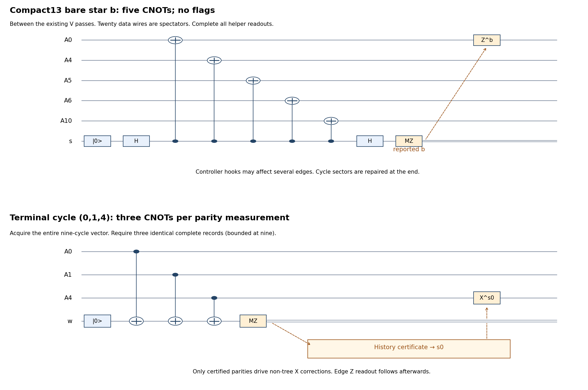

# Bare graph stars with delayed cycle recovery

This opt-in implementation removes the four nonroot graph-star flag
gadgets from each gauged round. It replaces per-round cycle checks by
one certified cycle acquisition just before destructive edge readout.
Enable it with `--graph-stars bare`. The previous schedule remains
`--graph-stars flags`; source, data and root-Gauss protection are unchanged.
The [flag-dependent data recovery](single_block_cz_flag_dependent_recovery.md)
option composes with either schedule. Existing SWAP files are unchanged.

The extra terminal history can now be replaced with the optional
[ordered terminal screen](single_block_cz_terminal_screen.md). Its proof
uses the same block-envelope output of ungauging; the counts and pilot
below retain the original certified terminal policy.

## What changes physically

A gauged round now executes:

1. The existing V coordinate pass (16 CX, 32 T/T†).
2. The eighteen bare data checks, with the existing certified recovery.
3. Four **bare X-star measurements** on graph vertices b,c,d,e, followed
   by the same reported-sign Z correction on the corresponding root edge.
4. The second V pass and the existing flagged root-Gauss measurement.

Three passing complete rounds are still required within at most five.
Cycles are deliberately left unfixed during these rounds. After the last
passing root measurement, acquire complete cycle-Z records, using the
existing three-identical-record rule (max nine), or the existing adaptive
commuting-history rule (max five) if explicitly selected. Correct that
certified syndrome using only non-tree edges. Then perform the unchanged
edge-Z readout, cut decoding, data byproduct and terminal data recovery.

No data reset, extra logical-X measurement, helper cat, new T gate, or
additional V pass is introduced. A noisy root report still cannot turn a
genuine negative CZ branch into the desired resource.



Editable SVG and generation source: `notes/build-single-cz-bare-stars.py`.

### Actual bare-star primitive

For vertex v, order its incident edges by physical edge index. Prepare s
in zero, H(s), then CX(s,A_e) for each incident edge, then H(s), MZ(s).
The meter measures Xstar_v. For reported result b_v, apply
Z(A_tree(v))^b_v. The two H gates make this an X-basis meter readout;
the actual result and the potentially wrong report remain distinct in
the runtime ledger. Every preparation, H, CX, MZ, correction and waiting
idle is a separate physical location. There is no flag preparation.

A meter X fault can spread to **several edges**. We explicitly allow its
whole graph operator algebra. We do not treat it as one physical edge
error, or let it spread into several charged data blocks by applying a
wrong coordinate-frame argument.

### Actual terminal-cycle primitive and correction

For each listed cycle C, prepare w in zero, execute CX(A_e,w) in the
listed cycle order, then MZ(w). Acquire the whole cycle vector before
testing the stopping rule. Every valid binary cycle vector is admitted:
this is not a radius-two error-pattern decoder.

Let T be the four root-tree edges and H_C the independent cycle parity
matrix. For the certified reported vector s, solve

```
H_C c = s,     c_e = 0 for e in T.
```

Apply X(A_e) once for each c_e=1, using individually noisy physical
one-qubit gates. The restriction of H_C to the E-4 non-tree columns is
invertible, so the correction exists uniquely for every s. This remains
true for current20's non-fundamental cycle basis. The production decoder
uses only reported parities and the graph specification.

Reject unstable histories, original data-decoder ambiguities, root
flags, insufficient positive rounds, cut-readout failures, and original
retry limits exactly as specified by the controller. Terminal cycle
correction itself has no absent/ambiguous syndrome rows.

## Why cycles may be deferred

Use the exact V from the existing signed physical construction. In its
coordinates, the data checks are the original eighteen code stabilizers,
the four nonroot Gauss checks are Xstar_v, and the root observable is

```
V G_a V = U Xstar_a,
Xstar_a = Xstar_b Xstar_c Xstar_d Xstar_e.
```

The second identity is an operator identity on the **entire edge Hilbert
space**, because each edge has two endpoints. It does not require zero
cycle syndrome. Thus after honest nonroot-star measurements and their
root-edge Z repairs, Xstar_a=+1 and root Gauss measures U on data.

For E edges, code checks plus the four stars leave two logical data
qubits and E-4 auxiliary graph degrees of freedom. The cycle values label
these auxiliary sectors. They are allowed to be unknown and entangled
with an environment until terminal recovery. This is a changed protection
schedule; we do **not** claim the original fully fixed gauged code's
distance theorem for this enlarged intermediate space.

For any graph word w, set eta_a=0, eta_v=w_tree(v), and
c=w XOR d eta. Then c has no tree support and labels its cycle sector.
For each c, the sixteen star characters span that cut orbit. Root-edge
Z repairs turn every star-sign character into the all-positive character.
Consequently the repaired star-positive space contains arbitrary coherent
superpositions of

```
|C_c> = (1/4) sum_(eta:eta_a=0) |c XOR d eta>.
```

Every such state has Xstar_a=+1, even for nonzero cycles. Before a clean
passing root check, the source invariant leaves data in the logical I/U
span of |++>, with arbitrary graph-dependent coefficients. Projecting
U=+ maps every nonzero accepted component to the **same CZ-magic line**.
The root projector alone is not a preparation theorem for arbitrary data;
the source invariant and code restoration remain essential.

## Global two-fault proof extension

Assume the [original physical model and source normal form](full_procedure_single_block_cz_proof.md),
including at most two arbitrary faulty locations globally, reliable
classical processing, separately faulty T/CX/T† gates, wrong reports,
failed preparations, correction gates, resets and serial/boundary idles.
Every accepted output still decodes to CZ magic with residual error in
the span of physical Paulis of weight at most two.

**1. Graph-only algebra in coordinates.** A bare star and all its helper
faults act solely on graph/helper registers between the two V passes.
This can change arbitrary graph amplitudes, phases and cycle sectors,
but adds no data support in that frame. A waiting-data fault adds one
data site. The original faulty-V and flagged-root arguments add at most
one inner-block data algebra per actual fault, with arbitrary graph
coefficients. A faulty graph Z sign correction is likewise charged once
to its associated block when viewed across V. Non-Clifford propagation
is never approximated by Pauli XOR.

**2. Clean passing round.** With two faults and three passing complete
rounds, at least one passing round is fault-free. Its full data projection
and accepted unique-class recovery remove the inherited correctable data
operator classes. The four stars then have positive eigenvalues, hence
so does Xstar_a independently of cycles. The honest positive root
projects the I/U source span onto CZ magic. The root/data algebra is
still used only after code-sector restoration; no globally commuting
history theorem is applied across it. Later graph-only operations cannot
change this logical state. Subsequent faults have the original charged
data-block bounds, and the original final decoder rejects ambiguities.

**3. Arbitrary cycle sectors can be flattened without data.** Cycle Z
measurements commute with V, all Gauss checks, and the dressed data code
checks. A non-tree X commutes exactly with V and with every Gauss and
dressed data check. Measuring cycles and applying X_c therefore changes
only the auxiliary graph state, including on entangled inputs. This
holds for a broad star hook of arbitrary weight; no per-edge fault-count
bound is needed before this step.

**4. A clean terminal cycle reference exists.** The acquisition contains
only a commuting QND Pauli family. The original global-two-fault history
lemma therefore applies directly. Three identical records contain a
clean complete record; the separately proved adaptive option is also
available. At that clean reference, H_C c=s makes every actual graph
word a cut after correction. Choosing only non-tree corrections is key:
these corrections do not enact unnoticed partial U_v operations on data.

**5. Late faults and cut readout.** After that clean reference, one cycle
meter fault adds at most one graph bit error; a meter phase may spread
broad graph Z, which is harmless here. Each correction, edge idle or
reported edge readout fault adds at most one bit discrepancy per faulty
location. All broad star hooks have already been absorbed into the
arbitrary sector c and its certified correction. Thus the reported word
is within two bits of the clean-reference corrected cut. Compact13's
cut distance five (or current20's stronger distance) uniquely decodes it.
Conditioning on each cut, the existing data byproduct cancels V's U_eta.
Graph phases and non-tree corrections add no data operation.

**6. Terminal data recovery.** Before the clean terminal data reference,
the same two-inner-block operator envelope applies to charged data
faults. The existing flag-conditioned and ordinary unique-class tables
correct it or reject. After that reference, the original one-site per
fault residual argument holds. A data flag starts a fresh data epoch,
as before. This proves the weight-two physical residual guarantee and
does not give a fresh two-fault allowance to any stage.

For arbitrary local quantum faults, expand the local action in an
operator basis and retain its complex conditioned coefficients. Bare-star
faults remain in the **entire graph algebra**, a support fact valid also
for coherent non-Pauli actions. The graph-only correction identities and
the data recovery conditions act linearly on every term. The proof is
not a stochastic-Pauli Monte Carlo argument.

## Worked broad-hook example

In compact13, put a controller X fault just after CX(s,A0) in star b,
and another just after CX(s,A4) in star c. Their combined graph X mask
is {4,5,6,7,8,10,11}. Its cycle vector is

```
(1,1,1,1,1,0,1,1,0).
```

The previous radius-two cycle table has no entry. Simply deleting flags
while keeping that decoder loses this correctable case. The new certified
chord correction flips exactly those seven non-tree edges. No data gate
is needed. Physical tests inject both faults at the actual CX locations
and recover a decoded target output. Current20 has a separate saved
two-location example, including two controller faults within one star.

Faults in these seven X corrections remain individual locations; a second
test covers a star hook plus a faulty correction within the same global
two-fault budget. Other tests cover two late edge discrepancies, broad
meter phase spread, coherent helper/edge action, data-flag recovery,
two terminal data idles, and falsely reported negative-sector outcomes.

## Counts, certificates and commands

With `decoded_flags` source and ordinary/root flag extraction:

| Clean full attempt | Previous stars | Bare stars |
|---|---:|---:|
| Compact13 CX | 2809 | **2665** |
| Current20 CX | 3051 | **2835** |
| T/T†, either graph | 256 | 256 |
| Compact13 peak live qubits | 39 | 39 |
| Current20 peak live qubits | 46 | 46 |

For compact13, the twelve stars fall from 204 to 60 CX and remove 72
flag preparations and 72 flag measurements. The former three 25-CX
cycle records are moved to terminal certification, costing the same
75 CX on the clean triple-history path. Current20 stars fall from
312 to 96 CX and remove 108 flag preparations/measurements; its three
38-CX cycle records likewise move to the end. Syndrome H counts are
unchanged. Nonzero terminal cycle records add their indicated X gates;
unstable records add bounded extra acquisitions. All are counted in
executed metrics. `rolling_flags` source adds the same 408 CX as before.

These are circuit counts, not CNOTs spent per accepted output. Benchmark
reports distinguish clean attempts, successful-attempt lengths, and
total executed gates divided by accepted outputs.

The finite certificate checks every computational graph word: 8192 for
compact13 and 1048576 for current20, all cycle/chord inversion decisions,
all 256 star-character sign repairs, and all late two-bit cut-readout
cases. Local Clifford signatures include target/helper actions and idles;
two-fault graph closure is analytical, not full-factory enumeration.
An exact small Gaussian-integer logical-register check retains coherent
cycle-sector coefficients. It supplements the existing signed physical
U/V certificates. No T-phase propagation is replaced by binary XOR.

```fish
/Users/kevinhemery/pytket-venv/bin/python src/check_single_cz_graph_stars.py \
    --output output/single-cz-graph-star-certificates.json

/Users/kevinhemery/pytket-venv/bin/python -m pytest -q \
    src/test_single_cz_graph_stars.py src/test_single_cz_flag_recovery.py \
    src/test_single_cz_simulation.py src/test_single_cz_cat_simulation.py

/Users/kevinhemery/pytket-venv/bin/python src/benchmark_single_cz_graph_stars.py \
    --shots 200 --seed 1000 --workers 2 \
    --two-qubit-infidelity 1e-3 --readout-flip-probability 1e-3 \
    --output-dir output/cz-bare-star-comparison-200
```

The last command compares previous gauging stars, bare gauging stars, and
genuine-cat CZ, all with the same data recovery, source and noise. The
cat has no graph stars to remove, so its circuit is unchanged. Schedules
differ; common seeds do not imply identical fault trajectories or
monotonically preserved accepted shots. Reports include saved-run
verification and all output fidelities; computational failures remain
unresolved. Use a new output directory. No long stochastic campaign is
required for the proof.

## Short pilot, 10 November 2026

The final 40-attempt pilot uses seeds 1000–1039, compact13, decoded source,
flag-dependent data recovery with max eight episodes, triple histories,
r2=q=0.001 and zero T/Clifford/preparation/memory noise. All attempts
completed, and all accepted saved outputs passed the decoded-target test.

| Schedule | Accepted / 40 | Mean CX in a successful attempt | Total CX / accepted output |
|---|---:|---:|---:|
| Previous gauging stars | 7 | 5821.0 | 21563.0 |
| Bare gauging stars | 8 | 5216.0 | 20109.0 |
| Genuine-cat comparator | 16 | 3119.8 | 7376.3 |

The clean circuit reduction is exact. This small pilot does not establish
a population-yield or matched-fidelity improvement. The altered schedules
sample different later faults even at equal seeds; paired acceptance is
not expected to be monotone. The cat remains cheaper in this sample.
The current saved report is
`output/single-cz-bare-star-pilot-20261110/comparison.md`.
