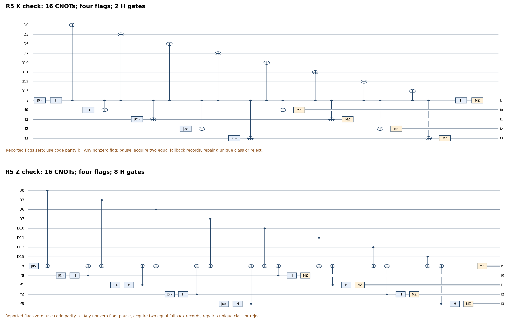

# Compact intermediate Pauli checks and fault cones

Enable `--data-checks compact_flags` with the recovery profile and flag
extraction. The default remains `rolling_flags`. This is a compiled-gadget
optimization shared by gauging and the genuine GHZ20-cat comparator. It
measures all eighteen code stabilizers; it does not skip outer checks.
The two-block SWAP implementation is unchanged.

The [companion proof](single_block_cz_compact_checks_proof.md) establishes
the same global two-arbitrary-fault accepted-output contract. Local support
certificates and recovery-table decisions are exhaustive for their stated
envelopes, not an enumeration of every pair of factory locations.

## Where the saving comes from

An ordinary post-source code record now uses these gadgets:

| Primitive | Previous CX / H / preparations / MZ | Compact CX / H / preparations / MZ |
|---|---:|---:|
| Weight-four X | 6 / 2 / 2 / 2 | 6 / 2 / 2 / 2 |
| Weight-four Z | 6 / 10 / 2 / 2 | 6 / 2 / 2 / 2 |
| Weight-eight X | 26 / 2 / 10 / 10 | 16 / 2 / 5 / 5 |
| Weight-eight Z | 26 / 18 / 10 / 10 | 16 / 8 / 5 / 5 |
| Complete eighteen-check record | **268 / 140 / 100 / 100** | **188 / 60 / 60 / 60** |

There are no T rotations in these gadgets. Fewer flag interactions reduce
the outer checks' CNOT cost. Reversing the Z-check CNOTs moves its basis
changes onto helpers and removes every data-qubit Hadamard in that check.
Helpers are destructively measured and freshly prepared on reuse.



Editable source: `notes/build-single-cz-compact-checks.py`; vector figure:
`notes/figures/c4-helix/single-block-cz/14-compact-pauli-checks.svg`.
The Python gate list is `src/single_cz_compact_checks.py`.

## Exactly what is measured, and in what order

For support (q0,...,q7), the X check uses syndrome s and four flags f0..f3.
Prepare s in zero, then H(s). For j=0,...,7:

1. CX(s,qj).
2. If j<4, prepare fj in zero.
3. CX(s,f[j mod 4]).
4. If j>=4, measure f[j mod 4] in Z and release it.

Finally H(s), MZ(s). Flags are returned in order f0,f1,f2,f3, followed by
the syndrome b. Each flag has exactly two couplings. The four-port X
check retains one flag: open after port 0, close after port 2, measure
the flag, execute port 3, then H(s), MZ(s).

For Z checks, prepare s in zero and use CX(qj,s) for each data coupling.
Each flag is prepared in plus, couples as CX(f,s) at its two bracket
boundaries, then is measured in X (H followed by physical MZ). Measure s
directly in Z. There is no H on s or on the data. This is the Hadamard
dual of the X gadget on all wires, with the data-frame conjugations
absorbed into the definition of the measured Z observable.

For arbitrary input rho, the ideal reported flags are zero. Conditional
on syndrome b, the unnormalized state is P_b rho P_b, where
P_b=(I+(-1)^b S)/2 and S is the indicated signed code stabilizer. Its
probability is Tr(P_b rho). Thus a nonzero syndrome is error information,
not automatic rejection. An unknown magic block is never reset.

Ordinary code records retain Z R0..R8 then X R0..R8. Histories, repetition
limits, recovery, corrections, and data-epoch restarts retain their previous
rules. The ordered terminal screen deliberately retains its existing
268-CX circuit and outer-first order. Its conditional full-history fallback
can use compact checks. The one-remaining-fault flag fallback, source
preparation/certification, graph checks, W/Gauss checks and cat-U gadgets
retain their existing separately certified programs.

## Faults, flags and recovery

A syndrome X fault in an X gadget can append X to all later data ports.
In a Z gadget the dual syndrome Z fault appends Z. This is a multi-qubit
hook, not a single physical-qubit error. Four overlapping flag brackets
distinguish its dangerous intervals. The exact local certificate includes
faults on every gate participant, helper preparation, destructive readout
and report, waiting qubit and boundary; it checks cancellations of two
faults' flag reports as well as single faults.

With zero reported flags, one fault leaves at most one physical data site,
and two faults leave at most two sites, modulo the measured stabilizer.
This is the same support guarantee used by the previous controller. It
is stronger than merely bounding the number of inner blocks.

Example: in R5, a controller X immediately after CX(s,D7) propagates to
D10,D11,D12,D15, and reports flag word 7 (least significant bit f0).
The controller records the actual extraction kind and selects the new
compact-gadget recovery table, not the old nine-flag table. It acquires
two consecutive equal complete conditional records within four attempts,
using the existing one-remaining-fault gadgets. The decoder allows one
exact flagged-gadget fault plus one arbitrary inner-block error elsewhere,
or two faults in the flagged gadget. It corrects only a unique stabilizer
class and rejects absent/ambiguous syndromes. All quantum corrections
and fallback locations use the same global two-fault budget.

An observed flag does not identify a unique error by itself. Shortening
the flag record loses some location information; the new tables preserve
every ambiguity rather than silently applying old recovery decisions.
Their acceptance statistics need benchmarking. Every successful flag
repair increments the data epoch and restarts the interrupted code record
and relevant histories, exactly as before.

## What the outer-check fault-cone audit says

The broad upstream envelope still permits an arbitrary Pauli on either
of two inner blocks. It does not justify a static omission of any of the
eight independent outer checks. For example Z(0,1,8,9) commutes with
every check except outer X R5, and is not stabilizer-equivalent to a
physical error of weight <=2. The certificate gives such a witness for
each of the eight single-check omissions, using explicit stabilizer
classes and the complete weight-two lookup.

These are counterexamples within the conservative envelope; no claim is
made that each is generated by two actual enrichment locations. Further
adaptive omission would require a tighter stage-specific *reachable*
coherent error span, followed by an audit of faults in the adaptive
measurements and fallback. This implementation instead exploits the
exact Pauli-check fault cones to reduce flag circuitry while retaining
all check information and the existing composition proof.

## Clean resources, counted from executable schedules

Decoded source, bare graph stars, terminal screen for gauging; genuine
GHZ20-cat U measurement and flag-dependent data recovery for cat:

| Factory | Previous CX | Compact CX | Previous 1q Clifford | Compact 1q Clifford | T/Tdg | Peak / allocated slots |
|---|---:|---:|---:|---:|---:|---:|
| Gauging compact13 | 2129 | **1889** | 1043 | **803** | 256 | 39 / 39 |
| Gauging current20 | 2299 | **2059** | 1043 | **803** | 256 | 46 / 46 |
| Genuine cat | 1716 | **1476** | 926 | **686** | 120 | 41 / 41 |

Each clean factory executes three optimized records: **240 fewer CX,
240 fewer H, 120 fewer preparations and 120 fewer MZ**. Gauging has
576 preparations / 556 MZ (compact13), 631 / 611 (current20); cat has
518 / 498. Reinitializations after first use are 537, 585 and 477.
An individual outer gadget now needs five helpers, versus four before.
At that stage the five graph vertices have already been measured, so
the factory peak does not increase. The graph-preparation/cat-U stages
still set the peak. All gates are one-qubit gates or CX; no atomic
three-qubit gate has been introduced.

These counts use the zero-report clean branch. Source/cut/vertex
corrections depend on records; the schedule counters and noisy summaries
count their physical gates. Conditional retries keep their existing
bounds (five combined rounds, history maximum nine/triple or five/adaptive,
four conditional flag records, shared known-resource retries and the
configured global flag-recovery cap). Amortized costs include rejected
attempts. Clean counts alone do not predict acceptance or matched-fidelity
cost. Both factories are optimized in the comparison.

## Reproduce and benchmark

From the repository root:

```sh
/Users/kevinhemery/pytket-venv/bin/python src/check_single_cz_compact_checks.py --output output/single-cz-compact-check-certificates.json
/Users/kevinhemery/pytket-venv/bin/python -m pytest -q src/test_single_cz_compact_checks.py src/test_single_cz_terminal_screen.py src/test_single_cz_graph_stars.py src/test_single_cz_flag_recovery.py src/test_single_cz_simulation.py src/test_single_cz_cat_simulation.py
/Users/kevinhemery/pytket-venv/bin/python notes/build-single-cz-compact-checks.py
```

The four-arm driver compares rolling/compact checks for *both* factories:

```fish
/Users/kevinhemery/pytket-venv/bin/python /Users/kevinhemery/quanti/top-order-lit-rev/src/benchmark_single_cz_compact_checks.py \
    --shots 200 --seed 1000 --workers 2 \
    --source-extraction decoded_flags --max-flag-recoveries 8 \
    --two-qubit-infidelity 1e-3 --readout-flip-probability 1e-3 \
    --one-qubit-infidelity 1e-4 --t-infidelity 1e-4 \
    --output-dir /Users/kevinhemery/quanti/top-order-lit-rev/output/cz-compact-check-comparison-200-20261110
```

The independent dense ideal-instrument check tests all ideal sign/flag
branches on a generic complex ket; it is a numerical spot check. The
local fault cones and all recovery-table acceptance/ambiguity decisions
are finite exhaustive certificates. The arbitrary-local-fault extension
and factory composition are analytical.

The simulator uses an exact tensor regrouping for Z parity meters: it
moves the syndrome helper into the sparse data factor during the gadget,
then destructive readout removes it. This avoids an exponential split
into redundant projected factors. It is an invertible representation
change, not a physical gate, measurement, recovery, truncation or use of
diagnostic information. Coefficients remain in Z[zeta8]; noise locations,
actual/report distinctions and the default capacity limits are retained.

## Short implementation pilot

`output/single-cz-compact-check-pilot-20261110/` contains twenty attempts
per arm, seeds 1000..1019, r2=q=1e-3 and Clifford/T infidelity 1e-4;
preparation and idle noise are zero. All saved runs and snapshots verify.

| Arm | Accepted / 20 | Decoded target matches | Total CX / accepted output |
|---|---:|---:|---:|
| Gauging rolling | 2 | 2/2 | 28378 |
| Gauging compact | 7 | 7/7 | 6803 |
| Cat rolling | 9 | 9/9 | 5909 |
| Cat compact | 13 | 13/13 | 3788 |

There were zero unresolved attempts. One accepted compact-cat output had
a correctable physical residual (raw fidelity zero, decoded fidelity one).
The sample is an implementation pilot, not evidence of equal rare-error
rates or a reliable yield/cost advantage. Changed schedules do not give
identical fault trajectories under shared seeds. No long campaign was run.
