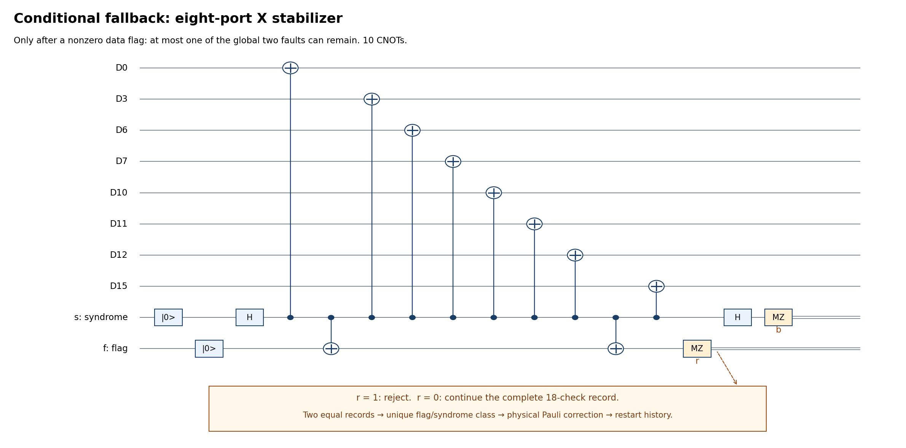

# Flag-dependent recovery for the one-block CZ factory

The additional [bare-star option](single_block_cz_bare_graph_stars.md)
removes nonroot graph-star flags and defers cycle repair. It composes with
the data recovery described here; root-Gauss flags still reject. Counts
and historical pilots below use the previous flagged-star schedule.

This is an opt-in extension of the [rolling-flag procedure](single_block_cz_flagged_verification_proof.md)
and [recovery controller](single_block_cz_simulation_recovery_proof.md).
Use `--flag-recovery data`; `--flag-recovery reject` preserves the strict
comparison circuit. Both the gauging runner and genuine GHZ20-CZ runner
support the option. Existing two-block SWAP files are unchanged.

The extension recovers flags on the eighteen X/Z **data stabilizers**.
Source flags retain known-source retry. Graph-star, root-Gauss, and direct
W-product flags still reject. A new flag during fallback also rejects.
No unknown magic-bearing data is reset, and no logical X is measured after
source preparation. No helper cat is introduced by this recovery.

## Executable decision and gate order

1. Finish the flagged primitive, including every helper measurement. Save
   the reported flag vector, measured axis, ordered physical support, and
   reported parity. A data flag aborts the incomplete eighteen-check row.
   The primitive's reported parity is not trusted for recovery.
2. Acquire fresh complete records of the eighteen bare code stabilizers,
   in Z-then-X order. Require two consecutive identical whole records,
   stopping at the first such pair and rejecting after four records.
3. For these fallback records only, use the one-remaining-fault circuit
   described below. Any nonzero fallback flag rejects. There is no nested
   recovery or new retry allowance inside this acquisition.
4. Look up the observed flag word and certified syndrome in the
   flag-conditioned error envelope. Apply a correction only if there is
   exactly one stabilizer-equivalence class; reject absent or ambiguous
   rows. Corrections are individual physical X/Y/Z gates, each with its
   own noise location.
5. Increment the data epoch, restart the interrupted full row, and discard
   earlier records in any enclosing syndrome acquisition. Re-certify from
   the new epoch. This prevents applying an old syndrome correction after
   the flagged recovery has already changed the data syndrome.
6. Continue the original combined code/cycle/star/Gauss schedule. In
   particular, recovery never turns a negative CZ eigenvalue positive.
   Three passing combined rounds still certify the desired magic sector.

The configurable bound `--max-flag-recoveries` defaults to eight episodes
under unrestricted stochastic noise. Under the theorem's global two-fault
hypothesis, at most two nonzero-flag episodes can occur anyway. Permitting
more episodes does not grant more faults in that theorem. Original source
and graph retry tokens are unchanged. Fallback uses the same physical
alphabet, actual-versus-reported measurements, boundary idles and noise
model as the ordinary circuit. The controller reads only reported records;
sampled faults and output-fidelity diagnostics are not decoder inputs.

## A cheaper fallback follows from the global fault budget

A nonzero reported flag requires at least one faulty location, even if
it is only a false report. Hence at most **one** of the global two faults
can remain outside that flagged gadget. This is not a fresh fault budget.

For a fallback Pauli product Q with n=4 or 8 ordered ports, execute:

```
PREP0(s), PREP0(f), H(s)
port 0
CX(s,f)
ports 1,...,n-2
CX(s,f)
port n-1
MZ(f), H(s), MZ(s)
```

An X port is `CX(s,Dq)`; a Z port is `H(Dq), CX(s,Dq), H(Dq)`.
The middle ports are bracketed by one flag. A controller flip inside
that interval triggers the flag. At either boundary, an undetected hook
is equivalent modulo Q to an error on at most one port. A faulty
controller-flag gate can hide its own flag but is at such a boundary.
Direct target faults and idles are included. Consequently every zero-flag
one-fault branch is supported on at most one target, modulo Q.

The independent finite propagator checks all Pauli location actions and
waiting idles for both axes and both arities. A quantum measurement fault
combined with an arbitrary wrong report is included by the equivalent
pre-measurement Pauli instrument, up to a conditioned scalar phase.
This circuit is **not** used on normal paths where two faults may remain.



Editable SVG and generation source: `notes/build-single-cz-flag-recovery.py`.

Two equal complete records contain a clean record because at most one
fallback record can contain a fault. They therefore certify a syndrome
at a clean reference time. They do not imply that the state cannot change
after that time. A late fallback fault remains a physical one-site error;
faults at subsequent correction gates are charged in the same budget.

## The flag-conditioned envelope

Let T_f be the set of physical data Pauli errors from one faulty location
in the flagged primitive, conditional on reported flag word f. Every
primitive gate, preparation, destructive measurement, and waiting idle is
included. Syndrome-report flips are unrestricted; only f selects the set.
Let B be the union of all Pauli algebras on a single one of the five
four-qubit inner blocks. At a clean recovery reference, use the envelope

```
E_f = { E P : E in T_f, P in B }
      union { E1 E2 : E1 in T_f1, E2 in T_f2, f1 XOR f2 = f }.
```

The first set covers one fault in the flagged gadget and zero or one
fault elsewhere. It deliberately permits an arbitrary whole-inner-block
error, rather than assuming one physical error per circuit fault. The
existing coordinate-frame normal form supplies this outside-gadget bound,
including errors produced by physical T/CX/T† circuits elsewhere. The
second set covers both faults within the gadget. Same-location pairs and
some physically incompatible histories are overincluded conservatively.

For each observed syndrome s, collect **all** stabilizer classes in E_f
with syndrome s. A unique class is corrected; two or more classes reject.
This tests recovery of arbitrary logical inputs, not only overlap with a
known magic vector. Global Pauli phases do not affect this decision.

Example: in the first outer X check, a syndrome-controller X fault just
after coupling to D7 gives flag word 24 and a hook on D10,D11,D12,D15.
The test trajectory's syndrome has bit 6 set. Its unique class can be
corrected with X on D0,D3,D6,D7, the stabilizer-complement representative.
Strict rejection loses this trajectory; recovery retains the magic state.

By contrast, flag word 24 and an all-zero syndrome for this same check
are ambiguous: the envelope includes both identity and a nontrivial
logical-X class. A false pair of flag reports and a hook combined with
an inherited block error cannot always be distinguished. This row rejects,
even though its syndrome is zero. The certificate saves explicit witnesses.

## Accepted-output proof extension

Assume at most two arbitrary faulty quantum locations in the **entire**
schedule, reliable classical processing, and the elementary physical
gate/location model of the existing proof. The extended schedule retains
the accepted-output guarantee: decoded CZ magic, with residual error in
the span of physical Paulis of weight at most two.

The new obligations are as follows.

1. All new flagged-recovery quantum operations are Clifford Pauli-check
   circuits. Expand each arbitrary local fault in a Pauli operator basis,
   with arbitrary conditioned complex coefficients. Propagating two such
   errors through this Clifford instrument gives Pauli products and XOR of
   report-flip bits, up to scalar phases. This is not propagation of a
   Pauli through T. Outside non-Clifford operations are handled only by
   the previously proved one-inner-block operator algebra.
2. Before the flag, the existing block-supported invariant applies.
   A nonzero flag consumes a fault. If it has one faulty location, any
   other fault contributes at most one inner-block algebra; if it has two,
   there are no outside faults. These are exactly the two sets above.
   During this temporary broad hook, only commuting Pauli data checks are
   measured; there is no intervening root-Gauss or dressed-check argument.
3. At least one of the two matching fallback records is fault-free.
   Pauli conditioning selects a fixed syndrome at that clean reference;
   all its error terms lie in E_f. For an accepted table row, correction C
   satisfies C E Pi_code = c_E Pi_code for every surviving term E. This
   is the Knill–Laflamme recovery condition for the single accepted class,
   retaining phases and coherent interference. It preserves all logical
   states and any entanglement with graph/environment registers.
4. A fault after that clean reference, including a correction fault,
   leaves a one-site residual per fault. Graph-memory faults retain the
   existing graph-phase/associated-block accounting. Thus the original
   block-supported invariant is restored before returning to Gauss checks.
5. Every repaired partial data row is restarted. Enclosing histories are
   reset on an epoch change, so their reference lemma is never used across
   an intentional syndrome-changing repair. A complete gauged round that
   invokes recovery contains a fault; three passing rounds still include
   a clean complete round under the global two-fault bound. The original
   positive-sector argument is unchanged.
6. The same reset rule applies during terminal recovery. Any flagged hook
   before its final reference has been corrected or rejected. After its
   final reference, zero-flag Pauli gadgets and correction locations leave
   the original weight-two correctable residual span. A terminal data flag
   starts a new recovery epoch instead of being treated as a late small
   error. Negative CZ branches remain negative and are rejected by the
   original combined-round certification.

This is an analytical composition proof using an exhaustive finite
certificate for the stated local/envelope claims. It is **not** an
enumeration of every full-factory location pair. Numerical coherent-fault
tests and noisy pilots supplement the proof; they do not replace it.

## Counts and reproducibility

On paths with no post-source data flag, quantum operations are unchanged:
with `decoded_flags` source, compact13 costs 2809 CX, 256 T/T† and peaks
at 39 live qubits. Current20 costs 3051 CX and peaks at 46. The genuine-cat
comparator with ordinary flag checks costs 1716 CX, 120 T/T† and peaks at
41. Choosing the default `rolling_flags` source adds 408 CX to each route.

A conditional fallback complete record costs 140 CX, 36 preparations,
36 measurements and 140 H gates, with zero T gates. Normally it takes
two records (280 CX); the bounded maximum is four (560 CX). Individual
Pauli corrections and the interrupted/restarted ordinary data row are
additional. No additional helper peak is required. All these operations,
waiting idles, failed fallbacks, and rejected attempts enter the saved
executed-cost summaries.

Each episode can interrupt a code row at most once before strict fallback.
There are at most two episodes under the two-fault hypothesis, and at
most the configured bound M on arbitrary noisy paths. Existing history
length limits apply per epoch; histories remain bounded by 9(M+1)
complete row acquisitions for an original nine-record history, plus
4M fallback records and the explicitly interrupted rows. The theorem
does not assume that different episodes have independent fault budgets.

Commands from the repository root:

```fish
/Users/kevinhemery/pytket-venv/bin/python src/check_single_cz_flag_recovery.py \
    --output output/single-cz-flag-recovery-certificates.json

/Users/kevinhemery/pytket-venv/bin/python -m pytest -q \
    src/test_single_cz_flag_recovery.py src/test_single_cz_simulation.py \
    src/test_single_cz_cat_simulation.py

/Users/kevinhemery/pytket-venv/bin/python src/benchmark_single_cz_flag_recovery.py \
    --shots 200 --seed 1000 --workers 2 \
    --two-qubit-infidelity 1e-3 --readout-flip-probability 1e-3 \
    --source-extraction decoded_flags --graph compact13 \
    --output-dir output/cz-flag-recovery-comparison-200
```

The last command runs four matched arms: gauging/cat, each with strict/data
recovery. It saves commands, source snapshots, per-attempt states, noise
and measurement records, fidelity diagnostics, executed costs, and a
`comparison.md` report. It checks that previously accepted paired seeds
retain exactly the same gate counts and diagnostics. Computational failures
remain unresolved, never physical rejections. Choose a fresh directory.

For an existing run, `--analyze-only --output-dir PATH` verifies and
regenerates its comparison without new simulation. Single-run CLI commands
can instead add `--flag-recovery data` to either original simulator.

The certificate covers all 18 actual checks and all flag/syndrome decisions
in its two-fault envelope: 645296 candidate terms including duplicates,
135904 unique-class decisions and 520 ambiguous decisions, plus the four
one-remaining-fault fallback shapes. These counts are mathematical table
sizes, not noisy acceptance probabilities. Saved table hashes and ambiguity
witnesses are in `output/single-cz-flag-recovery-certificates.json`.

## Short pilot, 10 November 2026

The final pilot uses compact13, `decoded_flags` source, triple ordinary
histories, max eight flag recoveries, seeds 1000–1039, r2=q=0.001, and
zero single-qubit/preparation/memory noise. Noise sampling has no fault
cap. No attempt was computationally unresolved. The four arms share the
same current production source hashes and noise parameters.

| Arm | Accepted / 40 | Decoded target matches | Executed CX / accepted |
|---|---:|---:|---:|
| Gauging, strict | 2 | 2/2 | 37245.5 |
| Gauging, flag-dependent | 7 | 7/7 | 21563.0 |
| Genuine cat, strict | 5 | 5/5 | 14631.8 |
| Genuine cat, flag-dependent | 16 | 16/16 | 7376.3 |

Both extensions preserve every strict accepted paired seed with exactly
the same physical gate counts and fidelity diagnostics. Recovery adds five
gauging acceptances and eleven cat acceptances in this sample. Gauging's
executed CNOT cost per accepted output falls by about 42%; cat's falls by
about 50%. All accepted states were independently re-diagnosed from their
saved complex output amplitudes by the saved-run verifier.

The gauging recovery succeeds in 70 episodes across all attempts, but
many repaired attempts still reject later. Increasing yield is not the
same as accepting every repaired trajectory. The cat comparator benefits
from the same optimization and remains cheaper in this sample. There
are too few accepted outputs to claim matched population fidelity or a
precise improvement factor. T and memory noise remain omitted in this
pilot and are explicit future parameters.

Saved commands, all four complete runs and the machine-readable report:
`output/single-cz-flag-recovery-bounded8-pilot-20261110/`.
`comparison.md` reports the final policy. Earlier development pilots with
two-episode caps are preserved separately and are not pooled with this one.
