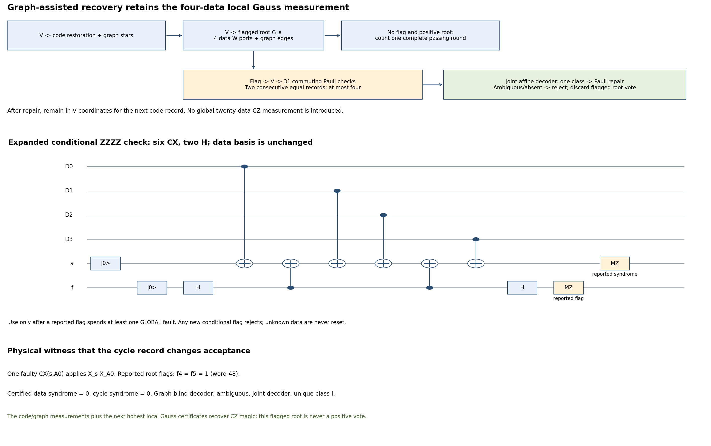

# Graph-assisted recovery of local Gauss flags

This opt-in extension returns to the **round-trip local-Gauss schedule**.
The root still measures four W data factors and its incident graph edges.
It introduces no twenty-data-qubit logical-CZ measurement on the gauging
route. Extra cycle information is used to recover some previously rejected
root flags. Persistent/tree4 modes remain separate and unchanged.

Enable `--root-recovery joint --conditional-checks dual_flags` on the
recovery/flag, round-trip gauging route. The recommended settings also use
`--graph-stars bare --data-checks compact_flags --flag-recovery data
--terminal-policy screen --source-extraction decoded_flags`.
The default `--root-recovery reject` retains the previous behavior.

The [companion proof](single_block_cz_graph_assisted_root_recovery_proof.md)
extends the same global two-arbitrary-fault accepted-output theorem using
conservative coherent operator spans. The simulator retains exact complex
phases. The finite audit certifies all generated root/graph affine error
families and every syndrome image of each distinct family; it does not
enumerate all location pairs of the factory.

## What is different physically

An ordinary gauged round remains:

    V -> bare data checks/recovery -> nonroot graph stars/sign repair
      -> V -> local root G_a = U_a Xstar_a.

A nonzero root flag now optionally starts this conditional branch:

1. Finish every root-helper readout. Ignore that root's parity as a vote.
2. Apply V to enter the bare-code coordinate frame.
3. Measure a complete commuting record, in order: eighteen data checks,
   all independent graph-cycle Z checks, four nonroot graph-X stars.
   Apply **no corrections between complete records**.
4. Stop at the first pair of consecutive equal complete records, within
   four. A nonzero data-check flag or unstable history rejects. The root
   flag has already spent at least one of the global two faults, so the
   pair contains a clean record. There is no new fault allowance.
5. Decode the reported root flags together with the certified data and
   cycle syndrome. Correct only if every compatible error family has one
   common Pauli class modulo the data stabilizers. Absent or ambiguous
   reports reject. Correct graph cycles with non-tree X edges, and graph
   star signs with Z on the indicated tree edges.
6. Increment the data epoch and resume the next complete gauged round
   already in V coordinates. Its usual first V is skipped, so there is
   no unnecessary return/entry pair. The next root is again the local
   four-data G_a. Three positive **unflagged complete** rounds within five
   are still required; a recovered flagged root never counts as positive.

Known source/graph retry rules, ordinary code recovery, the terminal
cycle/cut decoder, physical byproducts and ordered terminal screen retain
their existing schedules. Unknown magic data are never reset. Neither
source logical X is measured after source preparation.



Editable source: `notes/build-single-cz-root-recovery.py`; SVG has the
same filename under the figure directory. Gate programs and the decoder
are in `src/single_cz_flagged.py` and `src/single_cz_root_recovery.py`.

## Why the graph provides information

An X component on tree edge (a,v), when moved through V, is accompanied
by U_v on data block v. This correlation constrains which data blocks a
single fault can affect. A fault on a cycle meter adds at most one graph
bit; a bare-star controller can add an entire suffix of that star, but
acts on graph only in V coordinates. The decoder explicitly includes
these broad hooks; it does not apply a radius-two edge decoder to them.

The old data-only decoder aggregates unknown pairs of blocks. A separate
conditional algebra audit found that certifying one block would reduce
3,855 ambiguous syndromes to 960. That was motivation, **not** permission
to infer a block from a cycle pattern. The implemented decoder instead
includes all root-gadget fault signatures, graph/data correlations,
possible second-fault locations, wrong reports and diagnostic timing.

### A physical graph-information witness

In compact13, inject one joint Pauli fault X_s X_A0 immediately after
CX(s,A0) in the root gadget. This is **one faulty two-qubit location**.
The root reports flags f4=f5=1, flag word 48. For a reachable certified
record with data syndrome zero and cycle syndrome zero:

* The graph-blind decoder is ambiguous and rejects.
* The joint decoder has a unique data class I; the diagnostic projections
  remove the error component and no data Pauli is needed on that branch.
* Subsequent local Gauss certificates accept the correct encoded magic
  state. The faulty root's report has supplied no vote.

The blind ambiguity includes a nontrivial logical-Z class associated
with cycle syndrome 71 (bits 0,1,2,6), which is the syndrome of edge A0.
The actual zero cycle record excludes that alternative. A second fault
that cancels that graph syndrome is constrained to its corresponding
data cone; it cannot simultaneously supply an arbitrary third-block
error without exceeding the global budget. The joint table includes
all of those alternatives before accepting.

This witness is exercised by an actual quantum simulation and by the
independent affine certificate. It demonstrates use of graph information,
not a population-yield advantage.

## Coherent errors and the affine decoder

Controlled W is three physical locations, T^s, CX, T^-s. A fault can
produce a coherent sum of Pauli errors. For a W hook on support D,

    product_D W_s = 2^(-|D|/2) X_D product_D (I - i s_q Z_q).

Every Pauli term is retained in the allowed operator **span**, with
arbitrary complex coefficients. We do not sample one term or XOR Pauli
errors through T. Allowing arbitrary coefficients can reject cases that
exact interference would permit; it cannot justify a false acceptance.

The root's full measured-product factor becomes U Xstar_a in V
coordinates. It is kept as an I/U branch choice; it is never omitted as
an uncontrolled phase. The remaining data Pauli terms have an affine
binary description: fixed X support from the W hook, arbitrary Z on
that support, and arbitrary Pauli action on local damaged sites and the
allowed second-fault block. The graph cycle vector selects compatible
families. Graph phase errors are conservatively unrestricted; star
records are used to restore their graph signs.

For each family, reliable classical elimination computes its syndrome
image and its logical kernel. A nonzero logical kernel means ambiguity
for every covered syndrome. The union decoder requires one common
logical label across **every** matching family. Otherwise it rejects.
The selected physical Pauli is shortened only by code stabilizers.
The exact simulator, measurement conditioning and final diagnostics remain
independent of this conservative span approximation.

## Shared improvement for cat and gauging

`--conditional-checks dual_flags` improves the one-remaining-fault Pauli
gadgets used after **any observed data/root flag**. X checks retain their
old circuit. A Z check prepares s in zero and f in plus; data control
CXs into s. Flag-to-s CXs bracket the middle ports; f is read in X and
s in Z. This is the exact Hadamard dual, with all basis changes on the
helper. It is not a replacement for ordinary two-fault checks.

| Complete conditional data record | CX | H | PREP / MZ |
|---|---:|---:|---:|
| Previous | 140 | 140 | 36 / 36 |
| **Dual flags** | **140** | **36** | **36 / 36** |

Two equal records therefore save **208 H** per minimal data-flag repair,
with no added CX or helper. The same change is applied to the genuine
GHZ20-cat baseline. That factory has no used-root flag of this kind; its
cat preparation and local resource repair remain unchanged.

The direct global flagged-U comparator also receives root recovery,
using the same affine algorithm without graph information. Its CLI mode
is `--root-recovery data`, on the shared `--route direct_cat` entry with
`--direct-cz-extraction auto`. This is distinct from the genuine GHZ20
cat entry point, which must use `--root-recovery reject`.

## Costs, bounds and rejection

Clean-path counts are unchanged: local-Gauss compact13 uses **1889 CX,
256 T/Tdg, 39 peak qubits**; current20 uses 2059 / 256 / 46; GHZ20 cat
uses 1476 / 120 / 41; direct flagged U uses 1317 / 120 / 25.
No diagnostic graph check is added until a root flag occurs.

For compact13 a full conditional joint record costs **185 CX, 44 H,
49 preparations and 49 MZ**: data 140 CX, cycles 25, stars 20. Two
records cost 370 CX. Current20 uses 210 CX per record. Direct flagged U
needs only the eighteen-data record (140 CX). Corrections are physical
one-qubit gates depending on the reported record and are counted in
executed-shot metrics. The same source/graph retry cap, maximum five
combined rounds and configured total data-plus-root flag-recovery cap
(default eight) remain. With two actual faults at most two flag episodes
can occur. At unrestricted noise the cap limits work; it does not promise
acceptance.

A compact13 one-root-fault witness with the minimum two diagnostic
records costs 2531 CX on its accepted zero-other-syndrome path: 1889
plus 370 diagnostics and 272 for the extra complete round. New flags
inside a conditional data gadget reject. Absent/ambiguous affine classes,
unstable histories, root-sector failures and existing terminal ambiguities
also reject. Memory, T and all correction noise remain physical parameters.
Clean counts or a conditional algebra count do not predict rejection rates.

## Validation and short pilot

The combined regression suite passed **135 tests**. The saved
[finite certificate](../output/single-cz-root-recovery-certificates.json)
checks 2,461 cycle-indexed affine spaces for compact13, 4,103 for current20,
and 7,120 for the direct flagged-U control, including each distinct
affine image's complete syndrome/class decisions. External fault-cone
completeness and global composition are analytical proof obligations,
discharged in the companion proof; this is not a full-factory pair audit.

A 20-attempt-per-arm pilot at r2=q=1e-3 and r1=rT=1e-4 gave:

| Arm | Accepted / 20 | Root repairs completed | Accepted after root repair |
|---|---:|---:|---:|
| Gauging, root reject | 7 | 0 | 0 |
| Gauging, graph-blind | 8 | 2 | 1 |
| Gauging, joint | 8 | 2 | 1 |
| GHZ20 cat, legacy conditional checks | 13 | 0 | 0 |
| GHZ20 cat, dual conditional checks | 13 | 0 | 0 |
| Direct flagged U, root reject | 5 | 0 | 0 |
| Direct flagged U, root recover | 8 | 3 | 3 |

All accepted outputs decoded to the target within tolerance; all runs
completed, and saved report/control certificates, noise accounting,
source snapshots and output diagnostics were independently rechecked.
The cat-legacy pilot had one correctable physical residual, so its raw
physical fidelity differs from its decoded logical fidelity. See the
[saved comparison](../output/single-cz-root-recovery-pilot-20261111/comparison.md).
This sample does **not** distinguish graph-blind and joint population
performance, nor establish a noisy advantage for the dual gadgets.
The injected physical witness above establishes that cycle information
can change a valid recovery decision; a larger benchmark must measure
how often it helps and whether its extra work is worthwhile.

## Reproduce and compare

```sh
/Users/kevinhemery/pytket-venv/bin/python src/check_single_cz_root_recovery.py --output output/single-cz-root-recovery-certificates.json
/Users/kevinhemery/pytket-venv/bin/python -m pytest -q src/test_single_cz_root_recovery.py src/test_single_cz_persistent.py src/test_single_cz_compact_checks.py src/test_single_cz_terminal_screen.py src/test_single_cz_graph_stars.py src/test_single_cz_flag_recovery.py src/test_single_cz_simulation.py src/test_single_cz_cat_simulation.py
/Users/kevinhemery/pytket-venv/bin/python notes/build-single-cz-root-recovery.py
```

The seven-arm benchmark includes gauging reject/blind/joint controls,
cat legacy/dual controls and direct flagged reject/recover controls.
Blind and joint gauging acquire identical quantum diagnostics; the blind
decoder deliberately ignores cycle information when choosing its data
correction. All three gauging arms use dual conditional gadgets.

```fish
/Users/kevinhemery/pytket-venv/bin/python /Users/kevinhemery/quanti/top-order-lit-rev/src/benchmark_single_cz_root_recovery.py \
    --shots 200 --seed 1000 --workers 2 \
    --graph compact13 --source-extraction decoded_flags \
    --max-flag-recoveries 8 \
    --two-qubit-infidelity 1e-3 --readout-flip-probability 1e-3 \
    --one-qubit-infidelity 1e-4 --t-infidelity 1e-4 \
    --output-dir /Users/kevinhemery/quanti/top-order-lit-rev/output/cz-root-recovery-comparison-200-20261111
```

`--graph current20` is also supported with a fresh output directory;
the cat/direct graph field is a matched reference, not an allocated graph.
Saved summaries distinguish data and root repairs, raw and decoded
fidelity, successful-circuit cost and total cost per accepted output.
No statistical fidelity or yield advantage is asserted by the proof.
