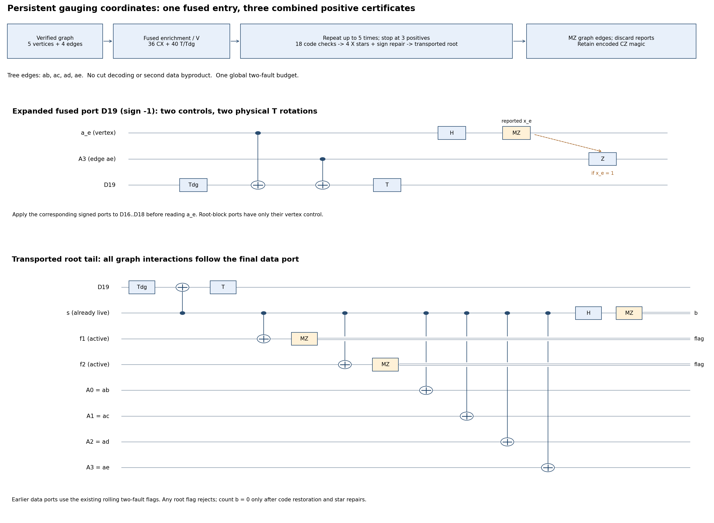

# Persistent coordinates for one-block CZ gauging

This opt-in schedule gauges the same internal logical CZ on one C4-Helix
block, applies the coherent edge-controlled ungauging correction once,
and retains the graph as a witness during combined code/Gauss certification.
The root Gauss observable is transported through that coordinate change.
There is no repeated return to the original gauged frame.

Enable `--gauss-frame persistent --graph-stars bare --terminal-policy intrinsic`.
Use `--data-checks compact_flags --source-extraction decoded_flags` for the
counts below. Previous schedules, simulators and the two-block SWAP files
remain available. This is an additional implementation of graph gauging,
not a claim that single-block Clifford gauging is a new principle.

The [companion proof](single_block_cz_persistent_coordinates_proof.md)
establishes the global two-arbitrary-fault accepted-output contract. The
new finite certificates are in `src/check_single_cz_persistent.py` and
`output/single-cz-persistent-certificates.json`.

## What changes and why

In the old schedule, each of three passing rounds executes V, restores
the data code and graph stars, executes V again, and measures
G_a=U_a Xstar_a. Six V passes cost 96 CX and 192 T/Tdg.

In the new schedule, stay in V coordinates. The actual root measurement
must then be **Q=V G_a V=U Xstar_a**, involving all twenty W data factors,
rather than only four. The four nonroot Gauss checks remain graph X stars.
The larger root check is more expensive individually, but it eliminates
five coordinate passes. After the last clean combined certificate, every
remaining data fault has physical-site support; graph errors are never
converted back into unknown block operations. Thus the extra terminal
screen, cycle recovery and cut decoding can be omitted under the new proof.

This also changes which graph property is needed. Cut distance five is
essential to the old cut-readout decoder; it is not used here. We add
`tree4`, with vertices a,b,c,d,e and edges ab,ac,ad,ae. It has cut distance
one, not five. The old decoder still rejects this graph. The new proof
uses clean resource constraints, charged block cones before certification,
and arbitrary graph algebra afterward; it does not claim the original
gauged-code distance theorem for tree4.

## Registers and physical primitives

Data D0..D19 retain the original supports, signs, logical convention and
encoded ++ source. Vertex controls a0..a4 are destructively measured in X.
For tree4, A0..A3 are respectively ab,ac,ad,ae; they remain live until
certification finishes. The source, one graph-parity meter w, ordinary
Pauli-check helpers and rolling root flags use the existing reset/reuse
rules. No measured vertex is reused without preparation.

Every T, Tdg, H, Pauli, CX, preparation, measurement/report, correction and
waiting idle is a separate physical location. There are no Fredkin, CCZ
or atomic controlled-W locations. A controlled-W is compiled into
T^s(data), CX(control,data), T^-s(data), with s=m.SIGNS[q]. Noise rates
remain independently configurable for Clifford, T, CX, preparation,
readout and memory. Classical processing is reliable.



Editable generator: `notes/build-single-cz-persistent.py`; SVG has the
same filename under the figure directory. The expanded tail shows the
actual D19 port, final active flag readouts, all four graph couplings,
and syndrome readout. Earlier data ports use the existing rolling program.

## Stage 1: source and graph resource

Prepare and certify the signed encoded ++ source using the unchanged
decoded-source circuit. Only this known, unused source may be rebuilt.
For example, a nonzero source syndrome is assigned its existing signed
right-inverse Pauli correction; it is not automatically a failed source.

Initialize vertices in plus and edges in zero, then apply the two
endpoint-to-edge CXs per edge. Verify L_e=Z(a_u) Z(A_e) Z(a_v) using
PREP0(w), CX(a_u,w), CX(A_e,w), CX(a_v,w), MZ(w). Three complete zero
scans are required. A nonzero scan rebuilds only this unused graph using
the existing shared two-token source/graph retry budget. Phase errors
remain arbitrary. There is no additional cat resource.

For tree4 this costs 44 CX: eight for the raw graph and 36 for three
parity scans. At a clean reference, the graph lies in the 32-dimensional
span of |t,dt>; a late meter fault adds at most one resource bit error,
with arbitrary phase support. A vertex bit error or a root-edge bit error
can affect one inner block during the next stage. Two such faults are not
assumed to be two physical data errors: the full block decoder is retained.
See proof Lemmas 1–2 and the independent resource-meter certificate.

## Stage 2: fuse enrichment with the one coordinate pass

Before vertex readout, execute the exact product V Omega. For each data
qubit q in block v, in order q=0..19:

1. T^s(Dq).
2. CX(a_v,Dq).
3. If v>0, CX(A_tree(v),Dq).
4. T^-s(Dq).

All rotations are normalized physical T/Tdg gates. This is 36 CX and
40 T/Tdg. The two adjacent basis rotations in the separate enrichment
and coordinate circuits cancel exactly. No controlled relative phase is
discarded. The program checks both signs on all two-control basis inputs.

For an ideal cut resource, the data exponent on nonroot block v is
t_v XOR (dt)_(a,v)=t_a. Thus the ideal joint state is

    2^(-5/2) sum_t |t>_a |dt>_A U^(t_a) |psi>_D.

This is an equality of full physical circuits, not a shortcut restricted
to a noiseless code state. A fault in either control or its target can
spread over the four data sites in that block. The participant light-cone
certificate bounds it by one entire inner block, not one physical site.

Now H/MZ each vertex a0..a4. For reported bits x_v, apply Z(A_tree(v))
when x_v=1 for v=1..4. These edge corrections commute with V, so moving
V before the vertex readout and corrections changes no ideal instrument.
The reported vertex parity is not itself accepted as a sector certificate.

For any fixed ideal vertex vector and valid eventual edge-Z record, the
data Kraus operator is P_x/16, with x=(-1)^(sum_v x_v). There is no
remaining U_eta byproduct: it has already been applied coherently. The
record probability is <psi|P_x|psi>/256. The exact certificate accounts
for all 32 vertex records and 16 valid edge words per record. For source
++ the total positive probability is 3/4, and the negative data branch is
11. The graph records cannot justify converting that branch into magic.

## Stage 3: restore and certify in persistent coordinates

For each round r=0..4:

1. Measure all eighteen **bare data stabilizers**, Z then X. They cost
   188 CX with compact checks. A nonzero syndrome starts the unchanged
   certified commuting history and unique-class recovery; ambiguity rejects.
   A Pauli-data flag uses its extraction-specific conditional recovery,
   increments the data epoch and restarts the interrupted record/history.
2. Measure the four **graph X stars**. Prepare s in plus, couple s to
   every incident edge in edge-index order, H/MZ(s); if the report is one,
   apply Z to that vertex's root edge. On tree4 each star has one edge,
   so all four stars cost four CX per round. Broad graph hooks are allowed.
3. Measure the **transported root Q=U Xstar_a**. Execute the existing
   twenty-W rolling-flag circuit on data, stopping before its final H/MZ(s).
   After every data interaction and every flag readout has completed,
   append CX(s,A_e) on each root-incident edge. Finally H/MZ(s).

The root program has 62+degree(a) CX, 40 T/Tdg, two H, and 22 preparations
and measurements. There are 21 flag reports with at most three live flags.
Any nonzero root flag rejects; it is not a Pauli-data recovery request.
On tree4 its CX count is 66. Only the reported root bit zero counts as
a passing **complete** round, after code restoration and all star repairs.
Stop at three passing rounds, or reject when three are no longer possible
within five. Negative root bits are not flipped by a data correction.

A worked data flag remains the R5 controller fault after CX(s,D7): its
four-target hook is corrected only when the new compact-flag table has
a unique class for the certified syndrome. A noisy whole-code history
A,B,B,B supplies a clean reference B under the global two-fault rule;
the old data-epoch reset rules still discard records predating a repair.
There is no QND-history rule applied to the entire code/star/root family.

In a clean complete round, code restoration places data in the source's
logical I/U span. Star sign repair makes Xstar_a=+ because it is the
product of the four nonroot stars, for any cycle sector. The honest
positive root therefore projects that span onto the single desired
CZ-magic line. Three passing complete rounds contain a clean one under
two faults globally. Root/data commutation is only used in the restored
code sector, not on an arbitrary syndrome sector. See Lemmas 3–5.

## Stage 4: finish without a second data correction

Measure every edge in Z solely to release it; record its report as
untrusted disposal information. Apply no edge-word data correction, no
cycle repair and no terminal screen. An extra U_eta here would apply the
byproduct twice. Unknown magic data are never reset or reinitialized.

This omission requires the new tail lemma. After the last clean passing
round, all graph operations are graph-only, and every accepted root fault
has at most one physical data site per fault modulo Q and graph factors.
For any physical error E, the ideal root projector maps E|CZ_magic> into
the span of E|CZ_magic> and (U E U)|CZ_magic>, with graph coefficients.
U is a product of single-qubit Clifford gates, so this does not enlarge
physical support. Ordinary code checks and their certified corrections
retain their existing locality. Thus two late faults remain in the
correctable weight-two span without an extra terminal extraction.

Example: two waiting-data faults on D0 and D19 during the last root's
graph CX leave a physical weight-two residual. The regression accepts
and decodes it correctly, although raw physical target fidelity is zero.
Two wrong edge-disposal reports are also harmless: they control no data
gate. This differs from the old cut-decoded byproduct tail, where a late
root-edge error could enact a four-site U_v and needed terminal recovery.

## Counts and fair comparisons

Clean zero-report paths, decoded source and compact data checks:

| Factory | CX | T/Tdg | 1q Clifford | PREP / MZ | Peak / allocated |
|---|---:|---:|---:|---:|---:|
| Previous compact13, round trips + screen | 1889 | 256 | 803 | 576 / 556 | 39 / 39 |
| Persistent compact13, fused | 1574 | 160 | 663 | 479 / 459 | 39 / 39 |
| Persistent current20, fused | 1693 | 160 | 663 | 507 / 487 | 46 / 46 |
| **Persistent tree4, fused** | **1421** | **160** | **663** | **443 / 423** | **30 / 30** |
| Genuine GHZ20 cat | 1476 | 120 | 686 | 518 / 498 | 41 / 41 |
| Direct global flagged CZ | 1317 | 120 | 629 | 410 / 390 | 25 / 25 |

The last row is the already available `--route direct_cat` with flag
verification and `--direct-cz-extraction auto`; despite that historical
route name, it prepares no cat. We include it because the transported
root uses the same global flagged-W meter. Comparing only against GHZ20
would miss this available alternative. The direct flagged factory is
still smaller than tree4 on these clean counts. No gauging advantage at
matched population fidelity is claimed.

Tree4 stage counts are source 567 CX; graph 44; fused entry 36; three
code records 564; stars 12; roots 198. The sum is 1421. T rotations are
40 in entry and 120 in roots. The initial graph plus verification helper
sets the thirty-qubit peak; the later five-helper code gadget uses 29.
There are 413 reinitializations after first use. No atomic multi-qubit
gate or extra cat verification resource is introduced.

Compared with the previous gauging schedule this saves 468 CX and 96 T/Tdg,
and eleven peak qubits. Vertex-sign corrections add up to four noisy Z
gates (ideal mean two); star corrections, source/data repairs and retries
are counted individually in executed-shot metrics. The clean totals do
not include these record-dependent nonzero branches. Repetition, shared
retry, fallback and flag-recovery caps are unchanged: at most five combined
rounds, nine/triple or five/adaptive code-history records, four conditional
flag records, two shared known-resource retry tokens and the chosen cap
of at most eight flag repairs in the recommended benchmark. Every such
location still uses the same global two-fault theorem budget.

All costs assume the existing unrestricted-connectivity elementary gate
model. The root check touches twenty data sites rather than four; no
hardware routing or parallel-depth advantage is inferred. Memory noise
and preparation noise remain exposed parameters; the pilot keeps them zero.

## Reproduce and benchmark

From the repository root:

```sh
/Users/kevinhemery/pytket-venv/bin/python src/check_single_cz_persistent.py --output output/single-cz-persistent-certificates.json
/Users/kevinhemery/pytket-venv/bin/python -m pytest -q src/test_single_cz_persistent.py src/test_single_cz_compact_checks.py src/test_single_cz_terminal_screen.py src/test_single_cz_graph_stars.py src/test_single_cz_flag_recovery.py src/test_single_cz_simulation.py src/test_single_cz_cat_simulation.py
/Users/kevinhemery/pytket-venv/bin/python notes/build-single-cz-persistent.py
```

The five-arm driver fixes graphs per arm and matches source, noise,
physical gate set, recovery caps and target:

```fish
/Users/kevinhemery/pytket-venv/bin/python /Users/kevinhemery/quanti/top-order-lit-rev/src/benchmark_single_cz_persistent.py \
    --shots 200 --seed 1000 --workers 2 \
    --source-extraction decoded_flags --max-flag-recoveries 8 \
    --two-qubit-infidelity 1e-3 --readout-flip-probability 1e-3 \
    --one-qubit-infidelity 1e-4 --t-infidelity 1e-4 \
    --output-dir /Users/kevinhemery/quanti/top-order-lit-rev/output/cz-persistent-comparison-200-20261110
```

For only the new tree schedule, use the shared simulator with `--graph tree4
--gauss-frame persistent --graph-stars bare --terminal-policy intrinsic
--data-checks compact_flags --flag-recovery data`. Its manifest identifies
`persistent_version=2`: the fused initial circuit. Version 1 development
results used separate enrichment and V (192 T/Tdg); do not pool them.

## Short fused-version pilot and validation

`output/single-cz-persistent-fused-pilot-20261110/` contains twenty
attempts per arm, seeds 1000..1019, r2=q=1e-3, Clifford/T infidelity
1e-4, preparation/memory noise zero. All saved source snapshots and
report/control certificates verify; there are no unresolved attempts.

| Arm | Accepted / 20 | Decoded target matches | Executed CX / accepted output |
|---|---:|---:|---:|
| Previous round trips | 7 | 7/7 | 6803 |
| Persistent compact13 | 5 | 5/5 | 8886 |
| Persistent tree4 | 8 | 8/8 | 4634 |
| GHZ20 cat | 13 | 13/13 | 3788 |
| Direct global flags | 4 | 4/4 | 9812 |

One accepted GHZ20 output has a correctable physical residual; all
accepted decoded fidelities are one. These are small implementation
pilots, not matched-population-fidelity or yield-advantage evidence.
In particular, the smallest clean circuit need not have the best noisy
yield: the global flagged root rejects on a used-meter flag, whereas the
GHZ20 baseline can repair/retry an unused cat locally. The benchmark
retains these different, explicitly specified physical rejection rules.

The full seven-file regression command passed **119 tests**, including
the original modes, exact fused phases, all ideal graph records, coherent
root faults, two falsely positive reports, a faulty initial control plus
flag recovery, and two late data faults without a terminal screen.
The finite audit additionally covers all root support signatures/equal-flag
pairs, the resource meter and graph constraints, all compiled initial
light cones, and accepted passing-round fault placements. It does not
enumerate all factory fault pairs. The arbitrary-local-fault extension,
source-span invariant and terminal composition are analytical.

The separate `output/single-cz-persistent-pilot-20261110/` is the archived
unfused version-1 development pilot. Its 192-T schedule is not pooled with
these version-2 results.
