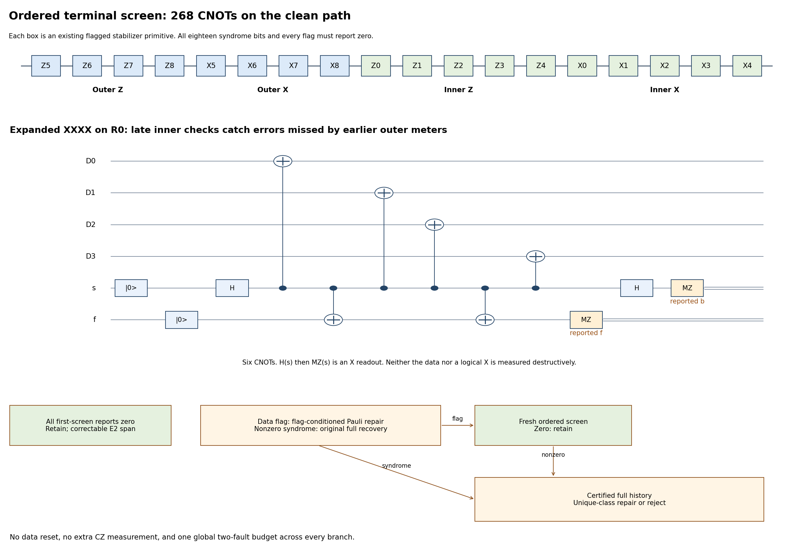

# Ordered terminal screen after ungauging

Enable `--terminal-policy screen` on the gauging/recovery route with
flag extraction. The previous terminal history remains
`--terminal-policy certified`. This extension composes with both graph-star
options and the [flag-dependent data decoder](single_block_cz_flag_dependent_recovery.md).
The recommended comparison uses [bare stars](single_block_cz_bare_graph_stars.md).
Existing SWAP files and all three positive Gauss certificates are retained.

The smaller terminal procedure exploits the **one-inner-block per upstream
fault** input envelope, not an unsupported reuse of noncommuting gauged
measurement histories. It replaces three complete terminal records on the
clean path by one specially ordered record. It adds no logical CZ/cat
measurement, T gate, graph interaction, or source-logical-X measurement.

## Actual schedule and outcomes

After the existing edge readout, cut decoder, physical byproducts and
boundary idle, the twenty-qubit data block is in the original code frame,
with the already certified logical magic resource and an upstream block
error envelope. An unknown resource is never reset.

Execute these flagged **code stabilizers**, in exactly this order:

1. Outer Z: R5,R6,R7,R8.
2. Outer X: R5,R6,R7,R8.
3. Inner Z: R0,R1,R2,R3,R4.
4. Inner X: R0,R1,R2,R3,R4.

Each primitive is the existing two-fault rolling gadget: X ports are
CX(s,Dq), Z ports H(Dq),CX(s,Dq),H(Dq), with the existing ancilla/flag
preparations, coupling order, bases, and destructive readouts. The ten
weight-four checks each cost six CX; the eight weight-eight checks each
cost 26. A complete screen is **268 CX, 100 preparations, 100 MZ and
140 H**, with no T rotations. Physical helper slots are reused only after
measurement and fresh preparation. All actual and reported bits remain
in the quantum ledger; control decisions use reported bits only.

Stop at the first nonzero syndrome or flag after finishing that primitive's
helper readouts. All-zero acceptance requires all eighteen checks and all
their flag reports to have actually been measured and reported zero.

The released **version 3** controller is bounded as follows:

- If the first screen is all zero, retain the data with a correctable
  weight-two residual span and finish with the boundary idle.
- If a code report is nonzero and flags are zero, start the original
  fresh certified full-code history: ordinary two-fault gadgets and
  triple/max-nine or adaptive/max-five acquisition. Correct only a unique
  class in the existing two-inner-block decoder; reject absent/ambiguous
  rows. This generic recovery is matched to the comparator's recovery.
- If a data flag is nonzero, use the existing flag-conditioned recovery
  when `--flag-recovery data` is selected. It includes both an actual hook
  and a false flag explanation. Strict flag policy instead rejects.
- After **flag-dependent** economical recovery, run a fresh ordered screen. This
  extra screen costs nothing on the clean first-screen path. If it is
  zero, retain. If it is nonzero, use the original full certified terminal
  history on the same data; a flagged second screen first invokes its
  flag-conditioned repair. This full fallback uses the original max-nine
  triple/max-five adaptive rule and epoch resets, with the same global
  flag-recovery cap. It never resets the data. A primary nonzero syndrome
  goes directly through the original full recovery and then finishes.

Syndrome corrections and all final boundary idles are individual quantum
locations. There are at most two screens and one original full fallback,
with the already bounded flag-recovery/history
rules. No branch has a fresh two-fault budget.



The figure's Z5/X5 labels denote code stabilizers S5^Z/S5^X, never logical
operators. Editable SVG and generation source:
`notes/build-single-cz-terminal-screen.py`.

## Why the ordering matters: terminal replacement lemma

Let Pi be the original code projector. Suppose f upstream faulty locations
leave a coherent operator span of Paulis on at most f inner blocks acting
on an arbitrary encoded input (including entanglement with an environment).
Let k faults occur in the terminal schedule, with f+k<=2 globally.

The all-zero ordered screen leaves an error in the span of physical Paulis
of weight at most two, modulo code stabilizers. The code therefore corrects
that entire coherent span. The lemma does not assume an independently
sampled Pauli channel or a known stabilizer input state.

Two C4-Helix properties are used:

1. Every zero-syndrome Pauli on any two inner blocks is a stabilizer.
   This is stronger than applying physical distance six to eight arbitrary
   sites; the property is independently checked on all 655360 two-block
   Paulis, including duplicates.
2. On each four-site block, the restriction of the four outer supports
   R5..R8 has binary rank three, with kernel {0000,1111}. Thus a one-block
   Pauli commuting with all outer X and Z checks is an inner stabilizer.
   In particular, a zero outer-X syndrome on a one-block error means
   its Z mask is zero/all-four, and conversely for outer Z and X masks.

For the stated zero-flag primitives, one internal fault is equivalent
modulo its measured code stabilizer to a one-site Pauli after that gadget,
with an unrestricted flip of its own syndrome report. Later ideal checks
are honest. Two internal faults with zero reported flags leave a two-site
span modulo stabilizers, by the existing local certificate. Measurement
faults and wrong reports at the same location are included in this model.

The global budget has only these partitions:

**Two upstream faults, no terminal fault.** The honest full code screen
projects a zero-syndrome two-block term to the stabilizer class, or gives
a nonzero report and triggers recovery. No unknown two-block correction
is silently selected on the fast path.

**No upstream fault, up to two terminal faults.** Every accepted primitive
has zero flags. The two-fault locality result, and the fact that incoming
data errors do not spread to other targets through ideal Pauli-check
couplings, leave at most two physical data positions modulo code
stabilizers. This includes two faults within one gadget, cancellations of
flag reports, helper resets and every waiting idle.

**One upstream block, one terminal fault.** Write the inherited Pauli as
E_B on one block B, and normalize the terminal fault to P on at most one
site, modulo a code stabilizer. Its own parity report may be wrong.

- If the fault is in an outer-Z gadget, all outer-X and both inner-axis
  families are later and honest. Final inner syndromes force a nontrivial
  P to lie in B; otherwise it creates an uncancelled inner syndrome on
  another block. The honest outer-X family makes the final Z mask zero
  or all-four on B. The honest inner-Z check makes the final X mask even.
  Modulo the inner stabilizers, an even four-bit pure-axis mask has weight
  zero or two. The final error is therefore equivalent to weight <=2.
- If the fault is in an outer-X gadget, the earlier honest outer-Z family
  makes the inherited X mask zero/all-four on B. Honest final inner-Z
  checks forbid an additional single-site X component. Honest inner-X
  checks likewise put any remaining Z component on B with even parity.
  Again the final error is equivalent to a pure-axis mask of weight <=2.
- If the fault is in the inner tail or final boundary, all eight outer
  checks were already honest. Their local rank-three property makes E_B
  an inner stabilizer. Only the fault's at-most-one-site residual remains.

This also covers faults on spectator data during a helper operation:
the effective physical site need not be a participant of that check's
support. Arbitrary conditioned complex coefficients are retained when
expanding local fault actions. Multiplying a Pauli by a stabilizer changes
only its scalar on a fixed encoded branch. Since the code corrects every
weight-two Pauli and their linear span, the extension applies to coherent
faults and quantum/environment correlations.

## Nonzero branches and the full factory theorem

A nonzero syndrome starts the original certified recovery on the same
unknown data. Its input errors still lie on at most two inner blocks,
including prior zero-flag screen faults. The original complete QND history
contains a clean reference. Its unique-class table corrects the inherited
error or rejects; late zero-flag gadgets and correction locations add one
site per remaining fault. The flag-conditioned branch uses its already
certified conditional history/table guarantee, including broad hooks and
false flags. Ordinary generic recovery is not made artificially cheaper
only on the gauging arm of the comparison.

The verification screen sees the same block-per-actual-fault invariant
(or its stronger physical-error bound). Its fast-path lemma applies again.
If it fails, the original full recovery theorem applies to the restored
input envelope. Epoch resets prevent reusing a pre-correction record.

The preceding gauging, three passing combined Gauss rounds, final cycle
certification and cut decoding are unchanged. They supply the logical
CZ-magic line and the upstream block envelope. Composing the terminal
replacement lemma and fallback proofs yields the same theorem:

**At most two arbitrary faulty locations in the entire physical schedule
imply every accepted output decodes to CZ magic, with a correctable
physical weight-two error span.** Preparations, each physical T/CX/T†,
measurements and wrong reports, resets, source/graph retries, corrections
and all boundary/serial idles are charged globally. Classical processing
is reliable. No physical symmetry phase is dropped, and no XOR propagation
is performed through upstream T gates; their errors enter only through
the independently established block operator envelope.

## Counterexamples that determined the final schedule

**Just deleting two old records is unsafe.** In a noiseless factory with
Born seed 4, put X on A1 just after CX(A1,w) in
`final_cycles/0/cycle/0`. After cycle flattening and the data byproduct,
this produces a whole-block U_c error. Now shorten the terminal stage to
one record in the ordinary Z0..Z8,X0..X8 order, and put Z_s Z_D1 just
after CX(s,D1) in its X7 gadget. The ordinary one-record shortcut accepts
with decoded fidelity exactly 1/9. Inner checks ran too early to see the
late data error. The ordered screen instead detects it and rejects the
ambiguous recovery. This is an actual two-location quantum regression,
not merely a sampled support estimate.

**Exiting immediately after conditional recovery is fragile above two
faults.** The first 40-shot prototype accepted one bad output at seed 1034.
It contained four CX faults, including two faults within the supposedly
one-remaining-fault recovery. Thus it was outside the theorem, but it
invalidated an empirical matched-fidelity claim. Its residual syndrome
was ambiguous in the full decoder. The released version adds the fresh
verification screen after economical recovery; deterministic replay of
all four faults now rejects that case. The failed prototype run is kept
separately, not pooled with the final pilot. This is not a four-fault
correctness guarantee.

Commands to replay both regressions are provided by the dedicated tests.
No unsafe ordinary-order shortcut is exposed as a production CLI option.

## Resources and reproducible verification

With decoded source, bare stars and otherwise unchanged protection:

| Clean full attempt | Original terminal history | Ordered screen |
|---|---:|---:|
| Compact13 CX | 2665 | **2129** |
| Current20 CX | 2835 | **2299** |
| Terminal CX | 804 | **268** |
| Terminal preparations/MZ | 300 each | **100 each** |
| T/T† | 256 | 256 |
| Peak live qubits | 39 / 46 | 39 / 46 |

The clean saving is 536 CX, 200 preparations, 200 measurements and 280 H.
There are no new helpers. Add 408 CX for rolling source as before.
With previous flagged stars the compact13/current20 totals are 2273/2515.
The genuine-cat comparator remains 1716 CX, 120 T/T† and 41 peak qubits;
it already ends with three combined code/CZ rounds and has no analogous
extra gauging-to-code terminal history to replace.

Flag-conditioned recovery takes two to four 140-CX records, individual
Pauli corrections, then a fresh 268-CX screen. Generic syndrome recovery
and the full fallback use the original certified record schedule; all
their actual work is counted. Clean counts
are distinct from successful-attempt circuit lengths and total gates spent
per accepted output. Reports also show raw physical fidelity, which can
include the allowed correctable residual errors, separately from decoded
logical fidelity.

The finite certificate compiles the full physical screen and independently
propagates every single-location Pauli signature, including helper/data
idles and the final boundary. It checks every accepted signature pair,
every compatible one-upstream-block plus one-screen signature, and all
655360 raw two-upstream-block cases. It tests correctability against
explicit weight<=2 representatives and independent stabilizer-group
membership, not just syndrome equality. This is exhaustive for the stated
terminal/input envelope, **not full-factory location-pair enumeration**.

```fish
/Users/kevinhemery/pytket-venv/bin/python src/check_single_cz_terminal_screen.py \
    --output output/single-cz-terminal-screen-certificates.json

/Users/kevinhemery/pytket-venv/bin/python -m pytest -q \
    src/test_single_cz_terminal_screen.py src/test_single_cz_graph_stars.py \
    src/test_single_cz_flag_recovery.py src/test_single_cz_simulation.py \
    src/test_single_cz_cat_simulation.py

/Users/kevinhemery/pytket-venv/bin/python src/benchmark_single_cz_terminal_screen.py \
    --shots 200 --seed 1000 --workers 2 \
    --max-flag-recoveries 8 \
    --two-qubit-infidelity 1e-3 --readout-flip-probability 1e-3 \
    --output-dir output/cz-terminal-screen-comparison-200
```

The comparison uses bare-star gauging with certified/screen terminal
policies and genuine-cat CZ, with matched source, data recovery and noise.
Existing modes remain defaults; single-run commands can add
`--graph-stars bare --terminal-policy screen`. Use a fresh output directory.
All stochastic channels are uncapped; unresolved computations are kept
separate from quantum rejection. Population fidelity must be assessed
with enough accepted samples; small pilots do not establish it.

## Matched short pilot, 10 November 2026

The final version-3 pilot uses seeds 1000–1039, compact13, decoded source,
bare stars, flag-dependent data recovery (max eight episodes), triple
histories, r2=q=0.001 and zero one-qubit/T/preparation/memory noise.
All attempts completed. Every accepted final-pilot output matched the
decoded target after independent saved-output verification.

| Schedule | Accepted / 40 | Mean CX in successful attempt | Total CX / accepted output |
|---|---:|---:|---:|
| Bare gauging, certified terminal | 8 | 5216.0 | 20109.0 |
| Bare gauging, ordered screen | 12 | 4035.7 | 11629.0 |
| Genuine-cat comparator | 16 | 3119.8 | 7376.3 |

The clean reduction is exact; the noisy cost and acceptance changes are
small-sample observations. The cat remains cheaper here, and matched
population fidelity is not established. Raw physical fidelity is reported
separately because both contracts permit correctable residual errors.
The final report is
`output/single-cz-terminal-screen-matched-pilot-20261110/comparison.md`.
Earlier development pilots are archived separately and are not pooled.
